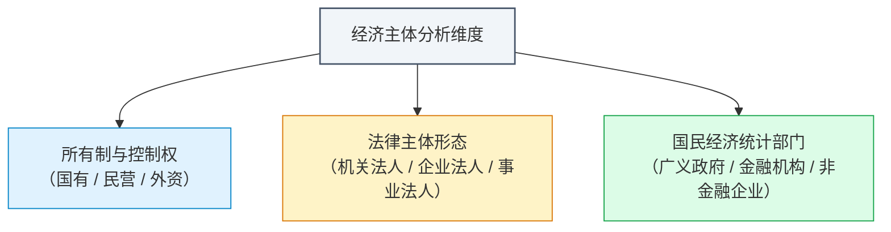
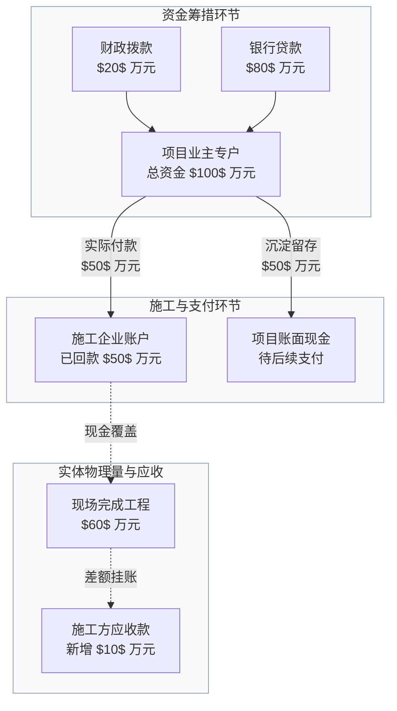
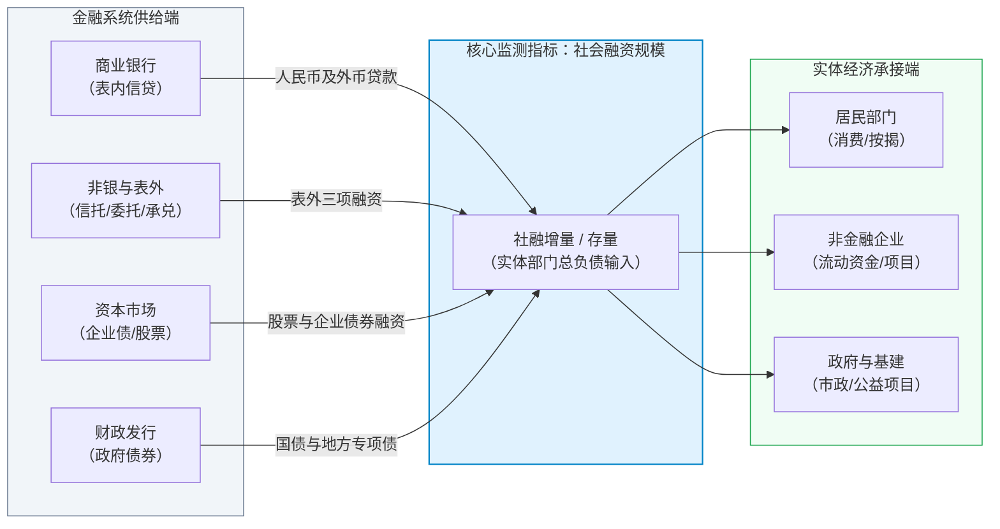
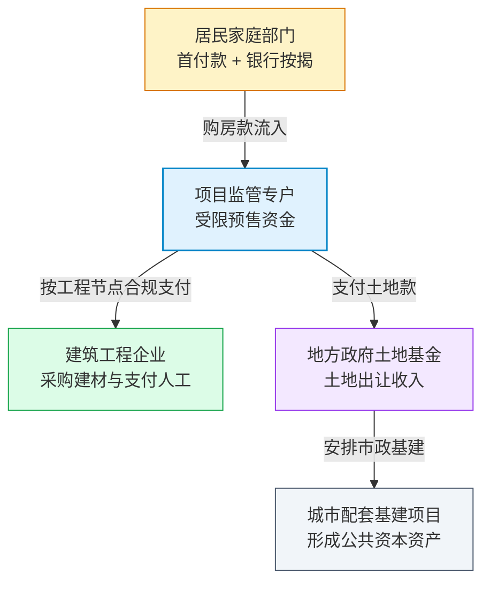

# 01 中国经济的账户地图：从美国框架切换到中国问题

[目录](./) · [下一章：口径转换](02-measurement.md)

> 中国篇深度升级版 · 2026-10。本书以美国篇为前置理论基础。案例均为教学假设；制度说明严格绑定所引官方资料，不把历史定义当作永久规则。

**前置阅读：**美国篇[01 经济地图](https://fangpings.github.io/us-econ/01-economic-map.html)、[15 银行与资产负债表](https://fangpings.github.io/us-econ/15-balance-sheets.html)。在阅读本章前，你应已掌握宏观国民账户中的增加值、部门账户恒等式以及“融资流动不等于最终收入”的基本逻辑；本章的核心任务，是将这些普适原理迁移到中国特有的经济运行与统计体系中。

---

## 1. 从大学宏观课堂走进中国经济简报

当你刚学完标准宏观经济学或者读完美国篇时，你的大脑里装满了一套优雅的分析框架：国民生产总值等于消费、投资、政府支出与净出口之和（$Y = C + I + G + NX$）；每个月初，你会习惯性地寻找美国劳工统计局（BLS）发布的非农就业数据（Nonfarm Payrolls）、经济分析局（BEA）发布的个人消费支出（PCE）物价指数，以及美联储的利率决议。

然而，在一个阳光明媚的周一早晨，当你打开中国宏观经济的月度快讯时，跳入眼帘的却是一组截然不同的名词：

- “1—8 月份，全国固定资产投资（不含农户）同比增长 $3.4\%$”；
- “8 月份，社会消费品零售总额同比增长 $2.1\%$”；
- “规模以上工业增加值同比增长 $4.5\%$”；
- “全国城镇调查失业率为 $5.3\%$”；
- “8 月末，社会融资规模存量同比增长 $8.1\%$，当月社融增量为 $3.03$ 万亿元”。

这常常让初学者产生强烈的困惑：
- “社零”（社会消费品零售总额）难道不就是 GDP 里的消费 $C$ 吗？
- “固定资产投资完成额”难道不就是 GDP 里的投资 $I$ 吗？
- 为什么新闻里总在讲“规模以上”？那些“规模以下”的去哪儿了？
- 为什么分析师不仅紧盯银行新增贷款，还要单独追踪一个叫“社会融资规模”的庞大指标？

这并不是同一种概念在英文与中文之间的简单词汇翻译。背后的差异来自三个根本性的现实：
1. **观察窗口与数据生产机制的差异**：月度高频报表往往是从销售终端（如商品零售和餐饮）或投资项目现场（如施工合同和设备购置）自下而上直报汇总的，它们是实体经济活动的直接投影，但并非国民经济核算（SNA）中经过完全调和的最终消费或资本形成。
2. **独特的融资与执行路径**：以一个典型的城市供水或轨道交通项目为例，它往往交织着地方预算安排、专项债券发行、项目资本金注入、银行信贷配套、平台公司借款、施工企业垫资以及实体工程进度。
3. **统计组织与修订节奏的差异**：规模以上企业的定期直报、前两月合并发布（避开春节错位）、累计同比报告方式，以及五年一次的全国经济普查基准修订，共同构成了中国特有的数据日历。

本书的教学主线正是：**先还原中国微观主体在现实制度下的真实交易与资金流向，再定位统计部门如何测量它们，最后与国际通行的国民账户框架进行精确对照。**

---

## 2. 区分三个维度：所有权、法律主体与统计部门

在分析中国经济时，最常见的入门误区是“概念混同”。例如，听说某地要建一条地铁，由国有城投公司作为业主、国有大型商业银行提供贷款、国有建筑央企进场施工，有人便脱口而出：“这全是政府出资，直接计入政府消费或者财政赤字。”

这种理解在国民账户核算中是完全错误的。我们必须严格厘清三个不同维度的分类：

| 现实中的经济主体 | 所有权背景 | 统计部门归属与主要功能 | 绝不能混淆的推论 |
| :--- | :--- | :--- | :--- |
| **国有商业银行** | 国有控股金融机构 | **金融机构部门**：提供信贷中介与资产管理服务 | 银行发放的商业贷款 $\neq$ 财政无偿拨款，借款必须偿还本息 |
| **大型国有建筑企业** | 国有控股施工企业 | **非金融企业部门**：从事工程承包与建筑生产活动 | 企业的施工产出 $\neq$ 政府消费，不能因为国有背景就视作财政购买 |
| **地方政府机关** | 公共管理部门 | **广义政府部门**：提供非市场公共产品，组织财政收支 | 地方下属国有企业的商业债务 $\neq$ 法定政府债务 |
| **公立医院 / 学校** | 事业单位或非营利组织 | 需按收入来源判断（部分属于广义政府，部分归入企业或为住户服务） | 挂有“公立”招牌 $\neq$ 所有的日常收费均直接进入财政一般公共预算 |

中国国家统计局在编制国民生产总值（GDP）时，严格遵循联合国等国际组织制定的国民账户体系（SNA 2008）基本准则，依据的是**常住单位的生产活动与增加值**，绝非按“体制内创造的产出 vs 体制外创造的产出”来画线。

在支出法 GDP 分类中，中国通常将“政府消费”归入“最终消费支出”，将“政府投资”（如市政基础设施等公用资产建设）归入“资本形成总额”；而美国 BEA 常见的 $C + I + G$ 表述中，$G$（Government Consumption and Investment）则同时囊括了政府的经常性消费与政府的固定资本投资。这一归类差异我们将在[第 05 章](05-gdp.md)中深度拆解。

---

## 3. 教学案例：把一笔地方基建资金追到施工现场

为了看清中国实体经济中资金、债务与工程进度的脱节现象，让我们来看一个生动的教学微观案例：

> **青禾市供水管网改建工程**：
> 本期青禾市政府财政拨付项目资本金 $\$20\$$ 万元；
> 项目业主公司（地方公用事业企业）以特许经营权为抵押，从银行实际借入中长期配套贷款 $\$80\$$ 万元；
> 施工单位（某工程建设公司）进场作业，本期经第三方监理测绘实际完成物理工程量 $\$60\$$ 万元；
> 项目业主公司根据工程节点进度款审批流程，本期实际向施工单位银行转账支付工程款 $\$50\$$ 万元，其余款项留存在业主账户中以备后续采购。
> （注：金额单位均为万元，暂忽略利息、增值税及物料留抵。）

让我们把各个相关报表在本期的记录汇总如下：

| 观察维度与报表入口 | 本期记录数值 | 真实对应的经济含义 |
| :--- | :---: | :--- |
| **财政预算支出** | $\$20\$$ 万元 | 政府公共财政或专项基金本期实际拨付的项目资本金 |
| **银行信贷与社融** | $\$80\$$ 万元 | 金融体系对实体企业本期新增的负债支持 |
| **项目业主现金流水** | 流入 $\$100\$$ 万，流出 $\$50\$$ 万，期末存量 $\$50\$$ 万 | 项目专户内的资金沉淀与实际兑付情况 |
| **项目固定资产投资完成额** | $\$60\$$ 万元 | 施工现场实际发生的建筑安装工程物理工作量（按合同预算价核算） |
| **施工企业应收账款** | 净增加 $\$10\$$ 万元 | 施工企业已完成工程量与实收现金之间的垫资差额（$\$60 - \$50 = \$10\$$ 万元） |

从上面的流程图中，我们可以提炼出三条极其关键的宏观研读戒律：

1. **不可随意求和**：
   项目资本金 $\$20\$$ 万元、银行借款 $\$80\$$ 万元、实际付款 $\$50\$$ 万元、完成工程 $\$60\$$ 万元，各自记录在不同的资产负债表与业务台账上。你绝不能把它们加在一起宣称“该项目拉动了 $\$20 + 80 + 50 + 60 = 210\$$ 万元的经济需求”。
2. **融资不等于产出**：
   银行虽然放贷 $\$80\$$ 万元，但本期当季现场真正凝聚成实体投资资产的只有 $\$60\$$ 万元。而且，在这 $\$60\$$ 万元的工程中，还包含了钢管、阀门、水泥等原材料的采购。在核算 GDP 时，必须扣除这些从其他厂家采购的中间物料消耗，才能得出该工程为本期贡献的新增增加值。
3. **资金与进度的跨期滞后**：
   资金到账（金融端领先）往往早于施工进度（实体端滞后）；而施工进度又往往早于工程款的最终现金结清（商业信用端垫资）。这解释了为什么在现实经济周期中，我们常常看到“金融社融数据先大幅放量，几个月后固投数据才开始回暖，再过数月工业品价格和企业利润才显现变化”的传导链条。

---

## 4. 融资中枢：为什么除了银行贷款还要看“社会融资规模”

在分析美国金融市场时，研究者常将目光聚焦于美联储的联邦基金利率、国债收益率曲线以及公开市场上的商业票据和企业债市场。但在中国，银行信贷历来占据主导地位。

如果只看银行贷款，会发生什么误判？让我们看两个对比情景：

- **情景 A（融资渠道替代）**：某大型制造企业去年向银行新增借款 $\$100\$$ 亿元，发债为 $\$0\$$ 亿元；今年由于债券市场利率走低，企业转向发行超短期融资券筹集资金，当期银行新增贷款降为 $\$40\$$ 亿元，企业净发行债券 $\$60\$$ 亿元。如果一个宏观分析师只盯着银行贷款，会惊呼“企业信贷腰斩了 $60\%$！”但事实上，两项渠道相加，该企业从金融市场获得的总资金依然稳定在 $\$100\$$ 亿元。
- **情景 B（借新还旧置换）**：某地方平台企业本期新增银行贷款 $\$80\$$ 亿元，但合同明确要求其中 $\$60\$$ 亿元必须用于兑付到期公募城投债，债券净融资为 $-\$60\$$ 亿元。两种债务工具轧差后，实体部门实际净融入的流动性仅增加了 $\$20\$$ 亿元。这笔贷款主要优化了负债久期、防范了违约风险，并没有凭空产生 $\$80\$$ 亿元的新增开工资金。

为了全面刻画金融体系对实体经济的资金支持全貌，中国人民银行于 2011 年正式创立了**社会融资规模（Total Social Financing, 简称 TSF）**统计指标。

### 中美融资统计的入口对照

初学者常问：“既然中国有社融，美国有没有社融？”
答案是：**统计目标相通，但组织载体不同。**

| 核心研究问题 | 中国数据入口 | 美国数据入口 | 交叉对照时的关键操作 |
| :--- | :--- | :--- | :--- |
| **实体部门总体获取了多少资金？** | **社会融资规模（TSF）** （央行月度发布增量与存量） | **美联储资金流量表（Z.1）** （Financial Accounts of the United States） | 对齐统计部门定义（剔除金融机构自循环）、工具覆盖范围与报告频度（月度 vs 季度） |
| **商业银行表内信贷扩张如何？** | **金融机构本外币信贷收支表** （企业贷款、居民中长期贷款等） | **美联储 H.8 报告** （Assets and Liabilities of Commercial Banks in the U.S.） | 区分借款人期限结构（短期周转 vs 中长期固定资产）与商业银行口径 |
| **公众与机构手中持有多少流动性？** | **广义货币 M2、狭义货币 M1** （央行月度货币供应量） | **美联储 H.6 报告** （Money Stock Measures） | 仔细比对存款分项口径（例如中国 M2 包含个人储蓄与单位定期，美国 M2 定义经历过多次调整） |

---

## 5. 跨部门联动中枢：中国房地产的资金闭环

在成熟市场体系中，家庭买房通常表现为简单的“存量住宅交易或期房交付，按揭贷款由银行发放给卖方”。但在中国过去二十余年的发展历程中，房地产开发深度绑定了家庭财富、商业银行、施工供应链与地方土地财政，形成了一个高度联动的多部门资金循环圈。

设一个家庭购买一套总价 $\$100\$$ 万元的期房，首付款 $\$30\$$ 万元，银行发放商业按揭贷款 $\$70\$$ 万元：
1. **资金流入受限专户**：根据住建部及金融监管部门关于预售资金监管的规定，这 $\$100\$$ 万元必须全额打入政府与银行联管的项目监管专户，房企集团总部不能随意将其抽调去偿还集团母公司的债券本息。
2. **施工形成实体产出**：随着工程按进度封顶，专户资金逐步拨付给施工单位，施工单位采购钢材、水泥并给建筑工人发放工资，此时才在宏观上沉淀为建筑安装增加值与固定资本形成。
3. **资金回流地方财政**：房企前期支付的土地出让金进入地方政府的政府性基金预算，地方政府再将其中的净收益用于城市拆迁补偿、园区通水通电等“七通一平”基础设施配套。

当房地产销售周期发生波动时，这个环环相扣的闭环便会显现出连锁反应：销售回款放缓不仅会直接收紧房企的现金流，还会通过土地拍卖市场影响地方政府的可用建设财力，进而传导至下游的建材、机械制造以及地方基础设施投资。要读懂这一链条，单凭一条“全国平均房价指数”是远远不够的，我们必须学会穿透预售监管、施工面积与土地财政等多个分项账户（详见[第 36 章](36-housing-development.md)与[第 39 章](39-housing-land-finance.md)）。

---

## 6. 构建你的宏观研读底层直觉：三类差异

在未来的学习中，我们会遇到数十个中美对比指标。为了不迷失在纷繁复杂的报表细则中，建议你建立一张结构清晰的三维认知框架：

| 差异类型 | 典型代表案例 | 背后机制与阅读策略 |
| :--- | :--- | :--- |
| **一、统计定义与边界差异** | 中国**固定资产投资（FAI）** vs 美国**固定资本形成总额（GFCF）** | **概念边界不同**：中国月度固投包含土地购置费和旧设备购置，而国民账户中的资本形成只核算“本期新生产的资本品”。不能拿固投直接代替 GDP 投资，必须学会做口径桥接。 |
| **二、金融结构与运行机制差异** | 间接融资主导的**银行信贷与社融** vs 直接融资主导的**资本市场信用利差** | **传导机制不同**：中国货币政策传导更侧重于信贷投放节奏、窗口指导、专项再贷款与存款准备金率；美国则侧重于政策利率目标区间对金融条件（Financial Conditions）与资产价格的调控。 |
| **三、特有制度与人口治理安排** | **户籍人口 vs 常住人口** **商品房预售资金监管制度** | **制度规则不同**：中国的城镇化率同时发布“常住人口城镇化率”与“户籍人口城镇化率”，背后关涉进城务工人员的社会保障与公共服务享有权；不能把两套数据简单混用。 |

---

## 7. 实操范例：怎样撰写第一份中国宏观研读笔记

假设你作为宏观研究助理，在某个月度发布日收集到了以下一组模拟宏观简报数据：
- 当月金融机构新增人民币贷款净增 $\$80\$$ 亿元；
- 企业债券净融资为 $-\$60\$$ 亿元；
- 重点项目计划固定资产投资完成额达到 $\$60\$$ 亿元；
- 社会消费品零售总额名义同比增长 $3.0\%$；
- 规模以上工业增加值实际同比增长 $6.0\%$。

**❌ 不合格的机械复述（初学者常犯错误）：**
> “本月信贷大增 80 亿，经济活力充沛。工业增速 6% 高于消费 3%，说明生产严重过剩，有 3 个百分点的商品积压在仓库里……”

**✅ 具备专业统计边界意识的研读报告：**
> 1. **融资结构研读**：虽然新增人民币贷款达 $\$80\$$ 亿元，但企业债券净融资净减少 $\$60\$$ 亿元，两者合计净增加仅为 $\$20\$$ 亿元。这表明当期信贷放量中相当一部分属于融资工具的‘债转贷’替代或偿债置换，实体经济获取的新增外源债务规模相对温和。
> 2. **投资与落地研读**：重点项目投资完成额达 $\$60\$$ 亿元，体现了实物工作量的推进；但现有金融数据尚未披露贷款在各项目间的具体用途明细，不能将 $\$80\$$ 亿元贷款全额等同于该工程的项目资金。
> 3. **供需指标的统计不可比性**：工业增加值 $6.0\%$ 测量的是‘规模以上工业企业’扣除物料消耗后的**可比价实际产出**；而社零 $3.0\%$ 测量的是全社会批发零售与餐饮终端的**现价名义销售额**。两者口径范围（工业 vs 批发零售餐饮）、核算层次（增加值 vs 营业总收入）和价格处理（扣除价格波动 vs 未扣物价）截然不同，绝不能将两者相减作为微观库存积压的度量，后续须结合工业企业存货与 PPI 数据进一步综合验证。

---

## 练习：建立你的中国指标认知地图

1. 某大型国有机床制造企业从商业银行借入 $\$100\$$ 万元专项技术改造贷款，用于从国内采购高精度数控机床。请说明：为什么这笔 $\$100\$$ 万元既不能直接记为财政赤字，也不能直接记为当季 GDP 支出法中的政府消费？
2. 在一个简化的信用市场中，当月企业新增银行贷款 $\$120\$$ 亿元，企业债券净发行额为 $-\$90\$$ 亿元（即偿还量大于发行量）。请计算实体企业从这两项渠道获得的净负债增量是多少？这一数值是否可以直接等同于全口径社会融资规模？
3. 某市政管网改造项目本期获取各渠道融资 $\$200\$$ 万元，实际向施工方打款付现 $\$80\$$ 万元，施工方经第三方工程监理核定完成实体管网铺设工程量 $\$100\$$ 万元。请分别说明这三个数字对应的经济内涵，并解释为什么不能将它们加总为 $\$380\$$ 万元？
4. 有观点认为：“因为美联储不公布名为‘社会融资规模’的月度统计指标，说明美国金融体系只依赖资本市场，没有全社会信用总量的宏观监测。”请指正这一观点的错误所在。
5. 请为“社会消费品零售总额”、“全国城镇调查失业率”、“固定资产投资（不含农户）”各找出一个在美国宏观统计中功能最相近的数据入口，并简述一个不可忽视的统计口径差异。
6. “只要某一二线城市商品房成交价格出现调整，该市下属各区县的市政基础设施建设支出就一定会同比例断崖式缩减。”请结合资金链传导过程，指出该推论忽略了哪些关键缓冲机制与制度条件，并列出你在求证时应当查验的至少两项统计数据。

参考答案与详细推理

1. **多重边界界定**：
   - 首先，所有权性质不等于统计部门。该机床厂是独立核算的非金融企业法人，银行借款属于商业信用行为，不产生政府财政法定债务；
   - 其次，支出性质不同。购置数控机床属于资本品购置，在国民账户中对应固定资本形成相关活动，而非满足公共管理日常支出的“政府消费”；
   - 最后，还须核实机床是本期新造还是二手置换：若为二手设备转让，在全社会固定资本形成总额中净值为零。
2. **负债计算与社融范围**：
   - 净负债增量为：$\$120 + (-\$90) = \$30\$$ 亿元；
   - 不能等同于完整社会融资规模。真实全口径社融还包含政府债券净融资、委托贷款、信托贷款、未贴现银行承兑汇票、非金融企业境内股票融资等多个工具分项；
   - 同样，实体企业借入负债后可能暂存于银行账户作为流动性储备，不能机械地假定这 $\$30\$$ 亿元全部在本月转化成了最终商品与服务采购。
3. **资金、支付与实物进度的会计差异**：
   - $\$200\$$ 万元是项目的资金来源（负债或资本金融资流入）；
   - $\$80\$$ 万元是项目公司的货币资金实际支出（现金流出）；
   - $\$100\$$ 万元是物理现场形成的固定资产投资完成额（工程进度）。
   - 这三者记录的是同一个投资项目在资金筹措、资金流转与物理建设不同环节的镜像，彼此之间存在时间差与商业信用结算差额（如施工方尚未收到的 $\$20\$$ 万元工程款转化为应收账款）。直接相加会导致严重的重复计算。
4. **指标名称与统计功能的混淆**：
   - 该观点错误地将“指标名称的唯一性”与“宏观统计职能”混为一谈。
   - 美联储季度发布的《美国金融账户》（Financial Accounts of the United States, Z.1 报告）系统性地记录了家庭、企业、各级政府与海外部门的资产负债表与资金流量，涵盖商业信贷、企业债、ABS、市政债等全谱系工具。
   - 两者的核心差异在于数据组织形式、发布频率（中国央行提供月度社融快报）及政策分析侧重点，而不是美国没有信用监测。
5. **功能相近入口与核心差异对照**：
   - **社零**：最接近美国 Census Bureau 的月度零售与餐饮销售（Retail and Food Services Sales）。*关键差异*：美国 PCE 包含大量的直接医疗、教育、金融理财及自有住房虚拟租金等非商品服务消费，而中国月度社零主要覆盖实物商品与餐饮服务。
   - **城镇调查失业率**：最接近美国 BLS 的当前人口调查（CPS / Household Survey）失业率。*关键差异*：中国调查失业率以城镇常住人口为样本总体（每周至少工作 1 小时即为就业），且对于农村进城务工人员的求职记录判定具有其地域与居住地特征。
   - **固定资产投资（FAI）**：最接近美国 Census Bureau 的建设支出报告（Construction Spending）或 BEA GDP 中的固定资本形成总额。*关键差异*：中国月度固投包含土地购置费（旧资产所有权转让），而 BEA 投资核算严格剔除土地费。
6. **房地产与基建的传导链条分析**：
   - **推论的逻辑断裂**：房价下跌并非直接扣减政府金库，而是需要经过“居民购房意愿 $\rightarrow$ 房企预售回款 $\rightarrow$ 房企拿地意愿与土拍溢价 $\rightarrow$ 地方政府土地出让收入 $\rightarrow$ 地方政府向基建项目拨付资本金”漫长的链条；
   - **缓冲机制**：各级政府可以通过发行地方政府专项债券、超长期特别国债、争取政策性开发性金融工具，或者调配一般公共预算结余资金来平滑基建资金；
   - **核查证据**：
     1. 查验该市或财政部的《地方政府性基金预算收支情况》（土地出让金实际入库进度）；
     2. 查验地方政府专项债券发行与资金拨付台账；
     3. 查验该地区月度固定资产投资中“基础设施投资（不含电力）”与“公共设施管理业”的实际增速。

[目录](./) · [下一章：口径转换](02-measurement.md)
