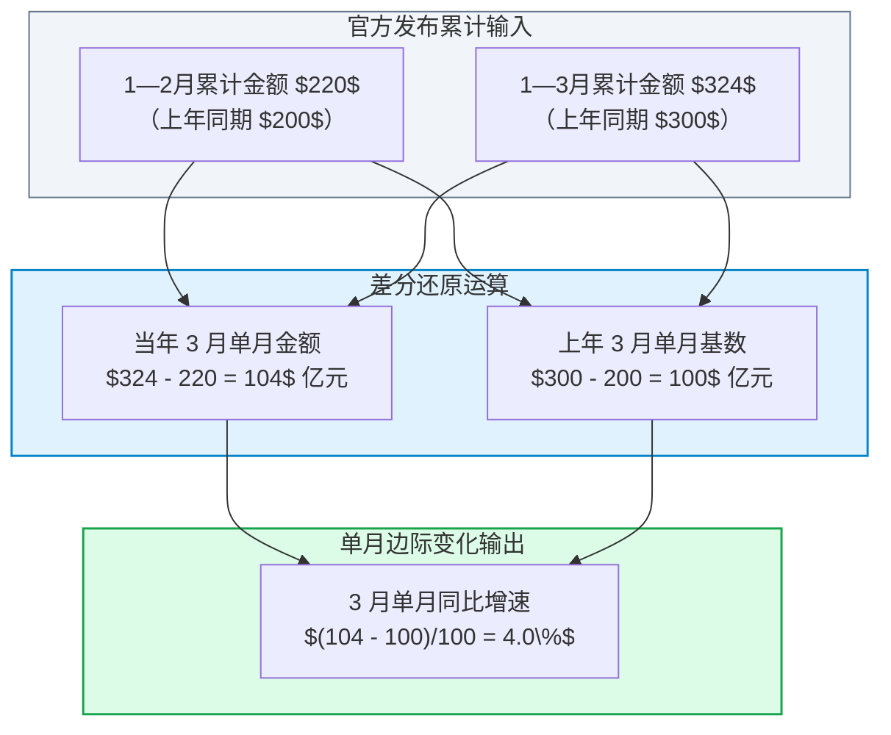
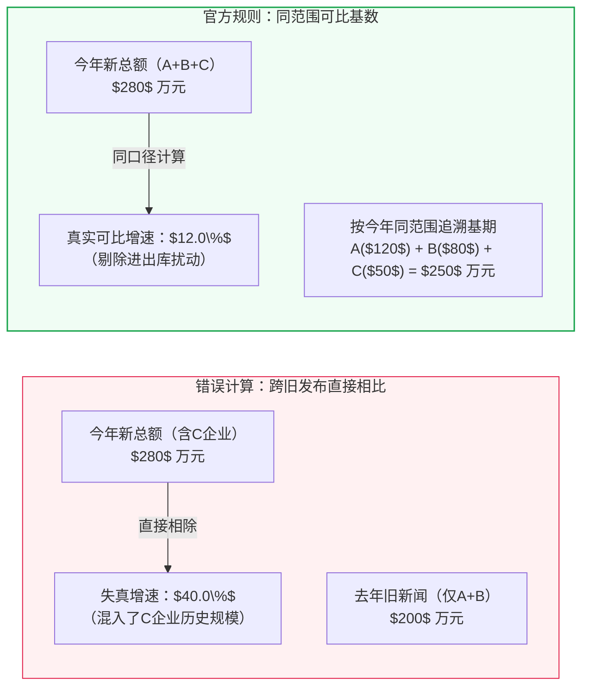
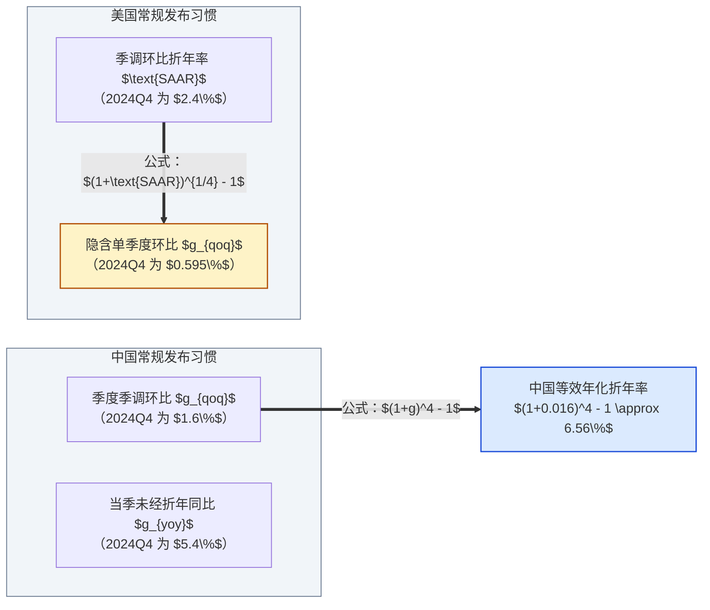
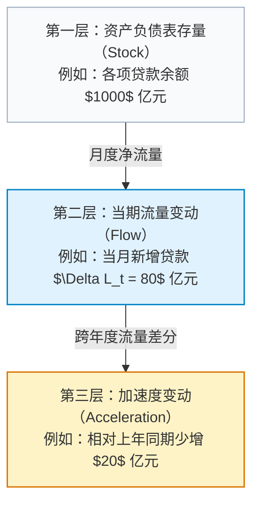

# 02 从美国读数切换到中国口径：累计、同比与可比基数

[上一章：账户地图](01-economic-map.md) · [目录](./) · [下一章：数据生产](03-data-production.md)

> 中国篇深度升级版 · 2026-10。本书以美国篇为前置理论基础。文中金额与案例均为教学假设；历史真实数据均标注出处版本。

**前置阅读：**美国篇[02 数字与统计口径](https://fangpings.github.io/us-econ/02-measurement.html)。在阅读本章前，你应已熟练掌握同比（YoY）、环比（MoM/QoQ）、季调年率（SAAR）以及名义与实际增长率的数学换算。本章的核心任务，是带你识别中国统计发布中特有的“累计值”、“可比基数”与“春节合并发布”规则，掌握严密的口径转换技能。

---

## 1. 办公室里的惊魂一幕：四个极易误读的“小词”

想象一下，你刚刚入职某家宏观研究机构。周五上午国家统计局发布了最新数据，你在群里迅速发了一条快讯：
> “重大突发！3 月份消费断崖式下跌，从前两个月的 $10\%$ 暴跌至 $-2\%$！”

不出五分钟，首席经济学家就把你叫进了办公室：“你把新闻稿翻开仔细看——人家写的是‘1—3 月份社会消费品零售总额**累计**同比增长 $8\%$，1—2 月份**累计**增长 $10\%$’。累计增速放缓 2 个百分点，怎么能直接算成 3 月单月增速是 $-2\%$ 呢？”

在中国宏观经济的数据发布中，类似的“翻车现场”屡见不鲜。由于统计制度与信息披露传统的差异，中国国家统计局与中国人民银行的官方新闻稿中，往往包含着四个极易被初学者忽略、却足以颠覆整个研判结论的关键限定词：

| 官方发布常见词 | 真实统计内涵 | 若按欧美标题习惯直接套用的严重误判 |
| :--- | :--- | :--- |
| **“1—N 月份累计”** | 从当年 1 月 1 日起至第 $N$ 月末的**跨月累计总额**相对上年同期的增速 | 误以为是第 $N$ 月当月的边际增速，忽视了前 $N-1$ 个月的基数平滑效应 |
| **“增加值实际增长”** | 已经过**分行业价格指数平减**（扣除物价变动影响）的实物产出增速 | 误当作现价名义数据，再次人为减去工业品出厂价格指数（PPI），导致价格二次扣除 |
| **“其中：限额以上”** | 满足特定年营收门槛（如批发 $2000$ 万、零售 $500$ 万元）的**大中型企业子集** | 误把大企业状况当作全社会整体，或错误地把“其中数”与“总额”直接相加 |
| **“按可比口径计算”** | 扣除了企业生灭、退库、跨门槛等样本变动后，**同范围企业**的计算增速 | 翻出去年同期的新闻旧金额直接相除，发现结果对不上，草率断言“官方数据造假” |

需要说明的是，这并不意味着中国数据“只有累计没有单月”，也不意味着中国没有“季调环比”。国家统计局在发布工业、社零和 GDP 的同时，也会发布经 X-12/X-13 季调模型处理的环比序列；同样，欧美机构也会定期发布累计报表。

研读宏观的第一步，永远是**阅读指标附注与表头，确认时间算子与样本边界**。

---

## 2. 核心数学技法：累计数据如何（以及何时不可）还原单月

中国每个月公布的固定资产投资（FAI）、规模以上工业企业利润等核心指标，官方通常只公布“1—$N$ 月累计完成额”与“累计同比增速”。如果我们想知道“本月究竟是加速还是放缓”，就必须学会**累计拆解法（De-accumulation）**。

### 2.1 规范的单月拆解推导

设某指标在同一统计范围、同一价格口径下，各期的名义金额均可无缝相加。我们用 $A_t$ 表示第 $t$ 月当月的真实发生额，$S_t = \sum_{i=1}^t A_i$ 表示当年 1 至 $t$ 月的累计金额；相应地，上年同期当月发生额为 $A^*_t$，上年同期累计金额为 $S^*_t$。

根据加法恒等式，第 $t$ 月的单月金额为：
$$A_t = S_t - S_{t-1}$$
$$A^*_t = S^*_t - S^*_{t-1}$$

则第 $t$ 月的单月同比增速 $g_{single, t}$ 为：
$$g_{single, t} = \frac{A_t - A^*_t}{A^*_t} = \frac{(S_t - S_{t-1}) - (S^*_t - S^*_{t-1})}{S^*_t - S^*_{t-1}}$$

让我们用一组标准的教学数据来走一遍全流程：

| 报告期间 | 上年同期累计金额（$S^*$） | 当年累计金额（$S$） | 官方累计同比（$g_{cum}$） |
| :--- | :---: | :---: | :---: |
| **1—2 月份** | $\$200\$$ 亿元 | $\$220\$$ 亿元 | $10.0\%$ |
| **1—3 月份** | $\$300\$$ 亿元 | $\$324\$$ 亿元 | $8.0\%$ |

1. **计算 3 月当期金额**：
   $$A_3 = S_3 - S_2 = 324 - 220 = 104 \text{ 亿元}$$
2. **计算 3 月上年同期基数**：
   $$A^*_3 = S^*_3 - S^*_2 = 300 - 200 = 100 \text{ 亿元}$$
3. **计算 3 月单月真实同比增速**：
   $$g_{single, 3} = \frac{104 - 100}{100} = 4.0\%$$

你看：1—3 月累计增速虽然比 1—2 月下滑了 $2$ 个百分点（从 $10\%$ 降至 $8\%$），但这绝不代表 3 月单月增速是 $-2\%$，也不代表 3 月单月依然有 $8\%$，它的真实单月同比是 **$+4\%$**。因为 3 月份单月的增速（$4\%$）低于前两个月的累计水平（$10\%$），从而把一季度的整体平均水平拉低到了 $8\%$。

### 2.2 还原单月的“三道红线”

在现实操作中，许多研究员直接套用上述公式却得出了荒谬的结论，原因在于触碰了以下三道红线：

1. **红线一：只有增速、缺少基期权重时不可倒推**
   如果你只知道“1—2 月累计增长 $10\%$，1—3 月累计增长 $8\%$”，在数学上是无法唯一定解 3 月单月增速的！
   假设上年 3 月份的基期规模极小，只有 $\$50\$$ 亿元（而非上例的 $\$100\$$ 亿元），那么上年 1—3 月累计基数变为 $\$250\$$ 亿元。当年 1—3 月按 $8\%$ 增长后累计总额为 $250 \times 1.08 = 270\$$ 亿元。此时 3 月当期金额为 $270 - 220 = 50\$$ 亿元，3 月单月同比增速实际上是 $\frac{50 - 50}{50} = 0\%$。基期月度分布权重的不同，会彻底改变反推结果。
2. **红线二：相邻月份统计范围发生变动时不可直接相减**
   在统计实践中，部分企业可能在 3 月份被剔除出样本库（例如破产停产或退库），或者统计部门进行了口径核实修正。如果 $S_3$ 与 $S_2$ 包含的企业池并不兼容，简单的差分相减就会将“样本剔除”误算为“业务断崖式萎缩”。
3. **红线三：四舍五入的舍入误差会被差分剧烈放大**
   官方公布的累计增速通常保留一位小数。当某单月数值占累计总额比例较小（如 11 月至 12 月的年末阶段）时，累计增速中仅 $0.1$ 个百分点的微小舍入，经过两期差分放大后，可能导致计算出的单月增速产生几个百分点的巨大震荡。因此，所有反推得到的单月数据，都必须在研究报告中醒目标注为“测算估计值”，绝不可冒充官方发布。

---

## 3. 为什么“本期金额除以上期旧新闻金额”算不出官方同比

许多初学者常常有这样的经历：翻出国家统计局去年同期的官方新闻通稿，找到当时的公布金额 $Y_{old}$，再用今年最新公布的金额 $Y_{new}$ 直接相除：
$$\text{算得增速} = \frac{Y_{new}}{Y_{old}} - 1$$
结果发现，算出来的百分比与新闻稿里赫然印着的“同比增长 $X\%$”完全对不上！于是惊呼：“一定是统计局算错了！”

真实的原因在于：**“可比口径”（Comparable Scope）规则。**

让我们看一个生动的微观样本变化案例：
- **去年基期**：某地区“规模以上工业企业”名录库中仅有 A、B 两家大型制造厂。A 厂营收 $\$120\$$ 万元，B 厂营收 $\$80\$$ 万元。去年公布的工业企业总收入为：
  $$Y_{old} = 120 + 80 = 200 \text{ 万元}$$
- **今年报告期**：当地原有一家老牌中型机械厂 C，因扩大生产线，年营收突破了 2000 万元的“规模以上”门槛，在本年度正式被国家统计局纳入联网直报库（称为“入库/升规”）。今年三家企业的实际营收分别为：A 厂 $\$130\$$ 万，B 厂 $\$90\$$ 万，C 厂 $\$60\$$ 万元。今年实际汇总上报的总营收为：
  $$Y_{new} = 130 + 90 + 60 = 280 \text{ 万元}$$

现在，统计部门在计算今年该地区的工业经济增长率时，应该怎么算？

- **如果按跨期旧新闻直接相除**：
  $$\frac{280}{200} - 1 = +40.0\%$$
  这个 $+40\%$ 产生了严重的虚假繁荣！因为 C 企业并不是今年从石头缝里凭空诞生的新公司，它去年就已经在运转并创造了 $\$50\$$ 万元的产值，只是去年没达到统计门槛未被纳入直报。把 C 企业几十年的全部历史积累算作今年一年的新增经济产出，显然是严重失真的。
- **国家统计局的规范做法（同范围可比口径）**：
  必须要求企业 C 同时补报其在上年同期的实际数据（假设为 $\$50\$$ 万元）。将基期企业的范围严格统一为当前口径下的 A、B、C 三家企业，计算出同口径的可比基期总额：
  $$Y^*_{base} = 120 + 80 + 50 = 250 \text{ 万元}$$
  进而计算出真实的同口径同比增长率：
  $$g = \frac{280}{250} - 1 = +12.0\%$$

官方新闻稿中公布的增长率正是 **$+12.0\%$**。如果你拿着今年的 $\$280\$$ 万去除了去年的 $\$200\$$ 万，你算出来的所谓“差距”，实质上就是**样本库动态调整的规模溢价**，绝非统计失误。

---

## 4. 春节与 1—2 月份合并发布机制

每年 1 月和 2 月，你翻遍国家统计局网站，都会发现一个奇特的现象：**根本找不到 1 月份单月的工业增加值、固定资产投资和社零数据！** 官方日历明确规定：1 月和 2 月合并，统一在 3 月中旬公布“1—2 月份累计数据”。

为什么中国不做单月的 1 月和 2 月统计？

核心原因在于**中国农历春节的“日历漂移效应”**。
中国的农历春节遵循阴阳历法，公历对应日期在 1 月 21 日至 2 月 20 日之间大幅摆动。
- 在春节所在的月份，工业企业工人通常在除夕前 1-2 周陆续返乡，工厂停工检修，物流停运；而在节后又需要 1-2 周逐步复工。这使得“春节当月”的工业有效工作日大幅缩水，生产端骤降；
- 与此同时，居民走亲访友、年货采购和文旅消费在春节期间迎来爆发性高峰，消费端逆势冲高。

如果某年春节在 1 月底（早春），1 月的工业就会断崖式下跌，2 月报复性反弹；如果次年春节漂移到 2 月中旬（晚春），两月的波动格局就会彻底颠倒。如果按单月公布同比数据，由于基期与报告期的有效工作日完全不可比，数据序列将呈现出剧烈的人为锯齿状波动，完全无法反映宏观经济的真实内在动能。

将 1 月和 2 月合并为一个报告期，完整覆盖了返乡、过年与复工的全周期，最大限度地熨平了春节移动造成的日历错位。

> **数据分析严正告诫**：
> 在编写自动化宏观数据库或运行计量回归时，有些程序员为了补齐序列，机械地将缺失的 1 月份数值填补为“0”，或者简单地把 1—2 月总金额除以 2 作为 1 月数值。
> 这两种做法在学术和实务中均属严重违规！“未单独发布”不等于“经济活动为零”；而简单对半切分则抹杀了 1 月与 2 月客观存在的季节性不对称。规范做法是：直接以“1—2 月累计值”作为一个不可分割的独立时间节点参与分析。

---

## 5. 跨国对照解构：中国季度同比 vs 美国季度折年率

在中美宏观对话中，最具迷惑性的一对指标是 GDP 的增速表述。
让我们来看 2024 年四季度的真实数据对比：
- **中国国家统计局发布**：2024 年四季度 GDP 当季同比增长 $5.4\%$，全年增长 $5.0\%$；经季节性调整后，四季度 GDP 环比增长 $1.6\%$。
- **美国经济分析局（BEA）发布**：2024 年四季度实际 GDP 增长率（Third Estimate）为 $2.4\%$。

如果你在国际研讨会上简单地陈述：“四季度中国增速 $5.4\%$，美国增速 $2.4\%$”，许多海外研究员会立即指出你的比较口径存在严重的时间算子错配：
- 中国公布的 $5.4\%$ 是**未经折年的当季同比（YoY, Year-over-Year）**，即本年四季度相对于去年四季度的跨年度产出变动；
- 美国公布的 $2.4\%$ 则是**季调环比折年率（SAAR, Seasonally Adjusted Annual Rate）**，即本季度相对于上季度的增长速度在假设维持一整年后的等效年化产出变动！

### 两种尺度之间的数学桥接

为了消除时间算子差异，我们必须将两国数据转换到同一个基准上：

1. **将中国的季度环比转换为美国常用的环比折年率（SAAR）**：
   $$\text{SAAR}_{CN} = (1 + g_{qoq, CN})^4 - 1$$
   代入中国公布的季调环比 $1.6\%$：
   $$\text{SAAR}_{CN} = (1 + 0.016)^4 - 1 = 1.06556 - 1 \approx 6.56\%$$
   如果按美国习惯的年化动能视角，中国四季度经济运行的环比动能折合年率约为 **$6.56\%$**，远高于美国当季的 $2.4\%$。
2. **将美国的环比折年率反解为季度单季环比（QoQ）**：
   $$g_{qoq, US} = (1 + \text{SAAR}_{US})^{1/4} - 1$$
   代入美国公布的折年率 $2.4\%$：
   $$g_{qoq, US} = (1 + 0.024)^{0.25} - 1 = 1.005946 - 1 \approx 0.595\%$$
   也就是说，美国四季度产出相对于三季度的实际环比增量仅为 **$0.595\%$**，而中国四季度的实际环比增量为 **$1.6\%$**。

只有建立在严格对齐的数学尺度上，跨国经济动能的比较才具备科学意义。

---

## 6. 中国金融报告特有词汇：“同比少增 / 多增”

在研读中国人民银行发布的月度金融统计数据时，新闻头条常常出现“人民币贷款新增 $X$ 亿元，同比少增 $Y$ 亿元”或者“社会融资规模增量同比多增 $Z$ 亿元”。

这常常让初学者摸不着头脑：“少增到底是增加了还是减少了？少增说明贷款余额缩水了吗？”

### 区分三层变化变量

我们必须在脑海中清晰地构建三层变量体系：

假设某商业银行去年 8 月份新增贷款为 $\$100\$$ 亿元；今年 8 月份由于实体有效融资需求偏弱，当月实际新增贷款为 $\$80\$$ 亿元。同时，上月末该行各项贷款余额为 $\$1000\$$ 亿元。

- **当月净增量（流量 Flow）**：本月企业与居民实际净借入借款 $\$80\$$ 亿元；
- **期末贷款余额（存量 Stock）**：在没有大额不良贷款核销的假设下，本月末总贷款余额上升为：
  $$\text{月末余额} = 1000 + 80 = 1080 \text{ 亿元}$$
  贷款余额环比增长了 $\frac{80}{1000} = +8.0\%$。实体经济手中的信贷资金总量依然在**持续扩张**，绝非信贷规模缩水！
- **同比少增（加速度变化）**：
  $$\text{少增额} = \text{今年当期新增量} - \text{去年同期新增量} = 80 - 100 = -20 \text{ 亿元}$$
  “同比少增 $\$20\$$ 亿元”仅仅描述了**信贷注入速度的二阶加速度在放缓**，绝不等于实体债务存量减少了 $\$20\$$ 亿元。

---

## 7. 综合实操演练：重构一份混乱的宏观分析简报

假设你拿到了一名实习生起草的晨会研判草稿：
> “本期中国宏观全面走弱：1—3 月消费累计增速仅 $8\%$，比 1—2 月暴跌 2 个百分点，折射出 3 月消费极度萎缩；中国四季度 GDP 增速 $5.4\%$ 虽然看似高于美国四季度 GDP 的 $2.4\%$，但如果减去规上工业 $6\%$ 的实际增速，依然有库存大量积压；信贷市场新增贷款同比少增 $20$ 亿元，说明企业正在大幅缩表去杠杆……”

**请指出草稿中的四处致命逻辑硬伤，并给出专业修正：**

1. **累计增速错判单月**：1—3 月累计 $8\%$ 相比 1—2 月累计 $10\%$ 的放缓，经严格差分测算，3 月单月同比增速依然录得 $+4.0\%$，仍在正向扩张区间，绝非“消费极度萎缩”。
2. **跨国时间尺度错配**：将中国未经折年的当季度同比（$5.4\%$）与美国季调环比折年率（$2.4\%$）直接对比属于指标误读。中国四季度季调环比为 $1.6\%$，折合年化环比动能高达 $6.56\%$，两国经济动能的比较必须基于同一度量衡。
3. **不同核算层次与价格维度的混淆**：规上工业增加值 $6.0\%$ 为扣除物价变动后的实际产出指标，且仅涵盖大中型工业制造企业；而社零为全社会消费品名义零售总额。拿实际增加值减名义销售总额，既混淆了价格维度，又混淆了产业边界，不能得出存货积压结论。
4. **存量与加速度概念混同**：信贷“同比少增 $\$20\$$ 亿元”描述的是新增放贷节奏的边际放缓，当月贷款余额仍然净增加 $\$80\$$ 亿元，实体部门信贷总存量仍在扩张，不能妄称“企业正在缩表”。

---

## 练习：转换中国发布，而不是复习百分比

1. **同范围累计金额拆解**：已知某指标在统计范围严格兼容的前提下，上年 1—2 月累计收入为 $\$400\$$ 亿元，1—3 月累计收入为 $\$600\$$ 亿元；本年 1—2 月累计收入为 $\$440\$$ 亿元，1—3 月累计收入为 $\$648\$$ 亿元。
   - （1）请精确计算本年 3 月份单月的同比增长率；
   - （2）请解释为什么 1—3 月累计同比（$8.0\%$）会低于 1—2 月累计同比（$10.0\%$）？
2. **基期分布反推难题**：某报告仅披露“某指标 1—2 月累计同比增长 $10\%$，1—3 月累计同比增长 $8\%$”。请证明：为什么在缺少基期金额分布权重时，无法唯一定解 3 月单月的实际同比增速？试构造一组具体的基期假设说明结果的差异。
3. **可比口径与旧发布辨析**：某市统计局最新公布本年度规上服务业营收总额为 $\$520\$$ 亿元，官方标注“按可比口径同比增长 $4.0\%$”。某研究员翻出上年度该市公布的同名新闻通稿，发现上年度公布的总额为 $\$480\$$ 亿元。研究员用 $\frac{520}{480} - 1 = +8.33\%$，据此在公开网络上指控官方统计存在数据矛盾。请运用本章所学，反驳该研究员的指控。
4. **金融流量与存量核算**：某月份金融机构新增人民币贷款规模由上年同期的 $\$150\$$ 亿元下降为本期的 $\$120\$$ 亿元。该行贷款总余额由期初的 $\$2000\$$ 亿元上升至期末的 $\$2120\$$ 亿元。
   - （1）请分别计算当月信贷净增量、“同比少增”额以及贷款余额的环比增速；
   - （2）在当前已知数据条件下，为什么依然无法计算贷款余额的“同比增长率”？
5. **中美增长率标准桥接**：中国公布某季度 GDP 季调环比增速为 $1.0\%$；美国公布同期实际 GDP 季调环比折年率（SAAR）为 $4.0\%$。在对两国的短期经济复苏动能进行客观评价前，你必须完成哪一步数学换算？换算后的具体数值对比是多少？
6. **日历合并规则的逻辑推演**：请查阅国家统计局年度发布日程表，阐述为什么统计数据库绝不能为了追求时间序列完整性，而武断地将缺失的 1 月份数据补零，或者简单地将 1—2 月合并总额按各占 $50\%$ 的比例切分？

参考答案与详细推理

1. **单月金额与同比计算**：
   - 上年 3 月单月金额：$A^*_3 = 600 - 400 = 200\$$ 亿元；
   - 本年 3 月单月金额：$A_3 = 648 - 440 = 208\$$ 亿元；
   - 3 月单月同比增长率：$g_3 = \frac{208 - 200}{200} = +4.0\%$；
   - 累计增速放缓的原因：前两个月累计增长为 $\frac{440 - 400}{400} = 10.0\%$，而 3 月单月增速仅为 $4.0\%$，单月边际动能明显弱于前期平均水平，从而拉低了整个季度的加权平均累计增速至 $8.0\%$。
2. **基期分布不确定性的数学证明**：
   - 设上年 1—2 月累计金额为 $S^*_2$，3 月单月金额为 $A^*_3$，则上年 1—3 月累计为 $S^*_2 + A^*_3$；
   - 当年 1—2 月累计为 $1.10 S^*_2$，当年 1—3 月累计为 $1.08 (S^*_2 + A^*_3)$；
   - 则当年 3 月单月金额为：$A_3 = 1.08 (S^*_2 + A^*_3) - 1.10 S^*_2 = 1.08 A^*_3 - 0.02 S^*_2$；
   - 3 月单月同比增速为：$g_3 = \frac{A_3 - A^*_3}{A^*_3} = 0.08 - 0.02 \times \frac{S^*_2}{A^*_3}$；
   - 可以清晰看出，$g_3$ 的最终数值完全取决于基期前两月规模与 3 月规模的相对比值 $\frac{S^*_2}{A^*_3}$。例如：若 $S^*_2 = 400, A^*_3 = 100$（比值为 4），则 $g_3 = 0.08 - 0.02 \times 4 = 0.0\%$；若 $S^*_2 = 200, A^*_3 = 100$（比值为 2），则 $g_3 = 0.08 - 0.02 \times 2 = +4.0\%$。因此仅有累计增速无法反推单月。
3. **样本调整与可比口径辨析**：
   - 研究员的指控是不成立的。他将“不同统计范围的历史旧数据”与“本期最新数据”进行了粗暴的直接相除；
   - 规模以上服务业企业的名录库每年都会动态调整：部分上年未达标的企业在今年“升规入库”，部分停产倒闭企业退出。官方公布的 $+4.0\%$ 是在剔除了这些出入库扰动、严格基于“今年在库企业及其在去年同期的真实可比业绩”计算得出的；
   - 根据 $+4.0\%$ 的可比增速，可以反推今年纳入统计的企业池在去年的可比基期总额约为 $\frac{520}{1 + 0.04} = 500\$$ 亿元。这说明今年入库企业的整体规模大于退库规模，使可比基数（$500$ 亿）高于上年旧通稿公布值（$480$ 亿）。
4. **金融多层次变量计算**：
   - （1）当月新增信贷增量为 $\$120\$$ 亿元；同比少增额为 $120 - 150 = -30\$$ 亿元；贷款余额环比增速为 $\frac{2120 - 2000}{2000} = +6.0\%$；
   - （2）已知条件仅给出了上年同期的“当月新增量（$\$150\$$ 亿）”，但并未给出“上年同期的贷款总余额基数”，因此无法计算余额存量的同比增长率。
5. **中美动能尺度对齐**：
   - 必须将两者的增速时间尺度统一：要么都转换为季度环比，要么都转换为环比折年率（SAAR）；
   - **方案 A（均转为环比折年率）**：将中国季度环比 $1.0\%$ 折年为 $(1 + 0.01)^4 - 1 \approx 4.06\%$，此时中国环比折年动能（$4.06\%$）与美国（$4.0\%$）基本持平；
   - **方案 B（均转为季度环比）**：将美国折年率 $4.0\%$ 反解为季度环比 $(1 + 0.04)^{0.25} - 1 \approx 0.985\%$，此时中国季度环比动能（$1.0\%$）略高于美国（$0.985\%$）。
6. **1—2 月不可拆分的统计原理**：
   - 中国农历春节在公历 1 月与 2 月之间大幅摆动，导致两个月份的有效工作日和居民消费习惯呈现高度非对称的季节性扭曲；
   - 机械补零会严重扭曲统计学均值与方差，导致计量模型崩溃；
   - 机械对半切分是一种无依据的强模型假设，忽视了春运峰值、除夕节点对单月实体活动的真实非对称冲击，得到的只是虚假的人造伪数据，无法充当官方实证依据。

[上一章：账户地图](01-economic-map.md) · [目录](./) · [下一章：数据生产](03-data-production.md)
