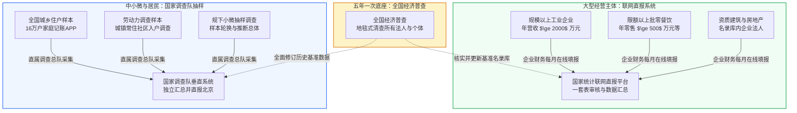
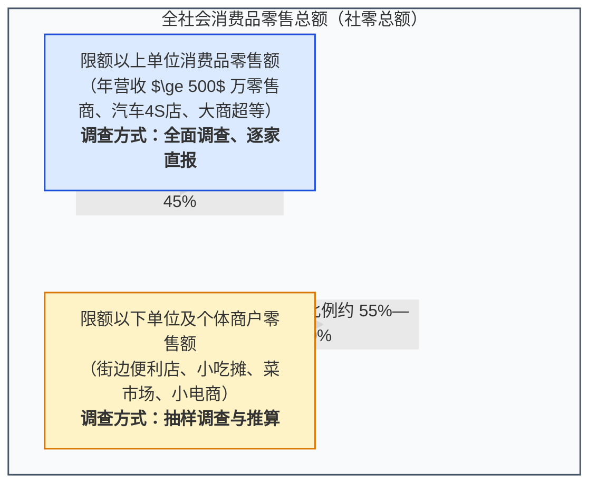
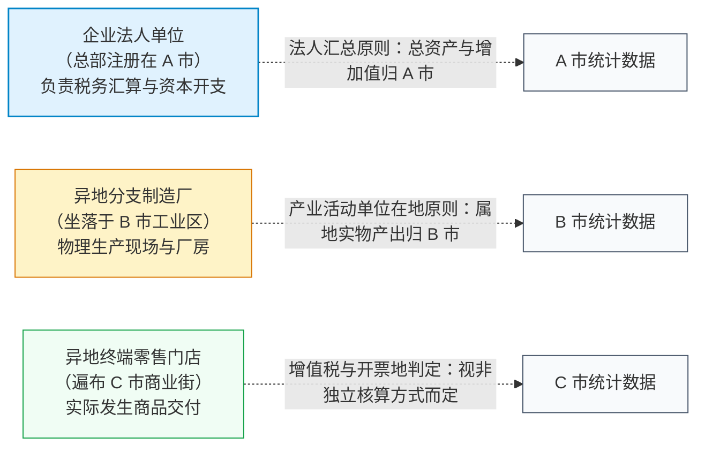
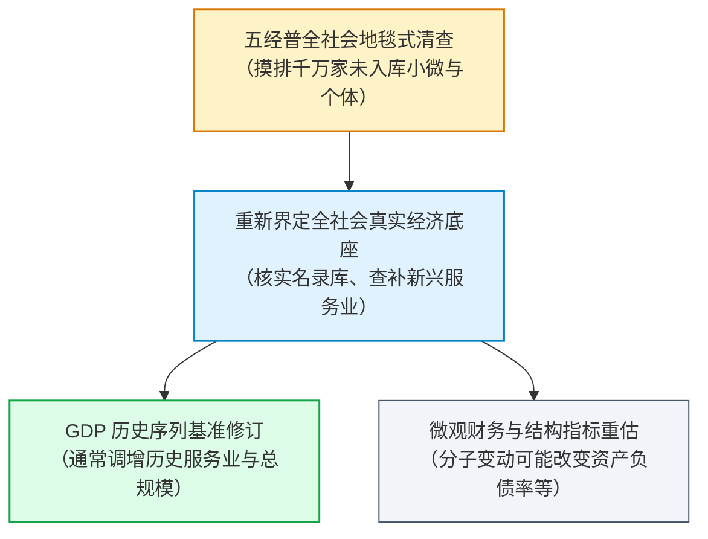

# 03 中国统计怎样生产：名录、直报、调查队与经济普查

[上一章：口径转换](02-measurement.md) · [目录](./) · [下一章：发布与版本](04-releases-and-vintages.md)

> 中国篇深度升级版 · 2026-10。本书以美国篇为前置理论基础。文中制度与技术规程均绑定国家统计局最新公开资料；模拟名单与金额均为教学设计。

**前置阅读：**美国篇[02 统计口径](https://fangpings.github.io/us-econ/02-measurement.html)、[06 就业调查](https://fangpings.github.io/us-econ/06-labor.html)。在阅读本章前，你应已掌握分层随机抽样、无回答偏差以及基准修订（Benchmark Revision）的基本统计学原理。本章的核心任务，是带你穿透“数据来自统计局”这句笼统的话，看清中国统计体系是如何通过**企业联网直报、国家调查队抽样与五年一次的全国经济普查**将微观经济活动凝聚为宏观指标的。

---

## 1. 街角的微观世界：四种主体怎样进入国家统计

漫步在任何一个中国城市的商业街区，你会看到纷繁复杂的经济景观：
1. **高新园区里的大型数控机床厂**：拥有 $800$ 名员工，年营业收入超过 $\$3\$$ 亿元；
2. **街角连锁奶茶品牌的加盟门店**：单店年流水 $\$120\$$ 万元，母公司是注册在外省的全国性品牌管理公司；
3. **农贸市场里的个体蔬菜生鲜摊位**：夫妻俩经营，现金与个人微信收款码混合记账，没有规范的资产负债表；
4. **穿梭在街头巷尾的外卖骑手**：户籍在周边农村，在城市租房居住，通过灵活用工平台按单结算收入。

当月末国家统计局发布“全国规模以上工业增加值”、“社会消费品零售总额”、“全国居民人均可支配收入”和“全国城镇调查失业率”时，初学者往往会产生一种浪漫的误解：“是不是统计局派人调查了每一个摊位、每一家奶茶店、每一位骑手？”

显然，任何现代国家都不可能在月度频段上对数千万家微观商户和十余亿人口进行穷尽式的普查。中国国家统计局之所以能够每月高效输出海量宏观读数，依托的是一套高度分工、多轨并行的**现代统计调查体系（“四大工程”）：**

- **第一轨：企业端“一套表”联网直报**。针对大中型核心骨干企业，建立严格的基本单位名录库。符合规模门槛的企业，其财务人员每月必须登录国家统计局直报专网，直接填报生产、财务与劳资台账，基层统计机构在线审核，杜绝中间层级篡改。
- **第二轨：居民与小微端“国家统计局直属调查队”垂直抽样**。针对分散的住户和不设规范财务账的个体工商户，由垂直管理的国家统计局各级调查总队（省、市、县直属调查队）组织调查员深入社区、乡村和商户，采用电子记账和手持终端现场入户采集，独立汇总直报国家。
- **第三轨：行政记录与部门资料共享**。海关总署提供进出口货物报关清单，财政部提供财政预决算收支流水，税务总局提供发票开具与纳税申报数据，中国人民银行提供金融机构信贷收支表。
- **第四轨：五年一次的全国经济普查（年份尾数为 3 和 8）**。动员数百万普查员进行地毯式地籍清查，彻底核实全社会各类法人单位、产业活动单位和个体经营户，作为修正历史核算偏差的终极基准。

---

## 2. 企业报表：“规模以上”门槛与联网直报机制

在中国宏观报告中，“规模以上”（简称“规上”）是出现频率最高的词汇。为什么工业、服务业都要设置“规模门槛”？

### 2.1 统计成本与经济重心的现实权衡

在任何经济体中，企业规模的分布都呈现出高度倾斜的“帕累托长尾”：全社会可能拥有数千万家微型工坊和小商店，但它们贡献的经济产值加起来可能只占两三成；相反，两三万家大型骨干制造厂，就贡献了全社会工业产出的七八成。

为了在“发布时效性”与“统计行政成本”之间取得平衡，国家统计局制定了严格的**全面调查与抽样调查结合制度**：

| 统计行业与对象 | “规模以上 / 限额以上”准入门槛标准 | 调查采集方式 |
| :--- | :--- | :--- |
| **工业制造与采矿** | 年主营业务收入达到 $\$2000\$$ 万元及以上的工业法人单位 | **全面调查**（名录库内企业逐家联网直报） |
| **批发业** | 年主营业务收入达到 $\$2000\$$ 万元及以上 | **全面调查**（逐家联网直报） |
| **零售业** | 年主营业务收入达到 $\$500\$$ 万元及以上 | **全面调查**（逐家联网直报） |
| **住宿与餐饮业** | 年主营业务收入达到 $\$200\$$ 万元及以上 | **全面调查**（逐家联网直报） |
| **建筑业与房地产** | 具有资质等级的总承包、专业承包建筑业企业；全部房地产开发经营法人 | **全面调查**（资质企业逐家联网直报） |
| **规下工业 / 限下商贸** | 上述门槛标准以下的全部小微企业与个体工商户 | **抽样调查**（按科学抽样框推算全社会总体） |

> **特别注意**：
> “规上企业全面调查”仅仅代表对“规定门槛内的合格单位”做穷尽式调查，**绝不等于调查了全社会所有的工厂！** 当你看到规上工业增加值增速强劲时，绝不能想当然地断定巷子里的小作坊和小微代工厂也在同步繁荣。在经济复苏或分化阶段，大企业往往由于融资成本低、抗风险能力强而率先企稳，小微企业可能仍在经历阵痛。

### 2.2 联网直报流程与上报前风险

联网直报不仅是一根数据网线，而是一整套管理闭环：

但必须清醒认识到：**联网直报虽然防范了地方中间层级的数据层层截留与干预，但它无法自动消除原始填报端的差错：**
1. **财务口径与统计口径的转换偏差**：企业的会计做账遵循税法与《企业会计准则》，而统计局的报表字段遵循国民账户原则。例如，企业会计上的“主营业务收入”可能包含销售旧资产的收入，而统计核算要求剔除旧资产转让；如果企业报税会计理解不准确，就会产生源头填报误差。
2. **入库资质的跨年审批滞后**：一家企业年产值在 10 月份突破了 2000 万元，并不能当月立刻进入“规上企业”系统。它必须在年末向当地统计机构提交纳税申报表、利润表等证明材料，经国家统计局多级核准入库后，于次年 1 月起才正式按规上企业上报。

---

## 3. 限额以上 vs 社零总额：不能把部分当作全体

在分析消费市场时，最常见的误区是混淆“社会消费品零售总额（社零总额）”与“限额以上单位消费品零售额”。

让我们看一个生动的消费市场结构对比：

- **限额以上部分**：主要包括大型连锁超市、汽车 4S 店、品牌百货商场和大型电商自营平台。它们的特点是销售标准化程度高，主要承载了汽车、石油制品、大型家电、名贵烟酒等“大宗耐用品消费”。由于对限额以上单位实行联网直报，这部分数据更新快、分品类明细详实（官方每月会公布汽车类、粮油食品类、金银珠宝类等十余种限上分类增速）。
- **限额以下部分**：主要包括数以百万计的社区小超市、农贸果蔬摊、夫妻老婆店、街头大排档以及中小微个体电商。它们主要承载了居民日常生鲜、廉价餐饮等高频散乱的日常消费，占社零总额的半壁江山（占比在 $55\%$ 以上）。

### 结构分化的研读陷阱

当消费出现结构性分化时，限额以上增速与全社会社零总额可能出现明显背离：
- 例如，当高收入群体消费韧性较强、或者国家出台针对乘用车与大型家电的以旧换新补贴政策时，汽车与大件消费放量，带动**限额以上零售增速大幅冲高至 $8\%$**；
- 但与此同时，中低收入群体由于就业或收入预期谨慎，街头小微餐饮和农贸日用消费增长乏力，**限额以下部分增速可能只有 $1\%$**。
- 两者加权汇总后，全社会**社零总额真实增速可能仅为 $4\%$**。

如果你只看金融终端推送的限额以上分项（因为它们有商品明细），误把限额以上当大全社会，就会得出“消费全面繁荣”的严重误判。

---

## 4. 法人、门店与项目：地区归属的“迷宫”

在研读各省、各市的宏观经济指标时，常有人提出疑问：“为什么某直辖市公布的新能源汽车产量如此之高，但在当地的工业园里却看不到几家大型总装车间？为什么某个电商巨头在全国各地都有仓储配送中心，它的销售额却几乎全算在了杭州或北京？”

要理解地区统计，必须理解三类统计基本单位的**空间归属规则**：

1. **企业法人单位（Legal Unit）**：依法设立、拥有独立财产、能够独立承担民事责任并编制完整资产负债表的组织。
2. **产业活动单位（Establishment）**：在一个地点从事一种或主要从事一种经济活动的分支机构（如制造车间、矿山分部、科研所），它通常没有独立完整的财务账簿，依附于法人单位。

在国家统计制度中：
- **工业产出与能源消费**：通常遵循**在地原则（产业活动单位在地统计）**，即无论母公司注册在哪里，工厂在哪个行政辖区排放废气、消耗电力、组装零件，其实物工作量和工业增加值原则上就核算在哪个地区；
- **商贸零售与金融服务**：若异地门店属于非独立核算的直营分支机构，其开票收款往往统一汇总至总部服务器，这常常导致大规模的零售额与服务业营业收入被系统性地吸附在总部法人注册地（如上海、北京、深圳、杭州）；
- **固定资产投资项目**：通常遵循**项目属地原则**，即无论出资方是哪里的投资公司，投资形成的公路、桥梁、厂房坐落在哪个县，投资完成额就统计在哪个县。

因此，当你比较不同省份或城市的“人均消费”或“第三产业规模”时，必须意识到跨区域总部经济带来的“吸附效应”和“统计飞地”现象。

---

## 5. 五年一次的洗礼：全国经济普查怎样改变历史坐标

你可能会问：“如果平时月度统计主要依赖联网直报和抽样，那些在平时遗漏了的微型企业、新兴数字平台零工或者瞒报漏报的产值，最终如何纠偏？”

答案就是：**全国经济普查（National Economic Census）**。

### 5.1 普查的运行机制

根据《全国经济普查条例》，中国每五年进行一次经济普查（在尾数逢 3、逢 8 的年份实施，例如第四次经济普查以 2018 年为基准期，第五次经济普查以 2023 年为基准期）。
普查动员了数百万名受过专业培训的普查指导员和普查员，手持电子移动终端（PAD），对全国所有从事第二、第三产业的全部法人单位、产业活动单位和个体经营户开展地毯式入户登记。

### 5.2 普查多发现的规模，不等于当期的新增增长

普查结果公布后，最常见的误解是把“补漏摸清的历史存量”当成了“当期经济突然爆发”。

例如，在第四次全国经济普查后，全国 2018 年 GDP 现价总量修订为 $\$91.93\$$ 万亿元，比初步核算数增加了 $\$1.90\$$ 万亿元（增幅 $2.1\%$）。其中，第三产业（现代服务业）增加值占了增量的绝大部分。

这并不是因为 2018 年底突然多冒出来两万亿的商机，而是因为普查运用大数据手段，把过去五年里分散在互联网灵活用工、家庭家政、微型设计工作室、小微软件开发等领域平时未进入常规月报统计的“隐性产出”一次性清查了出来。

国家统计局在处理这笔增量时，严格遵循国际通行规则：**采用历史平滑趋势比例法（Trend-Ratio Method），将普查发现的基准增量向前回溯分摊到过去四至五年的各个历史季度中，重新测算历史可比增速。** 绝不会把五年的摸底积累全算在普查当年作为突击增长！

---

## 6. 数据审计思维：如何建立严密可检验的研究假设

作为一名专业的宏观研究者，既不能陷入盲目相信官方标题的“机械复述”，也不能陷入捕风捉影的“虚无阴谋论”。成熟的做法是建立**交叉验证与假设检验框架**：

| 数据可能存在的异常表象 | 规范的学术/机构审计切入点 | 严密求证所需的必要限制 |
| :--- | :--- | :--- |
| **覆盖遗漏与断点** | 检查统计总体、基本名录库是否涵盖了所要研究的目标人群（如新就业形态劳动者、灵活就业） | 承认未公开的微观抽样权重细节，在报告中诚实指出推断边界 |
| **企业填报逻辑差错** | 查验跨期报表中的数量逻辑（如实物产量、单价与销售额是否平衡，增值税应纳税额与产值是否匹配） | 逻辑自洽不等于完全没有水分，需结合第三方货运物流、港口吞吐量交叉核实 |
| **进出库样本效应** | 查验统计局附注中的“同口径基数”变动，分离出“新升规企业溢价”与“原企业同店增长” | 当官方未公布精确的进出库名单时，反推数据须显式标注为测算近似值 |
| **多源指标相互背离** | 例如：工业用电量增速与工业增加值增速出现显著剪刀差 | **先拒绝简单归咎于作假**：检查是否因为高耗能重工业（耗电大户）减产，而低耗能高附加值行业（如芯片、生物医药）逆势高增；检查企业自备光伏发电是否替代了电网用电 |

---

## 7. 真实官方资料带读：手把手提取 2024 年 12 月社零方法论

现在，请你打开国家统计局发布的[《2024 年 12 月份社会消费品零售总额增长 3.7%》官方新闻稿](https://www.stats.gov.cn/xxgk/sjfb/zxfb2020/202501/t20240117_1958327.html)，跟着以下步骤进行专业解构：

1. **核对表头双轨结构**：
   定位数据表格，你会发现左侧为“12 月份（当月发生额及当月同比）”，右侧为“1—12 月份（全年累计完成额及累计同比）”。请时刻提醒自己：不要拿累计同比去代替 12 月份的当月变化。
2. **穿透“其中”层级结构**：
   在表格中找到“社会消费品零售总额”这一母项，向下寻找带有“其中：限额以上单位”缩进字样的子项。严格核对两者的规模占比，确认限额以上单位零售额占总额的比例大约为 $40\%$ 左右，在心理上牢固建立“剩余 $60\%$ 是分散在全社会限额以下商户中”的抽样认知。
3. **深入附注检索调查方法**：
   下拉至新闻稿最底部的【附注】，寻找《调查方法》段落。官方明确注明：
   > “对限额以上单位采用全面调查报送，对限额以下单位采用抽样调查。”
   这就是支撑你在研报中下笔写出“大中型零售商全面直报，小微商铺科学推断”的一手制度证据。
4. **研读环比修订提示**：
   在附注末尾寻找《环比数据修订说明》。官方明确披露：
   > “根据季节调整模型自动修正结果，对近一年各月的社零环比增速进行了修正。”
   把这一行字记在你的数据库维护日志里：这意味着历史月度的环比数据不是一成不变的刻舟求剑，每次模型运行都会微调历史估计值。

---

## 练习：审计一条中国数据链

1. **总体与抽样辨析**：某媒体在头条报道中声称：“国家统计局对规模以上工业企业实行的是全面调查，因此官方工业增加值数据穷尽式地覆盖了中国大地上的每一座工厂。”请指出该报道的逻辑错误。
2. **入库出库可比计算**：某工业园区去年仅有名录库企业 A 与 B，上年主营业务收入均为 $\$100\$$ 万元；今年 A 与 B 营业收入均增长为 $\$110\$$ 万元。此外，老企业 C 在去年已经营多年（去年收入 $\$50\$$ 万元），因今年产值达标，本年度首次升规入库，今年实际录得营业收入 $\$60\$$ 万元。
   - （1）如果直接拿今年新闻公布的新总额除以去年旧新闻公布的总额，算得的表面增长率是多少？
   - （2）按照国家统计局的可比口径规则，本年度该园区的真实可比同比增长率是多少？
   - （3）如果只观察连续两年均在库的老企业 A 与 B，它们的同店同比增速又是多少？
3. **直报风险识别**：国家统计局推行“企业一套表联网直报”有效减少了地方行政对统计数据的中间阻隔。但在企业财务人员通过键盘录入数据之前，仍可能存在哪些导致宏观失真的微观源头风险？请列举至少两项。
4. **空间归属难题**：某高新科技公司的行政总部注册在北京市海淀区，其组装生产制造总厂坐落在河北省廊坊市高新技术开发区，而其生产出的智能终端产品主要通过物流直邮给广东省深圳市的终端消费者。请说明：该公司的总产值、工业增加值以及终端零售额分别应当归入哪一个城市的统计账本？为什么不能用海淀区的一个地区字段涵盖所有数据？
5. **普查均值异动解析**：在某省开展第五次全国经济普查后，统计公报显示该省城镇就业人员的平均工资相比普查前估算数出现了 $5\%$ 的下滑。有人据此断定：“全省企业在普查当年普遍采取了降薪裁员措施。”请运用统计名录与调查覆盖原理，提供一个更有说服力的替代性统计解释。
6. **限额以上代表性验证**：请查阅国家统计局最新一期零售发布附注，解释为什么在汽车以旧换新政策强力刺激下，“限额以上单位零售额增速高达 $10\%$”不能直接推论出“全社会居民总体消费支出也增长了 $10\%$”？

参考答案与详细推理

1. **全面调查的定义域限制**：
   - 全面调查（Census/Complete Enumeration）只是在**特定的目标总体（Target Population）**内不漏一人地开展调查；
   - 工业统计制度中“规上”的法定总体被明确限定为“年主营业务收入达到 2000 万元及以上的工业法人单位”；
   - 门槛以下数以百万计的小微型加工厂、家庭作坊被严格排除在该总体之外，它们并不参与规上工业增加值的月度汇总。因此宣称“覆盖每一座工厂”是混淆了“调查方式”与“调查总体”。
2. **三套口径的数学运算与内涵**：
   - （1）**表面跨期相除增速**：
     去年旧总额为 $A + B = 100 + 100 = 200\$$ 万元；
     今年新总额为 $A + B + C = 110 + 110 + 60 = 280\$$ 万元；
     表面增速为：$\frac{280}{200} - 1 = +40.0\%$；
   - （2）**官方同范围可比增速**：
     按今年在库的三家企业重构去年可比基数：$A^* + B^* + C^* = 100 + 100 + 50 = 250\$$ 万元；
     官方可比增速为：$\frac{280}{250} - 1 = +12.0\%$；
   - （3）**持续在库同店老样本增速**：
     仅观察连续两年在库的 A 和 B 两家企业：$\frac{110 + 110}{100 + 100} - 1 = \frac{220}{200} - 1 = +10.0\%$。
   - 这生动展示了统计口径的层级性：$+40\%$ 是含样本扩容的虚高数字，$+12\%$ 是全库同口径增速，$+10\%$ 是存量企业内生有机增速。
3. **直报前微观源头风险**：
   - **财务会计与统计概念错位**：企业财务往往直接复制纳税申报表数据，例如将旧厂房、二手设备的处置收益错算为主营业务产出，违背了 GDP 只算新价值的原则；
   - **单位与量纲输入笔误**：基层企业填报人员对报表要求的“千元”、“万元”单位看错，导致数据产生量级偏差；
   - **企业趋利避害的申报动机**：部分企业为了迎合特定产业补贴政策可能倾向于高报技术研发投入，或者为了税收筹划少报部分营业收入。
4. **多区域统计实体的空间拆解**：
   - **工业增加值与物理产出**：按照“在地原则”，应当归入**河北省廊坊市**。因为实际消耗电力、占用土地、雇佣流水线工人并将原材料组装为成品的物理生产过程发生在廊坊；
   - **总部法人资产与财税汇总**：母公司的营业利润、资产负债表与研发费用通常归入**北京市海淀区**，作为法人单位统计；
   - **终端零售额**：若为线上自营直销，取决于电商开票法人的注册地；若为线下直营门店，若在**广东省深圳市**设有独立核算分支机构，则体现在深圳的社零总额中。
   - 不能用海淀区单一字段概括，因为现代企业的价值链已经跨越行政边界，生产、管理与消费分离。
5. **普查后工资均值下滑的统计学解释**：
   - 经济普查最核心的任务之一是“查漏补缺”，将平时常规统计覆盖不到的大量小微企业、劳动密集型民营个体服务网点（如小餐馆、快递代收点、保洁家政公司）全面纳入名录库；
   - 这些平时漏统的小微企业，其雇佣人员的工资水平普遍低于传统体制内单位和大中型垄断国企；
   - 当大量低薪酬群体的样本被一次性“补入”全省工资统计的分母中时，计算出来的全社会加权平均工资就会产生**结构性稀释（Composition Effect）**。这完全是统计样本覆盖扩容所导致的度量修正，不能轻率推断为在职员工被真实降薪。
6. **限额以上代表性局限分析**：
   - 汽车消费单价高（动辄十余万至几十万元），具有高资金杠杆属性，且几乎全部在具有独立资质的汽车 4S 店（限额以上大商户）中销售；
   - 国家以旧换新补贴主要直接定向补贴给汽车、大型品牌家电等特定门类，导致限额以上零售额短期内被集中催化拉升；
   - 然而，占社零总额近六成的广大限额以下小商户主要销售生鲜食品、大众便餐与日用百货，它们并不享受汽车补贴红利；如果普通家庭用于日常消费的可支配收入未见显著提振，全社会的整体消费增速将远低于受政策脉冲刺激的限额以上分项。

[上一章：口径转换](02-measurement.md) · [目录](./) · [下一章：发布与版本](04-releases-and-vintages.md)
