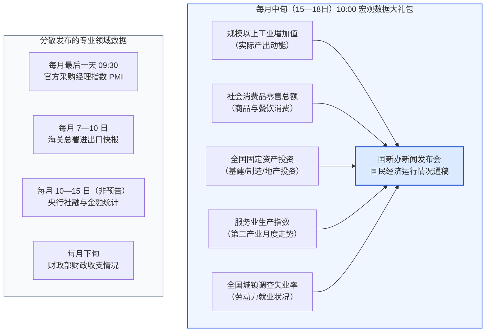
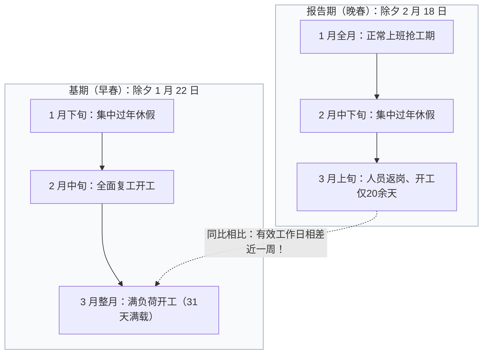
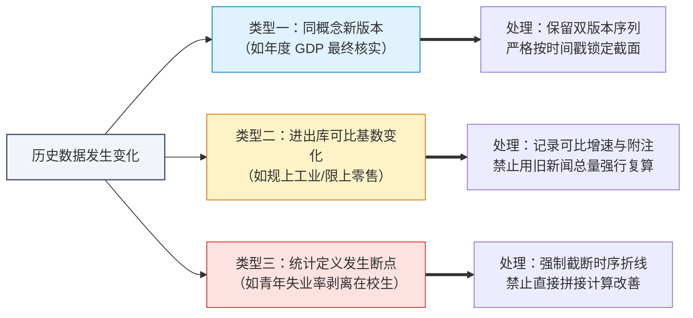

# 04 中国发布节奏与版本：从新闻稿到数据库

[上一章：数据生产](03-data-production.md) · [目录](./) · [下一章：GDP](05-gdp.md)

> 中国篇深度升级版 · 2026-10。本书以美国篇为前置理论基础。历史核算与修订案例均严格对应国家统计局官方公报；模拟简报用于实操审计演练。

**前置阅读：**美国篇[03 发布、预期与历史修订](https://fangpings.github.io/us-econ/03-releases-and-vintages.html)。在阅读本章前，你应已深刻理解“经济事实发生的时间 $\neq$ 统计数据发布的时间”、“截面意外（Surprise）不等于长期趋势”以及“历史数据版本（Vintage）回测防未来信息泄漏”等基本法则。本章的核心任务，是带你摸清中国宏观数据的**“发布大礼包”日历机制、新闻稿与数据库的时差、GDP 两步核算与版本修订规则**。

---

## 1. 为什么不能把美联储 / BLS 的日历模板直接搬过来

在美国宏观跟踪中，华尔街交易员的工作日历像发条一样精准且高度分散：
- 每月第一个周五上午 8:30，劳工统计局（BLS）发布非农就业与失业率；
- 月中某日上午 8:30，BLS 发布消费者物价指数（CPI）；
- 次日，商务部普查局（Census Bureau）发布零售销售数据；
- 月末，经济分析局（BEA）发布实际 GDP 的初值（Advance Estimate）。
每个指标单兵作战，金融市场有充足的时间在单个宏观事件窗口内消化预期差。

然而，如果你把这套单日历经验生搬硬套到中国市场，周一上午十点你可能会被汹涌的信息流瞬间冲垮：

在中国，宏观数据的发布呈现出独特的**“集中发布与分轨并存”格局**：
1. **统计局“国民经济运行发布会”大礼包**：通常在每月 15 日至 18 日上午 10:00，国家统计局通过国务院新闻办公室召开新闻发布会，**在同一秒钟同时披露**上月工业、服务业、消费、投资、房地产以及劳动力调查失业率等全部核心实体经济读数！若逢季末次月（如 4 月、7 月、10 月、1 月），发布会还会同时披露当季的**GDP 季度初步核算数据**。
2. **多部委专业序列独立披露**：
   - 官方制造业与非制造业 PMI：由国家统计局在每月最后一天上午 9:30 抢先独立发布；
   - 海关外贸进出口：由海关总署在每月 7 日至 10 日独立披露；
   - 社融与信贷金融数据：由中国人民银行在每月 10 日至 15 日之间披露，通常不设事先固定的精确钟点，发布日前后会有数天的“数据发布窗口期”；
   - 财政收支：由财政部在每月下旬以新闻公报形式公布。

> **事件研究（Event Study）的专业戒律**：
> 在上午 10:00 的大礼包发布瞬间，国债收益率与股票指数可能剧烈跳动。如果你看到市场利率走低，绝不能武断地下结论说“这是因为零售消费走弱导致的”。在同一个毫秒级事件窗口内，生产端可能超预期强劲、房地产投资可能加剧下滑、青年失业率可能出现反弹。你必须把发布包作为一个整体进行多维剖析，而不是抓住单一标题盲人摸象。

---

## 2. 新闻稿已经刷屏，为什么数据库里查不到

许多年轻研究员在工作中最抓狂的时刻是：上午十点统计局官网的新闻通稿已经在朋友圈和金融终端被数千次转发，但当他们打开 Python 爬虫或者登录国家统计局的官方数据库（“国家数据”平台，data.stats.gov.cn）时，最新的月份赫然显示为空白！

这常常引发新手对数据真实性的怀疑：“连数据库都没有，这新闻稿是不是临时编出来的？”

其实，这是国家统计局官方工作规程明确规定的**发布与入库时间差**：
- 根据国家统计局公布的年度《数据发布日程表附注》：新闻发布会通稿与快讯发布是**即时公开的第一信源**；
- 国家官方统计数据库的月度进度指标，通常在新闻通稿发布后的 **$3$ 个工作日左右**完成校验并批量入库；
- 而更加详尽的年度细分行业、细分省份历史长周期数据，则要随当年的《统计公报》（次年 2 月底）、《统计摘要》（次年 5 月）以及权威的《中国统计年鉴》（次年 9—10 月）分批渐进式归档入库。

### 专业研报的元数据（Metadata）规范

在编写宏观分析或量化投研策略时，严谨的数据治理必须包含以下元数据字段，杜绝盲目覆盖：
1. **观察统计期（Reference Period）**：如 2024 年 8 月；
2. **首次可得时间（First Available Date/Timestamp）**：以新闻通稿公布时间为准（如 2024-09-14 10:00:00）；
3. **数据库抓取时间（Retrieval Date）**：注明本次从数据库提取的具体时间；
4. **版本标记（Vintage Tag）**：明确标注是“初步核算数（Preliminary）”还是“最终核实数（Final）”。

在建立量化时序模型时，如果把 8 月的经济数据直接赋值在 8 月 31 日，或者在回测中提前调用了 3 天后数据库才更新的修正数据，就犯了严重的“未来信息泄露（Look-ahead Bias）”错误。

---

## 3. 为什么先发布初值，再进行历史修订

统计学永远面临一对不可调和的矛盾：**时效性（Timeliness）与完整性（Accuracy）的权衡**。

如果国家统计局非要等到全国每一家企业的年度审计财务决算报表、各级政府的财政决算审计报告全部出炉，数据质量确实会极其精准，但这往往需要耗时一年以上！而在那之前，中央银行要制定货币政策，财政部要安排国债发行，企业要决定投资规模，决策者不可能在长达一年的“数据真空期”里盲人骑马。

因此，国际通行的国民账户体系均建立了**分阶段核算与修订制度**：

| 修订驱动来源 | 现实中的典型机制案例 | 研究人员必须采取的应对动作 |
| :--- | :--- | :--- |
| **资料完整性推进** | 早期核算依靠大型骨干企业直报和部门财务进度快报；随后逐步收到中小微企业年报和税务汇算清缴资料 | 区分初值与终值，在量化模型中按时间截面固定版本，不把后期修订带入前期决策回测 |
| **模型季节性调整** | 季调模型（如 X-13ARIMA）在引入新一年 12 个新数据点后，会自动重新优化历史季节因子的权重拟合 | 历史各月的季调环比小幅变动属于统计学常态，必须定期备份历史原始未季调序列 |
| **五年经济普查摸底** | 逢 3 逢 8 年份的地毯式经济普查，发现并补统了大量过去漏统的个体工商户和新兴民营企业 | 检查国家统计局发布的历史趋势比例平滑修订序列，将基准跳变合理分摊至历史各期 |
| **行业分类与准则调整** | 如国家统计局推行 SNA 2008 标准，将研发支出（R&D）由中间消耗转计为固定资本形成 | 核对统计局的衔接说明，确认历史长周期序列是否已完成追溯调整，防止序列人为断层 |

以中国年度 GDP 为例，国家统计局规范设立了**两个核算步骤**：
1. **初步核算（Preliminary Accounting）**：于次年 1 月中旬的新闻发布会上对外发布（例如 2025 年 1 月 17 日发布 2024 年全年 GDP 初步核算数）；
2. **最终核实（Final Verification）**：在全面获取企业年度财务资料、财政预决算资料后，于次年 12 月底正式对外公告修订结果（例如 2025 年 12 月底对 2024 年 GDP 进行最终核实）。

---

## 4. 深度解剖：总量改了，为什么实际增长率可以完全不改

在研读年度 GDP 最终核实公报时，许多读者常常感到百思不得其解：
- 2025 年 12 月底国家统计局发布《关于 2024 年国内生产总值最终核实的公告》：
  经最终核实，2024 年 GDP 现价总量为 $\$1348066\$$ 亿元，比初步核算数（$\$1349084\$$ 亿元）减少了 $\$1018\$$ 亿元！
- 但仔细看公报下一行，所有人惊呆了：**“按不变价格计算，比上年增长 5.0%，与初步核算增速持平。”**

初学者常常困惑：“现价总量明明被砍掉了 1000 多亿，为什么实际增速依然纹丝不动，依然是 $5.0\%$？”

### 揭开不变价实际增速的数学公式

让我们用严格的 LaTeX 经济学公式还原这一过程：

1. **实际 GDP 增长率的本质定义**：
   $$g_{real} = \frac{\text{报告期不变价产出}}{\text{基期不变价产出}} - 1$$
   在统计实践中，报告期不变价产出通常是通过**分行业现价增加值**除以对应的**分行业价格缩减指数（Price Deflator, $P$）**汇总得出的：
   $$Y_{real, t} = \sum_{k} \frac{Y_{nom, t, k}}{P_{t, k}}$$
2. **基期与报告期的双向联动修正**：
   在最终核实过程中，统计局调减的往往是某些特定行业（如某些金融衍生服务或部分房地产业）的现价增加值 $Y_{nom}$；但与此同时：
   - 最终核实的经济普查或专项调查资料，也可能对上一年度的基期现价总量 $Y_{nom, t-1}$ 进行了同比例的微调；
   - 或者，在更加详实的工业品出厂价格、服务业价格细分调查资料入库后，分行业的平减指数 $P_{t, k}$ 同样得到了更精准的向下修正（即物价水平比当初预估的更低）。
3. **增长率四舍五入的区间容忍度**：
   官方公布的实际增长率保留一位小数。当实际测算的增速由 $5.04\%$ 微调为 $4.98\%$ 时，在保留一位小数的四舍五入规则下，两者的对外读数均为 **$5.0\%$**。

因此，“现价总量下修”与“实际增速持平”在统计数学上是完全自洽的。总量描述的是名义货币尺度的绝对厚度，而实际增速描述的是剔除物价扰动后物理实物产出的相对扩张速度。

---

## 5. 春节的日历错位：为什么“同比数据”也会被日历干扰

许多人以为：“环比（与上月比）受季节性影响大，而同比（与去年同月比）比较的是同一个月份，自然就不受日历影响了。”

这种观点在中国经济分析中是彻底错误的！

### 农历与公历的“相位差”

正如[第 02 章](02-measurement.md)所讲，农历春节的公历日期每年摆动范围超过 30 天。即使到了 3 月份，当 1—2 月合并期已经过去，春节的余波依然会剧烈扭曲 3 月单月的同比读数：
- **情景 A（早春年份）**：春节在 1 月 22 日。工厂在 2 月上旬就已全员返岗，复工复产节奏极快；到了 3 月份，企业进入满负荷生产，开工天数达到了完整的 31 天。
- **情景 B（晚春年份）**：次年春节推迟至 2 月 18 日。元宵节一直拖到 3 月初，建筑工人和流水线工人直到 3 月上旬才陆续返岗。3 月份前十天依然处于微弱的“节后启动期”，有效生产工作日比早春年份整整少了将近一周！

当报告期（晚春）与基期（早春）相比时，虽然它们在公历上都叫“3 月份”，但**两者的有效法定劳动时间相差了近 $20\%$**！这会导致当期 3 月份的工业增加值、发电量和出口同比增速出现断崖式失真，而这完全是日历相位差带来的统计噪音，绝不代表实体经济的基本面发生了恶性衰退。

---

## 6. 三类历史变化的专业治理策略

在长期数据维护中，你会遇到三种不同性质的数据调整。合格的分析师必须采取不同的工程治理方法：

1. **同概念新版本（Vintage Updates）**：
   - 典型代表：GDP 最终核实公报、季度季调环比模型月度刷新。
   - *治理规则*：建立版本快照表，对历史上的每一次官方修订建立时间戳。在回测历史投资策略或政策效果时，必须使用**当时决策时刻可获得的初值版本**，绝不可用若干年后的“上帝视角最终核实值”来评价当年的决策。
2. **样本库可比基数更新（Comparable Scope Adjustments）**：
   - 典型代表：规模以上工业企业利润总额、固定资产投资完成额。
   - *治理规则*：尊重国家统计局公布的可比口径同比增速，在数据库中将官方附注原汁原味地录入备注字段，严禁简单拿跨年度不同新闻发布稿的金额除法运算来覆盖官方增速。
3. **统计口径与定义实质性断点（Structural Breaks）**：
   - 典型代表：城镇调查失业率中“16—24 岁劳动力失业率”的口径调整。2023 年 12 月起，国家统计局正式完善劳动力调查统计，发布**“不包含在校生的 16—24 岁城镇调查失业率”**，将精力主要放在学业上的大中专在校学生彻底剔除出失业分子与分母。
   - *治理规则*：**坚决在图表上画出统计断点！** 严禁把 2023 年上半年包含在校生的旧口径失业率（如 $21.3\%$）与 2024 年不含在校生的新口径失业率（如 $15.3\%$）直接画在同一条连贯的曲线上，更严禁相减得出“青年就业大幅改善了 6 个百分点”的荒唐结论。

---

## 7. 第一模块综合作业：现场审计一份真实发布的宏观数据包

> **实战审计情景**：
> 假设今天是 $Y$ 年 4 月 16 日。你担任某宏观资产管理公司的初级研究员，需要为投资决策委员会起草一份一季度中国宏观运行审计摘要。
> 截至 4 月 16 日晨，你收集到了以下客观可得的信息：
> 1. **4 月 15 日国新办发布会**：公布 1—3 月全国社会消费品零售总额累计 $\$324\$$ 亿元，同比增长 $8.0\%$；此前同口径 1—2 月累计金额为 $\$220\$$ 亿元，同比增长 $10.0\%$。此时登录国家数据平台数据库，3 月份单月数据栏目依然显示为空白；
> 2. **4 月 15 日同场发布**：公布规模以上工业增加值一季度实际同比增长 $5.0\%$；
> 3. **4 月 14 日晚央行信贷快报**：当月金融机构新增人民币贷款净增 $\$80\$$ 亿元，企业债券净融资为 $-\$60\$$ 亿元，表外与政府债分项数据尚未披露；
> 4. **劳动力分项**：统计局公布了 3 月份“不包含在校生的 16—24 岁城镇调查失业率”为 $15.0\%$；而你的某位同事在旧数据库里找到了两年前同期包含在校生的旧口径失业率为 $20.0\%$，并据此在晨报PPT中写上了“青年失业大幅改善 5 个百分点”；
> 5. **外部传闻**：某券商草根调研传言称，4 月 20 日即将发布的某商贸补充资料将调减 3 月份的消费金额。

**请针对上述情境，严格按照国民账户规范完成以下审计要点：**
- （1）在数据库未更新的情况下，如何合规引用 3 月份的消费数据？
- （2）精确还原 3 月单月的真实消费同比增速；
- （3）针对工业 $5.0\%$ 与消费还原增速，评估是否可以直接相减以衡量宏观库存或供给过剩；
- （4）对同事起草的“青年失业率改善 5 个百分点”提出严厉审计指正；
- （5）说明在 4 月 16 日的正式决策报告中，应当如何对待 4 月 20 日才可能发布的补充修正传闻？

完整专业审计分析意见

1. **一手信源引用规范**：
   - 截至 4 月 16 日，国家统计局 4 月 15 日官方新闻发布会通稿及国务院新闻办发布会文字实录已构成法定正式的一手公开信源；
   - 官方数据库滞后 $3$ 个工作日入库属于既定工作规程，不影响新闻通稿的法定效力；
   - 引用时必须完整标注信源为：“国家统计局 4 月 15 日国民经济运行情况新闻发布会通稿”，并明确记录获取时间为 4 月 15 日，同时在数据库留档中预留“待入库校验”标记。
2. **3 月单月真实消费增速测算**：
   - 在题设同范围、同价格的可加性假设下：
     - 上年 1—2 月累计基数：$S^*_2 = \frac{220}{1 + 0.10} = 200\$$ 亿元；
     - 上年 1—3 月累计基数：$S^*_3 = \frac{324}{1 + 0.08} = 300\$$ 亿元；
     - 上年 3 月单月基数：$A^*_3 = 300 - 200 = 100\$$ 亿元；
     - 当年 3 月单月金额：$A_3 = 324 - 220 = 104\$$ 亿元；
     - 3 月单月同比增长率：$g_3 = \frac{104 - 100}{100} = +4.0\%$。
   - 必须在报告中严正指出：3 月单月增速为 $+4.0\%$，仍在正向扩张区间，绝非 1—3 月累计放缓所暗示的“单月暴跌”。
3. **供需指标不可简单相减**：
   - 规上工业 $5.0\%$ 为**大中型工业制造业扣除物料消耗后的实际增加值（实物工作量）**；
   - 消费 $4.0\%$ 为**全社会批发零售及餐饮业的现价名义销售额总额（未扣除物价变动）**；
   - 两者在产业对象（工业 vs 商贸餐饮）、核算层级（增加值 vs 总流水）和价格口径（实际量 vs 名义量）上完全不可比，绝不能直接相减（$5\% - 4\% = 1\%$）来作为库存积压或产能过剩的指标。真实的库存判断必须等待工业企业存货及产销率指标的进一步验证。
4. **青年失业率断点审计**：
   - 同事的表述构成了严重的“统计口径错配造假”；
   - 2023 年末实施的劳动力调查改革，已将主要任务为在校求学的学生彻底剔除，新口径的分子与分母均发生了根本性改变；
   - 新旧两套序列在统计学上存在无法弥合的制度断点，必须在时序图表中清晰阻断，严禁用新口径 $15.0\%$ 减去旧口径 $20.0\%$ 来宣称“就业改善了 5 个百分点”。
5. **版本隔离与时间截面边界**：
   - 严禁将 4 月 20 日才可能出现的后续信息带入 4 月 16 日的当前决策；
   - 宏观研究的原则是“基于当时可得的最优证据作决策”。任何未经官方正式公报披露的私下传闻均不能作为正式决策依据；在 4 月 16 日的基准报告中，必须严格基于 4 月 15 日的官方正式版本下达审计结论，待 4 月 20 日官方若发布正式修订公报后，再通过历史版本追踪系统进行追溯备案。

---

## 练习：安排一次可复核的数据更新

1. 某量化宏观团队在周一监测到国家统计局公布了当月核心数据，但团队的 Python 自动抓取脚本在周三依然报错提示数据库未更新。作为数据工程师，你应当如何合规设计系统流程，既不漏掉最新信息，又不造成未来数据污染？
2. 某日统计局发布数据后，股票市场出现全天暴涨。当天上午公布的工业增加值大幅超出市场预期，而社零消费则明显低于预期。财经评论员在晚间宣称：“今日股市大涨确凿证明了市场对中国内需消费全面复苏的坚定信心。”请从宏观事件研究方法论的角度，驳斥该评论员的结论。
3. 在某年度国家统计局公布的 GDP 最终核实公报中，现价 GDP 总量比初步核算数下调了 $\$1000\$$ 亿元，但按不变价格计算的实际 GDP 增长率却保持 $5.0\%$ 毫无变化。请用简炼严密的语言向非专业投资者解释为什么这并不矛盾？
4. 尽管统计局对 1 月和 2 月进行了合并发布，但在研读 3 月单月的经济同比数据时，为什么依然必须高度警惕农历春节带来的“残余日历扭曲”？
5. 某学术研究员在引用历史数据时，发现某官方网页的 URL 链接路径中带有 `/202503/` 字样，但网页正文的标题和落款公报日期赫然印着“2012 年 5 月 10 日”。该研究员应当以哪个日期作为该经济事实首次公之于世的基准时间戳？
6. 请将以下三种宏观数据变动现象，分别精准匹配到“统计定义断点”、“样本名录调整”与“核算版本核实”三大类治理机制中：
   - （1）2024 年规上工业利润总额公布值无法直接除以上年公布值；
   - （2）青年调查失业率剥离在校学生；
   - （3）国家统计局在年末将上一年度实际 GDP 增速由 $5.2\%$ 微调为 $5.3\%$。

参考答案与详细推理

1. **量化工程双轨设计**：
   - 设立“一手快讯暂存池”与“官方持久化数据库”双轨架构；
   - 在周一新闻稿发布时，自动化解析新闻稿文本，将核心指标写入暂存池，并打上 `is_preliminary_news=True`、`vintage=2026-04-15` 的时间戳供实时策略调用；
   - 数据库定时任务在周三至周五持续轮询官方数据平台，待正式入库后，执行自动交叉比对；比对一致后将记录转正为持久化状态，确保整个研报回测系统有完整的时间断面留痕。
2. **事件窗口多重冲击的反驳**：
   - 该评论员犯了“单一归因谬误”；
   - 在上午 10:00 的大礼包中，工业超预期、消费不及预期、投资与信贷等多重宏观力量同时进入市场信息池；
   - 此外，全天资产价格的走势还受到海外金融条件、盘中行业政策预期以及市场已有定价（Priced-in）预期的共同扰动。仅凭当天的指数收盘上涨，无法分离出究竟是哪一个分项在主导资产定价，更不能在消费不及预期的情况下反向得出“对消费信心坚定”的荒唐推论。
3. **名义总量与实际增速的通俗解释**：
   - 现价总量是用当年的货币金额衡量的，就像是用一把会伸缩的“皮尺”量出来的财富厚度；
   - 实际增速是用固定不变价格衡量的，相当于把皮尺伸缩（物价通胀或通缩）的因素彻底扣除，只量物理实物的扩张件数；
   - 在最终核实中，物价平减指数与基期基数同样经历了重新核算，只要分母与平减因子的调整与分子相匹配，扣除物价后的实物经济扩张速度就可以维持在 $5.0\%$ 不变。
4. **3 月单月残余日历效应**：
   - 农历除夕的早晚决定了工人在节后返岗复工的精确节奏；
   - 若某年为晚春，元宵节直至 3 月初才结束，导致 3 月上旬的有效生产天数受到长假拖尾效应的明显侵蚀；而上年若为早春，3 月整整 31 天均为满负荷工期。有效工作日的巨大差异会显著干扰 3 月单月的同比产出，不能机械归因于景气度的突变。
5. **历史文献首次公开时间判定**：
   - 必须以网页正文及落款的**“2012 年 5 月 10 日”**为准；
   - URL 中的 `202503` 通常是政府网站进行历史页面内容管理系统（CMS）重构、服务器迁移或 HTTPS 改造时自动生成的迁移建档时间戳，绝不代表该经济信息是在 2025 年才被社会公众所知晓。
6. **治理机制精准归类**：
   - （1）规上工业利润无法复算 $\rightarrow$ **样本名录调整**（规上门槛动态进出库、同范围可比口径重建）；
   - （2）青年失业率剥离在校生 $\rightarrow$ **统计定义断点**（调查对象分子分母内涵发生根本性范式转变）；
   - （3）年末 GDP 增速微调 $\rightarrow$ **核算版本核实**（初步核算向最终核实的例行制度化推进）。

[上一章：数据生产](03-data-production.md) · [目录](./) · [下一章：GDP](05-gdp.md)
