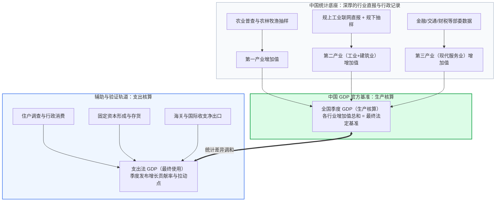
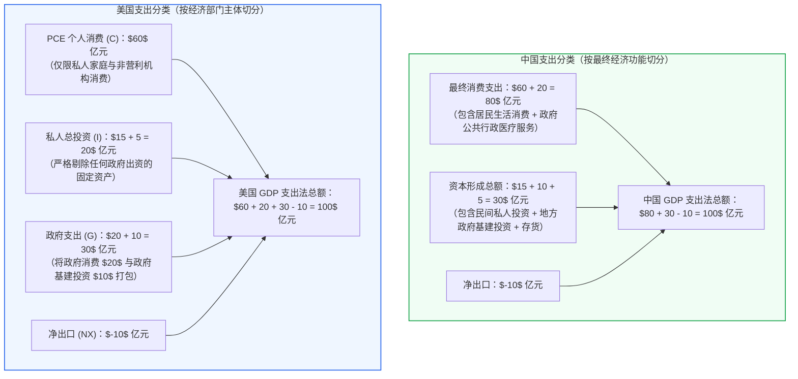
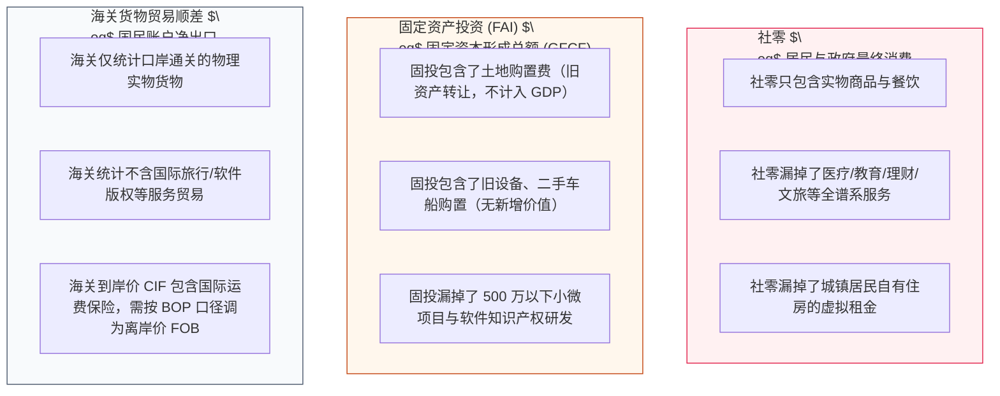
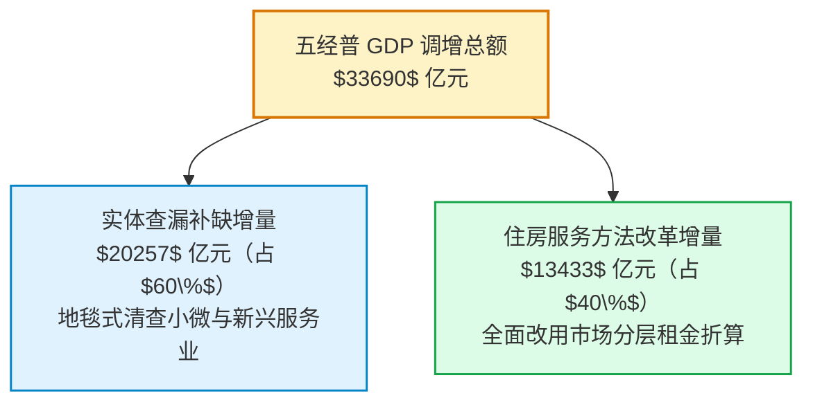

# 05 中国GDP：生产核算、支出桥接与住房服务改革

[上一章：发布与版本](04-releases-and-vintages.md) · [目录](./) · [下一章：消费与收入](06-consumption.md)

> 中国篇深度升级版 · 2026-10。本书以美国篇为前置理论基础。历史数据与制度规程均严格依据国家统计局官方核算方案；核算示例与推导过程遵循联合国国民账户体系（SNA 2008）。

**前置阅读：**美国篇[04 GDP与增长来源](https://fangpings.github.io/us-econ/04-gdp.html)。在阅读本章前，你应已深刻理解增加值（Value Added）、中间消耗扣除、库存变动以及名义量与不变价实际量的基本核算原理。本章的核心任务，是带你理解中国 GDP 为何以**生产核算**为法定基准、厘清月度“三驾马车”与年度支出法 GDP 的真实桥接关系、掌握中美支出分类的分组差异，并看懂中国**城镇居民自有住房服务虚拟租金改革**的深远影响。

---

## 1. 为什么中国季报总是先讲“第一、二、三产业”

打开美国经济分析局（BEA）的季度 GDP 新闻稿，第一段扑面而来的是对最终需求端的拆解：“个人消费支出（PCE）拉动了 $X$ 个百分点，私人设备投资拖累了 $Y$ 个百分点……”

然而，当你打开中国国家统计局的季度 GDP 发布会通稿时，版面结构却截然不同：
> “初步核算，一季度国内生产总值同比增长 $5.3\%$。分产业看：第一产业增加值同比增长 $3.3\%$；第二产业增加值增长 $6.0\%$；第三产业增加值增长 $5.0\%$。分行业看：信息传输、软件和信息技术服务业增加值增长 $13.7\%$，工业增加值增长 $6.0\%$，金融业增长 $5.2\%$……”

许多初学者会产生疑问：“中国是不是只算生产端，不算消费和投资？为什么中美两国公布 GDP 的第一视角完全不同？”

这并不是经济学理论的分歧，而是**统计数据生产基础的客观现实决定的**：

1. **生产核算（生产法与收入法）是中国 GDP 的法定准绳**：
   国家统计局在《国内生产总值核算概述》中明确界定：中国以**生产核算数据作为 GDP 的最终权威法定读数**。中国自计划经济时期的物质产品平衡表体系（MPS）向现代国民账户体系（SNA）转型过程中，沉淀了庞大而完备的工农业实物产量统计、行业企业财务报表以及部委行政记录。因此，从生产端各行业汇集增加值，数据源最直接、覆盖最完备。
2. **支出法核算同步开展，侧重分析增长动能**：
   国家统计局同样按季度测算支出法 GDP（最终消费支出、资本形成总额、货物和服务净出口），并在发布会上以“三大需求对经济增长的贡献率与拉动百分点”的形式对社会发布。两者在理论上应当严格相等，在实践中存在的微小核算差额，通过国际通行的统计误差项予以调和。

---

## 2. 从行业报表到季度 GDP：三层推算链条

许多人误以为：“工业企业报上来的营业总收入，直接加在一起就是工业增加值。”
这种想法忽视了 GDP 最核心的经济学定义：**增加值 = 总产出 - 中间消耗**。如果一家汽车厂卖出 10 万元的汽车，其中消耗了 7 万元采购自其他钢厂的钢板和轮胎，那么该车厂为 GDP 贡献的新增价值仅仅是 3 万元，绝不能把 10 万元全额算作 GDP。

在季度核算的实操中，统计局通常经历以下三层精密推算：

### 教学推导：某服务行业的单季核算演练

假设某现代信息服务行业在上年同期的现价增加值基数为 $\$100\$$ 亿元：
- **步骤一（进度指标外推）**：本季度该行业月度营业收入快报显示同比增长 $8.0\%$。在增加值率相对稳定的假设下，推算本期现价增加值估计为：
  $$Y_{nom, t} = 100 \times (1 + 0.08) = 108 \text{ 亿元}$$
- **步骤二（价格平减剔除）**：根据该行业对应的软件与技术服务价格平减指数，测得当期产出价格相比上年同期上涨了 $2.0\%$（即价格平减缩减指数为 $1.02$）。
- **步骤三（测算可比价实际增加值）**：
  $$Y_{real, t} = \frac{Y_{nom, t}}{P_t} = \frac{108}{1.02} \approx 105.88 \text{ 亿元}$$
- **步骤四（得出不变价实际增速）**：
  $$g_{real} = \frac{105.88 - 100}{100} \approx +5.88\%$$

> **专业研读警示**：
> 这个教学算例揭示了季度核算推算的三个潜在假设条件：
> 1. **外推代理指标的代表性**：月度规上营收指标是否能代表全行业的实际运行？
> 2. **中间消耗比率的稳定性**：如果该行业本期大幅增加了云服务器租赁等外包技术采购，中间消耗比重上升，营业收入的高增就不能线性转化为同比例的增加值高增；
> 3. **平减指数的适配性**：如果统计部门缺少该行业的细分产出价格指数，不得不借用整体服务业 CPI 进行替代平减，就会引入价格扭曲偏差。

---

## 3. 中美支出法的大差异：相同的蛋糕，不同的切法

在中美宏观对话中，最具破坏性的误解莫过于将两国的支出法项目混淆。
很多人看过一句名言：“中国最终消费占 GDP 比重只有 $50\%$ 多，而美国消费占比高达近 $70\%$，这证明中国经济完全不靠消费，全靠政府挥霍投资。”

得出这种荒谬结论的人，根本没有读懂**中美两国国民账户在支出分类（Accounting Classification）上的重大构造差异**！

让我们用一个完全可加、总规模为 $\$100\$$ 亿元的教学经济体，彻底拆解这一账本切法：

| 现实中的最终使用活动 | 交易金额 | **中国 SNA 支出法分组** | **美国 BEA NIPA 支出法分组** |
| :--- | :---: | :--- | :--- |
| **居民个人衣食住行消费** | $\$60\$$ 亿 | **最终消费支出**（居民消费） | **Personal Consumption Expenditures (C)** |
| **政府日常公共服务消费** | $\$20\$$ 亿 | **最终消费支出**（政府消费） | **Government Expenditures (G)** |
| **企业购置机器设备与厂房** | $\$15\$$ 亿 | **资本形成总额**（固定资本形成） | **Gross Private Domestic Investment (I)** |
| **政府出资建设公立医院与公路** | $\$10\$$ 亿 | **资本形成总额**（固定资本形成） | **Government Expenditures (G)** |
| **企业仓库新增存货变动** | $\$5\$$ 亿 | **资本形成总额**（存货增加） | **Gross Private Domestic Investment (I)** |
| **货物和服务贸易净出口** | $-\$10\$$ 亿 | **货物和服务净出口** | **Net Exports of Goods and Services (NX)** |

### 两种切法对比带来的惊人启示

1. **政府投资去了哪里？**
   在上述标准案例中，政府出资 $\$10\$$ 亿元建设的高铁与学校：
   - 在中国体系中，被归入了**“资本形成总额”**；
   - 在美国体系中，被归入了**“政府支出（G）”**，完全不进入美国的私人投资（I）。
   因此，中国统计中的“资本形成总额”（$\$30\$$ 亿）天生就比美国的“国内私人投资总额”（$\$20\$$ 亿）多出了整整一个“政府基建投资”的维度！如果你直接拿中国的投资率去和美国的私人投资率硬比，就会把两国的分类定义差异误判为所谓的过度投资。
2. **总额完全守恒**：
   无论按哪种切法，全社会的最终总产出都是严格恒等的 $\$100\$$ 亿元：
   $$\text{中国} = 80 (\text{消费}) + 30 (\text{资本}) - 10 (\text{净出口}) = 100$$
   $$\text{美国} = 60 (C) + 20 (I) + 30 (G) - 10 (NX) = 100$$
   分类的改变绝不会凭空创造或消灭一分钱的 GDP 产出。

---

## 4. 破除常见迷思：为什么“社零＋固投＋海关进出口顺差”绝不是中国 GDP

在许多网络财经自媒体甚至低劣的研报中，经常看到这种荒唐的公式：
> “把每个月的社零总额加起来，再加上全年的固定资产投资完成额，再加上海关总署公布的外贸顺差，这不就是中国 GDP 的三驾马车总额吗？”

如果你在正规宏观机构敢这么算，会被直接当场劝退。这三个月度指标与真正的支出法 GDP 之间，隔着巨大的不可逾越的口径鸿沟：

1. **社零 $\neq$ 最终消费支出**：
   社零仅仅测量批发、零售与餐饮企业销售的实物商品；而全社会最终消费支出中，超过 $40\%$ 是医疗健康、学杂教育、体育娱乐、家庭家政等**非实物服务消费**，并且还包含庞大的公立机构非市场公共服务与居民自有住房虚拟租金。
2. **固投（FAI）$\neq$ 固定资本形成总额（GFCF）**：
   中国月度发布的固定资产投资（FAI）是一个项目投资工程账概念，其中包含着极其庞大的**土地购置费（占地产开发投资比重常年超 $30\%$）**。土地是大自然赋予的稀缺自然资源，土地买卖仅仅是资产所有权的货币转移，并没有新生产出任何一砖一瓦的资本品，在国民核算中被一票否决、严格剔除！同时，固投还剔除旧厂房设备转让，并补入企业研发支出（R&D）等知识产权资本。
3. **海关口岸差额 $\neq$ 国际收支净出口**：
   海关快讯统计的是跨越中国海关边境的物理集装箱货物；而 GDP 净出口必须包含中国公民在海外留学的学费支出、国际知识产权版税等服务贸易，并严格转换为国际收支平衡表（BOP）的离岸价格（FOB）口径。

---

## 5. 制度重大突破：中国城镇居民自有住房服务核算改革

在国民经济核算史上，有一项极其关键却鲜为大众所知的重大改革：**自有住房服务核算方法改革**。

### 5.1 虚拟租金的经济学逻辑

假设你手头有 $\$300\$$ 万元现金：
- **情景 A**：你把钱存入银行，在小区租了一套两居室，每月支付租金 $\$6000\$$ 元。这一过程显性地创造了每月 $\$6000\$$ 元的租赁服务产出，计入 GDP 消费；
- **情景 B**：你用这 $\$300\$$ 万元全款买下了这套两居室自己居住。此时你不再给任何房东转账付租金。

从物理现实看，你享用着完全相同的遮风挡雨、居住安居的居住服务；但如果你不付租金，GDP 就会凭空蒸发掉每年 $\$7.2\$$ 万元的产出。为了保持不同住房自有率国家之间宏观经济的可比性，联合国 SNA 准则强制要求各国对“居民自有住房”进行**虚拟租金（Imputed Rent）核算**——假设你自己扮演房东，把房子租给自己住，给自己付了一笔虚拟租金，算作当期的 GDP 消费产出。

### 5.2 从“成本折旧法”迈向“市场租金折算法”

在 2024 年底之前，中国国家统计局对城镇居民自有住房长期采用**历史成本折旧法（Cost Depreciation Approach）**，即仅按房屋原始建造成本的一定折旧率（如 $2\%-3\%$）计算服务价值。
但随着中国城镇化与商品房市场的繁荣，一套 20 年前造价仅 10 万元的老房子，其市场租金可能已经高达每月数千元。如果依然按几十年前的微薄造价折旧，严重低估了中国城镇住房资产所释放的真实经济福利。

在第五次全国经济普查（基准年 2023 年）中，国家统计局正式启动了历史性并轨改革：
根据 2024 年 12 月 27 日国家统计局发布的《关于 2023 年国内生产总值最终核实的公告》：
- 2023 年全国 GDP 现价总量最终核实为 $\$129.4\$$ 万亿元，比初步核算数**大幅调增了 $\$33690\$$ 亿元**（调增幅度达 $2.7\%$）；
- 统计局在公报中极其罕见地对增量进行了精确来源拆分：
  $$\text{普查资料查实增量} = 20257 \text{ 亿元}$$
  $$\text{城镇居民自有住房服务核算改革增量} = 13433 \text{ 亿元}$$
  两者完美求和：$\$20257 + 13433 = 33690\$$ 亿元！

这一改革让中国 GDP 中的居民消费与第三产业增加值规模更加贴近国际主流标准。但你必须深刻理解：**房子本身的钢筋水泥没有变，老百姓银行卡里的可支配现金也没有凭空多出一分钱，这纯属国民账户统计度量尺度的优化升级。**

---

## 6. 统一核算下的地区生产总值：为什么不能把地方增速取算术平均

过去，各省公布的“地方生产总值（地区 GDP）”相加，往往显著高于国家统计局公布的“全国 GDP”，民间戏称为“统计注水”或“地方虚高”。

产生这一现象的技术根源在于：过去各省统计局独立核算本辖区数据，跨省企业的重复计算、物流货运的双向多报以及地方保护主义层层加码导致了数据汇总重叠。

为了彻底解决这一顽疾，中国自 2019 年起正式实施**地区生产总值统一核算改革**：
- 各省不再自核自报，改由国家统计局统一组织领导、统一核算方法、统一工作流程，由国家工作组集中调取数据统一生成各省 GDP。

### 为什么各省增速不能简单平均

设某国仅有两个省份，基期产出与报告期实际增速如下：
- A 省（东部沿海经济大省）：基期实际产出为 $\$900\$$ 亿元，本期实际增长率仅为 $2.0\%$；
- B 省（西部资源小省）：基期实际产出仅为 $\$100\$$ 亿元，由于大型风光基地并网，本期实际增长率高达 $10.0\%$。

如果不加权直接求算术平均：
$$\text{算术平均增速} = \frac{10\% + 2\%}{2} = 6.0\%$$
这是完全荒谬的！正确的全国加权真实增长率为：
$$g_{total} = \frac{100 \times 10\% + 900 \times 2\%}{100 + 900} = \frac{10 + 18}{1000} = +2.8\%$$
全国加权增速仅为 **$2.8\%$**，与算术平均的 $6.0\%$ 天差地别。在宏观分析中，时刻要用经济总量的体量权重说话，绝不可将省级新闻标题的百分比随意拼凑平均。

---

## 7. 真实官方资料带读：增长贡献率 vs 水平构成占比

请看国家统计局在 2025 年 1 月 17 日新闻发布会上公布的 2024 年经济增长核心成果：

| 最终使用分项需求 | 对实际 GDP 增长的**贡献率** | **拉动**不变价 GDP 增长 |
| :--- | :---: | :---: |
| **最终消费支出** | $44.5\%$ | $2.2$ 个百分点 |
| **资本形成总额** | $25.2\%$ | $1.3$ 个百分点 |
| **货物和服务净出口** | $30.3\%$ | $1.5$ 个百分点 |
| **合计** | **$100.0\%$** | **$5.0$ 个百分点** |

### 核心定义辨析：三道数学防线

1. **贡献率合计必须恒等于 $100\%$**：
   $$44.5\% + 25.2\% + 30.3\% = 100.0\%$$
   贡献率衡量的是**当期全国实际 GDP 新增增量中，究竟有几成是由该需求拉动的**：
   $$\text{贡献率}_k = \frac{\Delta Y_{real, k}}{\Delta Y_{real, total}} \times 100\%$$
2. **拉动百分点 = 贡献率 $\times$ 全年 GDP 实际增速**：
   消费对经济增长的拉动百分点为：
   $$\text{拉动点} = 44.5\% \times 5.0\% = 2.225\% \approx 2.2 \text{ 个百分点}$$
   三项拉动点相加：$2.2 + 1.3 + 1.5 = 5.0$ 个百分点，完美还原全年 $5.0\%$ 的实际增长率！
3. **“贡献率”绝不等于“水平占比”**：
   “消费对经济增长贡献了 $44.5\%$”，**绝不代表消费占当年 GDP 现价总量的比重是 $44.5\%$**，更不代表居民消费自身增长了 $44.5\%$！它仅仅描述了在 $5.0\%$ 的增量蛋糕中，消费贡献了其中的 $2.2$ 个点。并且，这里的最终消费支出中包含着庞大的政府日常行政与科教文卫公共消费，不能将 $44.5\%$ 全部归功于普通老百姓逛街买奶茶。

---

## 练习：把美国GDP知识应用到中国资料

1. **支出法分组重构**：请参考本章第 3 节的标准案例，用你自己的话解释：为什么在总经济规模完全相同（$\$100\$$ 亿元）的情况下，中国口径下的“资本形成总额”高达 $\$30\$$ 亿元，而美国口径下的私人投资（I）却只有 $\$20\$$ 亿元？
2. **季度行业增加值推演**：某新兴服务行业上年同期现价增加值为 $\$200\$$ 亿元。本季度可用统计代理指标显示其营业收入同比增长 $10.0\%$。统计部门测得该行业的产出价格平减缩减指数相比上年同期上升了 $5.0\%$（即指数为 $1.05$）。
   - （1）在行业增加值率保持稳定的假设下，请计算该行业本季度的不变价实际增长率；
   - （2）如果该行业企业在报告期内大幅增加了对外部算力租赁与算法研发的外包采购，上述推导中的哪个关键假设将被打破？
3. **宏观三驾马车辨析**：某财经自媒体撰文称：“只要把全国全年月度社会消费品零售总额、全国固定资产投资总额与海关货物贸易进出口顺差按现价相加，就能准确复核中国 GDP 的支出法总额。”请列举至少三项严重的统计口径谬误驳斥该文章。
4. **虚拟租金改革核算认知**：某家庭在城市拥有一套完全自主产权的商品房。在第五次全国经济普查实施自有住房服务核算改革后，该房屋为国家 GDP 贡献的虚拟增加值估值大幅增加了 $\$20000\$$ 元。请问：
   - （1）该家庭在当年是否因此新增了可支配现金收入？
   - （2）这是否意味着当期的居民消费价格指数（CPI）必然发生跳涨？
5. **官方普查修订加总验证**：请查阅国家统计局《关于 2023 年国内生产总值最终核实的公告》，验证并列出公报中披露的增量拆分数值，并解释为什么不能把全部调增金额统称为“过去统计遗漏了的企业生产”？
6. **增长贡献率指标解读**：官方发布“2024 年最终消费支出对经济增长的贡献率为 $44.5\%$”。如果某外国记者据此提问：“这是否意味着中国居民家庭消费占 GDP 的比重大约只有四成多？”你应当如何向其专业解释？

参考答案与详细推理

1. **政府投资归类差异解释**：
   - 差异的根源在**政府固定资产投资的归类归属**；
   - 中国核算严格遵循 SNA 功能分类，只要是形成了跨期实物资本品（如地方政府出资建设的高速公路、水利枢纽、市政管网），不论出资主体是民营企业还是各级财政，一律归入“资本形成总额（$\$10\$$ 亿）”；
   - 美国 BEA 体系则按主体部门分类，将所有政府主导的固定资本投资（Gross Government Investment，$\$10\$$ 亿）全额打包进入了“政府消费支出与投资总额（G）”中，其私人投资（I）严格限定于非政府的民间部门；
   - 因此，中国资本形成比美国私人投资多了这 $\$10\$$ 亿元的政府基建投资，但在国民经济全口径汇总下，两国的总盘子完全等价。
2. **行业推导与中间消耗假说**：
   - （1）实际增速计算：
     现价增加值外推估计：$Y_{nom} = 200 \times (1 + 0.10) = 220\$$ 亿元；
     不变价实际增加值：$Y_{real} = \frac{220}{1.05} \approx 209.524\$$ 亿元；
     实际同比增长率：$g_{real} = \frac{209.524 - 200}{200} = \frac{1.10}{1.05} - 1 \approx +4.76\%$；
   - （2）假设失效分析：大幅增加外包采购打破了**“中间消耗率保持不变”**的核心假设。当算力外包等中间投入占比显著激增时，企业营业收入虽然增加了 $10\%$，但扣除外包成本后的真实增加值增速将显著低于 $10\%$，直接导致推算值高估。
3. **三驾马车相加谬误剖析**：
   - **消费维度**：社零仅涵盖实物商品与餐饮销售，漏掉了占现代消费近半壁江山的医疗、教育、金融、文化旅游等全品类非实物服务消费以及自有住房虚拟租金；
   - **投资维度**：固定资产投资包含极其庞大的土地购置费（纯土地所有权资产转让，不产生新增生产价值），将其直接计入 GDP 属于严重虚增；
   - **净出口维度**：海关口岸顺差仅涵盖通关货物实物，遗漏了跨境留学、海外旅游、软件技术版税等国际服务贸易，且未作国际收支平衡表（BOP）离岸价（FOB）平抑调整。
4. **虚拟租金与现实经济运行**：
   - （1）**不能**。虚拟租金核算是国民账户为了度量居住福利所进行的会计推算（Imputation），家庭并没有收到任何银行转账现金流水；
   - （2）**不能**。CPI（消费者价格指数）是国家统计局调查队按月通过实际采集真实租房市场价格（租赁房房租）与居住类建材维护成本编制的物价度量工具，与 GDP 国民账户中宏观核算公式的口径改革属于两套相互独立的统计产品。
5. **官方普查修订与加总验证**：
   - 数据完全吻合：普查资料查实增量 $\$20257\$$ 亿元 + 城镇居民自有住房服务核算方法改革增量 $\$13433\$$ 亿元 = 总修订增量 $\$33690\$$ 亿元；
   - 不能统称为漏统企业产出，因为其中有高达 $\$13433\$$ 亿元（占比近四成）纯属**核算统计评估方法学（Methodology）的主动并轨升级**，属于度量尺度的改进，绝非物理世界上突然凭空多发现了无数家开工工厂。
6. **增长贡献率澄清**：
   - 必须向其指出混淆了“增量贡献率（Contribution to Growth Rate）”与“存量占比（Share of GDP Level）”；
   - $44.5\%$ 仅代表在全年 GDP 实际增长的 $5.0\%$ 增量中，有 $2.2$ 个百分点是由最终消费拉动的（$\frac{2.2}{5.0} = 44.5\%$）；
   - 并且，这 $44.5\%$ 涵盖的是包含政府日常公共行政科教支出的“全口径最终消费支出”，而非单独的居民家庭消费；要回答居民消费占 GDP 总盘子的比重，必须查阅当年现价支出法 GDP 构成表中的“居民最终消费支出 / 现价 GDP 总额”，二者不可混为一谈。

[上一章：发布与版本](04-releases-and-vintages.md) · [目录](./) · [下一章：消费与收入](06-consumption.md)
