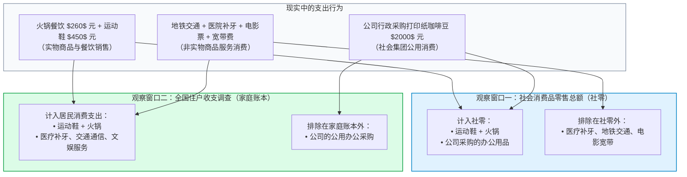
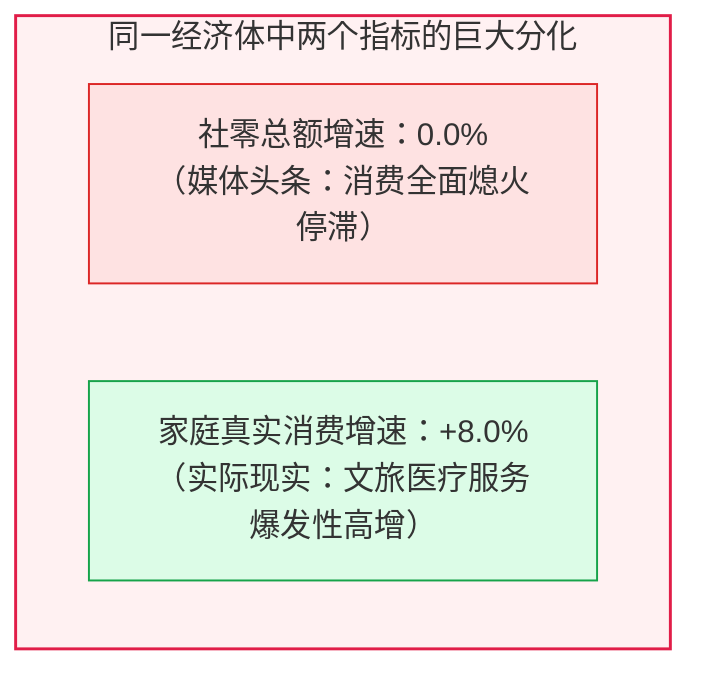
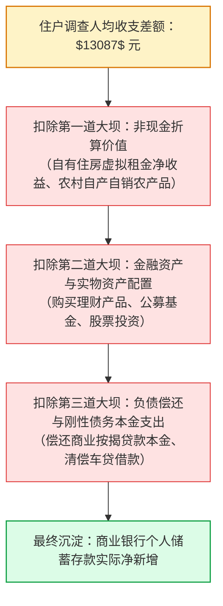

# 06 中国消费与收入：社零、住户调查和PCE怎样对照

[上一章：GDP](05-gdp.md) · [目录](./) · [下一章：就业与工资](07-labor.md)

> 中国篇深度升级版 · 2026-10。本书以美国篇为前置理论基础。微观消费与收支算例均为教学设计；全国住户调查数据严格对应国家统计局官方年度公报。

**前置阅读：**美国篇[05 消费、收入与现金流](https://fangpings.github.io/us-econ/05-consumption.html)。在阅读本章前，你应已掌握储蓄倾向、可支配收入恒等式以及名义与实际平减的基本概念。本章的核心任务，是带你拆解中国宏观消费的**三大观测窗口（商家销售端社零、家庭记账端住户调查、宏观核算端居民最终消费）**，掌握服务消费与非现金收支的边界，并建立严密的中美消费指标对照桥梁。

---

## 1. 都市周末的记账谜题：你的钱究竟流向了哪个指标

让我们跟随一名中国城市年轻人的普通周末，观察他的一连串消费活动：
1. **周五晚上**：在购物中心与朋友聚餐吃火锅，花费 $\$260\$$ 元；随后在品牌专卖店买了一双运动鞋，花费 $\$450\$$ 元；
2. **周六全天**：乘坐地铁去医院补牙，门诊自费刷卡 $\$320\$$ 元；下午在影院看了一场电影，花费 $\$45\$$ 元；晚上在网上交了当月宽带费 $\$100\$$ 元；
3. **周日傍晚**：该年轻人所在公司的行政部门，在大型仓储超市采购了价值 $\$2000\$$ 元的打印纸和咖啡豆，由公司企业账户转账支付，供全体员工下周办公使用。

到了月末，当国家统计局发布宏观消费数据时，这几笔交易分别去了哪里？

这个周末记账案例揭示了一个颠覆常识的宏观统计真相：
- 你自费去医院补牙、坐地铁、看电影的钱，**一分钱都没有算进“社会消费品零售总额（社零）”**！因为社零主要只统计实物商品和餐饮；
- 相反，你公司行政采购打印纸的 $\$2000\$$ 元公款，**却赫然算进了社零总额**！因为社零不仅包含居民个人消费，还包含“社会集团”的非生产性公款采购；
- 只有当你翻开国家统计局抽样调查的《全国住户收支与生活状况调查》时，你的医疗、交通和文娱支出才完整呈现在“人均服务性消费支出”中，而公司的公款采购则被严格剔除。

因此，当你试图分析中国消费时，必须首先搞清楚：**你手里拿的到底是谁的账本？**

---

## 2. 宏观三重视角：中国三套消费数据的本质区别

为了不在各种统计指标之间迷失，我们必须在脑海中建立三套完全独立的宏观观测窗口：

| 观测窗口 | 核心代表指标 | 数据来源与生产方式 | 核心覆盖范围与边界 |
| :--- | :--- | :--- | :--- |
| **一、商家销售端** （商业景气度） | **社会消费品零售总额** （月度发布） | 批发零售业与餐饮业联网直报 $+$ 规下抽样调查 | **优点**：月度高频、时效极强； **局限**：只含实物商品与餐饮，**漏掉全谱系非餐饮服务**，且含社会集团公费消费。 |
| **二、住户账本端** （民生福利分布） | **全国居民人均消费支出** （季度/年度发布） | 垂直管理的国家统计局调查总队，全国抽样 16 万户居民日记账 | **优点**：商品与服务全覆盖，包含非现金折算，提供城乡中位数； **局限**：按季发布，缺乏分品类月度高频颗粒度。 |
| **三、国民核算端** （宏观 GDP 需求） | **支出法 GDP：居民最终消费支出** （年度/季度发布） | 综合利用商贸统计、住户调查、财政社保及行业行政记录核算 | **优点**：国民经济核算闭环，包含自有住房虚拟租金、金融间接服务（FISIM）及政府对居民的实物转移。 |

---

## 3. 中美指标功能对照：避免“关公战秦琼”

许多宏观分析报告常常直接把中国公布的“月度社零增速”去和美国公布的“BEA 个人消费支出（PCE）物价指数或实际 PCE 增速”并排对比。这种对比在方法学上是完全不及格的。

| 研究问题与分析需求 | 中国最佳匹配入口 | 美国功能等价入口 | 跨国对比时必须完成的口径桥接 |
| :--- | :--- | :--- | :--- |
| **商贸零售与餐饮企业的月度销售景气** | **社会消费品零售总额（社零）** （国家统计局月报） | **Advance Monthly Retail & Food Services** （美国 Census 普查局月度零售报告） | 严格对齐零售行业分类标准（NAICS vs 中国国民经济行业分类），注意两者均不包含医疗/教育等综合服务 |
| **居民微观收入、支出结构与阶层分布** | **全国住户收支与生活状况调查** （住户调查司按季公布） | **Consumer Expenditure Surveys (CE)** （美国劳工统计局 BLS 家庭消费调查） | 对齐调查口径（“人均” vs “每户/Household”）、税前总收入与可支配收入的抵扣规则、现金与实物折算的包含范围 |
| **宏观总需求中居民消费的整体贡献** | **支出法 GDP 中的居民最终消费支出** （核算司按季发布拉动点） | **Personal Consumption Expenditures (PCE)** （美国 BEA 经济分析局 NIPA 消费组件） | 统一自有住房服务折算规则（租金等价法 vs 历史成本折旧法）、第三方代付医疗与社保救济实物转移的核算口径 |

---

## 4. 数学辨析：为什么不能单看商品社零就判定消费萎缩

让我们用一组标准的微观消费篮子教学数据，进行严格的数学推演：

> **消费结构分化教学案例**：
> 假设全社会由代表性家庭群体构成。
> - **基期**：家庭购买实物商品与餐饮支出 $\$60\$$ 亿元，医疗、旅游、文娱等其他服务消费支出 $\$40\$$ 亿元；社会集团公款采购商品 $\$20\$$ 亿元。
> - **报告期**：由于居民消费偏好转向体验型文旅与健康养生，实物商品与餐饮支出保持 $\$60\$$ 亿元不变，其他服务消费大幅增长至 $\$48\$$ 亿元；社会集团公款采购受财政纪律约束压缩至 $\$20\$$ 亿元。
> （注：假设价格水平不变，均为不变价实物量。）

让我们分别计算两个指标的读数：

1. **计算销售端社零型合计**：
   $$\text{基期社零} = 60 (\text{家庭商品餐饮}) + 20 (\text{社会集团商品}) = 80 \text{ 亿元}$$
   $$\text{报告期社零} = 60 + 20 = 80 \text{ 亿元}$$
   $$\text{社零同比增速} = \frac{80 - 80}{80} = 0.0\%$$
2. **计算家庭真实消费总支出**：
   $$\text{基期家庭消费} = 60 (\text{商品餐饮}) + 40 (\text{其他服务}) = 100 \text{ 亿元}$$
   $$\text{报告期家庭消费} = 60 + 48 = 108 \text{ 亿元}$$
   $$\text{家庭真实消费增速} = \frac{108 - 100}{100} = +8.0\%$$

看到了吗？如果一个研究员只看每月发布的月度社零快讯，他会在报告中写出耸人听闻的标题：“全社会消费增长彻底失速，增速仅有 $0\%$！”
但实际上，居民的真实总生活消费支出实现了高达 **$+8.0\%$** 的强劲增长！仅仅是因为高增的部分全部发生在了社零统计窗口之外的教育、文旅、体育、家政和健康服务领域。这种结构性转移（Goods-to-Services Shift）是中高收入经济体在发展过程中的普遍规律。

---

## 5. 住户调查的微观机器：16 万户家庭是怎样记账的

国家统计局公布的“居民人均可支配收入”和“人均消费支出”，并不是通过向企业发问卷估算出来的，而是由国家统计局直属的**各省、市、县调查队**通过**全国住户收支与生活状况调查**实地采集出来的。

### 5.1 调查体系运行规程

- **样本规模**：全国统一按分层、多阶段、随机概率比例抽样（PPS），抽中涵盖 31 个省份、千余个县区、数千个城乡社区的 **$16$ 万户代表性常住居民家庭**；
- **记账方式**：抽中家庭的记账人每天在智能手机“住户调查 E 记账”APP 上实时逐笔记账（从买一把小葱花了几元钱，到领到季度绩效奖金，逐笔记录收入来源与支出品类）；对于老年及不便使用手机的家庭，保留纸质日记账本，由专职辅助调查员定期上门核查编码；
- **样本轮换**：为防止固定样本老化产生的代表性偏差，住户调查每五年进行一次大样本大轮换，每年进行周期性小样本轮换。

### 5.2 2013 年城乡一体化住户调查改革断点

在查阅中国长期历史收入序列时，必须注意一个重大的**制度历史断点：2012 / 2013 年**。
- **2012 年及以前**：中国实行城乡分割的双轨调查制度。城市由城镇调查队开展“城镇居民人均可支配收入”调查；农村由农村调查队开展“农村居民人均纯收入”调查。两套问卷指标体系不同，“纯收入”包含了农村家庭生产经营的毛收入扣除成本，与城镇的“可支配收入”口径不可比，当时并没有统一发布的“全国居民人均可支配收入”。
- **2013 年及以后**：国家统计局启动了**城乡一体化住户收支调查改革**，统一了城乡居民收入指标定义、统一了抽样调查方案、统一了记账与审核标准，正式开始发布全国统筹的“全国居民人均可支配收入”。

在构建计量长时序时，绝不能把 2012 年以前的老“农村纯收入”简单拼接在 2013 年后的“农村可支配收入”之上，必须明确标注这一制度断点。

---

## 6. 会计防线：为什么不能把住户调查收支差额当成银行存款

在国家统计局公布年度居民收支数据后，经常看到财经自媒体做这样的计算：
> “2024 年全国居民人均可支配收入 $\$41314\$$ 元，人均消费支出 $\$28227\$$ 元。两者相减，每人多出 $\$13087\$$ 元！中国 14 亿人口，一年平白多出了近 18 万亿的储蓄资金，全存在银行吃利息！”

这种算账方式混淆了**统计调查账户的虚拟平衡与资产负债表的现金存量**。

### 阻隔在“收支余额”与“银行存款”之间的三道大坝

让我们来看一个具体的微观家庭收支账：
> **张家庭的年度现金与非现金账本**：
> 1. 工资与经营现金收入 $\$20\$$ 万元；
> 2. 拥有一套自住住宅，住户调查按租金折算其享受的非现金住房服务收入与消费各 $\$3\$$ 万元；
> 3. 日常生活现金消费支出 $\$15\$$ 万元；
> 4. 本年向建设银行按期偿还住房按揭贷款本金 $\$5\$$ 万元。

- **住户调查视角的纸面收支**：
  $$\text{调查口径总收入} = 20 (\text{现金}) + 3 (\text{非现金}) = 23 \text{ 万元}$$
  $$\text{调查口径总消费} = 15 (\text{现金}) + 3 (\text{非现金}) = 18 \text{ 万元}$$
  $$\text{调查口径结余差额} = 23 - 18 = +5 \text{ 万元}$$
- **银行账户视角的真实真金白银现金流**：
  $$\text{当年现金流入} = 20 \text{ 万元}$$
  $$\text{当年现金流出} = 15 (\text{消费支出}) + 5 (\text{还房贷本金}) = 20 \text{ 万元}$$
  $$\text{现金存款净增加} = 20 - 20 = 0 \text{ 万元}$$

看清楚了吗？尽管住户调查账本上赫然记着 $\$5\$$ 万元的年度“盈余”，但张先生一家在银行的存款在这一年里**净增加正好是 0 元**！因为这 $\$5\$$ 万元结余全部被用来偿还了银行的按揭贷款本金，转化为了家庭对房屋净资产权益的积累，根本没有变成银行卡里的闲钱存款。

---

## 7. 真实官方数据带读：2024 年中国居民真实账本

现在，让我们翻开国家统计局于 2025 年 1 月 17 日发布的[《2024 年居民收入和消费支出情况》权威公报](https://www.stats.gov.cn/sj/zxfb/202501/t20250117_1958325.html)，对全国核心指标进行逐项解剖：

| 核心指标名称 | 2024 年全国均值 | 名义同比增长率 | 扣除物价后实际增速 | 核心研读内涵与关注要点 |
| :--- | :---: | :---: | :---: | :--- |
| **全国居民人均可支配收入** | $\$41314\$$ 元/年 | $+5.4\%$ | $+5.3\%$ | 对应**全体常住人口全年人均水平**（折合月均约 $\$3443\$$ 元/人） |
| **全国居民人均收入中位数** | $\$34707\$$ 元/年 | $+4.7\%$ | — | 中位数与平均数比值为 $\frac{34707}{41314} \approx 84.0\%$，折射收入分布右偏 |
| **全国居民人均消费支出** | $\$28227\$$ 元/年 | $+5.5\%$ | $+5.3\%$ | 全年人均日常生活开支，实际增速与可支配收入实际增速（$5.3\%$）完全同步 |
| **服务性消费支出占比** | $45.6\%$ | — | — | 占人均消费近半壁江山，体现消费结构向服务化持续升级 |

### 专业分析师的四步交叉检验法

当面对这份公报时，合格的宏观研读应当遵循以下四步：
1. **单位与时间窗核验**：牢记这里的单位是**“元/人/年”**。如果你把 $\$41314\$$ 元误当成白领每个月的工资，就会得出“全国收入暴涨”的荒唐笑话。
2. **均值与中位数差距检视**：中位数（$\$34707\$$ 元）明显低于平均数（$\$41314\$$ 元），中位数与平均数的比率为 $84.0\%$。这表明收入分布存在长尾效应，少数高收入人群拉高了算术平均线。在评估大众普遍消费倾向时，中位数具有更高的现实代表性。
3. **城乡剪刀差检视**：城镇居民人均可支配收入为 $\$54153\$$ 元，农村居民为 $\$23298\$$ 元，城乡收入比约为 $2.32:1$。虽然农村收入增速（实际 $+6.3\%$）快于城镇（实际 $+4.4\%$），但绝对水平差额依然显著。
4. **与月度社零交叉印证**：如果某季度居民人均消费支出中“服务性消费占比上升至 $45.6\%$ 且增速高企”，而同期的“实物商品社零总额增速偏弱”，这并不意味着消费总引擎熄火，而是提示我们**消费动能正在发生结构性迁徙**。

---

## 练习：搭建消费口径桥

1. **多重口径加总计算**：某地区在某报告期内发生以下消费活动：居民家庭购买实物商品 $\$50\$$ 亿元、外出餐饮消费 $\$10\$$ 亿元、医疗与教育等其他非餐饮服务支出 $\$40\$$ 亿元；各级政府与机关事业单位公款采购办公设备与生活用品 $\$20\$$ 亿元。忽略其他未列杂项。
   - （1）请计算该地区的“社会消费品零售总额型”指标合计；
   - （2）请计算该地区的“居民家庭真实消费支出”总额；
   - （3）两者的差额是多少？这是否属于统计差错？
2. **结构分化动态演变**：承接上题，假设在下一报告期内，居民由于健康意识提升，医疗与文娱服务支出由 $\$40\$$ 亿元激增至 $\$50\$$ 亿元，其余所有商品、餐饮和公费采购项目金额均保持原值完全不变。
   - （1）请分别计算该期居民家庭真实消费支出的同比增长率，以及社零总额的同比增长率；
   - （2）如果财经媒体仅根据社零指标报道“该市消费增长彻底停滞为 $0\%$”，请指出该报道的致命漏洞。
3. **网购统计范围辨析**：某电商巨头在双十一大促后公布：“全国网上零售额突破 15 万亿元！”某投资者便在计算器上把这 15 万亿直接加到了国家统计局公布的 40 万亿社零总额上，宣称“全社会真实零售已经达到 55 万亿元”。请说明该投资者的加总错误。
4. **户籍与常住人口偏差**：国家统计局公布“农村进城务工人员（农民工）月均收入同比增长 $6.0\%$”。请问：这是否能直接等同于“全国农村居民人均可支配收入也同比增长了 $6.0\%$”？请从常住地与统计人口归属角度指出差异。
5. **现金与资产账本综合演练**：某居民家庭在调查期内取得工资等现金收入 $\$20\$$ 万元，农村自产蔬菜自食折算收入 $\$3\$$ 万元；发生食品日常现金消费 $\$15\$$ 万元，对应自产蔬菜消费记账 $\$3\$$ 万元；期内使用银行转账偿还买房按揭贷款本金 $\$5\$$ 万元。
   - （1）请计算住户调查口径下该家庭的年度收支结余差额；
   - （2）在忽略其他借贷交易的情况下，该家庭在商业银行的存款账户本年净变动额是多少？请解释两者差异的经济实质。
6. **中美中位数口径比较陷阱**：中国国家统计局公布的 2024 年全国居民可支配收入中位数为 $\$34707\$$ 元人民币；美国 Census 公布的 2023 年美国家庭收入中位数（Median Household Income）约为 $\$80610\$$ 美元。如果某自媒体直接拿两数相除并乘以汇率得出差距倍数，请指出该比较在**统计观察单位（Unit of Analysis）**与**税收抵扣口径**上存在的两处严重缺陷。

参考答案与详细推理

1. **三维口径测算与差额本质**：
   - （1）**社零型合计**：涵盖商品销售与餐饮活动（包含个人及社会集团），即：
     $$\text{社零} = 50 (\text{家庭商品}) + 10 (\text{餐饮}) + 20 (\text{机关公费商品}) = 80 \text{ 亿元}$$
   - （2）**居民家庭真实消费**：仅涵盖居民个人的商品、餐饮与全品类服务支出，剔除公费采购，即：
     $$\text{家庭消费} = 50 (\text{家庭商品}) + 10 (\text{餐饮}) + 40 (\text{其他服务}) = 100 \text{ 亿元}$$
   - （3）两者差额为：$100 - 80 = 20$ 亿元。**这绝非统计差错**，而是两者统计边界的内在交叉差异所致：家庭消费包含了社零漏掉的 $\$40\$$ 亿元服务，但社零包含了家庭账本所没有的 $\$20\$$ 亿元社会集团公款采购（$-40 + 20 = -20\$$ 亿）。
2. **动态演变与媒体误导**：
   - （1）家庭真实消费由 $\$100\$$ 亿上升为 $50 + 10 + 50 = 110\$$ 亿元，同比增长率达：
     $$\frac{110 - 100}{100} = +10.0\%$$
     社零型合计中，商品（$\$50\$$ 亿）、餐饮（$\$10\$$ 亿）、公费（$\$20\$$ 亿）均未发生变化，总额仍为 $\$80\$$ 亿元，同比增长率为 **$0.0\%$**；
   - （2）媒体报道的致命漏洞在于**“以偏概全”**：误把局限于商品销售的商业报表（社零）等同于全社会消费福利的全部。忽视了在消费升级驱动下，居民资金大规模向健康医疗、文体旅游等现代服务业转移的客观事实。
3. **网上零售额的重叠与加总谬误**：
   - “网上零售额”是**按零售渠道划分**的统计口径；
   - 其中的**实物商品网上零售额**（占网零比重约八成），在发生交易时已经由电商平台作为零售企业逐月申报，**完全包含在国家统计局公布的社会消费品零售总额之内**；
   - 直接把 15 万亿加在 40 万亿上，构成了严重的“重复计算”，荒谬地把线上卖出的手机家电算了两次。
4. **农民工收入与农村收支的统计偏差**：
   - **不能等同**；
   - **统计常住地归属不同**：根据国家调查队规则，在城镇居住半年以上的进城务工农民工，其常住地已被统计划入“城镇常住人口总体”，其收入记录反映在城镇劳动力统计中；
   - **统计分母与收入构成不同**：留在农村的常住人口中老年人、留守妇女与儿童比例较高，除了务工工资外，其收入还高度依赖农业家庭经营净收入以及转移性养老补贴；外出农民工汇款回乡属于家庭转移支付，不能把单一外出务工者的工资涨幅线性外推为留守农村总体的收入增幅。
5. **现金流量与调查盈余的多维度核算**：
   - （1）**住户调查口径结余**：
     $$\text{调查收入} = 20 (\text{现金}) + 3 (\text{实物折算}) = 23 \text{ 万元}$$
     $$\text{调查消费} = 15 (\text{现金}) + 3 (\text{实物折算}) = 18 \text{ 万元}$$
     $$\text{调查结余差额} = 23 - 18 = +5 \text{ 万元}$$
   - （2）**银行存款净变动**：
     $$\text{现金净流入} = 20 \text{ 万元}$$
     $$\text{现金支出} = 15 (\text{消费支出}) + 5 (\text{偿还房贷本金}) = 20 \text{ 万元}$$
     $$\text{银行存款净增} = 20 - 20 = 0 \text{ 万元}$$
   - **实质解释**：调查账本上的结余差额反映的是本年度未被日常生活消费耗尽的财富净积累；但在资金配置上，家庭将全部现金结余（$\$5\$$ 万元）用于归还银行按揭贷款本金（负债端缩减），转化成了住房资产所有权权益，并没有以高流动性的货币资金沉淀在银行存款账户中。
6. **中美中位数比较的严重缺陷**：
   - **缺陷一：统计观察单位（Unit）严重错位**。中国公布的 $\$34707\$$ 元是**“人均（Per Capita）”**中位数（全体男女老幼总人口平摊）；而美国 Census 发布的 $\$80610\$$ 美元是**“家庭户（Household）”**中位数（平均一户通常涵盖 2 至 3 口人）。如果直接对比，相当于拿中国的一个人去比美国的一整个家庭；
   - **缺陷二：税收与社会转移抵扣口径不同**。美国 Census 的家庭收入中位数通常是**税前货币收入（Money Income before Taxes）**，尚未扣除高额的联邦及州个人所得税、社保税（FICA），且不包含食品券等非现金政府转移；而中国统计局公布的是扣除了个税与社保个人缴费后的**“可支配收入（Disposable Income）”**。

[上一章：GDP](05-gdp.md) · [目录](./) · [下一章：就业与工资](07-labor.md)
