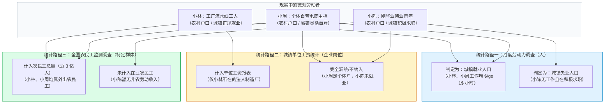
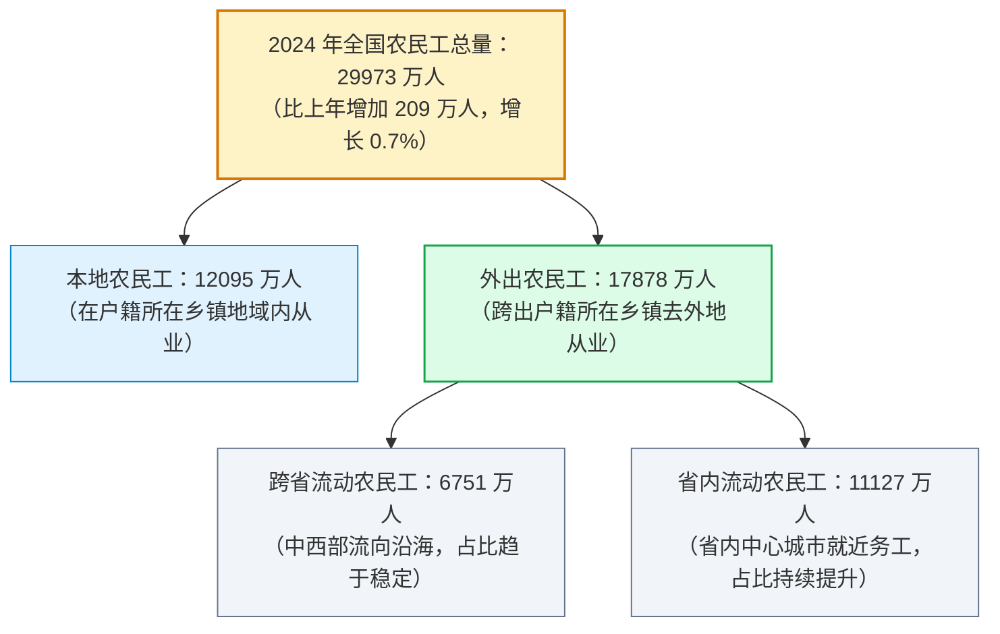
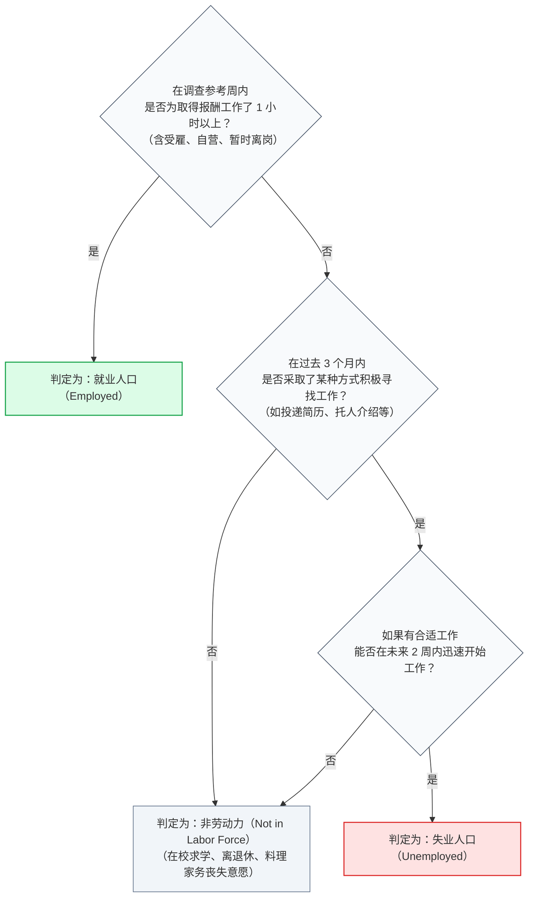
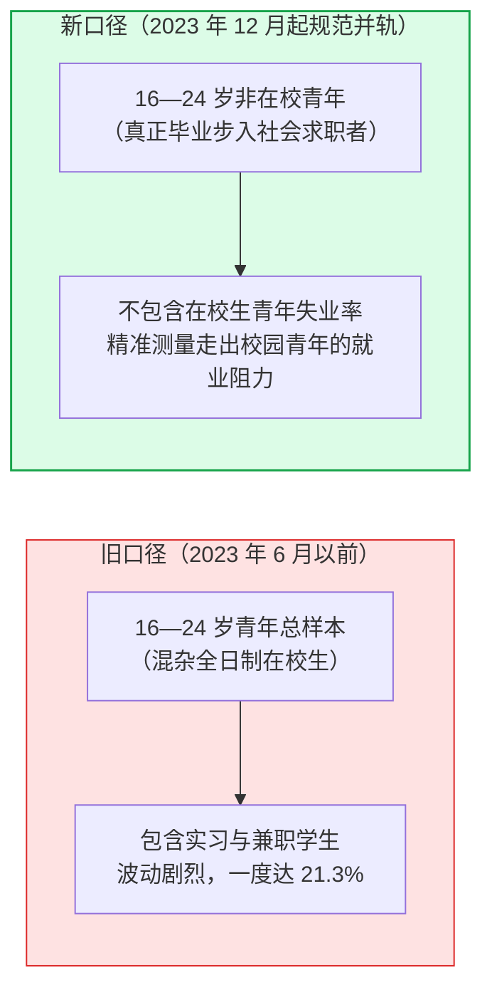

# 07 中国劳动力市场：城镇、户籍、农民工与单位工资

[上一章：消费与收入](06-consumption.md) · [目录](./) · [下一章：工业与服务业](08-production.md)

> 中国篇深度升级版 · 2026-10。本书以美国篇为前置理论基础。劳动力流动与就业案例均为教学设计；失业率调查规则与农民工数据严格依据国家统计局官方制度方案。

**前置阅读：**美国篇[06 就业、失业与工资](https://fangpings.github.io/us-econ/06-labor.html)。在阅读本章前，你应已掌握美国家庭调查（CPS）与机构调查（CES）的本质差异、劳动力参与率公式以及工资构成的均值稀释效应。本章的核心任务，是带你穿透中国特有的**户籍制度、常住地界定、近 3 亿农民工大军与城镇单位工资体系**，看懂中国劳动力市场的全貌。

---

## 1. 同乡三人的不同命运：你在哪张宏观表格里

想象一下，来自湖南同一座农村乡镇的三位同龄年轻人，各自踏上了不同的务工之路：
- **小林**：持有农业户口，常年在苏州工业园区的某大型外资电子厂组装流水线上班，住在工厂员工宿舍，签订了正式劳动合同并缴纳社保；
- **小周**：持有农业户口，常住在杭州某城中村出租屋，自己开了一家淘宝服装店做电商直播，每天独自打理进货发货，没有雇员，也没有受雇于任何公司；
- **小陈**：持有农业户口，大专毕业后常住广州，目前一边借住在同学家，一边每天在招聘网站上投递简历，寻找室内设计助理的工作。

当国家统计局公布全国劳动力数据时，这三个同样持有农村户口、同样生活在东南沿海大城市的年轻人，究竟被填入了哪张报表？

这个案例生动地展现了中国劳动力统计的三条不同坐标轴：
1. **人口状态轴（劳动力调查）**：以**城镇常住地**为准，只要每周工作 1 小时以上即为就业（小林和小周），想工作并在积极找工作且两周内能上岗即为失业（小陈）。
2. **企业组织轴（单位工资统计）**：以**独立核算法人单位**为准，只统计大中型企业、事业单位和机关里的在岗职工（小林），灵活就业的自雇个体户（小周）根本不在其统计名录中。
3. **人口户籍与流动轴（农民工监测）**：以**户籍在农村、从事非农产业**为准，专门追踪近 3 亿离开土地进城务工的特定劳动群体。

如果你试图用单一指标（如只看城镇单位平均工资）来推断全社会所有劳动者的生活状况，就会彻底遗漏像小周这样庞大的数千万自由职业与灵活就业大军。

---

## 2. 城镇常住人口与农民工的统计边界

在解读中国就业数据时，最容易产生混乱的两个概念是**“城镇”**与**“农民工”**。

### 2.1 城镇调查失业率的“城镇”到底指什么？

许多人顾名思义，以为“城镇调查失业率”只统计拥有城市红印户口簿的“城里人”，农村户籍人口被排除在外。
**这是彻底的误解！**

根据国家统计局发布的《城镇调查失业率城乡范围说明》：
- 城镇调查失业率严格依据国家《统计上划分城乡的规定》，以**居住地实际形态与常住人口**为标准；
- 凡是在城镇城区、镇区居住半年以上的常住居民，**不论其户籍是农村还是城镇，一律纳入城镇劳动力调查样本框！**
- 换言之，像小林和小周这样长期在城市打工、租房的农村户籍务工人员，在统计学上全部是“城镇常住劳动力”。

这意味着：当宏观经济出现周期性波动，部分沿海制造业农民工在春节前提前返乡、并在农村老家滞留生活超过半年时，他们在统计学上就会自动由“城镇常住人口”滑移回“农村常住人口”。
在分析短期城镇失业率波动时，**绝不能把城镇失业人数的减少，机械地等同于全国净创造了对应数量的新增工作岗位**，其中可能混合着农民工在城乡之间的候鸟式地理空间流动。

### 2.2 近 3 亿农民工的构成全景

根据国家统计局发布的年度《农民工监测调查报告》，农民工具有极其严格的统计学定义：
> **农民工**：指户籍仍在农村，在本地从事非农产业或外出从业 6 个月及以上的劳动者。

农民工是中国制造业、建筑业和生活性服务业（外卖、快递、家政、餐饮）最核心的劳动力供给底座。当你在分析固定资产投资或出口制造时，农民工的月均收入（2024 年为 $\$4961\$$ 元）及其流动方向，是最真实的微观劳动力成本风向标。

---

## 3. 城镇调查失业率是怎样测算出来的

在 2018 年之前，中国对社会公布的长期是**“城镇登记失业率”**。由于登记失业率要求失业人员必须主动携带档案去当地人力资源社会保障局窗口进行失业登记才能被计入，导致大量未登记人员、尤其是外来务工农民工被系统性漏统，失业率长期停留在 $4.0\%$ 左右的低位窄幅波动，无法灵敏反映宏观经济周期的真实冷暖。

自 2018 年起，国家统计局正式建立并向全社会定期发布**全国城镇调查失业率**。

### 3.1 严格的国际劳工组织（ILO）失业判定准则

城镇调查失业率由国家统计局直属调查队通过每月对全国抽取的数十万户城乡居民家庭进行入户调查产生。调查员手持移动终端 PAD，严格按照以下三步逻辑判定劳动者的就业状态：

### 3.2 城镇调查失业率核心公式

$$\text{全国城镇调查失业率} = \frac{\text{城镇调查失业人口}}{\text{城镇调查就业人口} + \text{城镇调查失业人口}} \times 100\%$$

> **“工作 1 小时即为就业”是国际通用准则，绝非中国独创**：
> 经常有公众质疑：“每周工作 1 小时也算就业，是不是在掩盖失业？”
> 必须向读者解释清楚：这是**国际劳工组织（ILO）自 1982 年起制定的全球统一标准**，包括美国劳工统计局（BLS）、欧盟统计局（Eurostat）和经合组织（OECD）在内的全球主要国家均严格执行该标准。
> 这一标准的初衷是为了捕捉任何形式的经济生产活动，哪怕是打一小时零工，在国民账户中也创造了微量 GDP 产出。它回答的是“有没有从事劳动”的二元状态，不能替代衡量“就业质量”、“工资水平”或“工作时间是否充分（Underemployment）”。

---

## 4. 青年失业率：剥离在校生与统计历史断点

在城镇调查失业率的细分分项中，最受国内外关注的是**“16—24 岁劳动力失业率”**。

在 2023 年上半年，该指标曾一度攀升至 $21.3\%$ 的历史高位，随后国家统计局宣布暂停发布并完善调查统计方法；2023 年 12 月起，国家统计局正式恢复发布**“不包含在校生的 16—24 岁城镇调查失业率”**。

### 为什么必须剥离在校学生？

随着中国高等教育的大规模普及，在 16—24 岁的青年总体中：
- 超过六成甚至七成的人口是在高中、中职、大学本科及研究生阶段全日制在读的青年学生；
- 在校学生的核心任务是学习，即使部分大学生在毕业前夕通过互联网投递简历，或者兼职寻找实习机会，他们本质上并未真正进入劳动力市场长期供给端；
- 如果把这数千万主要精力在求学、偶尔投递实习简历的学生混入失业率统计的分子与分母中，不仅会严重扭曲青年劳动力市场的真实供求格局，而且在每年 6—7 月毕业求职季，会由于毕业生集中投简历而产生剧烈的人为统计脉冲。

> **统计学严肃警诫**：
> 正如在[第 04 章](04-releases-and-vintages.md)中所强调的，**新旧两套青年失业率序列存在不可调和的定义断点**。严禁拿新口径的 $15.3\%$ 去直接减去旧口径的 $21.3\%$，声称“青年失业率大幅好转了 6 个百分点”！在制作时序图表时，必须显式中断连线。

---

## 5. 中美失业统计的细微规则差异

虽然中美两国的劳动力调查均遵循 ILO 的通用核心框架，但在具体的问卷问法与时间窗口上存在着不容忽视的细微规则差异：

| 关键统计规则 | 中国国家统计局（城镇劳动力调查） | 美国劳工统计局 BLS（当前人口调查 CPS） | 规则差异对跨国直接比较的影响 |
| :--- | :--- | :--- | :--- |
| **积极寻找工作的时间窗口** | **过去 3 个月内**采取过求职行动 | **过去 4 周内**采取过主动求职行动（Active Job Search） | 中国的求职回溯窗口较宽（3 个月），涵盖了部分求职节奏较慢的劳动者；美国窗口较窄（4 周），超过 4 周未找工作直接划入非劳动力 |
| **可开始工作的时间弹性** | 如果有合适工作，**未来 2 周内**能开始工作 | 只要调查参考周内随时能够开始工作（Available for work） | 均要求具备现实的供职可能性 |
| **地理空间采样覆盖** | **城镇常住人口**（涵盖城镇务工农民工，暂不公布农村独立调查失业率） | **全美所有常住人口**（涵盖全部城市、郊区与乡村地区） | 美国公布的是全国总失业率，中国高频月度公布的是城镇失业率（因为中国农村存在土地作为托底保障） |

---

## 6. 破除常见迷思：“城镇新增就业”绝非美国非农净增岗位

每年春季的全国两会《政府工作报告》中，都会设立一个举世瞩目的宏观目标：“城镇新增就业 1200 万人以上”。到了年末，人社部通报往往显示：“全年城镇新增就业超额完成，达到 1244 万人。”

许多初学者直接把这个数字对照为美国劳工统计局（BLS）每月公布的非农就业人数净增量（$\Delta \text{CES}$），得出“中国一年净增加了 1200 万个新岗位，而美国一年才增加 200 万，中国就业市场狂飙突进”的虚假推论。

### 行政业务毛增量 vs 国民经济净增量

我们必须彻底搞清**“城镇新增就业”的底层生成机制**：
- **城镇新增就业是人力资源社会保障部门的行政业务累计毛指标（Gross Additions）**：
  它统计的是各级公共就业服务机构、社保经办大厅台账中记录的：高校毕业生首次就业签约、失业人员再就业、困难人员就业援助等**“新进入就业系统的人数累加”**；
- **它完全不扣除当期退休离职减员的人数！**
  中国每年达到法定退休年龄（男 60 岁、女 50/55 岁）的正常退休离职劳动力高达数百万人甚至上千万人；
- **净增就业人数公式**：
  $$\Delta \text{就业总存量} = \text{新增进入就业人数} - \text{退休与自然退出人数} - \text{离职返乡退出人数}$$

而美国 BLS 发布的非农就业人数变化（Nonfarm Payrolls Change）是**两期企业在岗总雇员总存量的数学差额（Net Change）**，已经完全扣除了退休与辞职人员！
拿中国的行政业务毛增量（1200 万）去直接对比美国的净增存量（200 万），犯了最基础的统计口径概念混淆错误。

---

## 7. 城镇单位工资怎样取样：谁被排除在了统计之外

每年五月中旬，国家统计局公布上一年度《城镇单位就业人员平均工资》时，网络上总会掀起一股“对不起，我又给国家拖后腿了”的热搜自嘲。

为什么大多数普通白领和打工人都觉得自己“达不到官方平均工资”？

### 7.1 非私营单位 vs 私营单位的双轨分类

国家统计局发布的工资数据严格区分为两类：
1. **城镇非私营单位**：涵盖国有企业、股份合作企业、联营企业、有限责任公司、股份有限公司、外商投资以及港澳台商投资企业，并包含机关、事业单位和民间非营利组织。2024 年全国城镇非私营单位就业人员年平均工资通常在十余万元水平；
2. **城镇私营单位**：涵盖私营有限责任公司、私营股份有限公司、私营合伙企业和私营独资企业。2024 年全国城镇私营单位年平均工资通常仅为非私营单位的 $50\%-60\%$（约六七万元）。

> **关键提醒**：
> “非私营单位”绝不等于“公务员和体制内事业单位”！许多世界 500 强外企、大型中外合资整车厂、大型民营上市公司（若登记为股份制公司），在统计分类中全部归入了“非私营单位”。

### 7.2 致命盲区：谁根本没有进入这张工资表？

更关键的是：**城镇单位工资统计依据的是国家统计局的《一套表联网直报制度》，其调查对象被严格限制为“法人单位”！**
全社会中以下极其庞大的就业群体，从一开始就完全被排除在城镇单位工资统计的雷达之外：
- 数千万注册为**个体工商户（Self-employed）**的小店老板、菜摊摊主、个体手艺人；
- 没有与任何法人机构建立直接劳动合同的**外卖骑手、网约车网格司机、自由职业撰稿人、网络自媒体从业者**；
- 广大乡镇街道里没有企业资质的灵活散工与零工。

这些被排除在外的灵活就业与小微个体，其薪酬往往显著低于大中型正规法人单位。因此，官方公布的“城镇单位平均工资”，天然代表的是**正规部门、大中型企事业单位在岗职工的高位工资水平**，绝不代表全社会所有劳动者的普遍收入。

---

## 8. 真实官方数据带读：手把手解构 2024 年农民工报告

请打开国家统计局发布的[《2024 年农民工监测调查报告》](https://www.stats.gov.cn/sj/zxfb/202504/t20250430_1959523.html)，跟随以下专业流程提取核心事实：

1. **核验总量与流动结构**：
   - 2024 年全国农民工总量为 **$29973\$$ 万人**（约 $3\$$ 亿人），比上年增加 $\$209\$$ 万人，增长 $0.7\%$；
   - 其中，本地农民工 $\$12095\$$ 万人（增长 $0.7\%$），外出农民工 $\$17878\$$ 万人（增长 $0.7\%$）。省内流动占外出农民工的 $62.2\%$，显示中西部农民工向省内中心城市就近转移的长期趋势。
2. **核验月均收入水平**：
   - 2024 年农民工**月均收入为 $\$4961\$$ 元**，比上年增加 $\$164\$$ 元，增长 $3.4\%$；
   - 分行业看：从事**建筑业**的农民工月均收入最高（$\$5699\$$ 元），但建筑业用工占比持续下降；从事**住宿餐饮业**（$\$4136\$$ 元）和**居民服务修缮业**（$\$3953\$$ 元）的月均收入偏低。
3. **不能机械年化的数学戒律**：
   - 绝不能简单拿月均 $\$4961\$$ 元直接乘以 12 宣称农民工年入近 6 万元！因为建筑、装修等行业存在漫长的冬季停工期和农忙农闲季节，许多外出务工人员一年的实际有效打工月份仅为 9 至 10 个月。

---

## 练习：给劳动者选择正确的统计总体

1. **总体边界跨界甄别**：某位拥有农村户口、在省城常住两年的青年小周，全职经营着一家没有注册为独立法人的个人网店。请问：
   - （1）在月度城镇劳动力调查中，小周是否被计入“城镇就业人口”？
   - （2）在国家统计局公布的“城镇单位就业人员平均工资”中，小周的网店收入是否会被纳入计算？请解释原因。
2. **失业率空间流动演算**：某工业城市拥有城镇常住劳动力 $\$200\$$ 万人，其中就业人员 $\$190\$$ 万人，失业人员 $\$10\$$ 万人。由于部分低端产业外迁，有 $\$2\$$ 万名此前处于失业状态的流动务工人员彻底搬离该市，返回原籍乡村常住生活，其余人员的就业状态保持不变。
   - （1）请计算该市前后的城镇调查失业率；
   - （2）该市失业率的下降，是否意味着当地企业净新增了就业岗位？
3. **求职窗口期规则比较**：中国劳动力调查采用“过去 3 个月内积极寻找工作”，而美国 BLS 采用“过去 4 周内积极求职”。有人建议：“只要简单在两国失业率之间加减一个固定的 1 个百分点系数，就能消除这一规则差异。”请从统计学角度驳斥该建议的荒谬性。
4. **城镇新增就业指标辨析**：某省人社厅发布喜报：“本季度全省城镇新增就业完成 $\$80\$$ 万人，超额完成季度目标。”某财经评论员据此断定：“本季度末全省城镇就业总存量人数必定比期初净增加了整整 $\$80\$$ 万人。”请指正该评论员的逻辑错误。
5. **单位工资样本扩张稀释**：某地区原有名录库中仅包含 100 家大型非私营企业，平均年工资为 $\$10\$$ 万元。在第五次全国经济普查后，统计部门将新发现的 100 家小微法人单位纳入了城镇私营单位统计库，这 100 家小微企业的平均年工资仅为 $\$6\$$ 万元。在原企业员工工资完全没有发生任何削减的情况下，两类单位加权后的总平均工资由 $\$10\$$ 万下降为了 $\$8\$$ 万元。请运用该案例，解释宏观工资统计中的“样本结构稀释效应”。
6. **多源劳动力信号交叉审计**：如果某季度全国城镇调查失业率保持在 $5.1\%$ 的稳定低位，但与此同时，官方制造业 PMI 中的“从业人员指数”持续深处 $48.0\%$ 的收缩区间，且规模以上工业企业用工周平均工时出现连续微降。作为专业宏观研究员，你应当如何综合评估当前的实体劳动力需求？

参考答案与详细推理

1. **劳动力调查与单位工资的边界判断**：
   - （1）**计入**。劳动力调查遵循常住地原则（在城市居住半年以上）与 ILO“一小时准则”，小周在城镇常住且每周自营劳动超过 1 小时，确凿属于“城镇就业人口”；
   - （2）**不纳入**。城镇单位工资统计只对具有独立法人资质的机关、企事业单位进行联网直报，小周未注册为法人单位，属于个体自雇经营者，其收入体现为住户调查中的“经营净收入”，绝不进入单位工资报表。
2. **空间迁徙与失业率分母效应测算**：
   - （1）**变动前失业率**：
     $$\text{失业率}_1 = \frac{10}{200} = 5.0\%$$
     **变动后失业率**：
     由于 2 万失业人员返回乡村常住，城镇常住失业人数降为 $10 - 2 = 8\$$ 万人，城镇常住总劳动力分母同步缩减为 $200 - 2 = 198\$$ 万人；
     $$\text{失业率}_2 = \frac{8}{198} \approx 4.04\%$$
   - （2）**绝不意味着新增岗位**。就业人数自始至终稳定在 $\$190\$$ 万人，未曾增加一个新岗位；失业率由 $5.0\%$ 降至 $4.04\%$ 纯粹是由**失业人口地理空间回流导致的统计分母收缩**。
3. **固定系数调整的荒谬性驳斥**：
   - 规则差异对实际读数的影响取决于各国具体的劳动力行为微观分布；
   - 在经济衰退期与繁荣期，处于“4周至3个月之间曾投过简历但近期暂停”的气馁劳动者（Discouraged Workers）规模动态剧烈变化；
   - 如果没有在微观微观问卷层面同时采集两套窗口期的数据进行双轨严格重分类，机械地加减固定百分点纯属数字拼凑，没有任何计量经济学与抽样调查依据。
4. **毛增量与存量变动的混同驳斥**：
   - 该评论员将**行政业务毛增量（Gross Flow）**误当成了**总存量净变动（Net Stock Change）**；
   - $\$80\$$ 万人是新进入社保系统或新签约的进门人数；但在此期间，该省同样有大批老员工达到法定退休年龄办理退休退职，还有部分劳动者离职后暂时退出劳动力市场；
   - 真实的期末净增存量必须扣减所有离职退休人数，实际净增量必然显著低于 $\$80\$$ 万人。
5. **样本结构稀释效应解析**：
   - 原始平均工资：$\$10\$$ 万元；
   - 扩容后加权平均工资：
     $$\text{新均值} = \frac{100 \times 10 + 100 \times 6}{100 + 100} = \frac{1600}{200} = 8.0 \text{ 万元}$$
   - **核心启示**：平均工资名义上下降了整整 $20\%$，但现实中没有一名前辈老员工被克扣降薪！这纯属统计普查把低薪酬小微单位“补入样本库”后造成的**结构性权重稀释（Composition Effect）**。研读工资报告时，必须严格区分“同店同岗位真实调薪”与“统计样本扩容效应”。
6. **多指标冲突下的劳动力需求审计**：
   - **不能简单宣布指标造假**，应建立多维微观传导链条：
   - 调查失业率保持 $5.1\%$，说明城镇未出现大规模的即时解雇裁员；
   - 但 PMI 从业人员指数深处收缩区间（$<50\%$）且工时微降，强烈表明**企业面对短期订单不足，优先采取了‘减少招聘、缩短加班工时、鼓励轮休’等灵活性劳动缓冲策略**（即通过降低劳动集约度而非直接裁员来压缩用工成本）；
   - 这意味着劳动力市场的边际新增需求明显承压，必须高度关注随后的工时变动与下季度工资增长动能。

[上一章：消费与收入](06-consumption.md) · [目录](./) · [下一章：工业与服务业](08-production.md)
