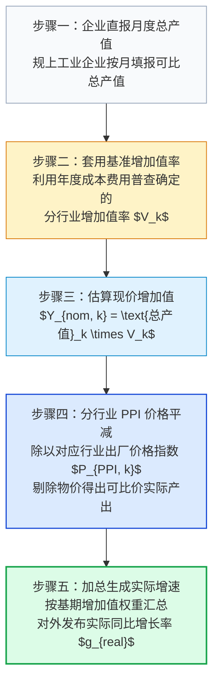
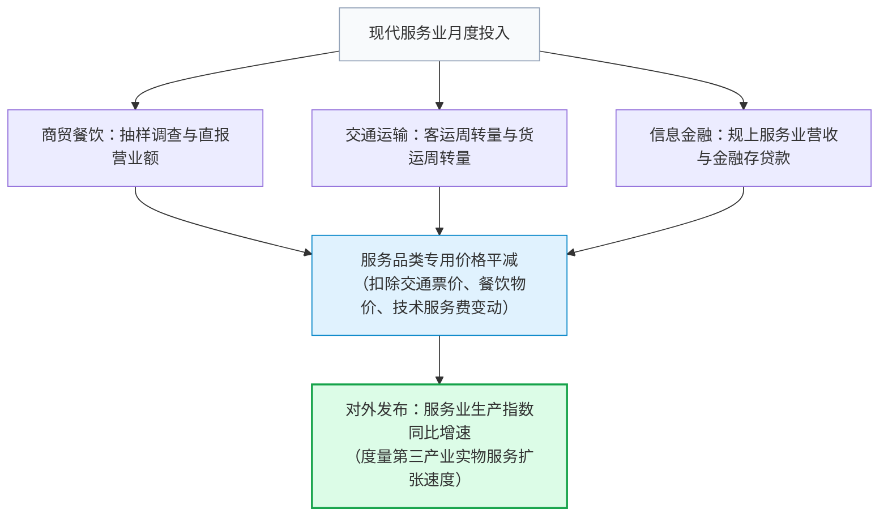
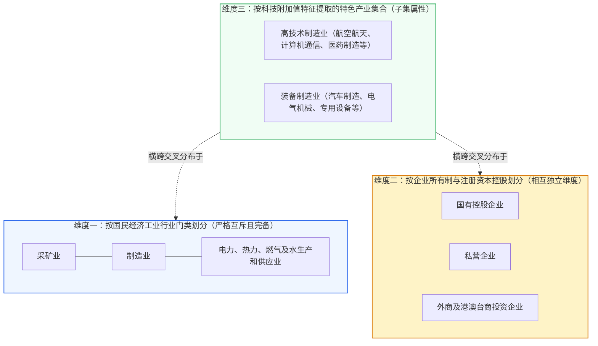

# 08 中国月度生产：规上工业、出口交货与服务业指数

[上一章：就业与工资](07-labor.md) · [目录](./) · [下一章：企业经营](09-business.md)

> 中国篇深度升级版 · 2026-10。本书以美国篇为前置理论基础。微观工厂生产与核算算例均为教学设计；工业增加值与服务业指数编制规程严格依据国家统计局官方制度方案。

**前置阅读：**美国篇[07 企业活动](https://fangpings.github.io/us-econ/07-business-and-housing.html)、[08 生产率](https://fangpings.github.io/us-econ/08-productivity.html)。在阅读本章前，你应已熟练掌握工业生产指数（IP）、产能利用率以及增加值与总产值的区别。本章的核心任务，是带你拆解中国宏观经济的供给侧中枢：看清**规模以上工业增加值如何从总产值中推算出来、出口交货值与海关出口的时差密码，以及服务业生产指数（ISP）的度量法则**。

---

## 1. 制造大省的流水线：一个电池包的宏观旅程

走进常州一座现代化动力电池制造基地的智能车间，机械臂正在飞速运转：
- **物料投入**：车间当月从上游采购了价值 $\$3.5\$$ 亿元的碳酸锂、正极材料、电解液和铝壳，消耗了 $\$3000\$$ 万元的工业电力与天然气；
- **成品下线**：工人们组装下线了 10 万套高能量密度电池包，按与整车厂签订的出厂合同价核算，当月完成**工业总产值 $\$5.0\$$ 亿元**；
- **价值沉淀**：扣除 $\$3.5\$$ 亿元外购原材料与动力消耗，该工厂当月为全社会经济贡献的**工业增加值为 $\$1.5\$$ 亿元**；
- **分拨去向**：在这 10 万套电池包中，有 3 万套被叉车装入集装箱，运往上海外高桥码头准备装船出口欧洲，工厂台账记下**出口交货值 $\$1.5\$$ 亿元**；
- **周边协同**：工业园区外，一家检验检测技术服务公司为这批电池出具了欧盟认证证书，收取了 $\$200\$$ 万元的技术服务费。

当月中国国家统计局发布宏观月报时，新闻标题是：
> “5 月份，规模以上工业增加值同比增长 $6.2\%$；服务业生产指数同比增长 $5.8\%$。”

这常常引发初学者的两个巨大困惑：
1. 为什么统计局每个月只公布工业增加值的**“百分比增速”**，却从来不在新闻稿里公布一个以“亿元”为单位的当月工业增加值绝对金额表？
2. 工业企业报送的明明是厂房里的总产值和销售流水，统计局究竟是施展了怎样的统计魔法，把物价波动与中间消耗剔除，算出了“可比价实际增长率”？

---

## 2. 统计魔法解密：月度工业增加值是怎样估算出来的

在统计核算的理想状态下，最完美的增加值算法是**生产法（总产出 - 中间消耗）**或**收入法（劳动者报酬 + 生产税净额 + 固定资产折旧 + 营业盈余）**。
但这要求全国数十万家工业企业每月都要编制极其繁冗的成本费用核算明细账！如果每月都要求填报全套成本物料表，既会给实体企业造成巨大的行政负担，又会导致数据报送严重滞后。

为了在**“时效性”**与**“准确性”**之间取得最佳平衡，国家统计局制定了科学的**“月度增加值率推算法 ＋ 分行业出厂价格缩减法”**：

### 严格的教学数学推导模型

为了彻底看清这一运算内核，我们构造一个包含两个完全不同行业的微观模型：
- **高端设备制造行业**：技术密集，附加值高，基期确定该行业的基准增加值率为 $40\%$；
- **基础原材料行业**：资源重工业，中间物料消耗大，基期增加值率仅为 $20\%$。

假设基期两行业的工业出厂价格指数（PPI）基准均为 $100.0$：

| 行业分项 | 上期总产值 | 本期总产值 | 行业基准增加值率 | 本期相对上期 PPI 指数 |
| :--- | :---: | :---: | :---: | :---: |
| **高端设备** | $\$100\$$ 万元 | $\$110\$$ 万元 | $40\%$ | $100.0$（物价持平） |
| **基础材料** | $\$200\$$ 万元 | $\$190\$$ 万元 | $20\%$ | $95.0$（价格下跌 $5\%$） |

让我们按国家统计局的标准规程分步计算：

1. **计算基期与本期的现价增加值**：
   $$\text{基期现价增加值} = 100 \times 40\% + 200 \times 20\% = 40 + 40 = 80 \text{ 万元}$$
   $$\text{本期现价增加值} = 110 \times 40\% + 190 \times 20\% = 44 + 38 = 82 \text{ 万元}$$
   $$\text{现价名义增速} = \frac{82 - 80}{80} = +2.5\%$$
2. **执行分行业价格缩减（Deflation），求出可比价实际增加值**：
   - 高端设备制造业：价格指数为 $1.00$（未变），其不变价实际增加值为：
     $$Y_{real, 设备} = \frac{44}{1.00} = 44 \text{ 万元}$$
   - 基础材料行业：价格指数为 $0.95$（产品出厂价下跌了 $5\%$），其不变价实际增加值为：
     $$Y_{real, 材料} = \frac{38}{0.95} = 40 \text{ 万元}$$
   - 全行业可比价实际增加值总额为：
     $$Y_{real, total} = 44 + 40 = 84 \text{ 万元}$$
3. **计算官方最终发布的实际工业增长速度**：
   $$g_{real} = \frac{84 - 80}{80} - 1 = \frac{4}{80} = +5.0\%$$

### 这一算例揭示的宏观真理

- **名义产值下降 $\neq$ 物理生产萎缩**：
  在基础材料行业，企业的名义产值从 200 万跌到了 190 万（名义萎缩 $5\%$），但因为出厂价格也同步下跌了 $5\%$，工人在流水线上冶炼的钢材水泥**实物物理吨数完全没有减少**！在不变价核算下，其实际产出依然稳定在 40 万元。
- **不能拿产值相加直接平均**：
  如果不作分行业价格平减，简单把名义产值（从 300 万变为 300 万，名义 $0\%$）或者名义增加值（$+2.5\%$）当作经济增长，就会由于工业品通缩（PPI 下行）而严重低估实体工厂的真实生产强度。国家统计局发布的 **$+5.0\%$**，精确度量了物理世界的实物生产扩张。

---

## 3. 中美对比：中国规上工业增加值 vs 美联储工业生产指数（IP）

初学者在阅读国际研报时，常常把中国的月度工业增加值与美联储发布的**工业生产指数（Industrial Production Index, 简称 IP）**互换。两者的经济学目标一致，但编制技术路线体现了不同的国情：

| 关键比较维度 | 中国国家统计局：规模以上工业增加值增速 | 美联储理事会（FRB）：工业生产指数（IP） |
| :--- | :--- | :--- |
| **编制机构** | 国家统计局（NBS 工业统计司） | 美联储理事会（Federal Reserve Board） |
| **基础数据源** | 企业联网直报的**分行业工业总产值** | **物理实物量统计**（如汽车组装辆数、原油桶数、耗电量）与企业员工劳动工时 |
| **价格处理法** | 利用分行业 PPI 指数进行**自上而下的价值缩减法（Deflation）** | 聚合物理实物量产出指数，以年度增加值权重进行**自下而上的费雪链式加总** |
| **统计范围门槛** | 严格限制为年主营业务收入 $\ge 2000$ 万元的**规模以上法人单位** | 抽样覆盖全美所有规模的工业设施（含矿业、公用事业），并根据基准普查回溯修正 |
| **指标发布形态** | 主要公布当月实际同比增速（$\%$）与季调环比增速 | 公布以某基期为 100 的定基指数序列（如 2017=100）及月度环比折年率 |

---

## 4. 供应链的时差密码：出口交货值 vs 海关出口总额

在宏观跟踪中，研究外需拉动通常会看两个指标：
- 指标 A（统计局工业发布）：**规模以上工业企业出口交货值**；
- 指标 B（海关总署外贸快讯）：**海关货物出口总额（按美元或人民币计价）**。

如果你把两个指标按月并排放在一张图上，你会发现它们常常出现明显的月度背离：某个月出口交货值增速大幅回暖，但海关公布的出口金额却依然低迷。

为什么两者会有时间与金额的错位？

| 核心差异维度 | 规模以上工业企业出口交货值 | 海关总署货物贸易出口额 |
| :--- | :--- | :--- |
| **观察地理位置** | **工业企业厂区大门**（生产现场） | **沿海/口岸海关边境关口**（物流终端） |
| **计价价格口径** | **工厂出厂价（Ex-works Price）**，不含企业外部运输仓储成本 | **离岸价（FOB, Free on Board）**，包含了境内公路运费、港口装卸费及中间外贸代理加价 |
| **时间记录节点** | 货物生产完毕开具出厂发票、移交物流货代之日 | 货物完成海关查验、正式结关放行离境之日（通常滞后数天至数周） |
| **货物范围覆盖** | 仅限**规模以上工业企业自行生产并交付出口的产品** | 涵盖全社会所有小微企业、外贸商贸流通公司及跨境电商的全部实物包裹 |

因此，当出现“港口集装箱积压”或“海外船期紧张”时，工厂可能已经完成了生产并计入了出口交货值，但集装箱在码头堆场等待通关，海关出口数据就会显现出明显的滞后性。出口交货值是**海外需求对国内工厂车间的领先投影**。

---

## 5. 服务业没有“物理吨数”，怎样测量实际增长

在钢铁、水泥或汽车行业，统计部门可以通过数吨数、数件数来检验实物产出。但对于占据国民经济半壁江山以上的第三产业——如银行理财、软件开发、餐饮堂食、法律咨询——根本不存在统一的物理度量单位。

国家统计局是如何在月度监测现代服务业的呢？答案是：**服务业生产指数（Index of Services Production, 简称 ISP）**。

### 服务业生产指数的编制技术

服务业生产指数主要利用批发零售、住宿餐饮、交通运输、信息软件、金融服务等行业的月度营业收入，通过**细分服务业价格平减指数**剔除通胀，综合编制出的反映服务业实际产出变动的月度综合指数：

### 概念红线：服务业生产指数 $\neq$ 非制造业 PMI 商务活动指数

许多初学者容易把统计局发布的两个服务业指标混为一谈：
- **服务业生产指数（ISP）**：是一个**“量的指标”（Volume Measure）**，度量的是实际增加了多少服务业务量（如增长 $5.8\%$）；
- **非制造业商务活动指数（PMI）**：是一个**“扩散指标”（Diffusion Index）**，度量的是认为本月业务比上月扩张的企业家比例（如 $50.2\%$）。

如果绝大多数小企业老板觉得本月生意“略有改善”（回答扩张），而少数头部平台企业业务“断崖式下滑”，PMI 可能会位于 50 以上的扩张区间，但加权汇总后的服务业生产指数却可能录得负增长！两者属于完全不同的统计维度。

---

## 6. 避免重复加总：解构工业报告中的交叉分类

在国家统计局发布的工业月度公报中，常常看到以下并列段落：
> “分三大门类看，采矿业增加值增长 $3.0\%$，制造业增长 $6.5\%$，电力热力燃气水生产供应业增长 $5.0\%$；
> 分经济类型看，国有控股企业增长 $4.0\%$，股份制企业增长 $6.5\%$，私营企业增长 $5.5\%$；
> 战略性新兴产业中，高技术制造业增加值同比增长 $9.0\%$，装备制造业增长 $7.5\%$。”

初学者最容易犯的低级错误，是拿出计算器把这些百分比胡乱相加。我们必须牢记：**这些分类存在严重的重叠与交叉属性**：

- **三大门类是互斥的**：采矿、制造与公用事业三者相加，正好构成完整的工业大盘（$100\%$）；
- **高技术制造业不是独立行业门类**：它是从制造业内部抽选出来的尖端技术行业集合（如医药制造、电子及通信设备制造）。一家国有的航天军工企业，它既是“制造业”，又是“国有控股企业”，同时也是“高技术制造业”！
- 绝不能将高技术制造业与国有企业或采矿业直接相加，更不能简单对它们的增速求算术平均。

---

## 7. 真实官方数据带读：2024 年 12 月工业与服务业全景

请翻开国家统计局于 2025 年 1 月 17 日发布的[《2024 年 12 月份规模以上工业增加值增长 6.2%》公报](https://www.stats.gov.cn/sj/zxfb/202501/t20250117_1958331.html)，跟随以下专业流程提取一手证据：

1. **核验时间跨度**：
   公报首页表格分为两大部分：左侧为“12 月份当月同比增速（$6.2\%$）”，右侧为“1—12 月累计同比增速（$5.8\%$）”。牢记：当月增速高于全年累计增速，说明年末工业生产动能在明显加速。
2. **核验实物产品产量**：
   下拉至《主要工业产品产量》附表，观察代表性产品的实物产量表现：
   - 2024 年全年，**新能源汽车产量突破 1200 万辆**，同比增长超 $30\%$；
   - 工业机器人、集成电路（芯片）产量录得双位数高增长；
   - 与房地产链条紧密相连的粗钢、水泥产量则呈现小幅收缩。
   这为你提供了微观工业结构优化的确凿实物量证据。
3. **联读服务业生产指数**：
   查阅同日发布的《服务业经济平稳运行》解读，2024 年 12 月份**全国服务业生产指数同比增长 $6.5\%$**，全年服务业生产指数增长 $5.2\%$。工业与服务业月度指数双双扩张在 $6\%$ 以上，共同支撑了四季度 GDP 当季 $5.4\%$ 的亮眼表现。

---

## 练习：审读一份工业与服务业报告

1. **会计指标辨析**：某券商实习生在报告中写道：“规模以上工业增加值，就是拿规模以上工业企业利润表中的‘营业收入’减去‘营业利润’计算得出的。”请指出该实习生对国民经济核算的严重无知之处。
2. **两行业模型实操复算**：某区域工业包含两类产业，基期 PPI 价格指数均为 $100.0$：
   - 电子装备产业：基期总产值 $\$100\$$ 亿元，本期总产值 $\$110\$$ 亿元，基准增加值率为 $40\%$，本期 PPI 为 $100.0$；
   - 煤炭采选产业：基期总产值 $\$200\$$ 亿元，本期总产值 $\$190\$$ 亿元，基准增加值率为 $20\%$，本期 PPI 为 $95.0$。
   - （1）请精确计算该区域工业的可比价实际增加值总额与实际同比增长率；
   - （2）请解释为什么煤炭行业产值下跌了 $\$10\$$ 亿元，但其可比价实际增加值却没有缩水？
3. **增加值率假设破损情景**：承接上题，如果在报告期内，电子装备企业为了降低成本，大规模增加了对外部芯片代工与云计算的采购（外包率显著上升）。请问：上述模型中的哪一步测算将产生偏差？是高估还是低估了实际产出？
4. **外贸供应链时差诊断**：某省统计局发布 3 月份规上工业出口交货值高达 $\$100\$$ 亿元，同比增长 $15\%$；但海关总署随后发布的该省 4 月份货物出口总额仅为 $\$110\$$ 亿元，同比仅微增 $1\%$。请列出导致这种时差与增速差异的至少两个客观产业链原因。
5. **交叉统计分类识别**：某市统计通报显示：该市规上工业增加值增长 $7.0\%$；其中，国有控股企业增长 $4.0\%$，民营企业增长 $8.0\%$，装备制造业增长 $9.0\%$。某评论员据此计算：$4\% + 8\% + 9\% = 21\%$，声称该市工业总增量中有 $21\%$ 的虚增。请反驳该评论员的错误逻辑。
6. **服务业生产指数外推边界**：国家统计局公布某月全国服务业生产指数同比增长 $6.0\%$。请问：这是否能直接推论出“当月全国第三产业全口径 GDP 也必定增长了 $6.0\%$”？是否能推论出“当月全国居民家庭的服务性消费支出也增长了 $6.0\%$”？请分别说明理由。

参考答案与详细推理

1. **营业收入与增加值的根本区别**：
   - 营业收入仅仅是企业销售产品回笼的资金总流水，包含着从外部采购的大量原材料、能源动力等庞大的中间消耗；
   - 营业收入减去营业利润，算出来的仅仅是企业的“营业总成本”（包含购买原材料的消耗），根本不是增加值；
   - 增加值的本质是**新创造的价值**（$\text{总产出} - \text{中间物料消耗}$），包含了工人的工资（劳动者报酬）、交给国家的税费（生产税净额）、厂房折旧与留存利润。该实习生混淆了企业财务成本会计与宏观增加值核算。
2. **两行业模型严格复算**：
   - （1）**增加值测算**：
     - 基期现价增加值：$100 \times 0.40 + 200 \times 0.20 = 40 + 40 = 80\$$ 亿元；
     - 本期现价增加值：$110 \times 0.40 + 190 \times 0.20 = 44 + 38 = 82\$$ 亿元；
     - 本期可比价实际增加值：
       $$Y_{real, 电子} = \frac{44}{1.00} = 44 \text{ 亿元}$$
       $$Y_{real, 煤炭} = \frac{38}{0.95} = 40 \text{ 亿元}$$
       $$Y_{real, total} = 44 + 40 = 84 \text{ 亿元}$$
     - 实际同比增长率：$g_{real} = \frac{84 - 80}{80} = +5.0\%$；
   - （2）**煤炭实际产出未缩水原因**：煤炭产值由 200 亿降为 190 亿，下跌幅度正好为 $5\%$（$\frac{190}{200} - 1 = -5\%$）；但同期该行业的出厂价格指数也同步下跌了 $5\%$（指数为 $95.0$）。名义金额的缩水完全是由价格下跌引起的，实际开采洗选的原煤物理吨数完全没有减少，因此剔除价格影响后的真实物理生产活动保持不变（$40\$$ 亿元）。
3. **外包深化对增加值率假设的冲击**：
   - 冲击发生在**步骤二与步骤三（套用固定增加值率）**；
   - 官方模型假设该行业的增加值率保持在基准的 $40\%$ 不变；
   - 但若企业大幅增加算力租赁与零部件外包，其中间消耗比例上升，真实的增加值率已经下滑（例如降为 $35\%$）。此时若依然机械套用 $40\%$ 的旧比率外推，就会**显著高估本期的现价增加值与实际产出**。
4. **出口交货值与海关出口的时差原因**：
   - **出厂与通关的物理时间滞后**：3 月份在工厂车间下线并交付物流的工业品，需要经历境内公路运输入港、集装箱堆场拼箱、报关查验与等待海运船期，实际通关报关往往落在 4 月份甚至 5 月份；
   - **范围与计价差异**：出口交货值仅统计规上工厂的出厂价（不含运费），而海关出口额涵盖全社会所有商贸公司、跨境小包裹并按离岸价（FOB）计价。海运运价波动、商贸代理环节的库存调整均会导致两套指标在月度截面上产生节奏脱节。
5. **交叉维度相加谬误驳斥**：
   - 该评论员犯了“不同分类维度粗暴相加”的初级逻辑错误；
   - “国有控股”与“民营”是按**资本所有制属性**划分的，两者在理论上构成了全社会企业的并集；
   - 而“装备制造业”是按**国民经济行业门类技术特征**划分的特定产业子集；装备制造企业本身就包含大量的国有车企、国有机床厂以及民营光伏企业，与所有制分类存在高度重叠交叉；
   - 评论员把装备制造业与所有制重复相加，就像把“全校男生人数、全校女生人数与全校短跑特长生人数”加在一起算总人数一样荒谬。
6. **服务业生产指数的外推限制**：
   - （1）**不能直接推出第三产业 GDP 增长 6%**：服务业生产指数仅覆盖部分可通过月度营业收入高频监测的市场化服务业（批零、住餐、交通、IT、租赁等），并未完整涵盖教育、卫生、公共管理以及自有住房虚拟租金等体量巨大的非市场服务；全口径第三产业 GDP 的核算范围远宽于月度服务业生产指数；
   - （2）**不能直接推论家庭服务消费增长 6%**：服务业企业的产出中，有极其庞大的比例是向其他企业或政府提供的“生产性服务”（如企业法律顾问、企业服务器租赁、大宗商品货运），绝非全部由居民家庭直接消费；家庭真实服务消费必须以住户调查中的服务性消费支出为准。

[上一章：就业与工资](07-labor.md) · [目录](./) · [下一章：企业经营](09-business.md)
