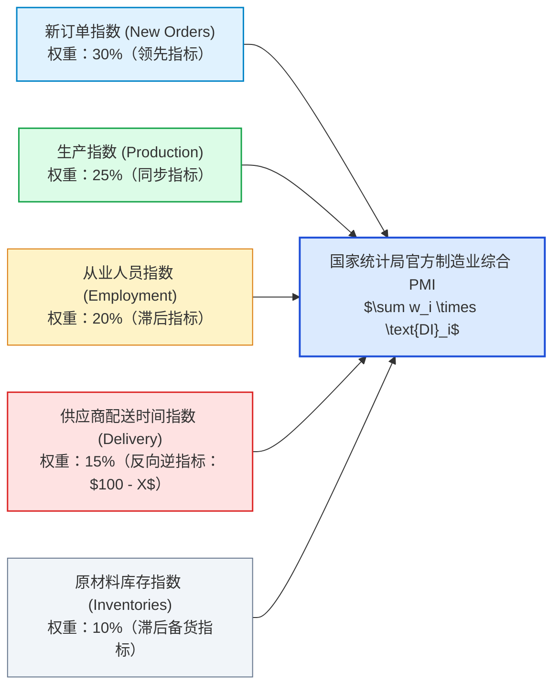
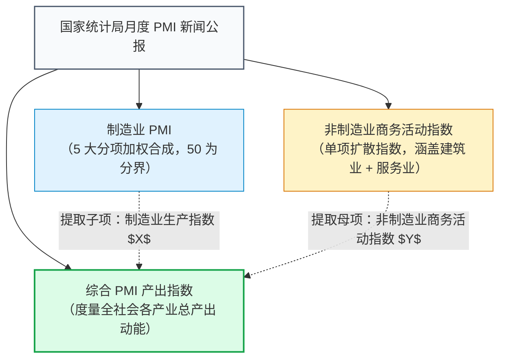
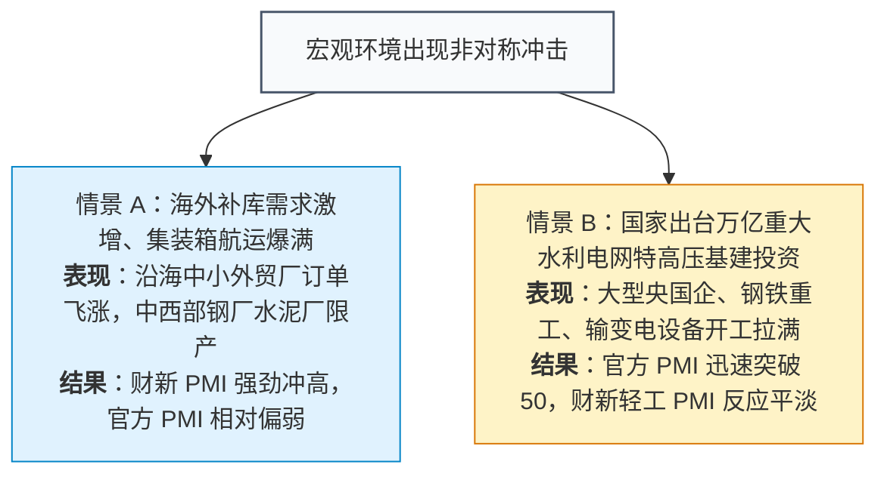
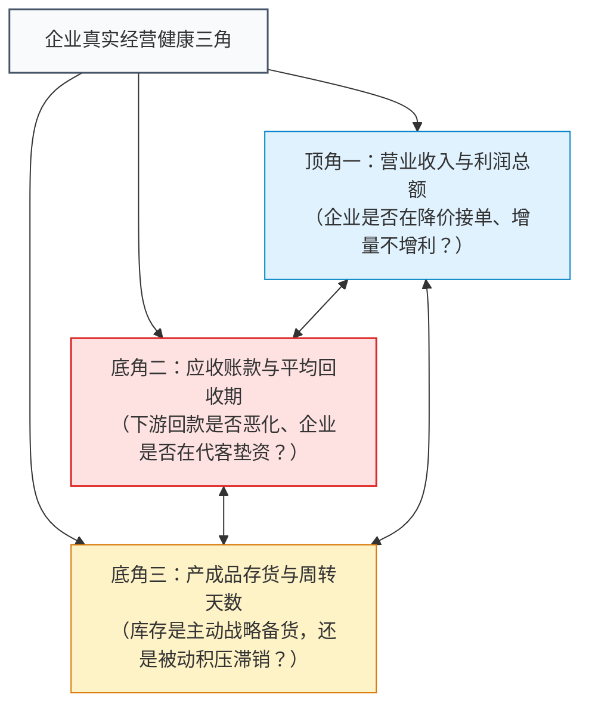

# 09 中国企业经营：官方PMI、工业利润与账款库存

[上一章：工业与服务业](08-production.md) · [目录](./) · [下一章：投资与产能](10-investment.md)

> 中国篇深度升级版 · 2026-10。本书以美国篇为前置理论基础。问卷抽样与企业财务算例均为教学设计；官方采购经理指数与规上工业利润口径严格依据国家统计局最新方案。

**前置阅读：**美国篇[07 企业活动与房地产](https://fangpings.github.io/us-econ/07-business-and-housing.html)。在阅读本章前，你应已掌握扩散指数（Diffusion Index）的基本构造原理、营业利润与现金流的会计差异以及存货投资波动的基本逻辑。本章的核心任务，是带你穿透中国微观企业的真实经营体温：看清**官方制造业 PMI 的分项合成公式、官方与财新 PMI 的背离密码，以及工业企业利润、应收账款与库存周转的三角联动**。

---

## 1. 采购经理与财务总监的对话：微观经营的多重视角

每月 25 日前后，浙江宁波某智能小家电制造企业的办公楼里，通常会发生这样一幕：
- **采购总监的问卷**：她登录国家统计局的直报系统，填写《采购经理调查问卷》。被问到：“与上月相比，本月公司的新增订单、生产量、主要原材料购进价格是增加、持平还是减少？”
  她回忆了一下：欧美客户下半年圣诞大促的吸尘器订单开始集中下达，排产拉满，于是她在“新订单”一栏勾选了**【增加】**，在“生产量”一栏勾选了**【增加】**；但因为红海航运紧张、货柜紧俏，供应商送货变慢，她在“供应商配送时间”勾选了**【放慢】**。
- **财务总监的账本**：在隔壁办公室，CFO 正在审视当月的企业真实财务报表：
  虽然生产和出厂订单大增，但由于海外大客户强势要求延长付款账期（从 60 天拖到 120 天），公司的**应收账款净飙升了 $\$3000\$$ 万元**；同时，由于关键芯片与注塑原料涨价，而终端售价面临价格战无法提价，当月**净利润反而同比下滑了 $5\%$**！

到了月末与下月初，宏观新闻先后公布：
1. **每月最后一天 09:30**：国家统计局公布“中国制造业采购经理指数（PMI）为 $50.3\%$，重回扩张区间”；
2. **每月 27 日前后**：国家统计局公布“规模以上工业企业利润总额同比下降 $3.3\%$，应收账款平均回收期延长”。

许多初学者再次感到认知失调：“PMI 明明显示企业繁荣扩张，为什么工业企业的实际利润却在萎缩？到底哪一个指标才是真实的中国经济？”

---

## 2. 扩散指数的底层数学：PMI 究竟是怎样算出来的

采购经理指数（PMI）本质上是一个**“扩散指数”（Diffusion Index）**。它的核心职能不是度量“生产了多少万亿元商品”，而是度量**“全社会经济体中，处于扩张状态的微观细胞占比究竟有多广”**。

### 2.1 单项扩散指数公式

在每个细分分项（如新订单、生产、原材料库存）中，企业采购经理只需回答定性方向：
- $P_1$：认为本月比上月**【增加 / 改善】**的企业加权比例；
- $P_2$：认为本月比上月**【持平 / 基本不变】**的企业加权比例；
- $P_3$：认为本月比上月**【减少 / 恶化】**的企业加权比例（$P_1 + P_2 + P_3 = 100\%$）。

该分项的单项扩散指数计算公式为：
$$\text{DI} = P_1 \times 1.0 + P_2 \times 0.5 + P_3 \times 0.0$$

> **微观算例验证**：
> 假设在某分项调查中，有 $30\%$ 的企业回答增加，$50\%$ 的企业回答持平，$20\%$ 的企业回答减少。
> 则该分项扩散指数为：
> $$\text{DI} = 30 \times 1.0 + 50 \times 0.5 + 20 \times 0 = 30 + 25 = 55.0$$
> **50.0 是荣枯分界线（临界点）**：
> - $\text{DI} = 55.0 > 50$，表明该领域处于扩张状态；
> - 但请千万牢记：**$55.0$ 绝不代表订单金额增长了 $55\%$！** 它仅仅代表认为业务改善的企业数量与权重超过了恶化的企业，是扩张动能扩散“广度”的度量，舍弃了每家企业具体的增减“幅度”。

### 2.2 官方制造业综合 PMI 的五大加权引擎

许多人以为制造业 PMI 是简单把问卷里十几个问题随便平均一下。在国家统计局的制度中，**制造业综合 PMI 是由五个核心分项按固定经济学权重合成的**：

$$\text{PMI}_{CN} = 0.30 \times \text{新订单} + 0.25 \times \text{生产} + 0.20 \times \text{从业人员} + 0.15 \times (100 - \text{配送时间}) + 0.10 \times \text{原材料库存}$$

> **极其精妙的反向处理：供应商配送时间**：
> 在经济学常识中，当市场需求极度火爆、工厂排产拥挤时，物流卡车和原材料供货商往往忙不过来，导致**送货时间拉长（放慢）**。因此在问卷中，“送货放慢”反而映射着实体经济的供不应求！
> 国家统计局在合成综合 PMI 时，将原始配送指数进行逆向处理：如果公布的原始配送时间分项为 $48.0$（表示配送放慢），进入公式的计算值实际为 $100 - 48.0 = 52.0$。

---

## 3. 中美制造业 PMI 规则解剖：中国加权 vs 美国等权

在中美宏观对话中，如果直接拿两国的制造业 PMI 总指数硬比，会忽略两国合成权重的重大机制差异：

- **中国国家统计局（NBS）规则**：严格按照宏观经济领先性，赋予新订单（$30\%$）和生产（$25\%$）高达 $55\%$ 的绝对主导权重，原材料库存仅占 $10\%$；
- **美国供应管理协会（ISM）规则**：对新订单、生产、就业、供应商交付、商业存货五大分项**严格实行均等的 $20\%$ 等权合成**！

### 教学数学模拟：相同分项下的权重差异

假设中美两国的采购经理调查，在某月录得完全一致的五大分项读数：
新订单 $= 54.0$，生产 $= 53.0$，就业 $= 49.0$，反向后的配送方向值 $= 52.0$，原材料库存 $= 47.0$。

| 分项名称 | 假设分项指数 | **中国 NBS 规则权重** | **美国 ISM 规则权重** |
| :--- | :---: | :---: | :---: |
| **新订单指数** | $54.0$ | **$30\%$** | **$20\%$** |
| **生产指数** | $53.0$ | **$25\%$** | **$20\%$** |
| **从业人员指数** | $49.0$ | **$20\%$** | **$20\%$** |
| **配送时间方向值** | $52.0$ | **$15\%$** | **$20\%$** |
| **原材料库存指数** | $47.0$ | **$10\%$** | **$20\%$** |

1. **按中国加权规则合成**：
   $$\text{PMI}_{CN} = 54 \times 0.30 + 53 \times 0.25 + 49 \times 0.20 + 52 \times 0.15 + 47 \times 0.10$$
   $$\text{PMI}_{CN} = 16.20 + 13.25 + 9.80 + 7.80 + 4.70 = 51.75$$
2. **按美国 ISM 等权规则合成**：
   $$\text{PMI}_{ISM} = (54 + 53 + 49 + 52 + 47) \times 0.20 = 255 \times 0.20 = 51.00$$

在底层微观企业的回答完全相同的情形下，**仅仅因为合成公式权重的不同，中国规则算出的总指数（$51.75$）就比美国规则高出了 $0.75$ 个百分点！** 这是因为中国公式更重订单与生产，弱化了处于收缩的库存项。因此，跨国比较时必须穿透到分项明细，绝不可拿着单一总数下结论。

---

## 4. 三大 PMI 指标辨析：非制造业、服务业与综合产出

在每月最后一天公布的官方 PMI 公报中，常常并列出现三个容易混淆的概念：

1. **非制造业商务活动指数 $\neq$ 服务业 PMI**：
   官方公布的“非制造业商务活动指数”，是一个包含了**建筑业（如市政基建、房建施工）**与**现代服务业（批发零售、航空运输、金融 IT）**的综合大类。当某月房地产投资走弱拖累建筑业商务活动下滑时，服务业分项可能在假期文旅拉动下逆势冲高；必须深入阅读公报中的《服务业商务活动指数》附表，绝不能把非制造业整体当作纯服务业。
2. **综合 PMI 产出指数的核心公式**：
   $$\text{综合 PMI 产出指数} = w_{man} \times \text{制造业生产指数} + w_{non} \times \text{非制造业商务活动指数}$$
   > **极其关键的防错提醒**：
   > 综合产出公式中代入的，是制造业分项里的**“生产指数”**，**绝对不是五项加权合成的那个“制造业综合 PMI”！** 因为非制造业商务活动度量的是当期产出活动，只有拿制造业同样度量实物产出的“生产指数”加权，在经济学概念上才具备对称性。

---

## 5. 官方 PMI vs 财新 PMI：为什么两张罗盘会给出相反方向

在投资实务中，经常出现戏剧性的一幕：上午 09:30 国家统计局公布官方制造业 PMI 跌破 50（例如 49.5），暗示制造业收缩；而次日财新传媒与标普全球（Caixin/S&P Global）公布的财新中国制造业 PMI 却强劲跃升至 51.5！

许多评论员喜欢用简单的政治标签断言：“官方数据代表国企，财新数据代表民企。”这种说法在统计学上是极其粗糙且不符合事实的。

两者的真实背离根源于**抽样设计与地理产业重心的客观差异**：

| 比较维度 | 国家统计局官方制造业 PMI | 财新 / 标普全球中国制造业 PMI |
| :--- | :--- | :--- |
| **样本量规模** | **$3200\$$ 家工业企业**（全国代表性大样本） | **约 $650\$$ 家工业企业**（精选代表性中小样本） |
| **行业与规模结构** | 严格按全国 31 个工业行业增加值权重抽样，**大中型骨干企业、基础原材料重工业比重较高** | 重点覆盖**沿海出口导向型、轻工制造、消费电子及中小微民营企业** |
| **地理区域分布** | 覆盖全国 31 个省份（涵盖东北老工业基地、中西部资源重镇） | 深度集中在**长三角、珠三角等东部沿海对外贸易前沿口岸** |

两张罗盘没有对错之分，它们测量的是中国双轨经济结构下的不同侧面：官方 PMI 是**全国内需重工业与大国工业底座的全景镜头**，而财新 PMI 是**东南沿海出口外贸与民营中小微制造的特写镜头**。

---

## 6. 企业财务死结：工业利润、应收账款与库存的三角联动

现在，我们终于可以回答本章开篇的谜题：为什么当期 PMI 订单饱满，而官方公布的工业企业利润却在下滑？

要读懂中国规模以上工业企业的真实生存环境，必须构建**“利润 - 应收账款 - 存货”的健康体检三角**：

### 6.1 “增量不增利”的典型微观机制

在工业品出厂价格指数（PPI）长期处于负增长区间的阶段，企业常常陷入**“价格战陷阱”**：
- **物理订单与产出饱满**：为了维持生产线运转、分摊厂房巨额固定资产折旧，工厂不得不大幅降价接单（此时采购经理眼中的“生产量”与“新订单”PMI 都在 50 以上）；
- **利润空间被上下游两头挤压**：上游大宗能源成本刚性，下游降价侵蚀毛利，导致虽然产品堆满了货架，但营业收入利润率（2024 年全国平均仅为 $5.39\%$）出现持续萎缩；
- **商业信用账期拉长导致的流动性休克**：客户在收到货物后迟迟不付现金，大量资金沉淀在应收账款上（2024 年末规上工业应收账款平均回收期高达 60 余天）。企业纸面上虽然有微薄的会计利润，但银行账上现金干涸，不得不依靠短期银行流动资金贷款续命。

### 6.2 工业库存周期的专业研读法则

在研读工业企业财务报告中的**“产成品存货同比增速”**时，必须结合需求景气度划分库存周期所处的具体阶段：

| 库存周期阶段 | 需求景气特征（PMI 新订单） | 企业库存行为（产成品存货） | 宏观经济运行含义 |
| :--- | :--- | :--- | :--- |
| **被动去库存** | 需求超预期回暖，订单激增 | 仓库库存被迅速买空，存货增速创低点 | **经济复苏初期**最强烈的牛市信号 |
| **主动补库存** | 需求持续旺盛，企业预期极度乐观 | 工厂开足马力加班备货，存货快速飙升 | **经济繁荣顶峰**，生产过热阶段 |
| **被动补库存** | 需求突然转冷，新订单断崖下滑 | 生产线来不及停工，产成品在仓库严重积压 | **经济下行初期**，企业陷入极度阵痛 |
| **主动去库存** | 需求持续低迷，企业预期谨慎悲观 | 工厂主动减产、折价抛售存货、出清库存 | **经济探底出清**阶段，等待新均衡 |

---

## 7. 真实官方数据带读：2024 年工业企业三大信号交织

请翻开国家统计局于 2025 年 1 月 27 日发布的[《2024 年全国规模以上工业企业利润下降 3.3%》权威通报](https://www.stats.gov.cn/xxgk/sjfb/zxfb2020/202501/t20250127_1958485.html)，提取核心财务指标并建立立体认知：

1. **核验营收与利润的剪刀差**：
   - 2024 年全国规模以上工业企业实现营业收入 $\$133.74\$$ 万亿元，比上年增长 $2.1\%$；
   - 实现**利润总额 $\$74454\$$ 亿元，比上年下降 $3.3\%$**；
   - 营业收入利润率为 **$5.39\%$**，比上年下降 $0.30$ 个百分点。
   *研读心得*：营收正增长（$+2.1\%$）而利润负增长（$-3.3\%$），确凿印证了制造业在 PPI 负增长压力下普遍面临的“增量不增利、毛利率承压”格局。
2. **核验应收账款与存货沉淀**：
   - 2024 年末，规模以上工业企业**应收账款 $\$25.68\$$ 万亿元，同比增长 $7.6\%$**；
   - 产成品存货 $\$6.38\$$ 万亿元，同比增长 $3.1\%$；
   - 应收账款平均回收期为 **$63.4$ 天**，比上年增加 $2.8$ 天。
   *研读心得*：应收账款增速（$+7.6\%$）显著跑赢营业收入增速（$+2.1\%$），回收期拉长至超两个月。这提醒我们在分析企业投资意愿时，必须把现金回流阻力纳入考量。

---

## 练习：从中国企业报表写出可验证判断

1. **公式加权实操复算**：已知某月制造业采购经理调查分项如下：新订单指数 $54.0$、生产指数 $53.0$、从业人员指数 $49.0$、供应商配送时间指数原始读数为 $48.0$、原材料库存指数 $47.0$。
   - （1）请按照中国国家统计局的官方合成规则，计算该月的制造业综合 PMI；
   - （2）如果改用美国 ISM 的五项等权合成规则，计算出的 PMI 是多少？两者差额反映了什么编制逻辑差异？
2. **综合 PMI 产出指数运算**：某月国家统计局发布数据：制造业综合 PMI 为 $49.0$（落入收缩区间），制造业生产指数为 $52.0$（处于扩张区间），非制造业商务活动指数为 $51.0$。假设制造业与非制造业在国民经济中的权重比例按 $40\% : 60\%$ 分配。请精确计算当月的“综合 PMI 产出指数”，并说明为什么不能把 $49.0$ 代入计算？
3. **官方与财新背离推演**：某月国家统计局公布的官方制造业 PMI 由 $50.2$ 滑落至 $49.4$，而同月公布的财新制造业 PMI 却由 $50.0$ 强劲上行至 $51.2$。请结合两大指标在样本行业结构、企业规模与地域分布上的差异，提供两个合乎产业经济逻辑的解释假设。
4. **单月利润差分反推审计**：某地区规模以上工业企业利润公报显示：上年 1—2 月累计利润总额为 $\$40\$$ 亿元，1—3 月累计为 $\$60\$$ 亿元；本年 1—2 月累计利润总额为 $\$36\$$ 亿元，1—3 月累计为 $\$60\$$ 亿元。
   - （1）在同范围可比假设下，请计算本年 3 月单月的利润同比增长率；
   - （2）在真实的宏观经济发布中，有哪些现实干扰因素会导致这种简单的单月差分还原出现严重失真？
5. **中美利润指标边界对照**：中国国家统计局发布的“规模以上工业企业利润总额”与美国经济分析局（BEA）在 NIPA 账户中公布的“企业税前利润（Corporate Profits before Tax）”，在**行业覆盖**与**存货/资本消耗调整（IVA/CCAdj）**上存在哪些根本不同？
6. **企业体检综合研判**：某工业细分行业在连续三个月内呈现出以下特征组合：
   - 制造业 PMI 中的“新订单指数”持续运行在 $53.0$ 以上的高景气区间；
   - 该行业规上企业工业利润总额同比出现连续两位数大幅暴跌；
   - 企业资产负债表中的“应收账款总额”以每年 $15\%$ 以上的速度恶化膨胀。
   作为工业行业分析师，请诊断该行业当前面临的核心经营困境，并指出你在后续季度求证时应当跟踪的至少两项关键数据。

参考答案与详细推理

1. **加权合成复算与逻辑反思**：
   - （1）**中国官方规则计算**：
     首先将配送时间指数反向：$100 - 48.0 = 52.0$；
     $$\text{PMI}_{CN} = 54 \times 0.30 + 53 \times 0.25 + 49 \times 0.20 + 52 \times 0.15 + 47 \times 0.10 = 51.75$$
   - （2）**美国 ISM 等权计算**：
     $$\text{PMI}_{ISM} = (54 + 53 + 49 + 52 + 47) \times 0.20 = 255 \times 0.20 = 51.00$$
   - 差额达 $+0.75$ 个百分点。中国规则突出新订单与生产的主导牵引作用，弱化了库存项的拖累；美国规则赋予各项均等地位，体现了不同的宏观合成哲学。
2. **综合 PMI 产出指数的严格计算**：
   - 计算公式：
     $$\text{综合 PMI 产出} = 52.0 \times 0.40 + 51.0 \times 0.60 = 20.8 + 30.6 = 51.4$$
   - **不能代入 49.0 的原因**：$49.0$ 是包含了新订单、就业、库存等多维度的“制造业综合景气指数”；而综合产出指数的目标是度量实体经济**“物理总产出”**的环比变化，必须使用制造业分项中纯度量生产活动的“生产指数（$52.0$）”与非制造业的“商务活动指数（$51.0$）”对称结合。
3. **官方与财新背离的微观解释假设**：
   - **假设一：海外出口脉冲与内需重工分化**。海外特定市场出现补库潮，长三角与珠三角的中小轻工、消费电子企业出口订单大幅回暖（拉升以沿海外向型中小企业为主的财新 PMI）；而国内地产基建开工淡季，中西部地区的钢铁、水泥、煤炭等大型重化工国企产销放缓（压低以全国重化工大企业为主的官方 PMI）；
   - **假设二：原材料价格与终端成品承受力分化**。大宗商品价格短期高位震荡，下游民营消费品制造企业通过小批量柔性接单实现灵活周转，而中游大型加工企业受制于长协订单与高库存成本，经营情绪出现暂时压制。
4. **单月利润还原与现实失真风险**：
   - （1）**单月同比计算**：
     上年 3 月单月基数：$60 - 40 = 20\$$ 亿元；
     本年 3 月单月金额：$60 - 36 = 24\$$ 亿元；
     3 月单月同比增长率：$\frac{24 - 20}{20} = +20.0\%$；
   - （2）**现实失真干扰因素**：
     - **样本名录动态变动**：3 月份若有部分企业退库或新增入库，两个累计值包含的调查主体不再同质；
     - **跨期财务核算审计调整**：部分企业在 3 月底集中对一季度的财务费用、资产减值损失进行统一补提摊销，导致单月数据包含非经营性的跨期会计杂音；
     - **官方可比口径基数的隐性修订**：官方公布的累计同比是基于同范围企业追溯基数计算的，直接拿公开的绝对金额相减放大了误差。
5. **中美企业利润的核心核算差异**：
   - **行业与经济部门覆盖**：中国统计局的“工业利润”严格局限于**规模以上工业采矿与制造业企业**，完全不包含金融业、互联网科技巨头、房地产开发与交通运输业；而美国 BEA 的 Corporate Profits 覆盖全美所有非金融与金融企业；
   - **国民核算调整项（IVA 与 CCAdj）**：BEA 利润严格执行国民经济核算准则，必须扣除由于历史成本折旧与重置成本差异导致的资本消耗调整（CCAdj），并剔除由于物价变动产生的名义存货持有收益（IVA）；而中国工业利润直接源于企业报送的法定财务会计利润表，未经存货估值与折旧平减调整。
6. **行业病理诊断与求证证据**：
   - **核心病理诊断**：该行业陷入了典型的**“增量不增利、赊销内卷与现金流枯竭陷阱”**。企业为了抢占市场份额，通过降价促销和大幅放宽信用账期（赊销）来换取订单高增（PMI 新订单破 50）；但微观盈利空间被价格战彻底打穿（利润暴跌），且货款大量沉淀为难以即时兑现的应收账款，企业实际承担着巨大的微观流动性垫资与坏账违约风险。
   - **后续追踪的关键证据**：
     1. 查验该细分行业的**出厂价格指数（PPI）同比与环比跌幅**，确认价格战烈度；
     2. 查验该行业的**应收账款周转天数与坏账准备计提比例**；
     3. 查验该行业的**工业企业资产负债率与现金及现金等价物净增加额**。

[上一章：工业与服务业](08-production.md) · [目录](./) · [下一章：投资与产能](10-investment.md)
