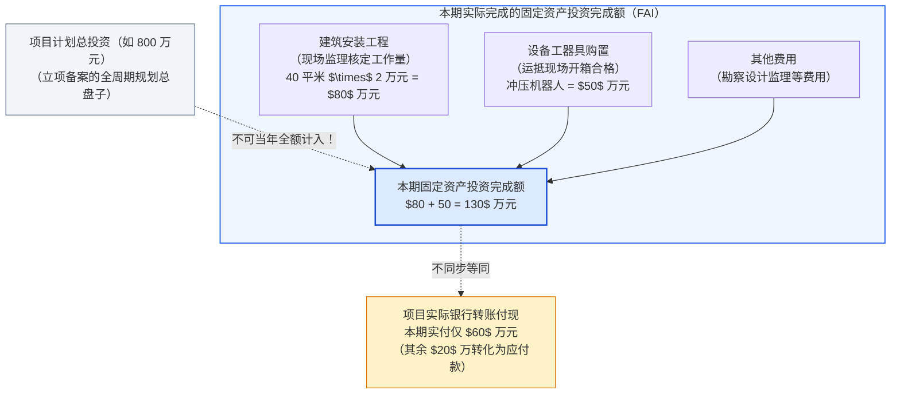
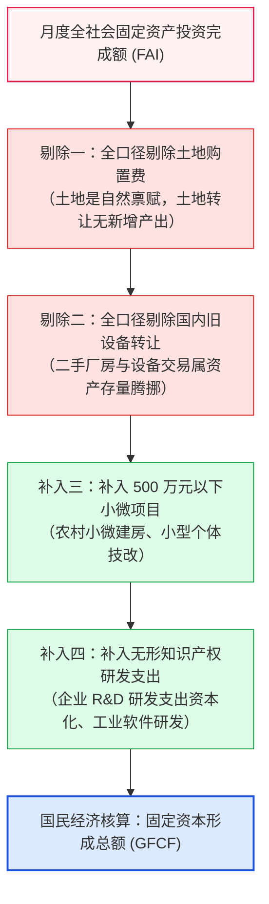
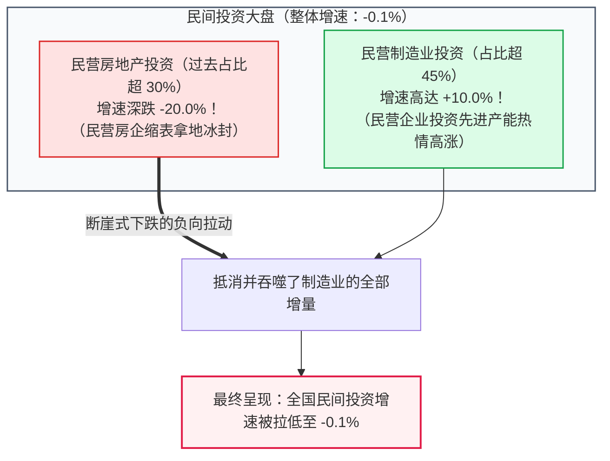
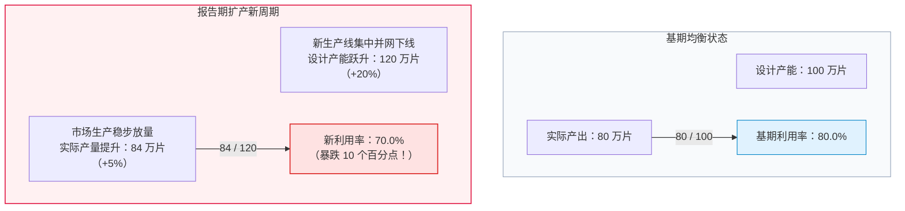

# 10 中国投资：项目统计、基建资金与资本形成

[上一章：企业经营](09-business.md) · [目录](./) · [下一章：人口与生产率](12-productivity.md)

> 中国篇深度升级版 · 2026-10。本书以美国篇为前置理论基础。工程进度与微观项目核算均为教学设计；固定资产投资统计规程与资本形成核算规则严格绑定国家统计局官方制度方案。

**前置阅读：**美国篇[04 GDP投资](https://fangpings.github.io/us-econ/04-gdp.html)、[07 企业投资与建设](https://fangpings.github.io/us-econ/07-business-and-housing.html)。在阅读本章前，你应已掌握私人固定投资、设备与建筑支出分流以及资本深化对长期生产率的理论含义。本章的核心任务，是带你拆解中国宏观经济的投资支柱：弄清**固定资产投资（FAI）与国民账户资本形成（GFCF）的鸿沟、地方基建从“发债”到“实物工作量”的三道检验，以及产能利用率在扩产周期的背离密码**。

---

## 1. 产业园区的工地上：一笔投资怎样在现场凝结

在合肥高新技术产业开发区的一片开阔工地上，吊臂起落，焊花飞溅：
- **项目蓝图**：某新能源汽车零部件制造企业在此投资建设年产 20 万套轻量化底盘生产线，经发改部门备案的**项目计划总投资为 $\$800\$$ 万元**（计划跨期两年建成）；
- **本期厂房施工**：本期建筑工程队进场打地基、立钢构，厂房规划总面积 100 平方米。根据经第三方工程监理核定的合同预算单价（每平方米 $\$2.0\$$ 万元），本期实际完成了 40 平方米的物理工程量，**确认建筑安装工程完成额 $\$40 \times 2 = \$80\$$ 万元**；
- **设备进场安装**：本期从国内机床厂采购了 2 套大型智能冲压机器人，发票金额 $\$50\$$ 万元，运抵现场并完成通电试运行，**确认设备购置完成额 $\$50\$$ 万元**；
- **两笔款项合计**：该项目在本报告期内形成的**固定资产投资完成额为 $\$80 + 50 = \$130\$$ 万元**。

此时，如果你翻看财务账本，会发现另一幅景象：
- 项目公司本期实际仅向施工队电汇转账了 $\$60\$$ 万元进度款，剩余 $\$20\$$ 万元因工程款结算审核流程尚在走审批，沉淀为施工方的**应收账款**；
- 在土地端，企业两年前为取得这片工业用地支付的 $\$100\$$ 万元土地出让金，其摊销款也记录在项目台账中。

当国家统计局公布宏观数据时：
> “1—12 月份，全国固定资产投资（不含农户）同比增长 $3.2\%$。其中，制造业投资增长 $9.2\%$，基础设施投资增长 $4.4\%$，民间投资下降 $0.1\%$。”

这组数据立即抛出了三个极具挑战性的宏观课题：
1. 为什么固定资产投资统计只盯着“计划总投资 500 万元及以上”的项目？
2. 为什么项目表里的 $\$130\$$ 万元绝对不能直接塞进当季 GDP 的投资项里？
3. 为什么“制造业投资大增 $9.2\%$”与“民间总投资下滑 $0.1\%$”可以同时并存？

---

## 2. 真实统计规程：固定资产投资完成额是怎样测算的

在中国的宏观数据字典里，月度发布的投资指标官方全称是：**“固定资产投资（不含农户）”**。

根据国家统计局公布的《全社会固定资产投资统计制度》：
- **统计门槛**：除房地产开发投资由全部具有开发资质的房企全面直报外，其他企事业单位的建设项目统计，设置了**计划总投资在 $\$500\$$ 万元及以上的准入门槛**；
- **构成结构**：固定资产投资完成额严格按工程形态细分为三大基本构成：
  1. **建筑安装工程（建安工程）**：房屋建筑与管道、铁路、道路等物理构造物的建设工程量；
  2. **设备、工器具购置**：达到固定资产标准的各种机械、传导设备及工具；
  3. **其他费用**：包括建设用地费（土地购置费）、勘察设计费、联合试运转费等。

> **两道核心防错戒律**：
> 1. **计划总投资 $\neq$ 当年完成投资**：计划总投资 $\$800\$$ 万元是该项目未来若干年全周期的总盘子。本期工地上真正施工安装的只有 $\$130\$$ 万元，只有这 $\$130\$$ 万元才能计入当年的月度固定资产投资完成额中，绝不能把 800 万元一次性算进本年投资！
> 2. **完成投资额 $\neq$ 银行现金转账流水**：固定资产投资测量的是**物理工程进度与资产购置的发生额**（权责发生制原则），哪怕项目公司因为资金紧张本期一分钱都没付给施工队，只要现场把墙砌好了、钢架搭好了，经监理确认后，这笔工程就必须确认为本期的固定资产投资完成额。

---

## 3. 统计口径鸿沟：为什么固定资产投资绝不能直接代入 GDP

在宏观经济学中，GDP 支出法中的“投资”专指**资本形成总额（Gross Capital Formation）**，其中最核心的是**固定资本形成总额（Gross Fixed Capital Formation, 简称 GFCF）**。

初学者最容易犯的致命错误，就是直接拿国家统计局月度公布的固定资产投资（FAI）总额，去当成 GDP 里的固定资本形成（GFCF）。两者之间隔着整整四道重大的国民核算桥接转换：

### 教学标准桥接测算表

假设某地区在某统计周期内的固定资产投资项目表上报总金额为 $\$160\$$ 亿元，各项明细如下表所示：

| 项目报表中的具体支出分项 | 上报金额 | 国民账户（SNA）固定资本形成的处理原则 | 桥接计算带入金额 |
| :--- | :---: | :--- | :---: |
| **新建实体工业厂房** | $\$40\$$ 亿 | **包含**：新生产出的物理建筑资产 | $+\$40\$$ 亿 |
| **采购国内全新高端机床** | $\$30\$$ 亿 | **包含**：本期新生产的机器设备资本品 | $+\$30\$$ 亿 |
| **支付既有工业用地购置出让金** | $\$30\$$ 亿 | **严格剔除**：纯土地资产所有权转移，无实体生产 | **$0$**（原表中扣除） |
| **购买国内其他企业的旧二手设备** | $\$20\$$ 亿 | **严格剔除**：属于全社会内部旧存量资产换手 | **$0$**（原表中扣除） |
| **项目表之外：企业符合标准的研发支出** | $\$15\$$ 亿 | **额外补入**：符合 SNA 2008 的知识产权无形资本化 | $+\$15\$$ 亿 |

让我们计算该地区计入 GDP 的真实固定资本形成总额：
$$\text{国民账户固定资本形成} = 160 - 30 (\text{土地}) - 20 (\text{旧设备}) + 15 (\text{研发补入}) = 125 \text{ 亿元}$$

- 在固定资产投资项目表上，记录的数字是膨胀的 **$\$160\$$ 亿元**；
- 但在 GDP 支出法核算中，真正转化为国民资本财富的只有 **$\$125\$$ 亿元**！
- 土地购置费在房地产开发投资中占比常年高达 $30\%$ 以上。在房地产投资火爆的年份，土地费暴涨会推高月度固投金额，但这些土地费在核算 GDP 时全部被当场扣除。如果不做桥接，就会产生“投资数字繁荣、GDP 却毫无反应”的虚假困惑。

---

## 4. “基建发力”的三道检验关口

在中国宏观调控中，每当经济面临下行压力，新闻头条必然充斥着“财政政策积极发力、地方专项债集中加速发行、全面掀起基建投资高潮”。

但作为专业的宏观研究员，绝不能看到财政部公布“发了 1 万亿专项债”，就立刻认定当月的基建投资会同步激增 1 万亿。一个基建项目从顶层资金注入到最终形成有效需求，必须严密穿透**三道检验关口**：

1. **关口一：资金到位 $\neq$ 现场开工**
   专项债券发行后，资金首先进入地方财政局或项目业主的银行监管账户。如果项目前期用地审批滞后、拆迁补偿未决、或者环评设计变更，资金就会以高额存款形式“沉淀”在银行账户里（表现为金融数据中机关团体存款或企业定期存款飙升），根本没有流入工地变成水泥和钢筋。
2. **关口二：完成工程 $\neq$ 现金付现**
   即便工地上塔吊林立、完成了施工并上报了投资完成额，施工企业能否顺利拿回工程款依然充满变数。如果地方财政结付滞后，施工企业就必须被迫垫资，导致建筑施工央企的应收账款急剧膨胀，进而传导至下游建材供应商与农民工工资发放。
3. **检验工具箱**：
   因此，验证基建是否“真正发力”，必须建立全链条验证雷达：
   - 先看资金端：地方政府专项债券发行进度与政策性开发性金融工具投放；
   - 再看实物端：**水泥出货率、石油沥青装置开工率、磨机运转率、挖掘机工作时长**；
   - 最后看财务端：基建类上市公司（如中国建筑、中国中铁）的单季经营性现金流与应收账款周转天数。

---

## 5. 制造业投资 vs 民间投资：一张交叉表击碎矛盾

2024 年国家统计局公布的投资公报中，出现了一个令许多外行百思不得其解的现象：
- **制造业投资同比增长 $9.2\%$**（高景气扩张）；
- 但与此同时，**全国民间固定资产投资却同比下降 $0.1\%$**（小幅收缩）！

有人惊呼：“民营企业占了制造业的八成以上，制造业投资这么好，民间投资怎么可能是负增长？这数据是不是打架了？”

真实的原因在于：**“制造业”是行业划分，而“民间投资”是所有制划分。两者的分类坐标轴截然不同！**

让我们通过一张清晰的双维交叉矩阵，彻底看清背后的结构性秘密：

| 行业大类划分 | **民间投资（民营控股）** | **国有及国有控股投资** | 全行业投资总计 |
| :--- | :---: | :---: | :---: |
| **制造业** | **强劲高增（如 $+10.0\%$）** （高技术装备、光伏、锂电、新能源车） | 稳步增长（如 $+7.0\%$） （大型石化、国企技改、战略制造） | **制造业投资大盘：$+9.2\%$** |
| **房地产业** | **大幅滑坡（如 $-20.0\%$）** （民营房企拿地收缩、开工骤减） | 相对平稳（如 $-5.0\%$） （地方国企城投托底拿地建设） | **房地产投资大盘：$-10.0\%$** |
| **基础设施业** | 占比极小（如 $-2.0\%$） | 强劲支撑（如 $+6.0\%$） （央企铁建、地方水利管网） | **基建投资大盘：$+4.4\%$** |
| **全社会总计** | **民间总投资：$-0.1\%$** （被房地产深坑彻底拖入负增长！） | **国有总投资：$+6.5\%$** （基建制造托底稳盘） | **全国固投大盘：$+3.2\%$** |

看清楚这张矩阵图，一切谜团迎刃而解：
- 民营企业家在新能源、高端机床、消费电子等先进制造业领域的投资不但没有萎缩，反而以 **$+10\%$ 的速度在逆势猛冲**！
- 但是，在民营投资的存量盘子里，过去占据三分之一巨额份额的**房地产开发投资遭遇了 $-20\%$ 的暴跌**！房地产业的巨大失血，彻底吃掉了制造业投资创造的全部顺差增量，最终在加权总数上把民间投资压制到了 $-0.1\%$。
- 如果不看交叉表，只看标题新闻，就会武断得出“民营制造业企业完全躺平不投资”的荒唐推论。

---

## 6. 产能利用率的悖论：生产扩张，利用率为什么反而大跌

在关注企业扩产时，宏观经济学会追踪国家统计局发布的季度**“工业产能利用率（Capacity Utilization）”**。

在许多重工业或新兴制造行业，分析师经常观察到一个反直觉的“悖论”：
某行业当季的**实物产量同比增长了 $5.0\%$**，但统计局公布的**产能利用率却从 $80.0\%$ 断崖式滑落至 $70.0\%$**！

生产明明增长了，为什么利用率反而暴跌了整整 10 个百分点？

### 揭开产能利用率公式的动态时差

$$\text{产能利用率} = \frac{\text{实际产量（实际生产动能）}}{\text{设计生产能力（设备设计产能）}} \times 100\%$$

让我们用一个极简但极其震撼的数学模型来演示：

> **大型光伏硅片工厂扩产案例**：
> - **基期状态**：工厂原有生产线的设计额定最大年产能为 $100$ 万片；当期实际开工生产了 $80$ 万片产品。
>   $$\text{基期产能利用率} = \frac{80}{100} = 80.0\%$$
> - **报告期状态**：基于对未来的乐观预期，两年前规划建设的二期新厂房和自动化新机组在本期**正式集中点火投产**！工厂的设计总产能瞬间从 $100$ 万片跳升至 **$120$ 万片**（产能供给能力激增了 $+20\%$）。
>   与此同时，终端下游需求虽然稳步增长，工厂开足马力将实际产量提升至 **$84$ 万片**（实物产量实现了 $+5.0\%$ 的高速增长！）。

现在，让我们计算报告期的最新产能利用率：
$$\text{新产能利用率} = \frac{84}{120} = 70.0\%$$
$$\text{利用率变动} = 70.0\% - 80.0\% = -10.0 \text{ 个百分点}$$

### 宏观周期启示：资本存量跃迁与需求消化时差

- 投资具有**“当期是需求、下期变供给”**的双重性格：今年购买机床设备，体现为固定资产投资需求的拉动；但一两年后机器安装调试完毕，就转化为全社会的生产供给能力（分母跳涨）。
- 这种“产量增长 $5\%$、利用率反而跌至 $70\%$”的现象，正是**资本密集型行业在新一轮扩产周期释放初期最典型的微观特征**。它揭示了产能的离散式跃迁（Lumpy Investment）与终端需求的平滑增长之间客观存在的动态时间错配，绝不能单凭利用率下滑就武断宣称企业即将全行业倒闭。

---

## 7. 真实官方数据带读：手把手解构 2024 年投资成绩单

请打开国家统计局发布的[《2024 年全国固定资产投资增长 3.2%》权威公报](https://www.stats.gov.cn/sj/zxfb/202501/t20250117_1958329.html)，跟随以下专业流程提取一手证据：

1. **核对基建投资范围的“小括号”**：
   公报中写道：“基础设施投资（不含电力、热力、燃气及水生产和供应业）同比增长 $4.4\%$。”
   *专业研读习惯*：统计局在发布基建时，习惯将水利、环境、公共设施管理和交运仓储作为“狭义基建”（增长 $4.4\%$）；如果你想看涵盖国家电网特高压、风光新能源大基地的“全口径基建”，必须将公用事业投资加回，此时增速通常显著高出狭义基建 $4-5$ 个百分点。
2. **核对大口径分类分化**：
   - 第一产业投资下降 $0.8\%$；
   - 第二产业（主要是制造业与采矿）投资增长 **$12.1\%$**（极端强劲！）；
   - 第三产业（受房地产拖累）投资仅增长 $0.4\%$。
   工业制造投资扛起了全社会固定资本扩张的大旗。
3. **核查设备购置的政策脉冲**：
   在投资构成附表中，寻找“设备工器具购置”分项。受国家“推动大规模设备更新和消费品以旧换新”政策强力催化，2024 年全国设备工器具购置投资保持了双位数的高速增长，其增速远快于传统的建筑安装工程，成为高端装备制造业景气度的关键底座。

---

## 练习：把资金、项目与核算接起来

1. **计划规模与门槛辨析**：某民营高新企业拟定了一项“智能化生产线升级技改方案”，董事会通过的《项目计划总投资方案》为 $\$800\$$ 万元。本年度该项目顺利取得银行中长期贷款 $\$300\$$ 万元，当年土建与设备调试完成额经监理核定为 $\$200\$$ 万元。
   - （1）在统计上报时，是否应当将 $\$800\$$ 万元全额录入本年度的固定资产投资完成额？
   - （2）统计局规定的“项目计划总投资在 500 万元及以上”的门槛，究竟约束的是哪一个指标？
2. **国民账户资本形成桥接实战**：某地级市发改委向市委提交了全年度重点工程投资完成汇总表，报表显示全市本年固定资产投资项目完成额合计为 $\$160\$$ 亿元。经统计核算专业审计，该汇总金额中包含：
   - 新建开发区标准厂房 $\$60\$$ 亿元；
   - 园区开发企业支付的历史存量建设用地出让金 $\$30\$$ 亿元；
   - 本地化工厂从外市整体搬迁接盘的二手旧化工成套设备 $\$20\$$ 亿元；
   - 此外，全市规上工业企业在本年度符合资本化确认标准、但未纳入建设项目表的软件与高新研发支出为 $\$15\$$ 亿元。
   在忽略其他杂项调整的假设下，请为该市核算当年度真正计入 GDP 支出法的“固定资本形成总额”是多少？
3. **资金与工程进度脱节审计**：某市政跨江特大桥工程，本期财政专项债与银团配套贷款累计到位资金 $\$100\$$ 万元已进入项目账户。项目业主本期实际仅向总包施工单位转账付现 $\$40\$$ 万元。总包施工单位经第三方工程监理核定完成实体桥墩桩基工程工作量 $\$50\$$ 万元。
   - （1）请分别列出金融信贷报表、项目业主银行流水与统计局投资完成额报表中记录的数值；
   - （2）在忽略前期欠款的假设下，总包施工企业本期资产负债表上的应收账款净变动是多少？
4. **所有权与行业交叉矩阵复算**：根据本章第 5 节的交叉表逻辑，假设某工业重镇在基期的投资结构为：民营制造业投资 $\$100\$$ 亿元、民营房地产投资 $\$100\$$ 亿元；国有制造业投资 $\$50\$$ 亿元、国有基建投资 $\$150\$$ 亿元。在报告期内：
   - 民营制造业投资同比增长 $+10.0\%$，民营房地产投资同比萎缩 $-20.0\%$；
   - 国有制造业投资同比增长 $+10.0\%$，国有基建投资同比增长 $+10.0\%$。
   - （1）请分别计算该镇民间投资总额的同比增长率，以及全镇全口径投资总额的同比增长率；
   - （2）请解释为什么民间投资总额大幅收缩，但全镇的制造业投资大盘却欣欣向荣？
5. **产能利用率背离实操推导**：某新能源电池工厂在基期的年设计最大产能为 $100$ 万只，当期实际产量为 $80$ 万只；报告期内，该厂二期超级工厂正式点火并网，年设计总产能飙升至 $120$ 万只。当期工人们开足马力加班生产，实际产品下线量达到了 $84$ 万只。
   - （1）请计算该厂报告期的实际产量增长率；
   - （2）请计算该厂前后的产能利用率变动了多少个百分点？
   - （3）这种利用率的大幅跳水，是否能作为该行业即将全线破产萧条的铁证？请结合企业扩产周期予以专业驳斥。
6. **中美投资指标跨国对比边界**：某海外研究员试图评估中美两国的投资拉动强度，他直接用中国公布的“1—12 月固定资产投资（不含农户）名义增速 $3.2\%$”去减去美国 BEA 公布的“实际私人国内投资总额（Gross Private Domestic Investment）环比折年率 $2.5\%$”，声称中国投资依然比美国高出近一个百分点。请向该研究员列出至少三项必须彻底清洗对齐的统计口径差异。

参考答案与详细推理

1. **计划规模与完成额边界界定**：
   - （1）**绝对不能**。$\$800\$$ 万元是该工程全生命周期的规划总预算；本年度物理现场真正形成的投资完成额仅为 $\$200\$$ 万元，只能按 $\$200\$$ 万元计入当年的固定资产投资完成额；
   - （2）**500 万元门槛约束的是入库项目的资格规模（计划总投资门槛）**。只要一个项目的全周期计划总投资达到 500 万元及以上，它就必须被纳入统计局的月度投资直报系统，并不要求该项目当年必须完成 500 万元的施工量。
2. **国民账户固定资本形成桥接严格核算**：
   - 原始项目统计完成额总计：$\$160\$$ 亿元；
   - **核算调整过程**：
     - 剔除土地出让金：$-\$30\$$ 亿元（纯土地自然资源使用权转移，不包含本期新生产的资本品）；
     - 剔除国内旧设备转让：$-\$20\$$ 亿元（属于国民经济内部二手旧资产的存量所有权换手，全社会固定资本未产生净新增）；
     - 补入研发支出资本化：$+\$15\$$ 亿元（符合 SNA 2008 的知识产权无形资本形成）；
   - **最终计入 GDP 的固定资本形成总额**：
     $$\text{GFCF} = 160 - 30 - 20 + 15 = 125 \text{ 亿元}$$
3. **基建多维报表审计与应收账款形成**：
   - （1）**多维度报表映射**：
     - 金融信贷报表：记录实体企业获得的新增银行中长期贷款及社融专项负债流入 $\$100\$$ 万元；
     - 项目公司银行现金流水：记录货币资金支出流出 $\$40\$$ 万元（账面留存闲置资金 $\$60\$$ 万元）；
     - 统计局投资完成额报表：按物理施工量记录固定资产投资完成额 $\$50\$$ 万元。
   - （2）**施工方应收账款**：
     施工方实际完成了 $\$50\$$ 万元的实物施工量，但仅收到 $\$40\$$ 万元银行电汇转账，差额 $\$50 - 40 = 10\$$ 万元直接转化为施工方的**应收账款（垫资）**。
4. **交叉矩阵测算与结构反差解密**：
   - （1）**增速测算**：
     - 基期民间投资总额：$100 (\text{制造}) + 100 (\text{地产}) = 200\$$ 亿元；
     - 报告期民间投资总额：$100 \times (1 + 0.10) + 100 \times (1 - 0.20) = 110 + 80 = 190\$$ 亿元；
     - 民间投资总额同比增长率：$\frac{190 - 200}{200} = -5.0\%$；
     - 基期全镇总投资：$200 (\text{民营}) + 200 (\text{国有}) = 400\$$ 亿元；
     - 报告期全镇总投资：$190 (\text{民营}) + [50 \times 1.1 + 150 \times 1.1] = 190 + 220 = 410\$$ 亿元；
     - 全镇总投资同比增长率：$\frac{410 - 400}{400} = +2.5\%$；
   - （2）**结构反差原因**：民间投资由制造业与房地产两大主力板块构成。民营房企拿地与施工暴跌 $-20\%$，产生的失血量（$-20\$$ 亿）完全吞噬了民营制造业投资的增量（$+10\$$ 亿），导致民间投资加权汇总后为负；但聚焦在制造业维度，不论民营还是国有均以 $+10\%$ 的速度高歌猛进，因此制造业大盘展现出强劲活力。
5. **产能利用率动态演练与反驳**：
   - （1）**实际产量增速**：$g_{output} = \frac{84 - 80}{80} = +5.0\%$；
   - （2）**产能利用率变动**：
     基期利用率：$\frac{80}{100} = 80.0\%$；报告期利用率：$\frac{84}{120} = 70.0\%$；
     利用率下降：$70.0\% - 80.0\% = -10.0$ 个百分点；
   - （3）**专业反驳**：绝对不能断言为萧条铁证！实物产量保持了 $+5\%$ 的良好增长；利用率的大幅滑坡完全是由于前期规划投资的二期工程在本期集中建成投产，使分母（设计产能）呈现出离散式的台阶式暴涨（$+20\%$）。这是典型的先进产能集中释放期，只要下游需求保持稳定消化，随着新产能爬坡完成，利用率将重回平衡。
6. **中美投资指标跨国对比清洗要点**：
   - **口径范围对齐**：中国月度固投包含巨额土地购置费（旧资产所有权转让）和二手旧资产，美国 BEA 私人固定投资严格剔除土地费与国内二手资产转让；
   - **主体部门归属对齐**：中国固投包含大量地方政府主导的基础设施公用投资（如高铁水利），而美国 BEA 私人投资严格限定于民间企业与家庭，政府基建投资全部打包进入了政府支出（G）中；
   - **时间算子与物价尺度对齐**：中国公布的是未经折年的累计名义同比增速（含通胀），美国公布的是经季节调整后的环比折年率（SAAR）且通常已剔除物价通胀（实际值）。两者在价格、时间算子与主体上完全不可比。

[上一章：企业经营](09-business.md) · [目录](./) · [下一章：人口与生产率](12-productivity.md)
