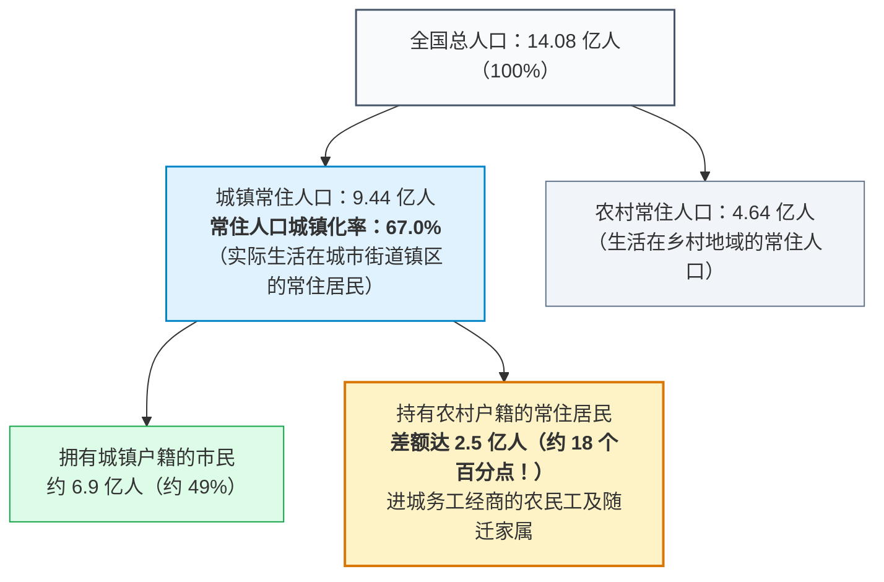
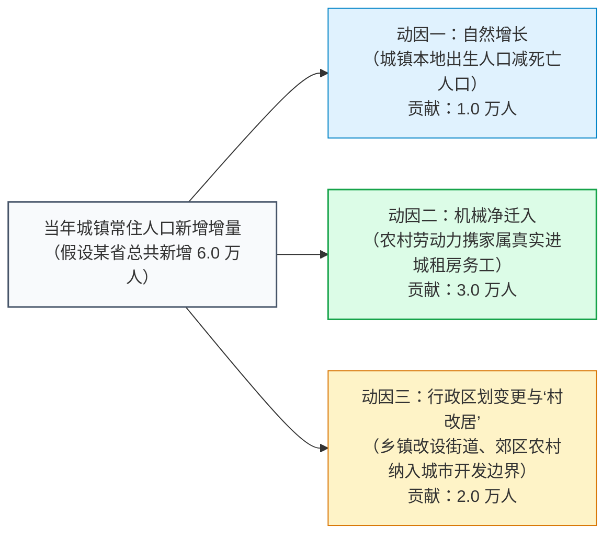
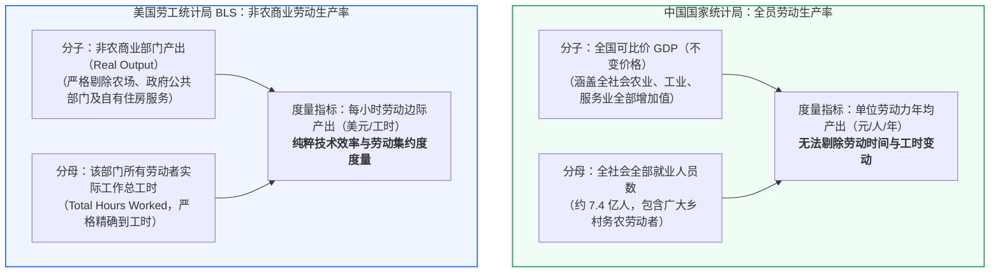

# 12 中国人口与生产率：城乡转换、统计分母与长期增长

[上一章：投资与产能](10-investment.md) · [目录](./) · [下一章：居民消费价格](13-consumer-prices.md)

> 中国篇深度升级版 · 2026-10。本书以美国篇为前置理论基础。城乡人口与生产率测算案例均为教学设计；全国人口普查与全员劳动生产率规程严格依据国家统计局官方制度方案。

**前置阅读：**美国篇[08 生产率与供给约束](https://fangpings.github.io/us-econ/08-productivity.html)。在阅读本章前，你应已掌握总产出分解公式（$\text{总产出} = \text{就业人数} \times \text{平均工时} \times \text{每小时产出}$）、资本深化（Capital Deepening）以及全要素生产率（TFP / Solow 残差）的基本概念。本章作为**第二模块（实体经济）的压轴总纲**，带你穿透中国特有的**双轨城镇化率、人口变动抽样调查分母，以及全员劳动生产率的中美核算桥接**，并对整个实体经济模块展开综合实战审计。

---

## 1. 城乡交界处的时代画卷：一户家庭的双重身份

在苏州市相城区的一处现代商品房小区里，生活着这样一个典型的中国家庭：
- **生活常态**：李先生和妻子五年前从安徽宿州农村老家来到苏州，李先生在一家新能源汽车配件厂做数控调试员，妻子在社区经营一家少儿美术托幼工作室。一家人已经在苏州连续生活、居住、工作了整整五年，并在当地按揭购买了住宅；
- **户籍现状**：夫妻俩和刚上小学的孩子，户口簿上依然清晰地盖着“安徽省某县某村”的农业户口印章。

在国家统计局公布的宏观人口画卷中，这一户家庭贡献了怎样的数据？
- 在**常住人口统计**中，由于他们常住城镇超过半年，全家三口被确凿记入**“城镇常住人口”**；
- 但在公安部的**户籍人口登记**中，他们依然被记录在**“农村户籍人口”**的底册上。

根据国家统计局公布的最新年度公报：
- 2024 年末，全国总人口为 **$140828\$$ 万人**（约 $14.08\$$ 亿人）；
- **城镇常住人口为 $94350\$$ 万人**，**常住人口城镇化率达到 $67.00\%$**；
- 而全国**户籍人口城镇化率仅在 $49\%$ 左右**！

这一高达 **$18$ 个百分点（对应约 $2.5\$$ 亿人）**的巨大统计剪刀差，是中国现代化进程中独一无二的人口景观：它真实刻画了数以亿计已经彻底卷入城市产业分工、但其社会保障、子女升学与土地权益仍维系在乡村的原乡务工大军。

---

## 2. 统计源头拆解：中国年度人口数是怎样推算出来的

初学者常问：“既然中国有 14 亿人口，国家统计局是不是每年都要把全国所有人重新普查一遍？”

显然不可能。全国人口数据的生成，遵循严密的**“十年大普查 ＋ 年度千分之一变动抽样调查”双轨制度**：

1. **十年一次的全国人口普查（年份尾数为 0）**：
   例如 2020 年进行的“第七次全国人口普查”（七人普），动员了 700 万名普查员，上门对全中国 14 亿常住公民进行地毯式摸排登记，彻底查清全国人口底数、性别、年龄结构、受教育程度及居住迁移状况，作为历史长周期数据的绝对基准。
2. **非普查年份的年度人口抽样调查**：
   在两次大普查之间的平年，国家统计局于每年 11 月 1 日零时开展**全国人口变动情况抽样调查**，抽样比大约为全国人口的 **$1‰$（千分之一左右，样本量约 100 余万人）**。
   调查员采集抽中样本户的出生、死亡、婚姻与迁移信息，结合国家卫生健康委的活产儿分娩出生记录、民政部的火化与婚姻登记行政资料、公安部的户籍变动大数据，运用人口统计学队列要素法（Cohort-Component Method），推算生成当年度的全国年末总人口、出生率与死亡率。

> **多层劳动力分母辨析**：
> 在研读长期生产率与劳动力供给时，必须分清以下四层不断缩窄的人口分母，绝不可拿总人口直接做除法：
> 1. **全社会总人口**（2024 年末约 $14.08\$$ 亿人）；
> 2. **16—59 岁劳动年龄人口**（传统适龄劳动人口，约 $8.5\$$ 亿人）；
> 3. **全社会经济活动人口（劳动力总量）**（涵盖 16 岁以上所有就业与失业人员，约 $7.8\$$ 亿人）；
> 4. **全社会实际就业人员总数**（全社会所有在岗在业劳动者总和，约 $7.4\$$ 亿人）。

---

## 3. 城镇人口扩张的三大动因：谁在推高城镇化率

许多宏观分析报告常常把“城镇常住人口增加了 1000 万人”，直接等同于“本年度有 1000 万名农村青壮年进城打工”。这种推论在人口统计学上是极其粗糙的。

在数学上，城镇常住人口的年度新增增量由三个截然不同的要素驱动：
$$\Delta \text{城镇人口} = \text{人口自然增长（出生减死亡）} + \text{城乡机械净迁入} + \text{行政区划调整与城乡属性变更}$$

> **警惕“原地城镇化”的统计魔术**：
> 在上面的算例中，城镇人口虽然账面增长了 6.0 万人，但其中有 **$2.0\$$ 万人根本没有搬家，他们的物理生活轨迹毫无改变！** 仅仅是因为当地政府实施了“撤县设区”或者“城中村改造村改居”，原有的农村居委会变更为城市社区居委会，统计局在系统里将该区域的代码由“乡村代码”调整为“城镇代码”，这 2 万人就在一夜之间被系统自动重分类为了“城镇人口”。
> 如果把这 2 万人也算作新进城的商品房潜在买家，就会对真实的边际增量需求产生严重的高估。

---

## 4. 全员劳动生产率：中美指标背后的巨大分母鸿沟

长期经济增长的终极源泉只有两个：劳动力数量的投入，以及生产率（Productivity）的跃升。

在中美宏观对话中，最具迷惑性的一对指标是生产率：
- **中国国家统计局发布**：2024 年全员劳动生产率为 **$\$173714\$$ 元/人**，比上年提高 $5.7\%$；
- **美国劳工统计局（BLS）发布**：非农商业部门劳动生产率（Nonfarm Business Labor Productivity）环比折年率增长 $2.2\%$。

如果你把两个数字并排对比，以为它们度量的是同一类效率，你就掉入了巨大的跨国度量陷阱中：

### 三大根本性口径差异

1. **分母度量单位不同（人 vs 工时）**：
   - 中国目前公布的法定全员劳动生产率是以**“人”（就业人员）**为分母计算的，度量的是每名劳动者一年创造的平均产出；
   - 美国 BLS 劳动生产率是以**“小时”（Total Hours Worked）**为分母计算的，精确捕捉了加班、轮休、兼职对真实劳动投入的调整。如果经济下行期中国企业普遍缩短工时以避免裁员（每个人的产出看似下降），按“人”计算的生产率就会掩盖工时缩短的缓冲效应。
2. **分子产业边界不同（全经济 vs 非农商业）**：
   - 中国的全员劳动生产率涵盖全社会所有产业（包含低生产率的传统分散农业，以及不以盈利为目的的政府公共行政服务）；
   - 美国 BLS 则严格将政府部门（公共服务缺乏市场定价）、农业（受天气周期扰动大）以及居民自有住房虚拟租金全部剥离，纯粹测量**非农商业部门（Nonfarm Business Sector）**的市场化技术变迁。
3. **不能机械除以周工时换算**：
   很多研究员翻出统计局公布的“企业就业人员周平均工作时间（例如 48.7 小时/周）”，直接拿年产出除以 52 周再除以 48.7 小时，宣称自己算出了“中国每小时劳动生产率”。
   这种算账在统计学上是严重违规的！因为该周工时调查仅仅覆盖了规模以上企业样本，广大个体户、农民工与农业人口的真实工时完全未知，直接拿非对称的分母相除，只会造成巨大的伪精确系统偏差。

---

## 5. 第二模块终极综合作业：现场审计一份漏洞百出的中美宏观对比简报

> **高阶实战审计演练**：
> 某海外对冲基金大中华区宏观实习生起草了一份季度宏观分析备忘录，标题为《中国全面承压与中美经济全面脱节简报》。该简报包含了以下核心段落：
> 
> **【备忘录原文摘录】**：
> 1. *消费板块*：“中国 1—12 月社会消费品零售总额仅增长 $0.0\%$，而同期美国 PCE 消费强劲增长 $6.0\%$，无可辩驳地证明中国居民消费已经全面陷入冰封；”
> 2. *GDP 动能*：“中国一季度名义 GDP 增量中，最终消费支出仅增加了 $\$14\$$ 亿元，而投资资本形成总额猛增了 $\$30\$$ 亿元（总增量仅 $\$50\$$ 亿元），说明经济复苏完全建立在低效政府基建狂飙的基础上；”
> 3. *投资核算*：“某重点项目报表显示固定资产投资完成额高达 $\$160\$$ 亿元，但根据地方 GDP 资本形成核算，该项目形成的资本财富也必然为 $\$160\$$ 亿元；”
> 4. *金融信贷*：“当月企业新增银行贷款 $\$80\$$ 亿元、发债 $-\$40\$$ 亿元，表明金融体系为实体注入了 $\$80\$$ 亿元全新的项目资金；”
> 5. *工业景气*：“某园区规上工业企业今年总营收由去年的 $\$200\$$ 万元跳升至 $\$280\$$ 万元，同比暴涨 $40.0\%$，体现了强劲的工业刺激成效；”
> 6. *工资与效率*：“在经济普查后，该市城镇单位平均工资由 10 万元滑落至 8 万元，跌幅达 $20\%$，证明所有企业职工都在普遍遭遇降薪减员；同时按就业人员折算的全员劳动生产率仅提高 $3.96\%$，显著低于美国劳动生产率表现。”

**作为首席宏观审计师，请根据本模块（第 05—12 章）所掌握的全部国民经济核算定理，逐条出具严厉的专业审计驳斥，并撰写一份客观中肯的替代简报：**

完整专业审计诊断与替代简报

### 逐项专业审计诊断意见

1. **消费比较口径完全错配**：
   - 实习生将中国的**商品零售与餐饮销售月报（社零）**与美国的**全口径国民账户消费（PCE）**直接对比，犯了基础性概念错配；
   - 在题设微观结构中，实物商品社零虽然受偏好转移影响持平（$0.0\%$），但涵盖文旅、医疗、教育的**中国式家庭完整真实消费支出实际增长了 $10.0\%$**（由 100 亿增至 110 亿），甚至跑赢了美国可比口径的 $6.0\%$！不能单凭商品销售否定整体消费升级。
2. **增长贡献率与政府投资归类的混同**：
   - 在 GDP 增量核算中（基期 1000 亿，本期 1050 亿，增量 50 亿），消费贡献 14 亿（拉动 $1.4$ 个百分点），资本形成增加 30 亿（拉动 $3.0$ 个百分点）；
   - 实习生忽视了**中国“资本形成总额”中包含了民间制造业先进设备投资**，绝非全部是低效政府基建；且中国“最终消费”中包含政府公共医疗行政消费，不能简单进行意识形态化标签归因。
3. **固投（FAI）与固定资本形成（GFCF）的混淆**：
   - 项目报表中的 $\$160\$$ 亿元固定资产投资完成额，必须依法剔除已支付的存量土地出让金（如 $\$30\$$ 亿）和二手旧设备（如 $\$20\$$ 亿），并补入表外企业自主无形研发支出资本化（如 $\$15\$$ 亿）；
   - 该项目真正计入 GDP 的固定资本形成仅为：$160 - 30 - 20 + 15 = 125\$$ 亿元，绝不能把 160 亿元全额代入 GDP。
4. **信贷工具置换与流量混同**：
   - 银行贷款净增 $\$80\$$ 亿元，但企业债券净偿还 $-\$40\$$ 亿元，实体部门从金融系统获得的净外源流动性仅增加了：$\$80 + (-\$40) = \$40\$$ 亿元；
   - 其中大部分属于“债转贷”的融资工具重构或债务置换，并没有为现场提供 80 亿元的新增项目工程款。
5. **跨期旧新闻相除的样本失真**：
   - 去年旧新闻 200 万（仅涵盖 A、B 两家老企业），今年 280 万包含了新升规入库的老企业 C（去年产值 50 万）；
   - 直接相除得出的 $+40.0\%$ 混入了企业 C 过去几十年的历史存量资产，按同口径在库企业重构后，**真实可比增速仅为 $\frac{280}{250} - 1 = +12.0\%$**。
6. **样本稀释效应与生产率时间尺度错配**：
   - 平均工资由 10 万降为 8 万元（$\frac{100 \times 10 + 100 \times 6}{200} = 8$），完全是普查把低薪酬小微企业纳入统计池后的**结构性权重稀释**，原高薪企业员工没有一分钱被减薪；
   - 中国全员劳动生产率度量的是“不变价 GDP / 全社会总就业人数”（实际增长 $\frac{1.05}{1.01} - 1 \approx 3.96\%$），缺乏全社会精确工时支持，不能与美国仅限非农商业部门的“每小时精细生产率”直接相减。

---

### 首席宏观分析师重写的替代标准简报（300 字范本）

> **【宏观运行真实诊断与中美对照替代简报】**
> 本期数据显示中国实体经济呈现出“需求结构转型、先进制造托底、核算边界重塑”的典型特征：
> 1. **消费端**：实物商品社零总额表现平稳，但居民家庭在文旅健康等现代服务领域的完整消费支出同比增长达 $10.0\%$，表现优于美国同期同类商品需求，内需动能正在加速向服务化转移；
> 2. **投资与供给端**：名义固定资产投资受土地购置费剔除影响表现温和，但在剔除土地旧资产后，实际固定资本形成保持良性扩张；规上工业可比增速达 $12.0\%$，高技术装备制造有力对冲了房地产开发投资下滑；
> 3. **金融与劳动效率**：信贷投放呈现明显的债务结构置换特征；普查后统计样本扩容引发名义工资均值结构性稀释，但存量岗位薪资与就业大盘稳定；扣除物价后全员实物劳动生产率稳步提升 $3.96\%$。当前宏观研判应紧盯服务消费持续性与企业应收账款现金回收进度。

---

## 练习：本章自测

1. **双轨城镇化率计算与信息边界**：某省统计年鉴显示：全省常住总人口为 $1000$ 万人，其中居住在城镇街区区域的常住人口为 $700$ 万人；在公安部门登记的户籍底册中，全省拥有城镇户籍的人口为 $600$ 万人。
   - （1）请分别计算该省的“常住人口城镇化率”与“户籍人口城镇化率”；
   - （2）这两个比率之间相差的 10 个百分点，是否意味着该省一定存在 100 万名被多报虚报的人口？请阐明其实质含义。
2. **城镇人口增长动因拆解**：某新兴工业城市统计局通报：本年度全市城镇常住人口比上年净增加了 $6.0$ 万人。经人口变动抽样调查核实，其中本市城镇原住人口自然增长（出生减死亡）为 $1.0$ 万人，由农村外来真实净迁入的务工经商人口为 $3.0$ 万人，因周边乡镇“撤乡设街道”完成行政区划代码变更而原地划入城镇的人口为 $2.0$ 万人。
   - 请问：该市本年度是否可以按照“新增了 6 万名进城购房刚需劳动力”来规划房地产建设？为什么？
3. **周工时与生产率分母错配**：国家统计局公布某年度中国实际 GDP 增长了 $5.0\%$，全社会就业人员总量增长了 $0.5\%$；同时在月度调查中发布“规上企业就业人员周平均工作时间为 48 小时”。某学者直接拿全年 GDP 除以 $52$ 周再除以 48 小时，计算出“中国每工时真实生产率”。请指出该计算在抽样代表性与时间维度上的两处致命硬伤。
4. **历史基准修订对生产率的传导**：在第五次全国经济普查完成后，国家统计局对上一年度的 GDP 现价总量大幅调增了 $\$3.37\$$ 万亿元（其中自有住房服务核算改革调增了 $\$1.34\$$ 万亿元）。请问：这是否意味着该年度中国普通工人的劳动技能与物理生产效率突然发生了飞跃？我们在重新评估该年度劳动生产率时必须同步校准什么？
5. **资本存量测算的前置清洗**：在运用柯布-道格拉斯生产函数（$Y = A K^\alpha L^{1-\alpha}$）测算中国全要素生产率（TFP）时，如果你试图利用历年公布的“全社会固定资产投资总额”去估算资本存量 $K$，你在数据输入前必须执行哪三步核心清洗动作？
6. **中美跨国对比口径对齐清单**：请为中国国家统计局公布的“全员劳动生产率”与美国 BLS 公布的“非农商业劳动生产率”，列出一份包含至少三个维度的标准化跨国清洗对照清单。

参考答案与详细推理

1. **双轨城镇化率计算与内涵辨析**：
   - （1）**比率计算**：
     $$\text{常住人口城镇化率} = \frac{700}{1000} \times 100\% = 70.0\%$$
     $$\text{户籍人口城镇化率} = \frac{600}{1000} \times 100\% = 60.0\%$$
   - （2）**绝对不是虚报多报**：相差的 10 个百分点（对应 100 万人），准确度量了**“生活居住在城镇、享受城市市政基础设施、但在公安户籍登记上依然保留农村农业户口”的流动务工与常住群体**。这一差额反映了户籍制度改革与公共服务均等化（如随迁子女异地高考、保障房申请门槛）的长期政策空间，是真实经济身份与空间错位的客观投影。
2. **城镇人口新增与刚需购房辨析**：
   - **绝对不能**；
   - 6 万新增人口中，包含城镇本地家庭自然出生的婴幼儿（属于未成年人，不构成现实独立劳动力与购房需求）；
   - 尤为关键的是，其中有整整 $2.0\$$ 万人纯属**“行政区划代码变更的原地城镇化”**！这部分居民原本就在当地拥有宅基地自建房，他们的生活居住物理空间毫无迁徙变动，根本不会产生由于空间迁移带来的异地商品房租赁或购置刚需；
   - 真实的流动增量主要是那 3.0 万名机械净迁入人口，且需进一步核实其家庭可支配收入与长期定居意愿。
3. **每工时生产率粗暴测算的致命硬伤**：
   - **硬伤一：调查样本总体严重不对称**。48 小时的周工时调查仅仅覆盖了**大中型规模以上企业**的在岗职工；而全国全员劳动生产率的分子是涵盖了传统小农经济、个体摊贩、街头灵活散工的“全社会总产出”，分母是涵盖 7.4 亿全行业从业人员的“全社会总就业”；拿规上企业的高集约度工时去平摊全社会农业与个体户，构成了严重的样本分母错配；
   - **硬伤二：样本参考周与全年工作周的时差扭曲**。统计局抽查的周工时仅对应某个月份的特定调查参考周，无法直接代表全年 52 周的真实加班与节假日轮休全貌（忽视了春节长假、农忙假、国庆调休等跨期扰动）。
4. **普查修订与生产率再评估**：
   - **绝不代表物理生产效率突然提高**；
   - 调增的 3.37 万亿元中，有近四成（1.34 万亿）纯粹是**城镇居民自有住房虚拟租金由成本折旧法向市场等价租金折算法的核算方法学改革**，属于度量尺度的会计优化；其余部分主要是查漏补缺的第三产业小微企业存量；
   - 在重新评估生产率时，**必须同步校准历史基期的价格平减指数以及普查同步核实的全部就业人员底数分母**；必须区分“名义货币水平重估”与“扣除物价后的实物技术进步”，绝不可拿着名义 GDP 增量宣布生产率发生了技术飞跃。
5. **资本存量 K 测算的前置清洗三部曲**：
   - **步骤一：剥离土地购置费与国内旧资产转让**。剔除不属于本期新生产资本品的土地所有权交易款和二手设备换手，将固定资产投资（FAI）还原为真实的固定资本形成（GFCF）；
   - **步骤二：补入研发无形资本与 500 万元以下小微资本品**。将企业符合标准的 R&D 知识产权支出与农业小型基础设施资本化计入资本形成总盘子；
   - **步骤三：应用固定资产投资价格指数（平减物价）并执行永续盘存法（PIM）折旧与退役**。利用分行业固定资产价格指数将名义投资转化为不变价实物流量，设定科学的经济折旧率（剔除报废设备），才能得出真实的生产性资本存量 $K$。
6. **中美劳动生产率跨国清洗清单**：
   - **维度一：产出分子部门边界对齐**。将中国 GDP 严格剥离农业、政府公共部门与自有住房服务，提取纯市场化的非农商业部门产出，以对齐美国 Nonfarm Business Sector；
   - **维度二：劳动投入分母度量衡对齐**。不能以中国“就业人员数”直接对比美国“总工时”，必须利用微观住户调查（如 CFPS 或 CHIP）精确估计中国非农劳动者的真实实际工作工时；
   - **维度三：价格平减与时间序列周期对齐**。将中国的不变价基期平减方法与美国的费雪链式指数（Chained-dollar Index）对齐，并统一两国的季节性调整周期与时间截面版本。

---

## 第二模块完成标准

读完本模块（第 05—12 章）后，以一个没有经济学专业背景的大学生为读者，你现在应当能够：
1. **彻底摆脱名词迷思**：不再把“社零”等同于消费、“固投”等同于投资、“新增贷款”等同于经济刺激，能够清晰画出从微观企业直报到宏观国民账户（SNA）的完整映射地图；
2. **精通统计边界与工程防线**：一眼识别出新闻通稿中“累计同比、按可比口径、其中限额以上、自有住房服务改革”等关键限定词，并能熟练完成单月差分还原与中美时间算子（同比 vs 环比折年率）的无缝切换；
3. **具备立体审计诊断思维**：当面对一份表面繁荣、但内部充满“增量不增利、应收账款恶化、产能利用率大跌、样本结构稀释”的宏观数据包时，能够像资深宏观分析师一样，条分缕析地指出其内在机制、传导阻滞与求证证据，而不是盲从单一标题或陷入无根据的阴谋论。

接下来，我们将正式跨入宏观经济的神经中枢——**价格与通货膨胀模块**，带你从猪肉周期、国际油价到核心 CPI 和 PPI，看清中国物价波动的底层逻辑！

[上一章：投资与产能](10-investment.md) · [目录](./) · [下一章：居民消费价格](13-consumer-prices.md)
