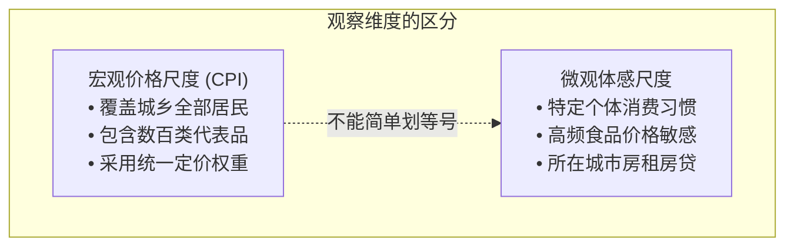
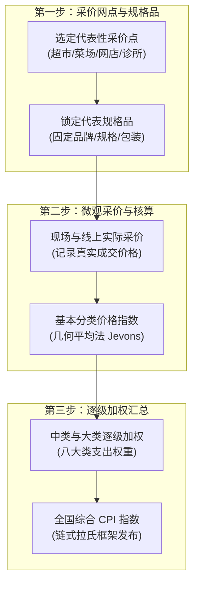
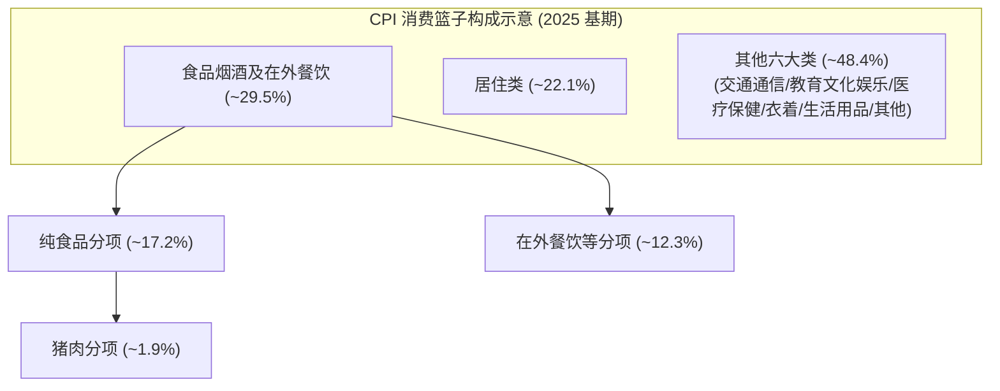
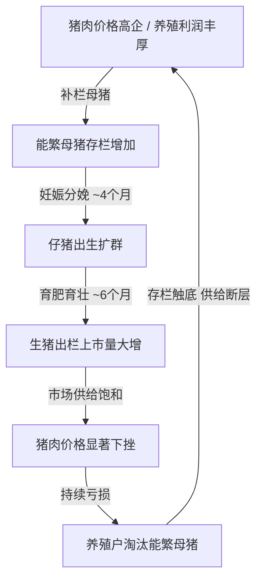
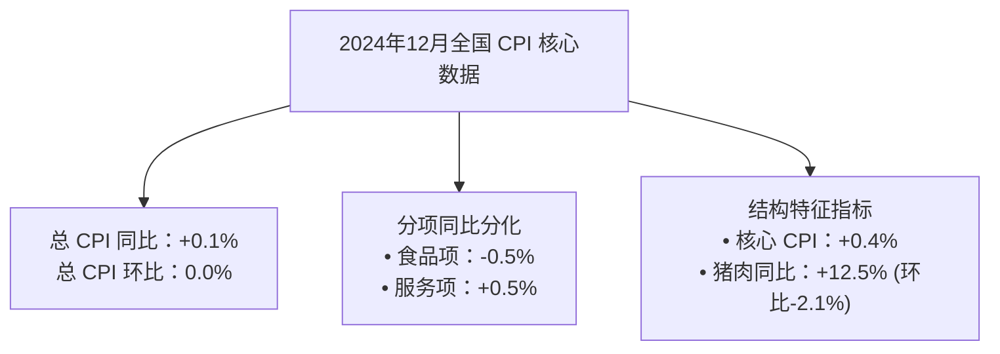

# 13 中国 CPI：消费篮子、食品波动与居住口径

[上一章：人口与生产率](12-productivity.md) · [目录](./) · [下一章：生产者价格](14-producer-prices.md)

> 编写于 2026-09-24。基期方法更新至所引 2026 年说明；报告带读固定使用 2025-01-09 发布的历史版本，不代表当前物价。

**前置阅读：**美国篇 [09 通胀的衡量](https://fangpings.github.io/us-econ/09-inflation-measures.html)。固定篮子、价格相对数、核心指标和链式加权计算作为已知。本章要解决的核心问题是：当我们把通胀分析的视角转到中国时，老百姓的“菜篮子”、生猪繁育的生物周期、特有的居住核算方式以及五年一次的基期轮换，如何塑造了我们每个月看到的中国 CPI 数据？

---

## 1. 走进中国 CPI：它在回答谁的生活成本？

每个月上旬，国家统计局公布的居民消费价格指数（CPI）总是牵动千家万户与金融市场的心。但初学者最容易产生的困惑往往是：**“为什么公布的 CPI 只有 0.1%，我却觉得去菜市场买肉买菜贵了不少？”**

要读懂中国 CPI，首先要厘清它的统计定位与观察边界：

1. **观察总体而非单个个体**：中国 CPI 衡量的是全国城乡居民购买消费商品和服务的总体价格水平变动。它由全国数以万计家庭的平均支出结构加权而成，反映的是宏观经济全貌，而不是任何一个特定家庭的生活账单。
2. **消费支出而非资产投资**：CPI 覆盖的是衣食住行等当期消费性支出，**不包含购置产权商品房的资本支出**，也不包含股票、基金等投资品。买房是资产投资，买菜、租房、看电影才是当期消费。
3. **相对价格波动与感受偏差**：高频购买的生鲜食品（菜篮子）涨价往往带来强烈的痛感记忆，而耐用消费品（如家电、手机、汽车）的降价或升级降价却容易被日常习惯忽视。

在日常研判中，我们必须把三个问题区分开：
- **物价是否上涨**：统计局采价网点测算的同规格消费品价格是否普遍上涨（看 CPI 读数）；
- **消费需求是否强劲**：提价是否由居民旺盛的自发购买力拉动（需结合居民可支配收入、消费倾向与社零销量）；
- **民生负担是否加重**：物价波动对不同收入群体的实际购买力冲击（需结合分项权重、就业与可支配现金流）。

---

## 2. 采价调查全流程：一张价格记录怎样汇成全国指数

中国 CPI 绝不是每个月向所有家庭发放问卷、询问大家花了多少钱，而是通过一套高度严谨的**代表规格品采价网络**完成的。

国家统计局在全国选定数百个市县、数万个采价点（包括农贸市场、大型超市、品牌专卖店、电商平台、社区卫生中心及各类服务网点），派驻专职采价员或通过大数据直采系统持续跟踪代表规格品的实际成交价格。[国家统计局：CPI 的基础数据来源](https://www.stats.gov.cn/zs/tjws/zytjzbqs/jmxxggzs/202501/t20250121_1958387.html)

### 2.1 消除规格变动的伪装：缩水式涨价与品质调整

在实际采价中，企业常常通过隐蔽手段改变价格，采价员必须保持数量与质量的可比性：

- **隐性缩水（Shrinkflation）**：某品牌大米原包装为 $5\text{ kg}$，售价 $40\text{ 元}$；厂商重新设计包装推出新规格 $4\text{ kg}$，标价依然是 $40\text{ 元}$。如果只看标价 $40\text{ 元}$ 会误判为价格不变，采价系统会将其折算为单位基准价格：
  $$\frac{40\text{ 元}}{4\text{ kg}} = 10\text{ 元/kg}, \quad \text{原价} = \frac{40\text{ 元}}{5\text{ kg}} = 8\text{ 元/kg}, \quad \text{实际涨幅} = \frac{10 - 8}{8} = +25.0\%$$
- **复杂促销与会员门槛**：标价 $100\text{ 元}$ 的商品，若全员实际以 $90\text{ 元}$ 成交，采价记录为 $90\text{ 元}$；如果只有极少数满足严苛跨店满减或大额储值条件才能拿到低价，则不能将其视为主流成交价。

---

## 3. 数学内核：基本分类几何平均与链式加权

中国价格指数的计算在底层和上层采用了不同的数学方法：底层规格品相对数使用**几何平均法（Jevons 指数）**形成基本分类指数；上层大类和总指数则采用**链式拉氏（Laspeyres）框架**逐级汇总。[国家统计局：居民消费价格指数计算方法](https://www.stats.gov.cn/zs/tjws/tjzb/202301/t20230101_1903757.html)

### 3.1 底层几何平均：消除极端值与对称性要求

设某个基本分类下有 $n$ 个代表规格品，基期价格为 $p_{i0}$，报告期价格为 $p_{it}$，价格相对数为 $r_i = \frac{p_{it}}{p_{i0}}$。该基本分类指数采用几何平均公式：

$$I = \sqrt[n]{\prod_{i=1}^n \frac{p_{it}}{p_{i0}}} = \left( \prod_{i=1}^n r_i \right)^{\frac{1}{n}}$$

> **算例演示**：某个基本分类下采集了两个等权规格品，价格相对数分别为 $r_1 = 1.10$（上涨 $10\%$）和 $r_2 = 0.90$（下跌 $10\%$）。如果使用算术平均，得到 $\frac{1.10 + 0.90}{2} = 1.00$（上涨 $0\%$）。但在几何平均下：
> 
> $$I = \sqrt{1.10 \times 0.90} = \sqrt{0.99} \approx 0.994987$$
> 
> 对应的实际价格变动为 $0.994987 - 1 \approx -0.5013\%$。几何平均兼顾了相对价格变动的反向平衡，有效避免了算术平均在比率变动上的向上偏误。

### 3.2 上层加权汇总：权重与贡献率的计算

将底层基本分类汇总为全国总指数时，各类别赋予相应消费支出权重 $w_i$（$\sum w_i = 1$）：

$$\Delta \text{CPI} = \sum_{i} w_i \times \Delta r_i$$

某一类别的**拉动点数（贡献点）**计算为：

$$\text{贡献点数} = w_i \times \Delta r_i$$

> **算例演示**：假设一个简化消费篮子中，食品类权重为 $25\%$，非食品类权重为 $75\%$。某月食品价格下跌 $4\%$，非食品价格上涨 $1\%$。总 CPI 变化为：
> 
> $$\Delta \text{CPI} = 0.25 \times (-4\%) + 0.75 \times (+1\%) = -1.0\% + 0.75\% = -0.25\%$$
> 
> 虽然占支出 $75\%$ 的多数商品都在温和上涨，但由于食品分项的大幅下挫，总体 CPI 读数依然为负。这就是为什么我们要进一步下拆核心 CPI 与细项。

---

## 4. 2026 基期轮换与动态权重更新

中国 CPI 编制实行**每五年进行一次基期轮换**的制度。按照国家统计局说明，自 2026 年 1 月起，以 2025 年为基期编制新一轮 CPI 系列指数。[国家统计局：2026 年价格指数基期轮换说明](https://www.stats.gov.cn/sj/sjjd/202602/t20260211_1962589.html)

在 2025 年基期结构中，八大类及代表性分项权重具有明确的统计界限：
- **食品烟酒及在外餐饮**：权重约为 $29.5\%$
  - 其中：**食品分项**权重约为 $17.2\%$
  - 重点品种：**猪肉**在总篮子中权重约为 $1.9\%$
- **居住大类**：权重约为 $22.1\%$

### 4.1 权重运用的三大禁忌红线

1. **不可将“食品烟酒及在外餐饮”等同于“食品”**：
   在核算核心通胀（Core CPI）时，扣除的是狭义食品与能源。不能把 $29.5\%$ 的整个大类全部当成食品剔除，在外餐饮兼具劳动力与服务属性，在核心篮子中应予以合理处理。
2. **基期支出份额 $\ne$ 报告期动态计算权数**：
   基期权重代表基准年份的支出结构。当某些商品价格经历持续暴涨或暴跌后，其实际支出占比在动态变化。
   
   > **动态加权演示**：假设基期家庭购买食品支出为 $20\text{ 元}$，非食品支出为 $80\text{ 元}$（食品权重 $20\%$）。若之后食品价格翻倍，在数量保持不变的简化假设下，篮子总成本升至 $20 \times 2 + 80 = 120\text{ 元}$，食品在当前篮子中的相对重要性升至：
   > 
   > $$\text{动态权数} = \frac{40}{120} = \frac{1}{3} \approx 33.33\%$$
   > 
   > 若下一个月食品价格再涨 $10\%$，它对当前总篮子的推动为 $\frac{1}{3} \times 10\% \approx 3.33\%$。如果机械套用基期的 $20\%$ 权重，就会严重低估为 $20\% \times 10\% = 2.0\%$。
3. **不可拿新基期权重倒推历史月份贡献**：
   2024 年各分项对总指数的拉动点数必须依当时的官方比较权数分析，不能用 2026 年启用的新权重去强行推翻历史报告。

---

## 5. 食品波动与猪周期：生物钟驱动的供给传导

为什么中国 CPI 常被市场戏称为带有“猪周期”烙印？这是由生猪养殖独特的**生物繁育周期**所决定的不可逆规律：

从能繁母猪受孕到生猪育肥出栏，至少需要 **10 至 12 个月** 的自然周期。这意味着：
- **供给响应滞后**：当猪价上涨时，即使养殖户全力补栏，新产能转化为货架上的猪肉也必须经历将近一年的时间滞后；
- **价格大幅超调**：等到大量生猪集中出栏时，市场供给瞬间井喷，又容易导致猪价跌破养殖成本线，引发新一轮产能出清。

在观察食品价格变动时，必须结合农业农村部公布的**能繁母猪存栏量**、生猪存栏以及饲料出货量等先行指标，才能科学预判猪肉是处于供给改善周期，还是需求偏弱阶段。

---

## 6. 中国汽油定价与输入型时滞机制

除食品外，能源价格也是消费波动的重要来源。中国国内汽油、柴油价格并不是由加油站每天自主根据纽约 WTI 或布伦特现货价格即时波动的，而是遵循国家发展改革委制定的**成品油调价机制**：

根据现行机制，发改委每 **10 个工作日** 对照国际原油加权均价变动进行一次测算：
- 调价金额每吨不足 $50\text{ 元}$ 时，不作调整，纳入下次调价时累加或冲抵；
- 设立调价**上下限（地板价 40 美元/桶，天花板 130 美元/桶）**以维护能源稳定。[国家发展改革委：成品油调价公告](https://www.ndrc.gov.cn/xwdt/xwfb/202512/t20251208_1402287_ext.html)

因此，当国际油价单日大幅暴跌 $5\%$ 时，中国 CPI 交通工具用燃料分项绝不会在同一天同步下跌 $5\%$，中间经历了时间窗口平滑、跨期累计与零售采价时点的缓冲。

---

## 7. 居住口径辨析：中国“居住”与美国“Shelter”的本质区别

中美物价对比中，最大的误区莫过于将中国的**“居住大类”**与美国的**“庇护所费用（Shelter）”**画等号。

| 比较维度 | 中国 CPI“居住大类” | 美国 CPI“Shelter” |
| :--- | :--- | :--- |
| **涵盖范围** | 包含租赁房租、水电燃料、住房保养维修及自有住房服务 | 纯粹核算住房租金与居住服务，**水电燃气单独列为能源分项** |
| **自有住房服务核算** | 目前主要采用成本折旧与相关维护服务评估法 | 采用**业主等价租金（OER）**，由相同类型租赁房样本租金模拟推算 |
| **商品房售价关联度** | **不直接挂钩**商品房销售市价（属于资产购买） | **不直接挂钩**全美房价指数（Case-Shiller） |
| **在总指数中权重** | 2025 基期约为 $22.1\%$（包含能源燃料） | 权重高达 $34\% \sim 36\%$ 左右 |

由于这一统计边界的根本不同：
1. **不能直接比较两者的单月涨跌幅**：美国 Shelter 指数往往滞后反映美国租赁市场租金走势，而中国居住分项包含了随煤电水气价格波动的公共事业费用；
2. **房价下跌不会直接导致 CPI 居住项雪崩**：居民购买一手房或二手房的成交价格下降，改变的是资产账面价值和居民财富，当月反映在 CPI 里的依然是日常租赁租金或当期维护成本。

---

## 8. 真实发布包带读：以 2024 年 12 月发布为例

打开国家统计局发布的 2024 年 12 月物价公报（发布于 2025-01-09），我们可以展开一场标准的专业研读训练：

数据呈现出非常典型的中国物价特征：
1. **食品与服务的冷热分化**：食品同比下降 $0.5\%$ 抑制了物价总读数，而服务类温和上涨 $0.5\%$，表明居民在文旅、教育娱乐等领域的消费需求仍有韧性。
2. **猪肉同比与环比的反向运行**：猪肉同比上涨 $12.5\%$（由于上年同期基数极低），但环比下降 $2.1\%$（由于生猪集中出栏，供给短期增加）。这再次验证了：**同比看的是过去一年的累计位移，环比看的是当下的最新动能**。
3. **核心通胀的稳定锚**：核心 CPI 同比上涨 $0.4\%$，高于总体 CPI 读数，表明剔除受季节性波动的生鲜和能源后，经济底层价格中枢整体保持微幅扩张。
4. **春节错位的日历效应**：分析岁末年初物价时，必须特别核对当期春节落在 1 月还是 2 月。春节期间的出行、家政、餐饮往往会出现脉冲式跳升，节后又迅速回落。

---

## 9. 课后自测与逐步推导

1. 在 2026 年新启用的 2025 基期权重中，能否将 $29.5\%$ 的“食品烟酒及在外餐饮”直接作为核心 CPI 扣除的全部食品权重？
2. 假设基期某篮子食品支出为 $30\text{ 元}$，其他商品支出为 $70\text{ 元}$。随后食品价格翻倍，其他不变。再过一个月，食品价格再度上涨 $5\%$，其他商品价格不变，求该月该篮子的总价格涨幅。
3. 某月全国 CPI 同比上涨 $0\%$，而猪肉分项同比大涨 $10\%$，这两个数据在统计逻辑上是否矛盾？如何核对猪肉对总指数的贡献？
4. 美国 Shelter 同比上涨 $5\%$，而中国居住分项同比为 $-0.2\%$，能否直接推断出“美国租房需求远比中国旺盛”？
5. 为什么我国国民经济核算中 GDP 自有住房服务估算方法的改革，不能直接等同于 CPI 居住项编制方法的变更？
6. 根据 2024 年 12 月真实发布数据（总体同比 $+0.1\%$、食品同比 $-0.5\%$、服务同比 $+0.5\%$、核心同比 $+0.4\%$、猪肉同比 $+12.5\%$ 但环比 $-2.1\%$），分别给出一个被数据支持的合规结论，和一个不能被支持的过度推断。

点击展开逐步参考答案与解析

1. **不可直接等同**。$29.5\%$ 包含“在外餐饮”等服务性消费。核心通胀在剔除生鲜食品与能源时，保留了具有服务属性的餐饮消费，并在此基础上对剩余篮子重新归一化计算权重。
2. **数学推导过程**：
   - 价格翻倍后，比较期该篮子的实际成本基数为：
     $$\text{成本} = 30 \times 2 + 70 = 130\text{ 元}$$
   - 再过一个月，食品在 $60\text{ 元}$ 基础上上涨 $5\%$，增加额为 $60 \times 5\% = 3\text{ 元}$；
   - 篮子总成本变为 $130 + 3 = 133\text{ 元}$；
   - 报告期相对比较期的总价格涨幅为：
     $$\frac{133 - 130}{130} = \frac{3}{130} \approx 2.3077\%$$
   - *常见错误*：若错误使用基期原始权重 $30\%$ 直接乘以 $5\%$，会得出 $30\% \times 5\% = 1.5\%$，严重低估涨幅。
3. **完全不矛盾**。
   - 猪肉在基期总篮子中的权重约为 $1.9\%$。猪肉同比上涨 $10\%$，对总 CPI 的拉动贡献点数约为：
     $$1.9\% \times 10\% \approx +0.19\text{ 个百分点}$$
   - 只要耐用消费品、汽柴油、鲜菜等其他占比超过 $98\%$ 的分项合计回落 $0.19$ 个百分点以上，总指数就会持平甚至为负。核算时需取得当期官方报告的实际贡献点数。
4. **不能直接推断**。
   - 两者的统计范围存在实质性差异：中国居住大类包含水电燃气等受公用事业定价调控的能源分项，而美国 Shelter 仅含房租及业主等价租金；
   - 估价模型不同：美国 OER 随私人租房市场价格变动敏感推算，中国包含建筑成本与维护折旧；
   - 租金上涨也可能源于当地住房供给短缺或按揭高息带来的转买为租，不能单一归因于需求旺盛。
5. **两套统计体系目的与方法不同**。
   - GDP 核算属于国民经济核算体系，测算全社会当期创造的增加值；CPI 属于物价抽样调查体系，监测居民直接支付的消费品与服务价格。两者的数据源、价格指数口径和调查更新机制相对独立，不可跨体系直接替代。
6. - **被数据直接支持的合理结论**：在 2024 年 12 月，中国消费品与服务价格呈现温和分化，生鲜与能源拖累总读数，而剔除食品能源后的核心消费价格温和扩张，猪肉价格虽然较上年同期大幅反弹，但月度边际动能已在放缓。
   - **不能被支持的过度推断**：得出“中国居民正在全面面临通缩压力”或“国内所有商品价格全面下跌”，这种推断混淆了微观食品波动与宏观总需求的界限。

---

[上一章：人口与生产率](12-productivity.md) · [目录](./) · [下一章：生产者价格](14-producer-prices.md)
