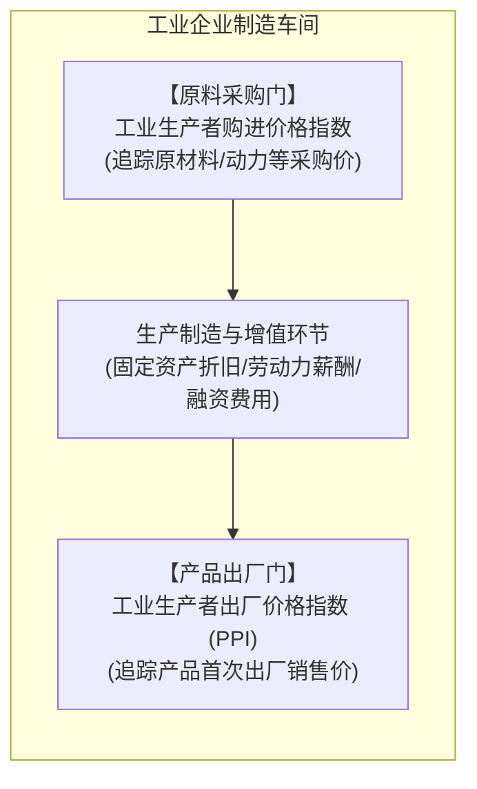
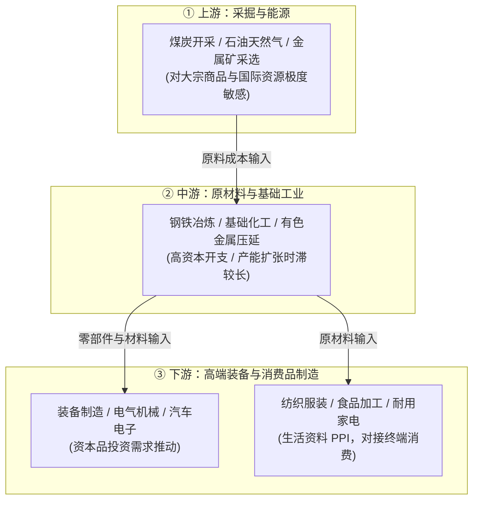
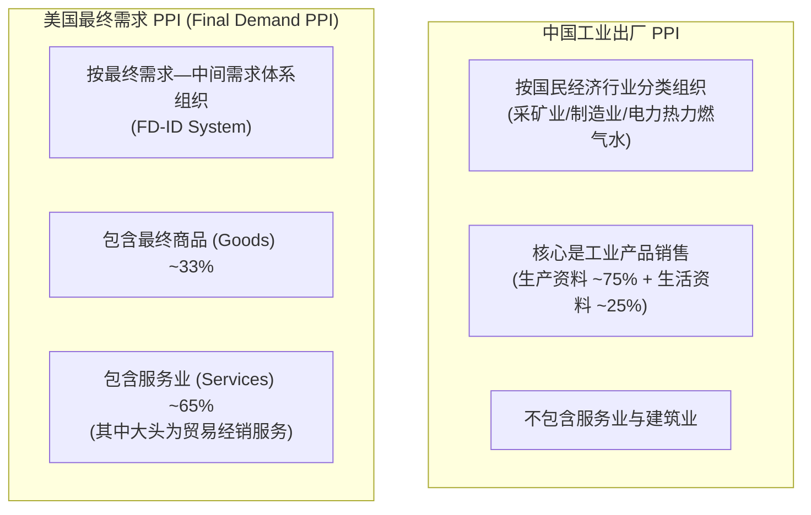

# 14 中国 PPI：工业定价、上下游利润与全经济价格

[上一章：居民消费价格](13-consumer-prices.md) · [目录](./) · [下一章：低通胀与名义增长](15-low-inflation.md)

> 编写于 2026-09-24。真实报告使用 2025-01-09 发布的 2024 年 12 月数据；企业案例均为教学假设。

**前置阅读：**美国篇 [09 通胀的衡量](https://fangpings.github.io/us-econ/09-inflation-measures.html)，中国篇 [08 月度生产](08-production.md)、[09 企业经营](09-business.md)。本章要把价格分析从老百姓的菜篮子延伸到中国强大的工业制造链条：钢铁、煤炭、锂电、芯片与通用设备的出厂价格是如何形成的？为什么人们常说的“PPI 剪刀差”不能简单等同于工业企业利润率？当中美两国都在公布 PPI 时，它们背后的统计篮子究竟有多大差异？

---

## 1. 厂门与校门：中国两张工业价格表的空间定位

如果说 CPI 站在消费者的超市收银台，那么工业生产者价格指数则站在中国制造业企业的**两扇大门**：

这两张表分别承担不同的经济监测职责：[国家统计局：工业生产者价格及附注](https://www.stats.gov.cn/sj/zxfb/202501/t20250109_1958169.html)

| 价格指数类别 | 观察点 | 调查对象与覆盖边界 | 核心经济意义 |
| :--- | :--- | :--- | :--- |
| **出厂价格指数（常规简称 PPI）** | 工厂大门口（产品第一次出售） | 工业企业销售的生产资料（采掘、原材料、加工）与生活资料（食品、衣着、一般日用品、耐用品） | 衡量工业产出的即时价格变动，直接影响工业企业销售额名义扩张速度 |
| **购进价格指数（IPI）** | 仓储入口（原材料进厂采购） | 工业企业购进的原材料、燃料、动力等中间投入品 | 衡量实体工业面临的直接物料成本压力，**但不包含工人工资、折旧及贷款利息** |

在垂直分工的现代产业体系中，**上游企业的产品往往就是下游企业的投入**。例如：
- 铁矿石采掘企业的出厂矿石，是钢铁厂的购进原料；
- 钢铁厂冶炼出的特种钢板，是机械制造厂的购进部件；
- 机械厂制造的冷轧冲压机床，又是汽车装配厂的固定资产设备。

这种链条式交易同时被纳入出厂价格统计，是中国 PPI 的设计特性。因此，**不能把 PPI 出厂价格当成剔除了中间消耗的工业增加值价格**，也不能把工业总产值变动直接当成 GDP。

---

## 2. 统计技术：如何剔除“产品升级”的伪通胀

在编制工业价格指数时，国家统计局采用重点调查与典型调查相结合的方法，跟踪成千上万家工业企业的代表规格品成交价。[国家统计局：工业生产者价格指数方法介绍](https://www.stats.gov.cn/zs/tjws/tjzb/202301/t20230101_1903637.html)

这里最容易让初学者产生错觉的是：**“平均销售单价上涨，是不是就代表发生了工业品通胀？”**

答案是：**绝对不能**。我们必须严格区分“纯价格变动”与“产品结构升级”。

> **典型案例演示**：
> 某数控机床制造厂生产普通型（A 款）与高精型（B 款）两款机床。基期与报告期的销售数据如下表：
> 
> | 时期 | A 款机床（单价 10 万元） | B 款机床（单价 20 万元） | 总销售额 | 总台数 | 平均出厂单价 |
> | :--- | :---: | :---: | :---: | :---: | :---: |
> | **基期（期初）** | 80 台 | 20 台 | $1{,}200\text{ 万元}$ | 100 台 | **12.0 万元/台** |
> | **报告期（期末）** | 50 台 | 50 台 | $1{,}500\text{ 万元}$ | 100 台 | **15.0 万元/台** |

如果只计算该企业平均单价变动：

$$\text{平均单价涨幅} = \frac{15.0 - 12.0}{12.0} = \frac{3.0}{12.0} = +25.0\%$$

但在实际生产中：
- A 款机床的销售价格依然是稳定的 $10\text{ 万元/台}$（涨幅 $0\%$）；
- B 款机床的销售价格依然是稳定的 $20\text{ 万元/台}$（涨幅 $0\%$）。

**同规格产品的价格一分钱都没涨！** $25\%$ 的均价抬升完全是由高附加值产品占比从 $20\%$ 提升至 $50\%$ 的产业升级带来的。在真实的 PPI 采价系统中，采价员通过固定代表规格品（固定技术参数、型号规格与交付条件），计算出该企业出厂价格指数为 $0\%$，从而精准剔除产品组合变动对通胀的污染。

---

## 3. 产业链价格传导与“PPI 剪刀差”的利润陷阱

中国工业体系门类齐全，上下游产业链呈现鲜明的金字塔式结构：

### 3.1 为什么“出厂价增速 − 购进价增速”不等于工业利润率？

财经媒体上常出现一种流行的粗糙论调：“出厂 PPI 上涨 $5\%$，购进价格只涨 $1\%$，产生 $4\%$ 的正向剪刀差，所以工业企业利润率大幅改善。”

这种算法犯了严重的**数学基数与结构性错误**。工业企业的利润是收入扣减各项成本后的剩余，受到基数比例与经营杠杆的强烈支配。

设某工业企业的标准成本结构如下：销售收入为 $100$，原材料等物料采购成本为 $60$，工资及固定制造费用为 $30$，期初利润为 $10$（销售利润率为 $10/100 = 10\%$）。

现假设该企业产销量完全稳定，因市场竞争出厂售价整体下调 $5\%$，销售收入降为 $95$。我们来对比两种不同的上游原材料变动情形：

$$R_{\text{new}} = 95, \quad \text{工资与固定费用} = 30\text{ (刚性不变)}$$

| 财务核算项目 | 基准状态 | 情形 A：材料购进价大跌 $10\%$ | 情形 B：材料购进价仅跌 $1\%$ |
| :--- | :---: | :---: | :---: |
| **出厂销售收入** | $100$ | $95$ | $95$ |
| **原材料采购成本** | $60$ | $60 \times (1 - 10\%) = 54.0$ | $60 \times (1 - 1\%) = 59.4$ |
| **工资、折旧与利息** | $30$ | $30.0$ | $30.0$ |
| **当期净利润** | **10** | **11.0** | **5.6** |
| **利润总额同比变动** | — | **+10.0%** | **-44.0%** |
| **销售净利润率** | $10.0\%$ | $\frac{11}{95} \approx 11.58\%$ | $\frac{5.6}{95} \approx 5.89\%$ |
| **两价之差（出厂增速 - 购进增速）** | — | $-5\% - (-10\%) = \mathbf{+5.0\%}$ | $-5\% - (-1\%) = \mathbf{-4.0\%}$ |

通过严格的数学推导，我们可以得出两大关键结论：
1. **杠杆放大效应**：在情形 A 中，两价之差仅为 $+5.0$ 个百分点，但最终净利润暴增了 $+10.0\%$；而在情形 B 中，两价之差为 $-4.0$ 个百分点，企业净利润却断崖式暴跌 $-44.0\%$！
2. **非材料成本的刚性存在**：购进价格指数只统计原材料动力，无法捕捉工人工资薪酬的刚性黏性、厂房设备的固定折旧以及银行贷款的利息支出。当销售收入萎缩时，刚性固定成本会急剧侵蚀企业利润底线。

---

## 4. 中美 PPI 为什么不能直接横向相减

在国际宏观分析中，若直接把中国国家统计局发布的 PPI 同比增长率与美国劳工统计局（BLS）发布的 PPI 数据相减，会得出极为荒谬的结论。因为它们虽然英文缩写都叫 PPI，统计的对象根本不是同一个篮子！[BLS：PPI 范围与分类体系](https://www.bls.gov/ppi/overview.htm)

| 核心比较维度 | 中国工业生产者出厂价格 (PPI) | 美国最终需求 PPI (Final Demand) |
| :--- | :--- | :--- |
| **组织范式** | 工业品首次出售环节（按工业行业分类） | 面向最终需求的商品与服务总价（按经济用途分类） |
| **中间工业品** | **大量包含**（如热轧钢卷、粗炼铜、工业硅） | 最终需求总指标中**彻底排除中间投入**（单列于中间需求表） |
| **服务业覆盖** | **完全不包含**服务业 | **深度覆盖**（医疗、运输、金融、批发零售贸易服务） |
| **主指标定位** | 观察工业体系内部价格传导与制造业经营 | 观察面向最终使用者的全口径商品与服务通胀压力 |

### 4.1 美国特有的“贸易服务（Trade Services）”价格陷阱

美国 PPI 中有一项比重巨大的指标称为“贸易服务 PPI”。**它测量的不是货架上商品的完整售价，而是经销商的加价毛利（Margin）**：

$$\text{贸易服务单位价格} = \text{最终销售价格} - \text{进货成本}$$

> **算例演示**：
> 某美国电子经销商基期以 $80\text{ 美元}$ 进货，以 $100\text{ 美元}$ 卖出，其经销毛利为 $100 - 80 = 20\text{ 美元}$。
> 报告期内，该商品零售价打折降至 $95\text{ 美元}$（消费端降价 $-5\%$），但由于全球供应链产能提升，该经销商进货价大幅降至 $70\text{ 美元}$。
> 此时经销商的加价毛利变为：
> 
> $$\text{新毛利} = 95 - 70 = 25\text{ 美元}$$
> 
> 该项“贸易服务 PPI”的变动率为：
> 
> $$\frac{25 - 20}{20} = \frac{5}{20} = +25.0\%$$
> 
> 结果出现了极为戏剧性的一幕：**零售端消费品实际在降价促销，而美国 PPI 中的贸易服务项却录得高达 $+25\%$ 的通胀大涨！** 若不深究统计定义，就会彻底误判通胀性质。

---

## 5. 工业价格向居民消费的传导衰减与时滞

上游工业品价格大跌，为什么超市里的最终消费品价格并没有按同等比例下调？从钢材到家电，价格传导要跨越重重阻尼：

1. **原材料成本占比有限**：
   一台售价 $3{,}000\text{ 元}$ 的家用冰箱，其内部所含的钢材、铜管等金属原材料成本合计可能仅有约 $300\text{ 元}$（占售价 $10\%$）。即便上游钢价遭遇暴跌 $10\%$，折合单台节约的物料成本也仅为：
   $$300\text{ 元} \times 10\% = 30\text{ 元}$$
   相对于 $3{,}000\text{ 元}$ 的整机售价，潜在的降价空间仅为 $\frac{30}{3000} = 1.0\%$。
2. **长协锁价与库存时滞**：
   大型制造企业通常按季度甚至年度锁定长期采购合同，或者维持数月的原料库存。现货市场的大宗商品价格跳水，传导至企业的实际出库成本往往存在 3 至 6 个月的显著时滞。
3. **市场博弈与渠道溢价**：
   在高度差异化、注重品牌和售后渠道的终端消费品领域，企业是否降价取决于终端需求韧性与渠道营销费用。若终端需求平稳，企业更倾向于将原料节约转化为自身利润空间的修复，而非打价格战。

---

## 6. 全经济价格的终极锚：GDP 平减指数

CPI 衡量居民消费篮子，PPI 衡量工业品出厂。如果我们要观察**中国整个经济体产出的全部商品与服务的综合价格水平**，唯一权威的指标是**GDP 平减指数（GDP Deflator）**。[中国 GDP 核算衔接见第 05 章](05-gdp.md)；[BEA：GDP 价格指数](https://www.bea.gov/data/prices-inflation/gdp-price-index)。

$$1 + \pi_{\text{GDP}} = \frac{1 + g_{\text{nominal}}}{1 + g_{\text{real}}} \implies \pi_{\text{GDP}} = \frac{1 + g_{\text{nominal}}}{1 + g_{\text{real}}} - 1$$

其中 $g_{\text{nominal}}$ 为同口径现价名义 GDP 增速，$g_{\text{real}}$ 为不变价实际 GDP 增速。

> **基准算例推导**：
> 假设基期名义 GDP 为 $1{,}000\text{ 亿元}$。报告期内，按基期价格计算的实际 GDP 产出为 $1{,}050\text{ 亿元}$（实际增长 $g_{\text{real}} = +5.0\%$）；按报告期现价计算的名义 GDP 为 $1{,}029\text{ 亿元}$（名义增长 $g_{\text{nominal}} = +2.9\%$）。
> 则 GDP 平减指数所反映的国内综合物价变动为：
> 
> $$\pi_{\text{GDP}} = \frac{1 + 2.9\%}{1 + 5.0\%} - 1 = \frac{1.029}{1.050} - 1 = 0.98 - 1 = -2.0\%$$
> 
> *注意：* 用名义增速直接减去实际增速的近似值（$2.9\% - 5.0\% = -2.1\%$）在低通胀环境下误差较小，但在正规教学与计量分析中，必须采用精确的几何除法公式。

---

## 7. 真实数据实战带读：同一天发布的物价双重奏

在 2025 年 1 月 9 日，国家统计局同时公布了 2024 年 12 月份的 CPI 与 PPI 核心指标：[国家统计局：2024 年 12 月物价数据](https://www.stats.gov.cn/sj/zxfb/202501/t20250109_1958169.html)

| 2024 年 12 月指标 | 同比变动率 | 环比变动率 | 核心传导机制解析 |
| :--- | :---: | :---: | :--- |
| **全国 CPI 居民消费价格** | **+0.1%** | **0.0%** | 服务消费温和扩张抵消了生鲜食品与能源的边际回调 |
| **工业生产者出厂价格 (PPI)** | **-2.3%** | **-0.1%** | 受国际大宗商品输入以及国内房地产施工偏弱拖累，工业品承压 |
| **工业生产者购进价格** | **-2.3%** | **-0.1%** | 原材料成本与出厂价格降幅一致，工业品上下游同步降价 |

专业分析师阅读这份数据包的思考框架应当是：
1. **核对同比基数与环比动能**：出厂 PPI 同比下跌 $-2.3\%$，环比仍小幅下跌 $-0.1\%$，表明工业品价格仍处于磨底筑底阶段；
2. **生产资料与生活资料分化**：继续下穿细项表会发现，生产资料 PPI 同比下跌幅度更大（受煤炭、黑色金属拖累），而生活资料 PPI 同比表现相对平稳；
3. **利润格局推演**：出厂与购进价格同比降幅均在 $-2.3\%$，并不意味着所有工业企业的利润率保持不变，重资产、高折旧、高负债率的传统上游冶炼企业承压更为显著。

---

## 8. 课后自测与逐步推导

1. 在第 2 节的数控机床算例中，企业全部机床的平均销售单价上涨了 $25\%$，为什么在统计核算中不能认定该企业的机床出厂价格发生了 $25\%$ 的通胀？
2. 某制造企业原销售收入为 $200\text{ 万元}$，原材料成本 $100\text{ 万元}$，其他固定及人工成本 $80\text{ 万元}$。在产量保持不变的前提下，产品出厂售价下降 $3\%$，原材料采购价格下降 $8\%$。请计算该企业报告期的净利润额、利润同比变动率以及销售净利润率。
3. 若某月全国工业出厂 PPI 与购进价格指数同比降幅完全一致（均为 $-2.0\%$），能否由此断定全国工业企业的平均销售利润率必然保持不变？
4. 某美国批发商的某款商品进货价格从 $60\text{ 美元}$ 降至 $54\text{ 美元}$，对零售商的批发售价从 $80\text{ 美元}$ 降至 $76\text{ 美元}$。请计算该商品的最终售价降幅以及其对应的“贸易服务价格”变动率。
5. 某国同版本核算年度的名义 GDP 同比增长 $3.0\%$，实际不变价 GDP 同比增长 $4.0\%$，求其 GDP 平减指数所衡量的综合物价变动率。
6. 如果让你设计一个对比中美工业通胀压力的研究框架，怎样做才能避免直接比较两国 PPI 总指数所带来的统计口径失真？

点击展开逐步参考答案与解析

1. **核心原因在于产品组合升级而非单品涨价**。A 款（$10\text{ 万元}$）和 B 款（$20\text{ 万元}$）两个独立规格品各自的销售单价均未发生变动。均价从 $12\text{ 万元}$ 升至 $15\text{ 万元}$ 完全是因为高附加值的 B 款占比由 $20\%$ 跃升至 $50\%$。采价系统通过固定规格品同质可比原则，剔除产品结构跃升的影响。
2. **逐步财务推导计算**：
   - 基期净利润：
     $$\text{利润}_0 = 200 - 100 - 80 = 20\text{ 万元}, \quad \text{利润率}_0 = \frac{20}{200} = 10.0\%$$
   - 报告期数据：
     - 新销售收入：$200 \times (1 - 3\%) = 194.0\text{ 万元}$
     - 新材料成本：$100 \times (1 - 8\%) = 92.0\text{ 万元}$
     - 其他固定成本刚性不变：$80.0\text{ 万元}$
     - 报告期净利润：
       $$\text{利润}_1 = 194.0 - 92.0 - 80.0 = 22.0\text{ 万元}$$
   - 利润变动分析：
     - 利润总额变动率：$\frac{22 - 20}{20} = \frac{2}{20} = \mathbf{+10.0\%}$
     - 销售净利润率：$\frac{22.0}{194.0} \approx \mathbf{11.34\%}$（上升约 $1.34$ 个百分点）
3. **不能推断利润率不变**。
   - 收入与成本基数不等：出厂价格对应的是企业全部销售额基数（$100\%$），而购进价格仅对应物料消耗基数（如 $50\% \sim 60\%$）；
   - 刚性成本未覆盖：工人工资薪酬、厂房折旧、设备租赁及债务利息均不在购进价格调查篮子内，收入下挫会导致这部分刚性成本占收入比重大幅上升；
   - 行业异质性：不同行业的物料成本占比与长协锁定周期差异极大，宏观平均值掩盖了微观分化。
4. **两项指标的数学计算**：
   - 最终批发售价变动率：
     $$\frac{76 - 80}{80} = -\frac{4}{80} = \mathbf{-5.0\%}$$
   - 单位加价毛利（贸易服务价格）：
     - 基期毛利：$80 - 60 = 20\text{ 美元}$
     - 报告期毛利：$76 - 54 = 22\text{ 美元}$
     - 贸易服务价格变动率：
       $$\frac{22 - 20}{20} = +\frac{2}{20} = \mathbf{+10.0\%}$$
   - 现象：批发商品售价下降 $5\%$ 的同时，贸易服务 PPI 却大幅上升 $10\%$。
5. **GDP 平减指数精确计算**：
   $$\pi_{\text{GDP}} = \frac{1 + 3.0\%}{1 + 4.0\%} - 1 = \frac{1.03}{1.04} - 1 \approx 0.990385 - 1 \approx \mathbf{-0.9615\%}$$
   国内综合物价水平约下降 $0.9615\%$。
6. **科学对比方案设计**：
   - **下穿至微观制造业行业**：放弃总指数对比，选取同口径的工业制造细分行业（如汽车制造、初级钢铁冶炼、半导体及电子元器件）；
   - **剔除服务业与中间品差异**：如果采用美国体系，使用美国 PPI 报告中的“中间需求 PPI（Intermediate Demand）”分项，或者仅提取“最终需求商品（Final Demand Goods）”，彻底剔除贸易服务项；
   - **控制汇率与交付条件**：统一价格计价币种（美元或本币），统一出厂价与到岸价（FOB/CIF）交货边界，并注明长协与现货定价机制差异。

---

[上一章：居民消费价格](13-consumer-prices.md) · [目录](./) · [下一章：低通胀与名义增长](15-low-inflation.md)
