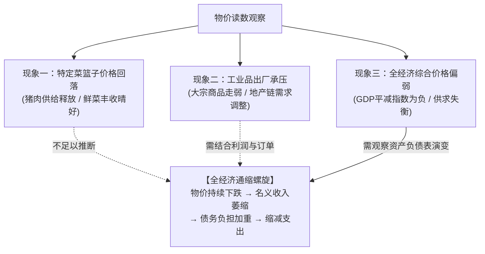
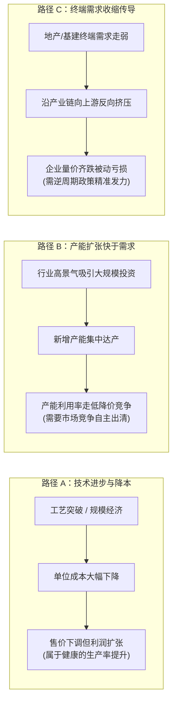
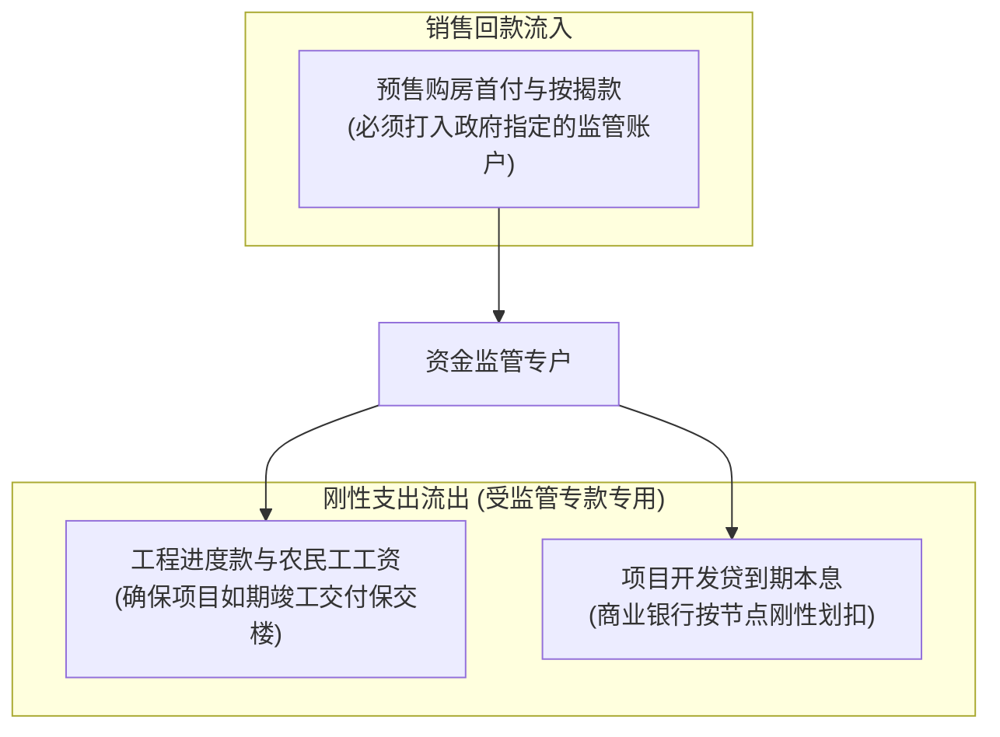
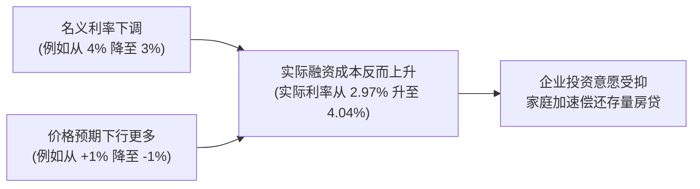
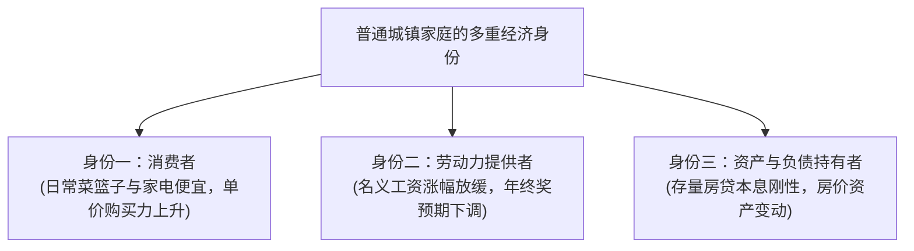
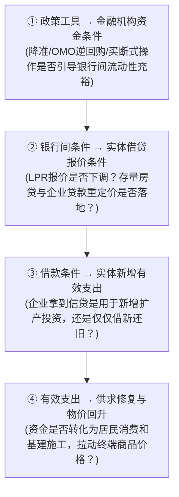

# 15 中国低通胀：名义收入、债务与政策传导

[上一章：生产者价格](14-producer-prices.md) · [目录](./) · [下一章：银行体系](16-banks-and-deposits.md)

> 编写于 2026-09-24。机制算例均为教学假设；政策阅读固定使用 2024 年第四季度货币政策执行报告，不是当前政策预测。

**前置阅读：**美国篇 [10 通胀来源、持续性与预期](https://fangpings.github.io/us-econ/10-inflation-mechanisms.html)，中国篇 [36 房地产链条](36-housing-development.md)、[13 CPI](13-consumer-prices.md)、[14 PPI](14-producer-prices.md)。供求冲击、费雪效应与预期形成原理作为已知。本章将这些经济学原理置于中国经济的真实运行环境：当 CPI 低位运行、工业 PPI 持续为负时，企业的名义回款、预售楼盘的施工专户、地方项目的化债约束以及家庭的负债资产负债表，会受到怎样的链式冲击？

---

## 1. 概念解构：把“低通胀与通缩”拆解为可检验命题

在宏观经济讨论中，初学者常常一看到某个月 CPI 同比跌破零，就脱口而出“经济陷入了全面通缩”。但在实证经济学中，**“价格读数为负”与“全经济陷入通缩螺旋”是两个必须严谨区分的概念**。

| 观察到的经济读数 | 它能够直接证明什么 | 它还**不能**直接证明什么 |
| :--- | :--- | :--- |
| **单月 CPI 同比为负** | 居民当期消费的一篮子商品和服务价格比去年同月更便宜 | 全社会总需求全面衰退、所有居民生活成本同步下降 |
| **工业出厂 PPI 持续为负** | 工业产品首次出厂售价低于上年同期，生产资料承压 | 服务业价格也随之下跌、每家工业制造企业必然亏损 |
| **GDP 平减指数为负** | 匹配核算口径下的国内生产综合价格水平出现收缩 | 下跌完全是由终端需求不足单向导致 |
| **多品类价格与企业名义收入同步承压** | 资产负债表与名义现金流面临考验，需高度关注 | 政策刺激已无空间或因果机制已经唯一锁定 |

在评估通胀态势时，必须摒弃“连续 $N$ 个月负值就机械判定”的教条主义，将**广度（分项扩散率）**、**深度（企业现金流与债务）**与**预期（居民与企业定价行为）**综合审计。

---

## 2. 工业品降价的三条微观路径

中国是全球制造大国，工业品出厂价格的变动绝非单一年由“内需不足”所能简单概括。在微观层面，存在三条性质截然不同的降价逻辑：

1. **路径 A：技术进步与工艺效率提升**
   例如光伏组件、锂动力电池与新能源汽车。企业通过自动化产线与技术创新，使单位产品的生产成本从 $90$ 骤降至 $80$。厂商主动降价至 $95$ 抢占市场，单台利润反而从 $10$ 扩大至 $15$。这种降价伴随的是全要素生产率的提升和居民实际福利的增进。
2. **路径 B：产能释放超前于短期需求吸收**
   在前期高利润刺激下，全行业企业纷纷扩建厂房、购置设备。当数倍的新增产能集中投产时，市场订单增速暂时跟不上供给释放速度。企业为了维持设备运转和员工就业，竞相降价。此时产量可能仍在增长，但产能利用率与毛利率显著下行。
3. **路径 C：终端实体需求收缩逆向传导**
   房地产开工面积下降或基建投资放缓，直接导致建筑用螺纹钢、水泥、工程机械等订单萎缩。下游采购商缩减进货，压力逆流而上，导致整个中上游产业链量价齐跌。

在实际研判中，这三条路径往往交织并存。仅看到一个行业的 PPI 下跌，不能武断判定为“产能过剩”或“需求崩溃”，必须下钻到该行业的**产能利用率、产成品库存、单位物料成本以及营业利润率**进行联合交叉检验。

---

## 3. 实际增长 vs 名义现金流：债务清偿的“单位陷阱”

宏观经济分析中一个最容易被忽略的硬约束是：**还本付息、发放工人工资、向供应商开具支票，用的是名义人民币现金，而不是剔除价格后的实际 GDP！**

### 3.1 量增价跌下的企业营业收入

企业销售收入由销售价格 $P$ 与产品物理销量 $Q$ 共同决定：

$$R = P \times Q \implies 1 + g_R = (1 + g_P)(1 + g_Q)$$

> **算例演示**：
> 某工业装备制造企业上年销售 $100\text{ 台}$ 机器，每台售价 $10\text{ 万元}$，总收入为 $1{,}000\text{ 万元}$。
> 本年技术改造后，实物销量扩张了 $5.0\%$（卖出 $105\text{ 台}$），但面对行业价格战，同规格产品售价下调了 $4.0\%$（降至 $9.6\text{ 万元/台}$）。
> 该企业本年的名义销售收入为：
> 
> $$R_{\text{new}} = 105 \times 9.6 = 1{,}008\text{ 万元}$$
> 
> 其名义收入同比变动率为：
> 
> $$g_R = (1 + 5\%) \times (1 - 4\%) - 1 = 1.05 \times 0.96 - 1 = 1.008 - 1 = \mathbf{+0.8\%}$$
> 
> 尽管在生产统计和实际 GDP 中，该企业贡献了高达 $+5.0\%$ 的产出增长，但账面上流入的名义现金收入仅仅微增了 **$0.8\%$**！如果下游客户资金紧张拉长付款账期，企业的实际经营现金流甚至可能出现净流出。

### 3.2 房地产预售专户中的现金流刚性断裂

把这一机制放到中国特有的**商品房预售监管资金制度**中（参见第 36 章），就会看清为什么物价与销售放缓会对企业形成致命约束：

> **预售资金推演**：
> 某保交楼在建楼盘原计划售房回款 $100\text{ 万元}$。按规定，必须支付刚性工程施工进度款 $60\text{ 万元}$，支付到期项目开发贷利息与本金 $25\text{ 万元}$，留存富余流动资金 $15\text{ 万元}$。
> 后因区域房价微跌及购房者观望，当期实际售房款降至 $85\text{ 万元}$。
> 由于工程节点交付与银行借款是不可逾越的刚性契约（合计支出仍为 $60 + 25 = 85\text{ 万元}$），**该项目的富余流动资金瞬间被压缩至零！**
> 在资金监管框架下，母公司集团就算在其他业务账面上有存款，也无法随意挪用抽调；而该项目也绝不可能将专户资金挪出母公司偿付其他集团债券。这种现金流时点与专款专用的刚性错配，正是微观企业信用风险爆发的根源。

---

## 4. 名义降息下的实际利率反弹：欧文·费雪效应

许多初学者会问：**“既然央行已经连续下调了贷款市场报价利率（LPR），为什么实体经济中的企业和购房者还是觉得贷款负担很重？”**

关键就在于**预期价格变化所决定的真实借贷成本——实际利率（Real Interest Rate）**。根据宏观经济学中精确的费雪方程式：

$$1 + r_{\text{real}} = \frac{1 + i}{1 + \pi^e} \implies r_{\text{real}} = \frac{1 + i}{1 + \pi^e} - 1$$

其中 $i$ 为名义贷款利率，$\pi^e$ 为借款人对自身销售产品或消费篮子的预期价格变动率。

> **费雪效应基准测算**：
> 设某民营工业制造借款人在基期的名义银行贷款利率为 $i_0 = 4.0\%$，其对所生产设备的价格预期为温和上涨 $\pi_0^e = +1.0\%$。此时借款人的事前实际利率为：
> 
> $$r_{\text{real},0} = \frac{1 + 4.0\%}{1 + 1.0\%} - 1 = \frac{1.04}{1.01} - 1 \approx 1.029703 - 1 \approx \mathbf{+2.97\%}$$
> 
> 经过一轮宏观货币降息后，该借款人的名义贷款利率下调了整整 $100\text{ BP}$，降至 $i_1 = 3.0\%$。然而，由于市场价格竞争激烈，企业预期未来一年自身产品售价将下跌 $\pi_1^e = -1.0\%$。此时该企业的事前实际利率变为：
> 
> $$r_{\text{real},1} = \frac{1 + 3.0\%}{1 - 1.0\%} - 1 = \frac{1.03}{0.99} - 1 \approx 1.040404 - 1 \approx \mathbf{+4.04\%}$$
> 
> 名义利率下降了 $1.0$ 个百分点，**但以企业产品计价的实际债务负担反而加重了约 $1.07$ 个百分点！**

企业卖出一台机器所能抵偿的银行债务本息反而变多了。在固定名义本金的约束下，企业的最佳理性选择自然是减少新的资本开支、优先用手头利润加速偿还存量银行贷款。

---

## 5. 家庭的多重身份：物价低位下的消费两面性

低通胀环境下，普通家庭究竟是“受益者”还是“谨慎者”？答案取决于家庭在经济体中扮演的**多重角色**：

> **双家庭对照实验**：
> 设宏观经济呈现低物价环境，居民消费品篮子平均便宜了 $1.0\%$（即物价平减为 $0.99$）。
> - **甲家庭（收入稳定型）**：在公用事业部门工作，名义可支配收入维持 $100$ 不变。其实际购买力变为：
>   $$\text{实际购买力变动} = \frac{100}{0.99} - 100 \approx +1.01\%$$
>   生活成本降低，真实福利得到切实提升。
> - **乙家庭（民企工薪与负债型）**：在受价格战冲击的下游制造企业工作，因公司降本薪酬总额缩水 $5.0\%$（名义收入变为 $95$），同时背负刚性名义房贷。其实际购买力变动为：
>   $$\text{实际购买力变动} = \frac{95}{0.99} - 1 = 0.959596 - 1 \approx \mathbf{-4.04\%}$$
>   尽管货架上的东西更便宜了，但由于收入的萎缩速度超过了物价的跌幅，其实际购买力深度缩水超过 $4\%$！

因此，面对宏观物价偏弱，不能简单依据“商品打折必然刺激消费”这一朴素直觉下结论。家庭是否愿意消费，取决于其**就业稳定性、对未来工资收入的边际预期以及家庭资产负债表上的还贷压力**。

---

## 6. 破解债务-通缩负反馈：政策传导的四步检验

面对名义增速放缓与低通胀压力，现代货币与财政政策的终极目标，就是**切断债务-通缩螺旋的自强化链条**。中国人民银行在《货币政策执行报告》中明确提出要“推动物价保持在合理水平”。[中国人民银行：2024 年第四季度货币政策执行报告](https://www.pbc.gov.cn/goutongjiaoliu/113456/113469/5587716/2025022618190099812.pdf)

检验政策传导是否畅通，绝不是简单看降准或降息了多少次，而必须沿着以下**四步传导链条**进行逐级穿透检验：

如果企业缺乏合意的订单，或者借入新贷款纯粹是为了偿还即将到期的旧债务（步聚 ③ 受阻），那么即便央行投放了充裕的流动性，贷款指标也无法转化为拉动物价回升的真实总需求。这正是下一模块中我们要深入剖析银行体系与社会融资规模的核心动因。

---

## 7. 全景诊断指南：宏观物价多维证据链

| 审计维度 | 核心观察指标 | 关键交叉验证项 | 必须排除的分析误区 |
| :--- | :--- | :--- | :--- |
| **居民消费端** | 总体 CPI、核心 CPI、服务类 CPI | 鲜菜与猪肉分项、春节日历错位 | 误把生猪出栏的供给周期当作全社会需求崩溃 |
| **工业制造端** | 生产资料与生活资料出厂 PPI | 采掘/原材料/加工制造业细分增速 | 误把光伏锂电技术降本混同于传统行业萧条 |
| **企业经营端** | 规模以上工业企业营业收入与利润 | 产成品存货、应收账款平均回收期 | 误把“实际物理产量增长”等同于“名义现金回款改善” |
| **宏观综合端** | 同版本现价名义 GDP 与不变价实际 GDP | GDP 平减指数（几何除法测算） | 误用单一口径的 CPI 或 PPI 代替全经济综合产出价格 |
| **金融传导端** | 政策操作利率、LPR、实际贷款利率 | 预期通胀变动率、新增信贷的用途分项 | 误把名义利率走低等同于实体实际偿债负担减轻 |

---

## 8. 第三模块大作业：审计一份中美物价研究简报

### 8.1 简报原始输入数据（教学假设资料）

某宏观研究机构发布了一份关于中美物价的研究简报，提供了以下同期的教学假设数据：
1. **中国消费端**：某月总体 CPI 同比为 $-0.2\%$，核心 CPI 同比为 $+0.6\%$，未经季节调整的单月 CPI 环比为 $+0.7\%$；该年春节比上年提前了一个月（出现明显节日错位）。
2. **中国工业端**：同期工业出厂 PPI 同比为 $-3.0\%$。某重点机械制造上市企业公布其产品物理销量同比增长 $6.0\%$，受市场竞争影响同规格售价下调 $4.0\%$；该简报未列出该企业的物料采购成本变动与应收账款回款周期。
3. **宏观综合价格**：同版本公布的年度核算显示，现价名义 GDP 增速为 $+3.0\%$，不变价实际 GDP 增速为 $+5.0\%$。
4. **金融利率条件**：某制造企业获得的银行名义借款利率从 $4.0\%$ 降至 $3.0\%$，但该企业对其核心产品的预期价格变动率由过去的 $+1.0\%$ 修正为 $-1.0\%$。
5. **美国价格对照**：美国劳工统计局公布最终需求 PPI（Final Demand）同比上涨 $+2.0\%$。另有美国某消费电子批发商的数据显示，其单品进货价从 $80\text{ 美元}$ 跌至 $70\text{ 美元}$，而给零售终端的批发售价从 $100\text{ 美元}$ 降至 $95\text{ 美元}$。

### 8.2 待审计的简报错误推论

该简报撰写者得出以下结论：
> *“中国经济已全面陷入通缩泥潭，但当月环比年化高达 8.7% 证明经济立刻迎来 V 型反转。设备企业物理销量增加 6%，利润必然大幅改善；央行降息让借款人实际负担减轻了 1 个百分点。中美两国 PPI 相差 5 个百分点，表明同一批工业品在两国的走势分化了 5 个百分点。”*

### 8.3 请完成以下六项专业修正计算与分析

1. 结合总体、核心分项及春节错位，准确评估消费端价格动能；
2. 计算该机械企业的名义销售收入增速，指出推导其利润还必须补充哪些变量；
3. 计算该年度 GDP 平减指数所体现的隐含综合价格变动率；
4. 利用费雪方程式计算该借款人在降息前后的事前实际利率；
5. 分析美国批发商终端售价与该商品对应的“贸易服务价格”变动方向；
6. 撰写一段不超过 $250\text{ 字}$ 的合规专业替代简报。

点击展开作业逐步参考推导与审计解析

**第一项：消费价格评估**
- 总体 CPI 为 $-0.2\%$ 与核心 CPI 为 $+0.6\%$ 发生显著背离，说明价格拖累主要来自波动剧烈的生鲜食品或能源分项，底层消费品与服务价格仍具黏性，不能轻言“全面通缩”；
- 环比 $+0.7\%$ 叠加了春节提前错位带来的服务消费脉冲式跳升。未经季调的单月异常脉冲不能直接年化（$(1+0.7\%)^{12}-1 \approx 8.7\%$），更不能以此断言趋势已发生 V 型反转。

**第二项：企业收入与利润测算**
- 该企业的名义销售收入增速为：
  $$g_R = (1 + 6.0\%) \times (1 - 4.0\%) - 1 = 1.06 \times 0.96 - 1 = 1.0176 - 1 = \mathbf{+1.76\%}$$
- 物理销量虽扩张 $6.0\%$，但名义收入仅增长 $1.76\%$；
- 要判断利润，还必须补齐：原材料购进成本降幅、人工及固定折旧费用、税费变动以及应收账款能否按期收回等经营数据。

**第三项：GDP 平减指数测算**
$$\pi_{\text{GDP}} = \frac{1 + 3.0\%}{1 + 5.0\%} - 1 = \frac{1.03}{1.05} - 1 \approx 0.980952 - 1 \approx \mathbf{-1.9048\%}$$
全经济综合产出价格平减指数约为 $-1.90\%$。

**第四项：实际借款利率推导**
- 降息前事前实际利率：
  $$r_{\text{real},0} = \frac{1 + 4.0\%}{1 + 1.0\%} - 1 = \frac{1.04}{1.01} - 1 \approx \mathbf{+2.97\%}$$
- 降息后事前实际利率：
  $$r_{\text{real},1} = \frac{1 + 3.0\%}{1 - 1.0\%} - 1 = \frac{1.03}{0.99} - 1 \approx \mathbf{+4.04\%}$$
- 借款人的实际偿债负担不仅没有减轻，反而反弹攀升了约 $1.07$ 个百分点。

**第五项：美国贸易服务分析**
- 商品最终批发价变动：$\frac{95-100}{100} = \mathbf{-5.0\%}$；
- 批发商单位加价毛利（贸易服务价格）：从 $100 - 80 = 20\text{ 美元}$ 变为 $95 - 70 = 25\text{ 美元}$，变动率为 $\frac{25-20}{20} = \mathbf{+25.0\%}$；
- 商品售价虽然下降，但美国最终需求 PPI 中的贸易服务分项录得大幅上涨。中美两国的 PPI 由于统计范畴（中间品与服务业覆盖）不同，绝不能直接相减。

**第六项：专业替代简报示范**
> *“本期中国消费物价总体与核心呈现结构性分化，总体 CPI 受食品等拖累微幅为负，而核心 CPI 保持正向增长；未经季调的单月环比受春节提前错位干扰，不宜直接年化推断趋势反转。年度 GDP 平减指数约为 $-1.90\%$，反映产出端物价整体承压。制造业样本企业量增价跌，销售名义收入仅增长 $1.76\%$，利润改善仍需验证成本与回款；受价格预期下行影响，样本企业实际借贷成本由 $2.97\%$ 反弹至 $4.04\%$。美国最终需求 PPI 包含贸易服务毛利，与中国工业出厂 PPI 口径不可比，需剔除服务项并统一细分制造业后审慎对照。”*

---

## 9. 课后自测与逐步推导

1. 在工业分析中，如何利用微观财务数据有效区分“技术进步带来的效率型降价”与“需求收缩带来的竞争型降价”？
2. 在房地产项目资金监管制度下，当某预售项目的购房回款不及预期时，为什么不能直接用母公司集团账面上的总资金来判定该项目是否能够如期完工？
3. 某工薪家庭名义年收入下降了 $3.0\%$，同期其生活消费品篮子价格下降了 $1.0\%$，请使用精确公式计算该家庭实际购买力的变动幅度。
4. 为什么在评估企业微观资本开支决策时，使用事后实际实现的 CPI 倒推出来的实际利率，不能直接等同于企业决策时的真实意愿？
5. 当商业银行向地方城投公司发放的一笔中长期贷款被用于全额置换即将到期的旧存量债务时，这笔贷款对于化解到期信用风险与拉动当期有效投资需求分别意味着什么？
6. 从本模块学习中选择一项中美宏观价格体系的差异，说明它究竟属于“统计定义差异”、“经济结构重要性差异”还是“制度安排差异”？

点击展开逐步参考答案与解析

1. **多维微观指标的联合检验**：
   - **效率型降价**：伴随着企业单位产品物料/人工成本的更大幅度下降，全要素生产率（TFP）提高，企业销售毛利率或净利润额不降反升，产能利用率通常维持在合理健康区间；
   - **需求收缩型降价**：单位固定制造费用因产出受限而被动摊薄抬高，售价跌幅超过原料跌幅，销售利润率严重受损，伴随产成品库存被动积压与产能利用率的大幅滑坡。
2. **专户监管与法人防火墙制度**：
   - 预售资金属于专款专用专户监管资金，优先保障本项目工程进度款与施工农民工工资的支付，具有法律上的独立封闭性；
   - 集团母公司账面资金受制于不同法人实体责任、股权结构、信贷抵押约束及其他项目的偿债优先权，不能随意拆借跨项目救急。
3. **实际购买力精确计算**：
   $$\text{实际购买力变动} = \frac{1 - 3.0\%}{1 - 1.0\%} - 1 = \frac{0.97}{0.99} - 1 \approx 0.979798 - 1 \approx \mathbf{-2.02\%}$$
   物价的轻微下降（$-1\%$）缓解了部分损失，但无法抵消收入的更大幅度萎缩（$-3\%$），家庭真实购买力缩水约 $2.02\%$。
4. **决策依据的是事前主观预期而非事后实现结果**：
   - 企业在决定是否投资建厂、签订借款合同时，面对的是未来的不确定性，依赖的是当时的销售订单指引、行业景气度及主观价格预期；
   - 拿一年后公布的事后通胀结果去倒算企业的决策意图，犯了“信息穿越”的时序逻辑错误。
5. **对到期压力 vs 新增投资的二元分离**：
   - **化解到期风险**：该笔贷款平滑了主体的债务到期期限，降低了流动性违约的发生概率，实现了存量债务的续接展期；
   - **拉动新增需求**：由于资金全额用于偿还旧银行欠款，资金在金融体系内部循环回流，并未转化为购买钢筋、水泥、聘用劳动力的实际现金支出，因此对当期宏观 GDP 物理工作量的增量拉动为零。
6. **中美价格体系三类差异的分类判定**：
   - **统计定义差异**：如中国 PPI（纯工业出厂价格）与美国最终需求 PPI（FD-ID 体系，含 $65\%$ 服务业与建筑）在指标范围设计上的本质不同；
   - **经济结构重要性差异**：如由于恩格尔系数与居民消费习惯差异，食品（特别是猪肉）在中国 CPI 篮子中的权重显著高于美国；
   - **制度安排差异**：如中国成品油价格依托发改委 10 个工作日挂钩窗口机制调控，而美国汽油零售价格由加油站根据现货市场每日即时完全浮动定价。

---

[上一章：生产者价格](14-producer-prices.md) · [目录](./) · [下一章：银行体系](16-banks-and-deposits.md)
