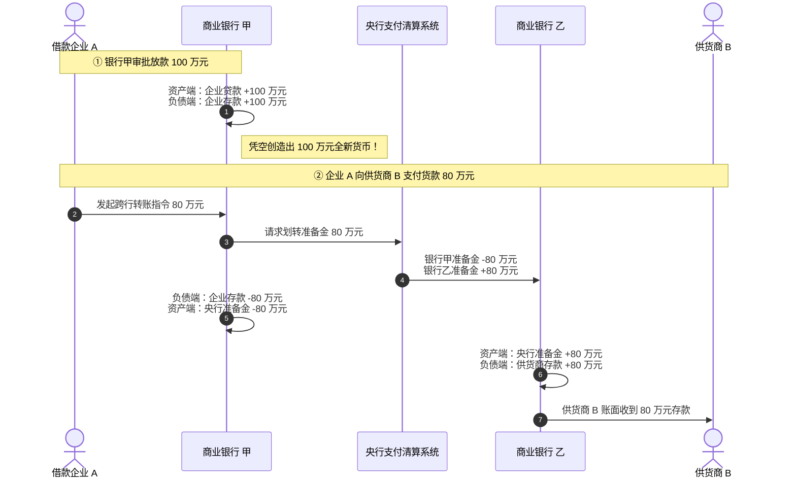
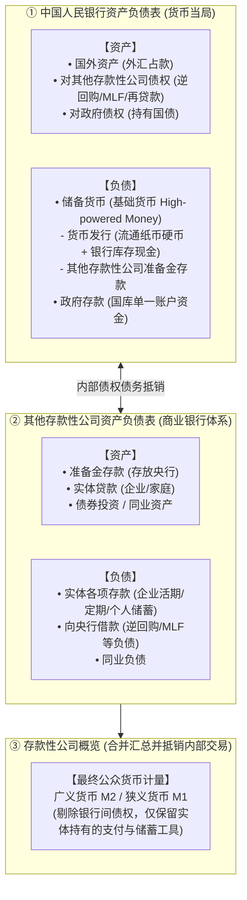
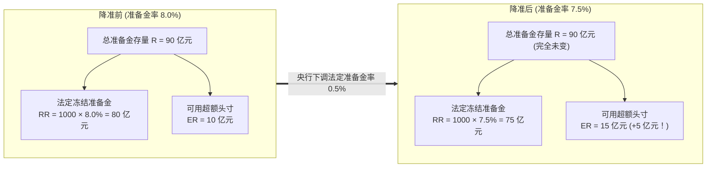
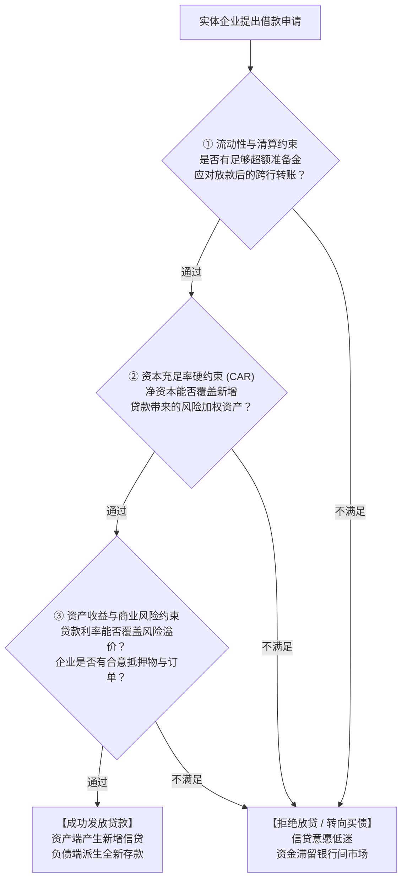
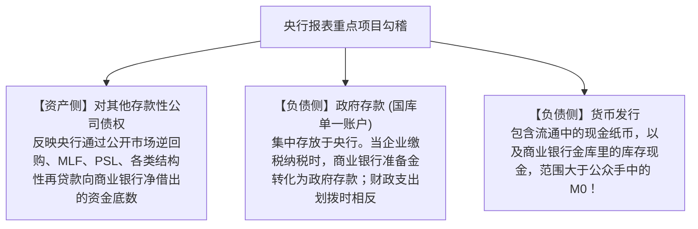

# 16 中国银行体系：存款、准备金与信用创造

[上一章：低通胀与名义增长](15-low-inflation.md) · [目录](./) · [下一章：货币口径](17-money-aggregates.md)

> 编写于 2026-09-26。制度与统计范围依所引版本；所有简化资产负债表均为教学假设，不是银行真实报表。

**前置阅读：**美国篇 [15 银行与央行资产负债表](https://fangpings.github.io/us-econ/15-balance-sheets.html)、[18 银行信贷](https://fangpings.github.io/us-econ/18-bank-credit.html)。贷款创造存款、跨行清算准备金转移、资本吸收损失原理作为已知。本章将全面揭开中国庞大金融体系的核心引擎：**以银行为主导的现代金融体系，究竟是如何通过一笔笔贷款“凭空”创造出海量存款的？央行降准的底层会计分录是什么？为什么在准备金充裕时，银行依然可能“有钱贷不出去”？**

---

## 1. 概念地图：在中国，把三个“银行体系”清晰分开

许多经济学初学者在阅读财经新闻时，常常把“银行”看作一个铁板一块的庞然大物。但在专业分析中，至少存在三个不同维度的“银行体系”，切不可混为一谈：

```mermaid
flowchart TD
    subgraph View1["① 监管法人维度 (金融牌照与商业属性)"]
        A1["国有大型商业银行 (工农中建交邮储)"]
        A2["全国性股份制银行 (招商/中信/浦发等)"]
        A3["城市商业银行与农村中小金融机构"]
        A4["政策性与开发性银行 (国开行/进出口行/农发行)"]
    end

    subgraph View2["② 货币统计维度 (存款性公司概览)"]
        B1["中国人民银行 (货币当局)"]
        B2["其他存款性公司 (商业银行/信用社等信用货币创造主体)"]
    end

    subgraph View3["③ 金融统计维度 (全口径金融机构信贷)"]
        C1["银行业存款类金融机构"]
        C2["纳入统计的消费金融公司 / 汽车金融公司"]
        C3["理财公司 / 金融资产投资公司 (AIC) 等"]
    end
```

| 观察维度 | 划分核心依据 | 典型包含主体 | 最容易产生的分析误解 |
| :--- | :--- | :--- | :--- |
| **监管与机构分类** | 股东属性、区域范围与业务定位 | 六大行、股份行、城商行、农信社、政策性银行 | 误以为国有所有权等同于财政兜底，误把城商行贷款当成政府直接支出 |
| **货币统计分类** | 负债是否具备即时流动性与支付功能 | 货币当局（央行）+ 其他存款性公司 | 误把非存款类非银金融机构也计入基础货币创造端 |
| **金融统计报告** | 实体信用供给的主体范畴 | 银行业金融机构、消费金融公司、理财公司等 [央行金融统计范围](https://www.gov.cn/lianbo/bumen/202501/content_6998520.htm) | 误以为“各项贷款”统计表里只有传统商业银行，忽视了消金与理财的扩张 |

**思考训练**：某地方国有企业向当地一家城商行申请了 $5\text{ 亿元}$ 经营性设施贷款。
- 在所有权层面，借款人和放贷行都带有地方国资背景；
- 在国民经济部门层面，借款人属于**非金融企业部门**，绝不是政府部门；
- 在信用工具层面，这是一笔**标准银行企业贷款**，绝不能因为借款人由国资控股就改记为政府债券。

---

## 2. 现代货币创造核心：贷款创造存款（LCD 机制）

教科书中最具误导性的比喻，莫过于“银行是水库，先有人存钱进来，银行才能把钱贷出去”。

**在现代法定货币体系下，真实的运行逻辑完全相反：是贷款创造了存款（Loans Create Deposits），而不是存款创造了贷款！**

### 2.1 跨行支付与资产负债表推演

我们用严格的资产负债表分录，重现一笔 $100\text{ 万元}$ 贷款的发放与随后的 $80\text{ 万元}$ 跨行资金流转（假设无手续费与现金漏损）：

| 流转阶段 | 商业银行 甲（放款行） | 商业银行 乙（收款行） | 实体企业部门（企业 A + 供货商 B） |
| :--- | :--- | :--- | :--- |
| **初始放贷阶段** （向企业 A 发放贷款 100 万元） | **资产**：客户贷款 $+100$ **负债**：客户存款 $+100$ | *无任何变动* | **资产**：银行存款 $+100$ **负债**：银行贷款 $+100$ |
| **跨行转账阶段** （企业 A 付给供货商 B 货款 80 万元） | **资产**：准备金存款 $-80$ **负债**：客户存款 $-80$ | **资产**：准备金存款 $+80$ **负债**：客户存款 $+80$ | 企业 A 存款 $-80$ 供货商 B 存款 $+80$ *实体总存款维持 $+100$* |
| **全体系合并净额** | **资产**：贷款 $+100$, 准备金 $-80$ **负债**：存款 $+20$ | **资产**：准备金 $+80$ **负债**：存款 $+80$ | **实体总存款净增 $+100$** **实体总负债净增 $+100$** |

### 2.2 两大关键启示

1. **存款是从哪里来的？**
   在银行甲点击放款确认的瞬间，全社会凭空多出了 $100\text{ 万元}$ 全新的人民币存款！银行不需要提前拉来 $100\text{ 万元}$ 现金纸币才能放款。
2. **跨行清算转移的是准备金**：
   单家银行不能无限任性放贷。虽然贷款创造了存款，但一旦客户将款项转给在其他银行开户的对手方，放款行就必须动用自己在央行的**超额准备金（结算底头寸）**向收款行完成清算。如果银行甲准备金不足，就必须在银行间同业拆借市场上借钱，或者承受高额的跨行流动性透支风险。

> **还款销账演示**：若供货商 B 收到 $80\text{ 万元}$ 后，将其中的 $30\text{ 万元}$ 用于偿还自身在银行乙的旧银行贷款，则银行乙资产端贷款减少 $30\text{ 万元}$，负债端存款同步注销减少 $30\text{ 万元}$。全社会总存款净增量变为 $100 - 30 = 70\text{ 万元}$。**发放贷款创造货币，偿还贷款消灭货币。**

---

## 3. 央行资产负债表与货币三大统计表的衔接

要掌握中国宏观金融底牌，必须把央行、商业银行与公众货币三张表紧密串联：[国家统计局：货币供应量基础数据与合并过程](https://www.stats.gov.cn/zs/tjws/zytjzbqs/hbgyl/202410/t20241025_1957180.html)

### 3.1 基础货币、M2 与社融的三维界标

- **基础货币（高能货币，Base Money）**：央行负债侧的储备货币，是商业银行赖以结算和派生信贷的基础燃料；
- **广义货币 M2**：公众与非金融实体持有的货币总量，主要表现为商业银行负债侧的各项存款；
- **社会融资规模（TSF）**：从实体经济资产负债表融资侧观察，实体从金融体系获得的全部资金总额。

---

## 4. 降准真相：释放的是法定枷锁，而非凭空印钞

每当央行宣布“降准 0.5 个百分点”，网络上往往充斥着“央行当场向市场注入 1 万亿现金购买力”的误解。

**在资产负债表上，降准既没有让央行资产负债表扩张，也没有直接让居民银行卡里的存款增加一分钱！**

### 4.1 准备金账户的内部解冻机制

商业银行存放在央行准备金账户中的总资金 $R$，严格划分为两部分：
1. **法定准备金（Required Reserves, $RR$）**：按照法定准备金率 $r_d$ 强制冻结、不可随意用于对外放贷或日常支付的资金；
2. **超额准备金（Excess Reserves, $ER$）**：超出法定要求、商业银行可以随时动用进行跨行转账清算与信贷投放的富余流动资金。

$$R = RR + ER = r_d \times D + ER \implies ER = R - r_d \times D$$

其中 $D$ 为银行适用的法定存款准备金计提基数。

> **基准算例推导**：
> 某商业银行吸收适用存款准备金基数 $D = 1{,}000\text{ 亿元}$，在央行共存放了准备金总额 $R = 90\text{ 亿元}$。
> - **降准前**：法定准备金率为 $r_{d,0} = 8.0\%$。
>   - 法定冻结准备金：$RR_0 = 1{,}000 \times 8.0\% = 80\text{ 亿元}$
>   - 自由可用超额准备金：$ER_0 = 90 - 80 = 10\text{ 亿元}$
> - **降准后**：央行下调存款准备金率 $0.5$ 个百分点至 $r_{d,1} = 7.5\%$。
>   - 在降准落地的瞬间，银行在央行的准备金总余额依然是整整齐齐的 $90\text{ 亿元}$，既没有变多，也没有变少；
>   - 法定最低要求下降为：$RR_1 = 1{,}000 \times 7.5\% = 75\text{ 亿元}$；
>   - 银行可自由支配的超额准备金激增至：
>     $$ER_1 = 90 - 75 = 15\text{ 亿元} \quad (\Delta ER = +5\text{ 亿元})$$

**降准的本质，是把原本被监管法律强行“冻结”的法定准备金，转化为商业银行可以自由调度、对外放贷清算的超额流动性（Liquidity Release）。**[中国人民银行：2024 年第一季度货币政策执行报告](https://www.pbc.gov.cn/zhengcehuobisi/125207/125227/125957/5347949/4fcccad1c1b342c18c1832aa7469cac1/2024051109091110942.pdf)

至于银行随后是选择用这 $5\text{ 亿元}$ 去增加信贷投放、购买国债，还是提前偿还之前向央行借的高成本 MLF 借款，完全取决于银行的微观资产负债配置策略。

---

## 5. 商业银行放贷的三重硬约束：为什么流动性充裕仍可能“惜贷”？

在宏观流动性极为充裕、银行超额准备金率偏高的环境下，为什么实体经济依然可能出现信贷扩张放缓？因为现代银行放贷绝非仅仅受准备金约束，必须同时通过**三重关卡**的严苛考验：

### 5.1 约束一：跨行流动性与同业负债成本

即使银行派生了贷款，若款项迅速跨行流失，银行就必须承担融资负债成本。如果同业存单发行成本过高，银行放贷的边际收益就会被侵蚀。

### 5.2 约束二：资本充足率（CAR）的紧箍咒

准备金解决的是流动性问题，而**资本金解决的是资不抵债的破产风险**。根据国家金融监督管理总局发布的《商业银行资本管理办法》，银行发放的每一笔信贷都会占用宝贵的**风险加权资产（RWA）**：[商业银行资本管理办法法规库](https://policy.mofcom.gov.cn/claw/clawContent.shtml?id=98924)

$$\text{资本充足率 (CAR)} = \frac{\text{合格资本净额}}{\sum (\text{资产规模} \times \text{对应风险权重})} \ge \text{监管红线}$$

> **资本侵蚀算例推导**：
> 某城商行拥有合格核心资本 $10\text{ 亿元}$，原风险加权资产总额为 $80\text{ 亿元}$。
> 其初始资本充足率为：
> 
> $$\text{CAR}_0 = \frac{10}{80} = 12.5\%$$
> 
> 现有一家制造企业申请 $20\text{ 亿元}$ 信用贷款，在监管标准中该类一般工业贷款的风险权重为 $100\%$。
> 若银行发放此笔贷款，其风险加权资产将跃升为：
> 
> $$\text{RWA}_1 = 80 + 20 \times 100\% = 100\text{ 亿元}$$
> 
> 在资本金没有及时补充的情况下，该行的资本充足率将骤降至：
> 
> $$\text{CAR}_1 = \frac{10}{100} = \mathbf{10.0\%}$$
> 
> 资本充足率暴跌 $2.5$ 个百分点！如果该指标逼近监管红线或内部风控底线，哪怕央行降准释放再多准备金，该行也**绝对不敢**批准这笔贷款。

### 5.3 约束三：商业可持续性与合格资产匮乏

在实体经济名义增速放缓的环境下，优质安全资产收益率下行。若企业缺乏稳定的销售订单与抵押物，银行按市场化利率放贷无法覆盖潜在的违约坏账成本。银行宁愿将富余资金用于购买无信用风险的超长期国债，也不愿冒险下沉信用资质放贷。

---

## 6. 真实报表带读：央行资产负债表实操训练

打开中国人民银行公布的《货币当局资产负债表》（历史基准报表结构），我们需要掌握三项极为关键的读表纪律：[中国人民银行：货币当局资产负债表](https://www.pbc.gov.cn/diaochatongjisi/attachDir/2025/11/2025110417081351491.pdf)

### 6.1 税期波动与财政收支的流动性抽水机

每年 1 月、4 月、7 月、10 月通常是中国的大税收申报月份。当全社会企业向国库缴纳税款时：
- 企业的银行存款被扣除；
- 商业银行在央行的准备金存款同步被扣划，转入央行负债侧的**“政府存款”**。

这相当于央行资产负债表内部发生了负债置换（准备金减少、政府存款增加），导致银行间市场流动性在短时间内被剧烈抽水。因此，央行通常会在税期高峰通过大额逆回购操作对冲资金面波动。

---

## 7. 课后自测与逐步推导

1. 商业银行甲向企业 A 发放贷款 $200\text{ 万元}$，随后企业 A 将其中的 $150\text{ 万元}$ 跨行转账支付给在商业银行乙开户的材料供应商。在忽略现金提取与手续费的前提下，全银行体系的总贷款、总存款以及央行总准备金分别发生了怎样的变化？
2. 某商业银行法定存款准备金计提基数为 $2{,}000\text{ 亿元}$，央行将法定准备金率从 $7.0\%$ 下调至 $6.5\%$。若该行在央行持有的准备金总余额始终保持在 $160\text{ 亿元}$ 不变，求该行可用超额准备金的变动额。这是否意味着该行当天会自动凭空增加对应额度的新贷款？
3. 某商业银行拥有核心合格资本净额 $12\text{ 亿元}$，原风险加权资产（RWA）为 $100\text{ 亿元}$。现该行拟新增一笔 $20\text{ 亿元}$、风险权重为 $100\%$ 的对公企业贷款。请计算该行放贷后的最新资本充足率。能否仅凭该单一比率数值直接判定该行是否合规？
4. 当商业银行在债券市场上认购某国有企业新发行的 $10\text{ 亿元}$ 公司债券时，从融资工具与资金提供方角度看，这笔交易体现了怎样的性质？
5. 为什么在阅读中国人民银行资产负债表时，不能将负债侧“储备货币”项下的“货币发行”直接等同于社会公众手中持有的流通中现金 M0？
6. 试反驳以下流传甚广的观点：“中国广义货币 M2 已经突破 300 万亿元，资金规模极其庞大，因此全国各地的任何一家地方中小银行都绝对不会出现流动性短缺或缺钱的现象。”

点击展开逐步参考答案与解析

1. **全体系金融资产负债表推演**：
   - **银行体系总贷款**：净增加 $+200\text{ 万元}$（完全由银行甲发放形成）；
   - **银行体系总存款**：净增加 $+200\text{ 万元}$（企业 A 保留 $50\text{ 万元}$，供应商在银行乙持有 $150\text{ 万元}$）；
   - **央行总准备金**：**总量完全不变**。$150\text{ 万元}$ 的准备金仅仅是从银行甲的央行账户划转至银行乙的央行账户，属于银行间同业准备金的横向结构位移，并未改变全社会准备金存量。
2. **准备金超额余量精确计算**：
   - 降准前法定准备金要求：$RR_0 = 2{,}000 \times 7.0\% = 140\text{ 亿元}$，可用超额准备金为 $ER_0 = 160 - 140 = 20\text{ 亿元}$；
   - 降准后法定准备金要求：$RR_1 = 2{,}000 \times 6.5\% = 130\text{ 亿元}$，可用超额准备金为 $ER_1 = 160 - 130 = 30\text{ 亿元}$；
   - **可用超额准备金增加额**：$30 - 20 = \mathbf{+10\text{ 亿元}}$；
   - **不能判定自动转化为新贷款**。降准释放的是商业银行的流动性调配空间，是否形成新增贷款取决于实体企业的真实融资需求、信贷审批风控以及银行资本金约束。
3. **资本充足率测算与监管边界**：
   - 新风险加权资产：$\text{RWA}_1 = 100 + 20 \times 100\% = 120\text{ 亿元}$；
   - 放贷后资本充足率：
     $$\text{CAR}_1 = \frac{12}{120} = \mathbf{10.0\%}$$
   - **不能直接判定违规**。具体是否达标需对照该行适用的差异化监管标准（系统重要性银行附加资本、储备资本缓冲要求），以及是否存在二级资本债等其他资本工具补充。
4. **直接融资外壳下的间接信用供给**：
   - 从**融资工具**看：企业采用的是在债券市场发行的标准化债券工具（属于直接融资）；
   - 从**资金提供与信用承接方**看：出资人是商业银行，资金来自商业银行资产负债表扩张，信用违约风险完全由银行承担。因此，这在本质上依然是银行体系对实体经济的信用支持。
5. **银行库存现金的扣减差额**：
   - 央行资产负债表中的“货币发行”包含了**商业银行金库中存放的现金（银行库存现金）**；
   - 货币统计中的 M0 是指**流通于银行体系之外、真正由非金融企业和居民个人随时用于即时支付的现金**；
   - 必须扣减商业银行库存现金后，才能得到真正的 M0。
6. **总量充裕无法掩盖结构性流动性断裂**：
   - **M2 是公众持有的金融负债总量**，而银行需要的是在央行的准备金流动性；
   - **准备金在银行间分布极不均衡**：大型国有行吸纳了大量低成本核心负债，资金充裕；而部分区域性中小银行可能面临存款外流、同业负债依赖度高以及优质合格抵押品匮乏的问题；
   - 在金融去杠杆或信用分层冲击下，中小银行在货币市场上的拆借难度可能大幅上升，甚至出现局部的流动性摩擦。

---

[上一章：低通胀与名义增长](15-low-inflation.md) · [目录](./) · [下一章：货币口径](17-money-aggregates.md)
