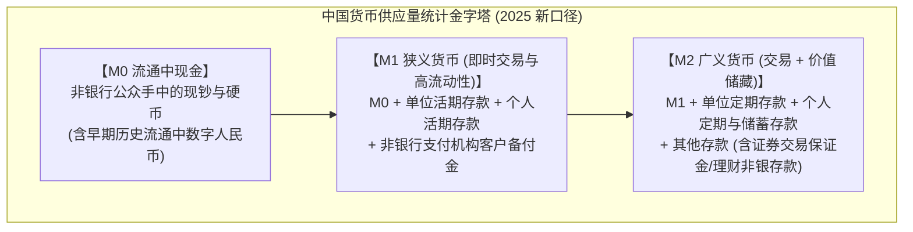
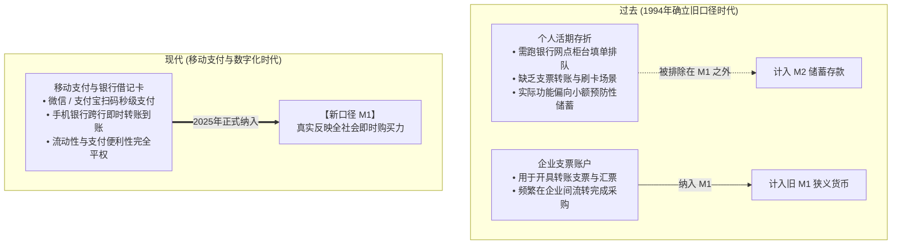
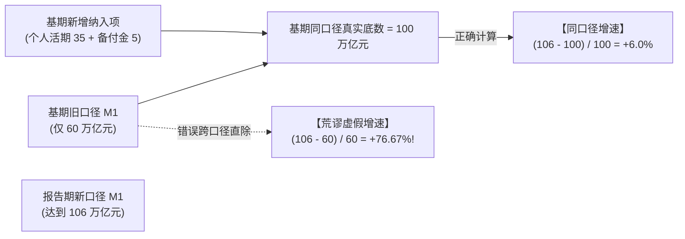
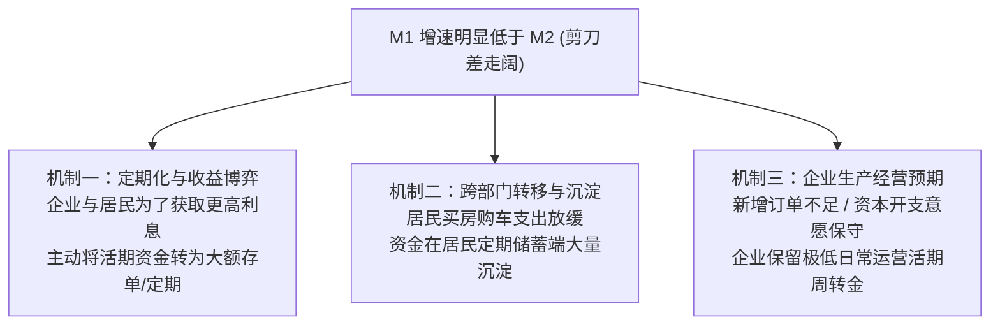
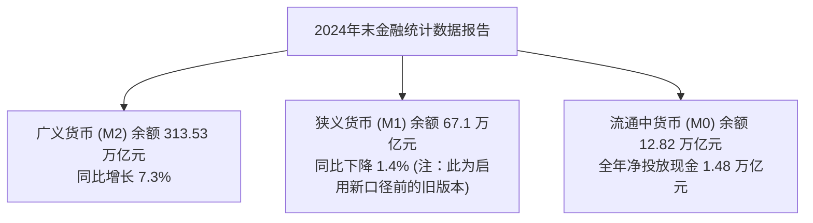

# 17 中国 M0、M1、M2：支付方式改变以后，货币怎样统计

[上一章：银行体系](16-banks-and-deposits.md) · [目录](./) · [下一章：社会融资规模](18-social-financing.md)

> 编写于 2026-09-26。中国 M1 使用 2025 年起的新口径，并补充 2026 年数字人民币制度变化；美国对照注明 2020 年与 2026 年的统计变化。历史报告保留当时版本。

**前置阅读：**美国篇 [15 资产负债表](https://fangpings.github.io/us-econ/15-balance-sheets.html)及中国篇 [16 银行体系](16-banks-and-deposits.md)。本章聚焦中国宏观金融分析中最受关注的一组密码：**M0、M1 与 M2**。为什么在微信和支付宝高度普及的今天，老百姓卡里的活期存款直到 2025 年才正式被纳入 M1？M1 与 M2 之间忽大忽小的“剪刀差”究竟在释放什么信号？中国持续攀升的 M2/GDP 比例是否意味着全社会存在大量“闲钱”？

---

## 1. 货币的金字塔：从法定纸币到广义流动性

货币是经济交易的润滑剂。但在现代金融体系中，货币并不是一个单一的具体物品，而是一座按照**流动性（即时支付便利程度）**层层递进的金字塔：



| 货币层次 | 包含的核心资产项目 | 经济学功能与流动性特征 |
| :--- | :--- | :--- |
| **M0（流通中现金）** | 银行体系之外流动的纸币与硬币 | 最高流动性，具有法律强制清偿力，现钞无交易摩擦 |
| **M1（狭义货币）** | M0 + 企业活期存款 + **个人活期存款** + **支付机构客户备付金** | **现实购买力**的核心代表，随时用于转账消费与商务结算 [人民银行新口径](https://www.pbc.gov.cn/rmyh/109339/2025080818580470423/index.html) |
| **M2（广义货币）** | M1 + 单位定期与协议存款 + 居民定期储蓄 + 证券保证金等 | 包含潜在购买力与储蓄储藏功能，衡量全社会总体货币存量 |

在阅读货币报表时，必须牢固树立**“资产与负债一一对应”**的思维：企业与个人手里的银行存款，是居民的资产，同时是商业银行的负债。银行间相互持有的同业拆借资金，在合并编制全国货币总量时必须被严格抵销剔除，不能重复计入公众货币。

---

## 2. 划时代变革：为什么个人活期存款直到 2025 年才纳入 M1？

在 2025 年 1 月之前，中国宏观经济分析中存在一个长期被诟病的现象：**企业账上的活期存款被计入狭义货币 M1，而普通老百姓银行卡里的个人活期存款，无论金额多大，哪怕随时可以刷卡扫码支付，也只能委屈地呆在 M2 里面！**

为什么会出现这种看似荒谬的统计边界？答案藏在中国支付工具演化的历史脉络中：[人民银行：M1 修订答记者问](https://jrj.sh.gov.cn/SCDT197/20241203/e2d0d7d348ab4aaaa2fde9a976d3ae17.html)



### 2.1 工资发放测试：新旧口径的对照实验

企业给员工发工资，是最日常的微观资金流动。我们来看在两套口径下，全社会 M1 会发生怎样截然不同的数字变化：

> **典型案例演示**：
> 某制造企业在月末从其银行单位活期账户中，向全体员工的个人活期借记卡发放工资合计 $20\text{ 亿元}$。在此期间无取现、无对外采购、无还贷。
> 
> ```mermaid
> flowchart LR
>     Firm["企业单位活期存款 (-20 亿元)"] -->|网银发放工资| Staff["员工个人活期存款 (+20 亿元)"]
> ```
> 
> - **在旧口径时代**：
>   - 企业活期属于 M1：M1 减少 $20\text{ 亿元}$；
>   - 个人活期属于 M2：M2 增加 $20\text{ 亿元}$（由于 M1 也包含在 M2 内，两相抵消后 M2 总量不变）；
>   - **经济现象**：一笔正常的企业薪酬支付，在统计报表上竟然凭空制造出“全社会 M1 暴跌了 20 亿元”的假象！
> - **在 2025 年新口径下**：
>   - 企业活期（新 M1）减少 $20\text{ 亿元}$；
>   - 个人活期（新 M1）增加 $20\text{ 亿元}$；
>   - **新 M1 总额保持完全稳定（变动为零）**，真实反映了资金在居民与企业之间的正常流动，没有对宏观流动性产生虚假冲击。

---

## 3. 统计断点陷阱：跨口径增速与同口径比较

口径调整最容易诱发分析灾难。当新口径纳入了庞大的个人活期存款（数十万亿元规模）和支付机构客户备付金后，**如果直接拿新口径的期末余额除以旧口径的历史余额，就会算出惊世骇俗的“虚假货币暴增”！**



> **基准算例推导**：
> 设某历史基准期末，旧口径 M1 为 $60\text{ 万亿元}$；经普查核对，该时点符合新标准的个人活期存款为 $35\text{ 万亿元}$，非银行支付机构客户备付金为 $5\text{ 万亿元}$。
> 一年后，报告期新口径 M1 经统计发布为 $106\text{ 万亿元}$。
> 
> - **错误算法（跨口径直接相除）**：
>   $$g_{\text{wrong}} = \frac{106}{60} - 1 \approx 1.766667 - 1 \approx \mathbf{+76.67\%}$$
>   *得出“央行一年内印钞扩表超 76%”的荒诞结论。*
> - **正确算法（同口径回溯比较）**：
>   基期的新口径可比底数为：
>   $$M1_{0}^{\text{新}} = 60 + 35 + 5 = 100\text{ 万亿元}$$
>   同口径真实货币增长率为：
>   $$g_{\text{correct}} = \frac{106 - 100}{100} = \frac{6}{100} = \mathbf{+6.0\%}$$

因此，国家统计局与中国人民银行在发布新数据时，都会同步提供**经过追溯调整的可比历史序列**。我们在建立数据库时，切不可将未经调整的新老两个剪贴板数据直接拼接相除。

---

## 4. 手机里的四种余额：并不属于同一种金融负债

今天，普通居民一部智能手机里可能躺着微信钱包零钱、银行借记卡活期、余额宝货币基金以及数字人民币。它们虽然都可以扫码买咖啡，但在法律属性与金融统计上却属于截然不同的世界：

| 手机上看到的形态 | 底层对应的金融对象 | 法律上的直接债务人 | 货币统计中的最终落脚点 |
| :--- | :--- | :--- | :--- |
| **银行借记卡活期** | 商业银行吸收的个人活期存款 | 相应的开户商业银行 | **直接计入新 M1**（属于商业银行核心负债） |
| **微信/支付宝钱包零钱** | 非银行支付机构**客户备付金** | 支付机构，但**资金 100% 集中存管于人民银行** [备付金管理办法](https://www.pbc.gov.cn/zhengwugongkai/attachDir/2025/11/2025111914411687312.pdf) | **直接计入新 M1**（杜绝支付机构挪用或自行放贷） |
| **余额宝等货币基金** | 货币市场基金份额（底层投资同业存单、国债） | 基金财产（属于受托资产，非银行负债） | **不属于 M1**；赎回转为银行存款或备付金后方可进入支付 |
| **数字人民币 (e-CNY)** | 2026 年起明确为**商业银行钱包负债**，按活期存款计息并纳入准备金管理 [中国银行计息公告](https://www.boc.cn/ebanking/bi2/202512/t20251231_25636788.html) | 运营商业银行（承担对客兑付与计息责任） | **按流动性计入相应货币层次** |

### 4.1 2026 数字人民币制度演进：走向商业银行存款货币

在早期试点阶段（2022 年底至 2025 年），数字人民币主要定位于“数字现金（M0）”，不计付利息。
自 2026 年起，中国人民银行明确了数字人民币发展的升级框架：**运营商业银行的实名数字人民币钱包余额，正式确立为商业银行的负债，纳入相应准备金管理，并按挂牌活期存款利率计息！**

这一制度变迁具有重大的金融学内涵：
- 它彻底消除了数字人民币与传统银行电子存款之间的制度套利摩擦；
- 避免了居民将银行存款大规模兑换为数字现金时，对商业银行造成的流动性脱媒风险；
- 在统计上，数字人民币钱包余额顺理成章地依照活期存款性质计入新 M1，展现了中国法定数字货币在现代化银行体系中的深度嵌入。

---

## 5. 解读 M1 与 M2 增速差：资金活化还是存款定期化？

在证券分析中，**“M1-M2 剪刀差（$g_{M1} - g_{M2}$）”**常被奉为判断股市行情的牛熊风向标。市场常把“M1 增速低于 M2”解释为“企业资金活化不足、对未来预期悲观”。

这一假说有其合理性，但在现实中，我们必须将以下**三种不同性质的资金流动**严格剥离：



> **产品转换算例**：
> 设全社会新口径 M1 为 $100\text{ 亿元}$，M2 为 $200\text{ 亿元}$（其中准货币 $M2 - M1 = 100\text{ 亿元}$）。
> 某企业因未来半年暂无设备采购计划，为锁定收益，在网银中将 $10\text{ 亿元}$ 活期存款转存为 3 年期大额存单（定期存款）。
> - M1 减少 $10\text{ 亿元}$，降为 $90\text{ 亿元}$；
> - 准货币定期增加 $10\text{ 亿元}$，升为 $110\text{ 亿元}$；
> - **广义货币 M2 依然维持 $200\text{ 亿元}$ 完全不变！**
> 
> 在这个操作中，全社会并没有凭空“蒸发了 10 亿元货币”，银行体系内的存款一分钱都没少。这完全是存款人基于资产收益率在不同产品期限之间的再配置行为。如果单纯将其视作“经济活动瘫痪”，就会夸大悲观预期。

---

## 6. 中美货币口径的跨国对照：名字相同，定义不同

| 比较维度 | 中国新 M1 口径 | 美国新 M1 口径 (2020年改革后) [美联储 H.6 说明](https://www.federalreserve.gov/releases/h6/20210223/) |
| :--- | :--- | :--- |
| **涵盖项目** | M0 + 企业活期 + 个人活期 + 支付备付金 | 流通中货币 + 需求存款（Demand Deposits）+ **其他流动存款（Other Liquid Deposits，含储蓄存款）** |
| **储蓄存款归属** | 居民储蓄定期与活期严格分离（定期在 M2） | 2020 年取消储蓄账户提款限制后，**全部传统储蓄存款已并入 M1** |
| **指标规模对比** | 占 M2 比例相对适中 | 由于全美储蓄存款整体并入，M1 规模发生历史性跃升 |

**警惕比较陷阱**：美国在 2020 年将 Savings Deposits 并入 M1 时，美国 M1 出现了一条垂直拉升的虚假跳折线。我们绝不能拿中国的新 M1 增速去直接与美国历史上的 M1 增速直接相比，跨国研究必须统一底层资产的真实流动性界限。

---

## 7. 破解迷思：中国 M2/GDP 偏高，意味着遍地是“闲钱”吗？

很多非专业评论常说：“中国 M2 超过 300 万亿元，而年度 GDP 只有 130 多万亿元，M2/GDP 比率超过 2.3，说明中国货币严重超发，随时可能引发通胀大爆发。”

这种论调混淆了**存量与流量**的根本经济学属性：
1. **单位不匹配**：GDP 是一年内生产活动的**流量（Flow）**，而 M2 是某一历史时点的财富与债权**存量（Stock）**。直接用存量除以流量，不能得出“有多余钞票”的结论。
2. **金融结构差异（间接融资 vs 直接融资）**：
   - 中国是典型的以商业银行为主导的间接融资体系。实体经济运转所需的资金绝大部分依托银行贷款创造，并沉淀为银行存款（M2）；
   - 美国则是高度发达的资本市场（直接融资体系）。美国家庭的大量财富沉淀在股票、企业债券、共同基金与私人养老金中，这些海量金融资产根本不在美国 M2 统计范围内！
3. **高储蓄文化与投资渠道**：中国居民部门保持着全球领先的高储蓄率，在理财净值化与房地产资产预期调整的背景下，居民大量财富更倾向于以保本保息的银行定期存款形式持有，从而被动推高了 M2 存量。

---

## 8. 真实金融统计报告带读：以 2024 年末数据为例

查阅中国人民银行发布的《2024 年金融统计数据报告》（发布于 2025-01-14）：[中国政府网：2024 年金融统计报告](https://www.gov.cn/lianbo/bumen/202501/content_6998520.htm)



在阅读该份历史报告时，专业分析师会立刻做出三个专业标记：
1. **时点存量属性**：313.53 万亿元是 2024 年 12 月 31 日当天的余额；
2. **口径版本识别**：67.1 万亿元是**旧口径 M1**，尚未计入庞大的个人活期存款。在后续建立长期计量模型时，必须前往央行回溯数据库提取可比的新口径序列；
3. **M1 负增长的经济含义**：旧口径下企业活期资金同比下降 $1.4\%$，直观印证了企业在房地产及设备开支上的谨慎态度，以及存款向定期化产品转移的现实格局。

---

## 9. 课后自测与逐步推导

1. 某制造企业从其单位活期账户中划拨 $20\text{ 亿元}$，向员工发放工资至其个人活期借记卡中。在旧口径 M1 与 2025 年新口径 M1 体系下，全社会 M1 总量分别会发生怎样的变动？广义货币 M2 是否会因此改变？
2. 某历史时点上，全国旧口径 M1 为 $70\text{ 万亿元}$，个人活期存款总额为 $40\text{ 万亿元}$，非银行支付机构客户备付金为 $5\text{ 万亿元}$。一年后，报告期公布的全新口径 M1 余额为 $120\text{ 万亿元}$。请计算该年度同口径下的真实 M1 增长率。
3. 在 2025 年新 M1 口径下，若某居民将自己银行卡里的 $5{,}000\text{ 元}$ 活期存款充值转入微信零钱（支付机构备付金），能否在统计上将这两项各计算一次，宣称全社会新增了 $10{,}000\text{ 元}$ 的即时货币？
4. 当市场观察到 M1 增速显著低于 M2 时，能否直接断言“全国所有企业都彻底停止了生产投资”？试列出两个可能导致这一现象但并不代表企业停工的资金分配动因。
5. 美联储在 2020 年对其 M1 统计口径做出了重大修改，与中国 2025 年的新 M1 调整相比，两者有哪些异同？
6. 美联储在 2026 年调整了退休账户扣除项的列示位置，未经季调的 M2 总额未变但部分分项改变，这对我们的数据跟踪提出了什么检查要求？

<details>
<summary>点击展开逐步参考答案与解析</summary>

1. **新旧口径对比解析**：
   - **旧口径 M1 体系**：企业活期属于 M1（减少 $20\text{ 亿元}$），个人活期属于准货币储蓄存款（排除在 M1 之外）。因此旧 M1 **净减少 $20\text{ 亿元}$**；
   - **2025 年新口径 M1 体系**：企业活期与个人活期均已统一纳入 M1 范畴。这笔转账属于新 M1 内部两个子部门之间的等额划转，**新 M1 总额完全不变（净变动为零）**；
   - **广义货币 M2**：在两套体系下均**保持不变**（单位活期与个人活期始终都包含在 M2 范畴内）。
2. **同口径增速标准推导计算**：
   - 基期在新口径下的可比底数为：
     $$M1_0^{\text{新}} = 70 + 40 + 5 = 115\text{ 万亿元}$$
   - 报告期新口径 M1 为 $120\text{ 万亿元}$；
   - 同口径可比增速为：
     $$g_{M1} = \frac{120 - 115}{115} = \frac{5}{115} \approx 0.043478 \implies \mathbf{+4.35\%}$$
   - *错误警示*：若跨口径直接相除 $\frac{120}{70}-1 \approx 71.43\%$，属于严重的口径混淆错误。
3. **不能重复计算，属于支付工具内部替换**：
   - 个人活期存款（新 M1）减少 $5{,}000\text{ 元}$；
   - 支付机构客户备付金（新 M1）增加 $5{,}000\text{ 元}$；
   - 这只是资金存放介质的变化，总 M1 增量为零。同时，央行对备付金实行集中存管，在央行负债侧体现为备付金存款，不可重复计入基础货币。
4. **不能直接推断企业停工**：
   - **原因一：存款定期化博弈**。企业为获取利息收益，将暂不使用的运营资金购买大额存单、协议存款等定期产品，资金并未离开银行体系，只是在 M1 与准货币之间重构；
   - **原因二：跨部门向居民储蓄转移**。企业销售商品或回款后向居民发放奖金分红，居民将资金存为 3 年期定期储蓄，导致 M1 向 M2 转移；
   - 必须结合工业企业产成品库存、固定资产投资完成额和开工率等实体数据交叉研判。
5. **中美口径调整的异同**：
   - **相同点**：都源于现代支付技术的飞速变革，传统储蓄与交易账户的流动性边界彻底模糊；
   - **不同点**：美国直接将数额极其庞大的全部流动性储蓄存款（Savings Deposits）并入 M1，导致美国 M1 规模爆发式倍增；中国则是将高流动性的“个人活期存款”与“支付机构备付金”纳入 M1，企业与个人的定期储蓄存款依然保留在 M2 内。
6. **核查口径位置与季调回溯要求**：
   - 查证扣除项是在分项层面还是总量层面操作；
   - 查证历史序列是否进行了统一回溯，避免在时间断点前后混用不同的分项加总方法；
   - 查证季节调整因子是否因口径微调而发生重估，确保引用的序列为同版本季调数据。

</details>

---

[上一章：银行体系](16-banks-and-deposits.md) · [目录](./) · [下一章：社会融资规模](18-social-financing.md)
