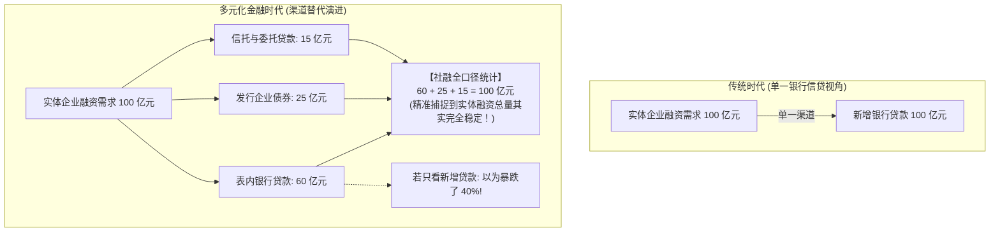
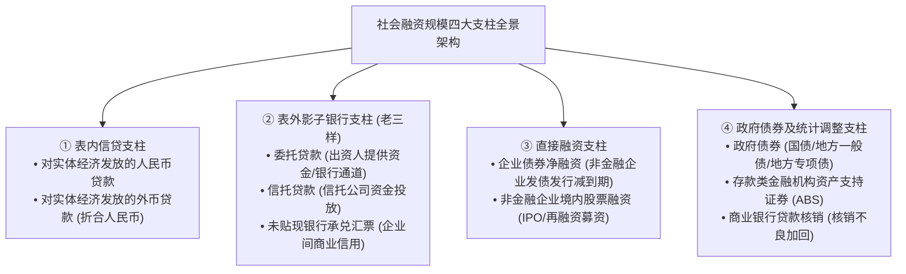
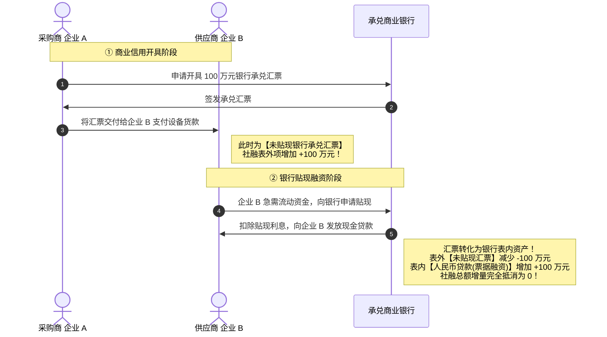
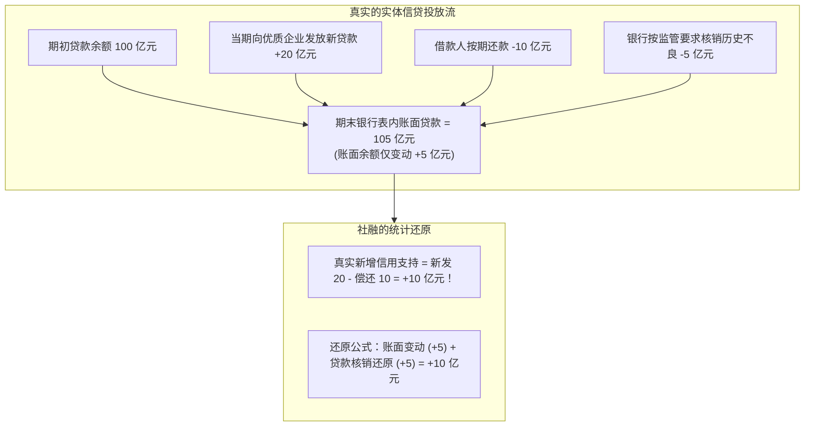
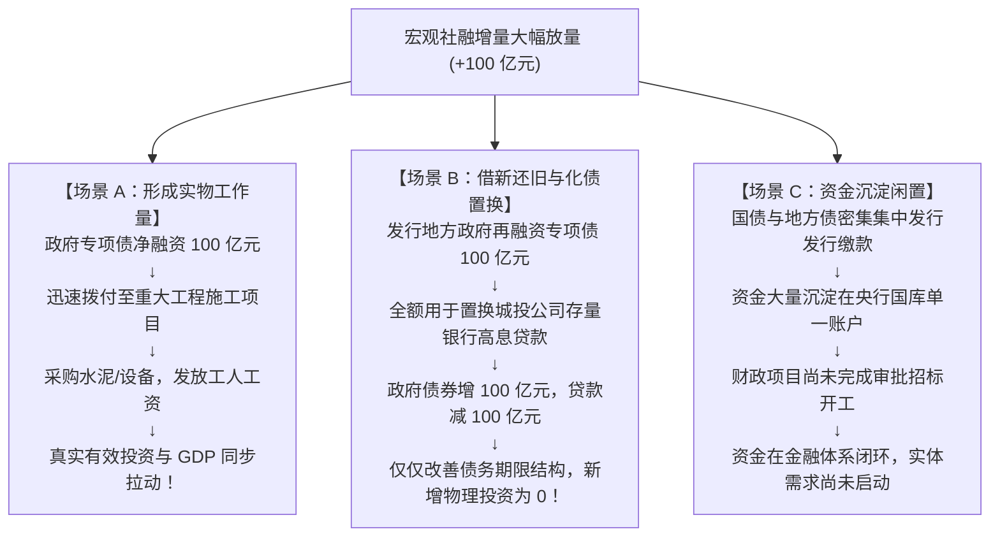
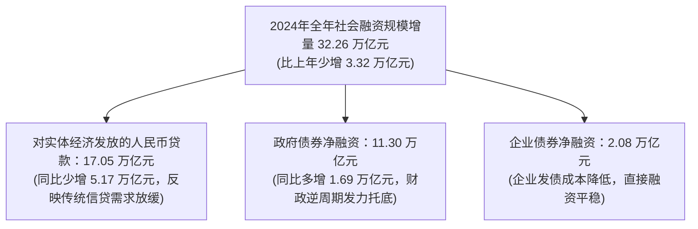

# 18 社会融资规模：中国为什么需要它，美国怎样观察同一问题

[上一章：货币口径](17-money-aggregates.md) · [目录](./) · [下一章：信用需求与供给](19-credit-supply-demand.md)

> 编写于 2026-09-26。历史报告使用 2025 年 1 月公布的 2024 年数据；美国金融账户使用注明日期的归档版本。逐笔交易为教学简化，不替代完整统计制度。

**前置阅读：**美国篇 [18 银行信贷](https://fangpings.github.io/us-econ/18-bank-credit.html)、中国篇 [01 账户地图](01-economic-map.md)和 [16 银行体系](16-banks-and-deposits.md)。在宏观经济分析中，每个月最受瞩目的两份央行报告，一份是货币供应量（M2），另一份就是**社会融资规模（Total Social Financing, TSF）**。为什么中国要首创这个全球独具特色的金融指标？当企业从向银行借钱转向去债券市场发债时，社融是如何捕捉这种渠道替代的？社融大增为什么并不等于实体投资等量回暖？

---

## 1. 时代呼唤：社融指标的诞生与渠道替代

回溯到 2010 年以前，中国宏观调控与金融分析几乎完全盯住一个指标——**金融机构新增人民币贷款**。

但随着中国金融市场的深化演进，单纯盯住银行贷款开始频频失真。中国人民银行在 2011 年正式推出社会融资规模指标，其核心初衷正是为了应对**金融脱媒与融资渠道的深刻替代**：[人民银行：关于金融宏观调控和社融的访谈](https://wzdt.pbc.gov.cn/rmyh/2025-07/21/article_2025072114532573602.html)

如果央行和宏观分析师仍然只盯着传统银行信贷，就会把企业发债或通过信托融资的正常“结构切换”，误判为金融体系对实体经济支持力度的断崖式萎缩。**社融从实体经济的资产负债表需求端出发，统计了实体从整个金融体系获得的一切外部信用资金。**

---

## 2. 全景架构：社融四大支柱与统计边界

社会融资规模是指**实体经济（境内非金融企业和住户部门）在一定时期内从金融体系获得的全部资金总额**。

在统计边界上，必须牢牢把握两大“铁律”：
1. **只计实体，不计同业**：商业银行之间相互借入拆出的同业拆借、同业存单，属于金融体系内部资金空转调配，**绝对不计入社融**！
2. **涵盖全部正规金融工具**：包括表内信贷、表外影子银行、直接融资以及政府债务。[人民银行社融统计表](https://www.pbc.gov.cn/diaochatongjisi/attachDir/2025/11/2025110511302392865.pdf)

---

## 3. 票据流转与去重：银行承兑汇票的真实旅程

在表外三项中，初学者最感困惑的是**“未贴现银行承兑汇票”**。为什么一张汇票贴现后，不能在社融里重复计算两次？我们来追踪一张汇票的生命周期：

### 3.1 票据搬家的会计推演

> **典型案例演示**：
> 某月份，全国企业之间新签发且尚未贴现的银行承兑汇票增加了 $100\text{ 亿元}$（计入社融表外项 $+100$）。
> 随后，部分持票企业为了资金周转，前往商业银行将其中面额 $100\text{ 亿元}$ 的汇票办理了贴现。
> 
> 在这一瞬间：
> - 表外未贴现银行承兑汇票注销减少：$-100\text{ 亿元}$；
> - 商业银行表内贷款项下的“票据融资”增加：$+100\text{ 亿元}$；
> - **两项加总净效果为**：
>   $$\Delta \text{TSF} = -100\text{ 亿元 (未贴现)} + 100\text{ 亿元 (表内贷款)} = \mathbf{0\text{ 亿元}}$$

通过这种动态扣除机制，社融成功避免了同一笔商业信用在贴现前后被“一鱼两吃”重复计算两次的荒谬错误。

---

## 4. 统计对账：为什么金融统计的“各项贷款”与社融的“实体贷款”不一致？

查阅中国人民银行发布的 2024 年全年月度公报，我们会发现两份报告中的贷款数据存在显著差异：[人民银行：2024 年金融统计与社融报告](https://www.gov.cn/lianbo/bumen/202501/content_6998520.htm)
- 《金融统计数据报告》显示：2024 全年人民币各项贷款增加 **$18.09\text{ 万亿元}$**；
- 《社会融资规模增量报告》显示：2024 全年对实体经济发放的人民币贷款增加 **$17.05\text{ 万亿元}$**。

**两者之间存在高达 $1.04\text{ 万亿元}$ 的差额！这并不是统计误差，而是由严密的主体统计边界决定的**：

金融统计报告是从商业银行的**信贷资金流出全景**出发，只要银行放了款都要记入；而社融是从**境内实体经济（非金融企业与家庭）的净负债获得**出发。银行借给证券公司用于自营拆借的资金属于同业资金融通，社融必须坚决将其剔除！

---

## 5. 贷款核销与不良资产证券化：为什么“核销”会增加社融？

在社融统计表中，经常会出现一个令初学者费解的调整项目——**“贷款核销（Loan Write-offs）”**。

在银行日常经营中，当一笔贷款出现长期逾期、确认无法收回时，银行会提取拨备在账面上将其核销（Write-off）。核销在账务上表现为贷款余额减少，但**借款企业当天并没有向银行偿还一分钱现金！**

> **核销调整算例**：
> 某银行期初贷款余额为 $100\text{ 亿元}$。当期新发放贷款 $20\text{ 亿元}$，客户正常偿还本金 $10\text{ 亿元}$，同时该行依据会计准则，将 $5\text{ 亿元}$ 历史不良烂账进行了账面核销冲销。
> - 该行期末公布的账面贷款余额为：$100 + 20 - 10 - 5 = 105\text{ 亿元}$；
> - 账面余额的账面增量仅为 $105 - 100 = \mathbf{+5\text{ 亿元}}$；
> - 如果直接拿余额差额算，就会严重低估当期银行体系向实体经济提供的真实信贷支持（实际净发放为 $20 - 10 = \mathbf{+10\text{ 亿元}}$）。
> - **因此，社融指标在统计调整中将核销的 $5\text{ 亿元}$ 重新加回：**
>   $$\Delta \text{TSF 贷款相关项} = \Delta \text{账面余额} + \text{当期核销} = 5 + 5 = \mathbf{+10\text{ 亿元}}$$

这一精妙的统计调整，真实还原了金融体系当期对实体经济的毛信用支持力度。[人民银行：2018 年社融统计调整说明](https://xining.pbc.gov.cn/diaochatongjisi/116219/116225/060ccf383b7145a0a4367fcb83bd36c0/index.html)

---

## 6. 数学内核：存量、增量、同比多增与外币折算

在研读社融月度快报时，必须严格掌握以下统计学数学公式，杜绝语文形容词式的混淆：

### 6.1 存量增量与同比多增公式

设 $S_t$ 为报告期末社融存量规模，$F_t$ 为报告期内当期新增社融流量（增量）：

$$\text{当期增量} \quad F_t \approx S_t - S_{t-1} - \text{Valuation Adjustments}$$

某一月份新增融资与上年同期的对比，称为**同比多增（少增）额**：

$$\Delta \text{YoY} = F_t - F_{t-12}$$

> **辨析算例**：
> 某年 12 月新增社会融资规模为 $F_t = 25\text{ 亿元}$，而上年 12 月的新增融资规模为 $F_{t-12} = 30\text{ 亿元}$。
> - 同比变动额为：$\Delta \text{YoY} = 25 - 30 = \mathbf{-5\text{ 亿元}}$；
> - **专业表述**：当月社会融资规模**同比少增 $5\text{ 亿元}$**；
> - **低级错误**：绝对不能表述为“12 月份全社会融资余额减少了 5 亿元”！当期新增依然是高达 $+25\text{ 亿元}$ 的正向资金净流入。

### 6.2 外币贷款折算的汇率幻觉

社融中包含了外币贷款（折合人民币计算）。
假设某企业的外币贷款本金整年维持在 $100\text{ 万美元}$ 纹丝不动。
- 期初汇率为 $1\text{ 美元} = 7.0\text{ 元人民币}$，折合账面为 $700\text{ 万元人民币}$；
- 期末因国际外汇波动，汇率变为 $1\text{ 美元} = 7.2\text{ 元人民币}$，账面折合为 $720\text{ 万元人民币}$；
- 账面余额差额虽然增加了 $20\text{ 万元人民币}$，但这纯粹是**汇率折算估值效应（Valuation Effect）**，借款人并没有在当期多借入一分钱美元资金。央行在统计官方增量时会剔除汇率与估值波动。

---

## 7. 实体穿透：社融大增，为什么不等于经济需求等量回升？

很多投资者最容易犯的逻辑错误是：**“本月社融超预期大增 4 万亿，说明实体经济的开工建设与消费需求立刻出现等额暴增。”**

从资金进入实体账户，到转化为拉动 GDP 的水泥钢筋物理工作量，存在明显的**时间阻尼与用途阻断**：

因此，在分析社融时，必须重点核验：**资金究竟是投向了新增资本开支，还是流向了存量债务滚动；是已经花到了工地上，还是依旧沉淀在国库专户中**。

---

## 8. 中美宏观融资统计体系对照：TSF vs 美联储 Z.1 金融账户

美国美联储并没有一个完全叫做“TSF”的单一同名月度主指标。美国宏观分析体系主要依托美联储发布的季度**Z.1 资金流量表（Financial Accounts of the United States）**：[美联储：Z.1 金融账户归档报告](https://www.federalreserve.gov/releases/z1/20250612/html/default.htm)

| 比较维度 | 中国社会融资规模 (TSF) | 美联储 Z.1 资金流量表 (Financial Accounts) |
| :--- | :--- | :--- |
| **发布频率** | **月度发布**（每月 10-15 日公布上月数据），高频敏锐 | **季度发布**（每季度结束后约 2 个月公布），相对低频滞后 |
| **涵盖范畴** | 聚焦实体从金融市场获得的债务融资、股权融资与调整项 | 完整的国民金融账户矩阵（分部门、分资产工具的完整复式借贷平衡表） |
| **指标设计目的** | 补足传统银行信贷视角短板，监测全社会流动性供给 | 审计居民、非金融企业、各级政府与海外部门的综合资产负债表与净财富 |

中国社融的优势在于其**极高的发布时效性与对宏观金融信用的全景覆盖**；而在观察全社会各部门之间的深度资金对手方关系时，则需进一步借助中国的年度资金流量表（Flow of Funds）。

---

## 9. 真实数据实战带读：以 2024 年全年社融报告为例

打开中国人民银行发布的 2024 年社会融资规模增量与存量统计报告（发布于 2025-01-15）：[上海市委金融办转载：2024 年社融报告](https://jrj.sh.gov.cn/SCGK194/20250115/0e2b8ef740064ad6ad14b0a2e609c2f5.html)

在阅读该报告时，专业分析师会提炼出核心宏观逻辑：
1. **增量结构大分化（“政府升、信贷降”）**：对实体人民币贷款同比少增超 $5\text{ 万亿元}$，而政府债券净融资高达 $11.30\text{ 万亿元}$（占全社融增量比重高达 $35.0\%$）。这清晰表明：在私人部门（居民与民营企业）信贷自发需求偏弱时，**中央与地方政府通过大规模发债承接了信用扩张的主力任务**。
2. **存量与增量比例不可混淆**：2024 年末全国社会融资规模存量达到 **$408.34\text{ 万亿元}$**，同比增长 $8.0\%$。政府债券虽然在全年增量中贡献了 $35\%$，但其在存量总盘子中的比重依然在 $20\%$ 左右。绝不能拿当期增量的边际占比去错误推算存量的全局结构。

---

## 10. 课后自测与逐步推导

1. 某月份，商业银行向实体企业发放贷款净增 $80\text{ 亿元}$，企业间未贴现银行承兑汇票净减少 $30\text{ 亿元}$，非金融企业发行债券净融资 $20\text{ 亿元}$。在不考虑其他分项变动的前提下，该月全社会的简化社会融资规模增量是多少？
2. 某大型国企在债券市场上成功发行了 $50\text{ 亿元}$ 低成本公司债券，并将募集到的资金全额用于归还此前在银行的等额高息流动资金贷款。请分析：这笔交易对全社会融资结构与社会融资规模总额分别产生了怎样的影响？
3. 某商业银行期初各项贷款账面余额为 $100\text{ 亿元}$。在本统计报告期内，该行新发放对公贷款 $25\text{ 亿元}$，客户按期正常还款 $15\text{ 亿元}$，同时该行依据监管要求在账面上核销了历史不良贷款 $4\text{ 亿元}$。请计算该行期末的账面贷款余额。银行核销的 $4\text{ 亿元}$ 是否代表企业当天新收到了 $4\text{ 亿元}$ 现金借款？
4. 某月全国社会融资规模增量为 $20\text{ 亿元}$，统计局报告显示其同比少增 $8\text{ 亿元}$。请推算上年同期的实际社融增量是多少？
5. 为什么在严肃的金融学研讨中，不能把社会融资规模存量指标整体称作“中国全社会的总债务”？
6. 如果需要对中美两国的非金融企业部门融资总规模进行跨国对照，请列出至少四个必须完成的统计口径标准化校准步骤。

点击展开逐步参考答案与解析

1. **简化社融增量标准核算**：
   $$\Delta \text{TSF} = 80\text{ (实体贷款)} - 30\text{ (未贴现汇票)} + 20\text{ (企业债券)} = \mathbf{+70\text{ 亿元}}$$
   *分析提示*：不能只盯住贷款增加的 $+80\text{ 亿元}$，未贴现汇票的转入贴现或到期减少会抵扣总融资增量。
2. **结构优化但总量中性的替代分析**：
   - **融资结构层面**：企业实现了从间接融资（银行贷款）向直接融资（标准化债券）的转型，拉长了负债久期并锁定了低利率成本；
   - **社融总量层面**：企业债券净融资增加 $+50\text{ 亿元}$，而表内对实体人民币贷款减少 $-50\text{ 亿元}$，两者在社融统计口径内**完全等额相互抵消，总额增量为零**；
   - **实体需求层面**：由于资金全额用于债务置换，并未形成针对厂房、设备、原材料的新增现金采购，因此没有带来当期实物投资工作量的扩张。
3. **贷款核销与账面余额计算**：
   - 期末账面贷款余额为：
     $$100 + 25\text{ (新发)} - 15\text{ (偿还)} - 4\text{ (核销)} = \mathbf{106\text{ 亿元}}$$
   - 账面余额净增额为 $106 - 100 = 6\text{ 亿元}$；
   - **核销不代表新收到现金**。核销是银行处理沉淀资产损失的会计账务冲销，借款人并没有收到任何增量现金。社融将其加回是为了还原银行当期实际提供的信用净供给（$25 - 15 = 10\text{ 亿元}$）。
4. **同比增量反推计算**：
   - 设上年同期增量为 $F_{t-12}$，依定义：
     $$\Delta \text{YoY} = F_t - F_{t-12} = -8\text{ 亿元} \implies 20 - F_{t-12} = -8 \implies F_{t-12} = 20 - (-8) = \mathbf{28\text{ 亿元}}$$
   - 当月虽然同比少增，但当期依然实现了高达 $20\text{ 亿元}$ 的正向资金净流入。
5. **社融包含股权与调整项，非纯债务**：
   - **包含股权融资**：社融中包含了“非金融企业境内股票融资”（IPO 与定向增发募资），股票属于权益资产而非债权债务；
   - **包含会计调整项**：如贷款核销、资产支持证券等；
   - **未覆盖全部债务**：如企业之间的民间借贷、商业应收应付账款拖欠、境外直接发行的外币债等并未被社融全量收录。
6. **中美企业融资标准化校准步骤**：
   - **步骤一：固定观察时期与数据版本**（统一为日历季度或年度，注明经季调年率还是未经季调原始流量）；
   - **步骤二：严格对齐企业部门边界**（美国 Z.1 提取 Nonfinancial Corporate Business，中国提取非金融企业分项）；
   - **步骤三：工具与资本性质拆分**（将债券、贷款等债务工具与股票股权融资分别归类，剔除市值重估波动）；
   - **步骤四：汇率与通胀平减转换**（统一计价货币单位，并剔除离岸外债与跨国统计调整项差异）。

---

[上一章：货币口径](17-money-aggregates.md) · [目录](./) · [下一章：信用需求与供给](19-credit-supply-demand.md)
