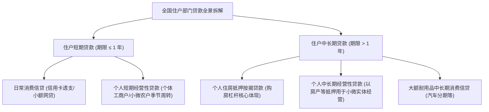
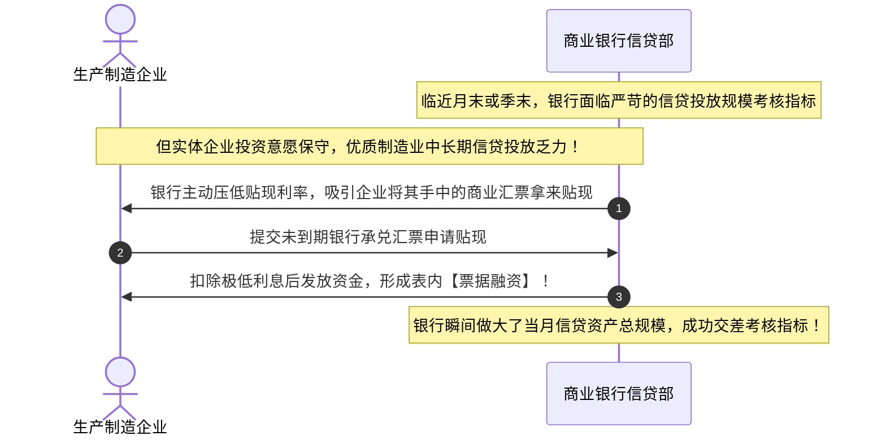
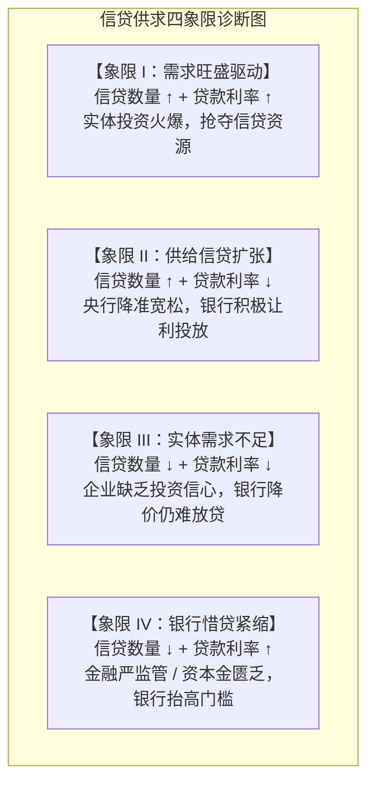
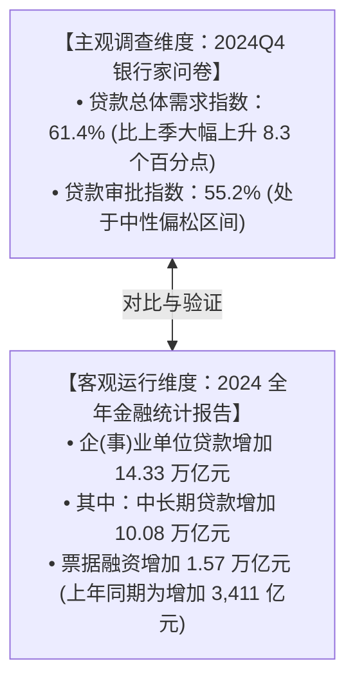

# 19 中国信用：贷款少了，是没人借，还是银行不愿贷

[上一章：社会融资规模](18-social-financing.md) · [目录](./) · [下一章：央行政策传导](20-monetary-transmission.md)

> 编写于 2026-09-26。报告带读固定使用 2024 年第四季度银行家调查及 2024 年金融统计，案例为教学假设。

**前置阅读：**美国篇 [18 银行信贷](https://fangpings.github.io/us-econ/18-bank-credit.html)、中国篇 [09 企业经营](09-business.md)及 [18 社融](18-social-financing.md)。在宏观经济运行中，如果某个月的新增信贷明显回落，市场上往往会爆发激烈的争论：**究竟是实体经济订单不足“没人想借钱”（需求收缩），还是商业银行畏惧坏账“不敢放款”（供给收紧）？** 我们如何利用央行公布的住户分项、企业期限、票据贴现以及银行家问卷，像侦探一样抽丝剥茧还原信贷供求的真相？

---

## 1. 穿透信贷黑箱：一笔贷款出账的完整决策链

许多人误以为，银行信贷数据就像水龙头里的自来水，央行一拧开开关，资金就哗哗流进企业账户。但在真实的微观银行业务中，**从企业动念头到最终在报表上形成一笔新增贷款，要跨越漫长而严格的决策台阶**：

在阅读金融统计数据时，必须坚决防范**四类口径的混淆**：
- **政策额度 $\ne$ 银行授信**：国家设立的专项再贷款额度，只是央行提供的政策意向资金池；
- **银行授信 $\ne$ 签约合同**：银行给某企业批复了 $10\text{ 亿元}$ 综合授信额度，企业有权在额度内提款，但这**不是已发放贷款**；
- **提款出账 $\ne$ 余额净增**：企业本月虽然提款了 $3\text{ 亿元}$，但如果当月同时归还了到期的 $2\text{ 亿元}$ 历史借款，银行资产负债表上的贷款余额**仅仅增加 $1\text{ 亿元}$**！

---

## 2. 解剖住户贷款：按揭房贷、消费信贷与大额经营贷

中国人民银行在《金融统计数据报告》中，将各项贷款第一层划分为**住户贷款**与**企（事）业单位贷款**，第二层划分为**短期贷款**与**中长期贷款**。

许多初学者容易产生一种想当然的刻板印象：“住户中长期贷款就是居民房贷，住户短期贷款就是刷卡消费。”

**这种将“期限划分”与“用途划分”机械绑定的做法是完全错误的！**[中国人民银行：金融机构信贷收支表](https://www.pbc.gov.cn/diaochatongjisi/attachDir/2025/11/2025111817275980622.pdf)

### 2.1 提前还贷潮下的按揭净增失真

在存量房贷利率与居民投资理财收益率出现明显利差的时期，居民部门往往会动用储蓄**提前归还存量房贷**：

> **典型案例演示**：
> 某月份，商业银行向购买新建商品房的居民新发放了按揭贷款 $80\text{ 亿元}$。
> 但在同一个月内，老业主按照合同正常还本付息扣款了 $30\text{ 亿元}$，更有大量存量业主选择动用定期存款提前还贷了 $20\text{ 亿元}$。
> 此时，该行**个人住房按揭贷款余额净增额**仅为：
> 
> $$\Delta \text{按揭余额} = 80 - 30 - 20 = \mathbf{+30\text{ 亿元}}$$
> 
> 与此同时，个体工商户因扩大网店进货申请的个人中长期经营贷款净增了 $15\text{ 亿元}$。
> 最终，官方报告中公布的“住户中长期贷款增加额”显示为 $30 + 15 = \mathbf{45\text{ 亿元}}$。
> 
> 如果分析师看到 $45\text{ 亿元}$ 就下结论称“本月新增购房房贷需求回暖了 45 亿元”，就同时犯了**抹杀提前还贷对冲**以及**混淆经营性与消费性用途**的双重错误！

---

## 3. 解剖对公企业贷款：中长期成色与“票据冲量”之谜

在企（事）业单位贷款中，中长期贷款通常被视作经济内生动力的风向标，因为企业借入 3 年期、5 年期大额资金，通常是为了建设新厂房、购置大型先进设备或者投向基建工程。

但我们同样要高度警惕其中的特殊金融现象——**“票据冲量”**。

### 3.1 识别票据冲量的量价证据链

当我们在月度金融数据中看到**“企业中长期贷款增长乏力、票据融资爆发式脉冲大增”**时，必须结合以下三组量价线索进行精准确证：
1. **票据贴现利率与资金利率倒挂**：
   在银行疯狂抢购票据冲规模的极端月末，票据转贴现利率甚至跌破同期限的央行政策利率或同业存单利率（出现“零利率贴现”奇观）；
2. **短期资产与长期资产替代**：
   银行以 3-6 个月短期票据代替 3-5 年中长期项目贷款，反映银行风险偏好收缩，只愿为短期低风险资产提供信用额度；
3. **月初断崖与月末冲顶**：
   信贷投放呈现鲜明的“月初萎靡、月末突击”脉冲式波动，印证了行政考核驱动的非自发性特征。

---

## 4. 银行家问卷与扩散指数计算：主观判断的量化法则

中国人民银行每季度在全国范围内向数千家银行业金融机构负责人开展**银行家问卷调查**，编制发布“贷款总体需求指数”与“银行贷款审批指数”。[中国人民银行：银行家问卷调查报告](https://www.pbc.gov.cn/diaochatongjisi/fileDir/resource/cms/2025/03/2025032117151243875.pdf)

### 4.1 扩散指数（Diffusion Index）的标准数学公式

问卷通常设立三个选项：**“增长（放松）”**、**“基本不变”**与**“下降（收紧）”**。扩散指数采用概率加权算式：

$$\text{扩散指数} = P_{\text{增长}} \times 1.0 + P_{\text{基本不变}} \times 0.5 + P_{\text{下降}} \times 0.0$$

其中 $P_{\text{增长}} + P_{\text{基本不变}} + P_{\text{下降}} = 100\%$。该指数以 **$50.0\%$ 为荣枯分界线**：
- 高于 $50\%$：表明景气处于扩张或改善区间；
- 低于 $50\%$：表明景气处于收缩或恶化区间。

扩散指数还可以直接与**“净增长比例（Net Percentage）”**进行数学换算：

$$\text{扩散指数} = 50\% + 0.5 \times (P_{\text{增长}} - P_{\text{下降}})$$

> **基准算例推导**：
> 某季度受访银行家针对工业企业贷款需求的问卷调查统计结果为：认为贷款需求“增长”的银行占比为 $40.0\%$，认为“基本不变”的占比为 $40.0\%$，认为“下降”的占比为 $20.0\%$。
> 
> - 贷款需求扩散指数为：
>   $$\text{需求指数} = 40.0\% \times 1.0 + 40.0\% \times 0.5 + 20.0\% \times 0.0 = 40.0\% + 20.0\% = \mathbf{60.0\%}$$
> - 净增长比例为：
>   $$\text{净增长} = 40.0\% - 20.0\% = \mathbf{+20.0\text{ 个百分点}}$$
> - 代入换算公式验证：
>   $$\text{扩散指数} = 50\% + 0.5 \times 20\% = 50\% + 10\% = 60.0\%$$

**特别强调**：$60\%$ 描述的是**受访者回答倾向的分布重心高于 $50\%$ 荣枯线**，绝对不能误读为“本季度全社会贷款金额暴增了 $60\%$”或者“有 $60\%$ 的企业拿到了银行贷款”！

---

## 5. 中美信贷调查对比：先把坐标系方向校准

美联储对应的主流调查是每季度发布的**高级信贷官员意见调查（SLOOS）**。[美联储：SLOOS 调查报告](https://www.federalreserve.gov/data/sloos.htm)

在跨国对比中，初学者极易犯下“把相反方向强行画在同一张图”的低级错误：

| 调查特征维度 | 中国人民银行银行家问卷调查 | 美联储高级信贷官员意见调查 (SLOOS) |
| :--- | :--- | :--- |
| **标准基准方向** | **放松扩散指数**：以 $50\%$ 为中性界线，高于 $50\%$ 表示整体趋于宽松 | **净收紧比例（Net Tightening %）**：以 $0\%$ 为中性线，大于零表示整体偏向紧缩 |
| **调查对象** | 全国大中小各类商业银行总行及代表性分支机构负责人 | 全美大型商业银行及外国银行在美分行首席信贷官员 |
| **核心问题聚焦** | 宏观经济感受、信贷总体需求、行业贷款需求、审批放松度 | 工商业贷款（C&I）、商业地产（CRE）、居民住宅按揭及信用卡条款标准 |

> **坐标转换演示**：
> 设某样本中，认为信贷标准“放松”的比例为 $30.0\%$，“不变”为 $50.0\%$，“收紧”为 $20.0\%$。
> - 在中国央行口径下，审批指数为：$30\% \times 1.0 + 50\% \times 0.5 = \mathbf{55.0\%}$（高于荣枯线，反映边际偏松）；
> - 若换算为美联储 SLOOS 风格的“净收紧比例”：
>   $$\text{净收紧比例} = P_{\text{收紧}} - P_{\text{放松}} = 20.0\% - 30.0\% = \mathbf{-10.0\%}$$
> 
> $55\%$ 的中国审批指数与 $-10\%$ 的美国净收紧指数，**描述的是完全相同的宽松情景**！如果不加换算直接拼接，就会得出结论相反的误判。

---

## 6. 信贷供求四象限：量价配合诊断模型

面对信贷总量的波动，如何精准判定是供给驱动还是需求驱动？经济学中最经典、最强大的工具是**量价联合坐标系（P-Q 四象限模型）**：

| 市场量价表现 | 核心诊断结论 | 微观经济传导机制 | 必须进一步核实的实体证据链 |
| :--- | :--- | :--- | :--- |
| **数量偏弱，利率下行** | **实体有效需求不足主导** | 银行资金充裕愿降价促销，但企业缺乏合意投资回报率，主动减少负债提款 | 查企业订单指数、民间固定资产投资增速、产成品库存与开工率 |
| **数量增长，利率走低** | **金融政策供给发力推动** | 央行宽货币传导至宽信用，银行加大产业信贷投放，结构性再贷款落地 | 查信贷资金真实用途（是否形成新增固定资产开支）、中长期贷款占比 |
| **数量偏弱，利率攀升** | **金融供给收紧与惜贷** | 银行受资本充足率、不良坏账高企或风险偏好抑制，缩减授信敞口 | 查银行不良贷款生成率、资本充足率分布及银行间同业负债成本 |
| **票据暴增，中长贷款走弱** | **资产结构性防御冲量** | 银行为了达成考核规模，通过压低票据转贴现利率吸收资产替代一般信贷 | 查票据贴现利率与资金利率差（转贴现利差）、实体承兑汇票签发量 |

### 6.1 警惕“结构性降息”的辛普森悖论

在观察全国新发放贷款加权平均利率时，我们经常会发现加权利率大幅下行，但小微民营企业依然抱怨“自己拿到的贷款利率并没有下降”。这背后的数学秘密是**结构组合权重的跃迁**：

> **辛普森悖论算例推导**：
> 某银行只做两类贷款：A 类（低风险大型央国企贷款，固定利率 $3.0\%$）与 B 类（高风险民营小微贷款，固定利率 $6.0\%$）。
> - **基期结构**：两类客户放款规模各占一半（权重各 $50\%$）。全行加权平均贷款利率为：
>   $$\bar{r}_0 = 50\% \times 3.0\% + 50\% \times 6.0\% = 1.5\% + 3.0\% = \mathbf{4.50\%}$$
> - **报告期结构**：面对宏观经济不确定性，该行实施避险策略，大幅收紧民营小微授信，将 $80\%$ 的信贷额度倾斜给央国企，小微贷款占比压缩至 $20\%$。两类客户的单笔报价利率**完全没有下调（A 类依然是 $3.0\%$，B 类依然是 $6.0\%$）**。
> - 此时全行公布的加权平均贷款利率变为：
>   $$\bar{r}_1 = 80\% \times 3.0\% + 20\% \times 6.0\% = 2.4\% + 1.2\% = \mathbf{3.60\%}$$
> 
> 全行公布的贷款平均利率整整骤降了 **$90\text{ 个基点（0.9 个百分点）}$**！但这并不是央行降息让利的结果，而是银行主动向安全资产“拔足撤退”的结构性产物。任何一个微观个体客户面对的借贷价格**一分钱都没有降低**。

---

## 7. 真实数据实战带读：主观调查与年度客观数据的对话

打开中国人民银行发布的 2024 年第四季度银行家问卷调查与同期金融统计公报：[人民银行：2024 年第四季度银行家调查报告](https://www.pbc.gov.cn/diaochatongjisi/fileDir/resource/cms/2025/03/2025032117151243875.pdf)

专业研读的审慎结论应当是：
1. **边际预期改善与基数筑底**：四季度银行家对信贷需求的判断录得 $61.4\%$，环比反弹明显，体现出一揽子逆周期宏观政策出台后，金融机构对重大项目开工与债务化解的预期显著提振；
2. **客观数据呈现结构分化**：全年企业贷款依然保持超 14 万亿元的大体量，中长期贷款占比超过 $70\%$，体现了对制造业转型与基础设施的持续支撑；
3. **票据冲量同比多增明显**：全年票据融资增加 $1.57\text{ 万亿元}$，同比多增超万亿元，表明部分流动性仍通过票据转贴现形式释放，一般实体工商企业的自发中长期贷款意愿仍处于渐进修复期。

---

## 8. 课后自测与逐步推导

1. 某商业银行向重点制造企业批复了综合授信额度 $200\text{ 亿元}$。在该月份内，该企业根据新建产线施工进度实际提款出账了 $70\text{ 亿元}$，同时该企业按原还款计划向银行归还了已到期的流动资金贷款本金 $50\text{ 亿元}$。在忽略其他业务变动的前提下，该笔业务在当月给全行贷款余额带来了多大的增量？
2. 某月统计报告公布全国“住户中长期贷款增加 $60\text{ 亿元}$”，能否凭此数据直接认定“该月份全社会新增个人住房按揭贷款需求为 $60\text{ 亿元}$”？试列出至少两个关键抵扣或用途干扰因素。
3. 某季度银行家问卷调查显示：认为制造业信贷需求“增长”的银行占比为 $35.0\%$，认为“基本不变”的占比为 $50.0\%$，认为“下降”的占比为 $15.0\%$。请计算该季度的制造业信贷需求扩散指数。
4. 某次银行业信贷审批问卷统计显示：认为信贷标准“放松”的占比为 $20.0\%$，“基本不变”为 $60.0\%$，“收紧”为 $20.0\%$。请分别计算其对应的中国人民银行审批扩散指数，以及美联储风格的“净收紧比例”。
5. 某银行两类贷款的执行利率始终固定：优质类为 $3.0\%$，普通类为 $5.0\%$。若该行优质类贷款占总贷款的比例从基期的 $25.0\%$ 大幅攀升至报告期的 $75.0\%$，请计算该行全行加权平均贷款利率的变动幅度（基点）。
6. 当某月宏观金融统计公布“新增人民币贷款同比大幅少增”时，请分别从“实体需求端”、“银行供给端”以及“统计技术口径端”各给出一个合理解释，并说明验证该解释需要調取哪些一手资料。

点击展开逐步参考答案与解析

1. **实际贷款净增量标准测算**：
   $$\Delta \text{贷款余额} = 70\text{ (当期实际提款)} - 50\text{ (到期正常还本)} = \mathbf{+20\text{ 亿元}}$$
   *分析提示*：$200\text{ 亿元}$ 授信额度属于商业授信承诺，未动用部分不构成资产负债表资产，实际形成信用供给的净增量仅为 $20\text{ 亿元}$。
2. **不能直接等同于新增房贷需求**：
   - **原因一：存量房贷还款冲减**。住户中长期贷款公布的是余额净增量，新发放按揭需扣除当月存量按揭的合同正常还本以及居民提前结清还贷额；
   - **原因二：经营性与消费性混淆**。住户中长期贷款包含了以个人房产或资产抵押的中长期个人经营性贷款（用于个体工商户或小微实体经营），不全属于购房消费。
3. **扩散指数标准公式计算**：
   $$\text{需求扩散指数} = 35.0\% \times 1.0 + 50.0\% \times 0.5 + 15.0\% \times 0.0 = 35.0\% + 25.0\% = \mathbf{60.0\%}$$
   高于 $50\%$ 荣枯线，反映受访者整体倾向于需求回升。
4. **两套指标对照计算**：
   - **中国央行审批扩散指数**：
     $$\text{审批指数} = 20.0\% \times 1.0 + 60.0\% \times 0.5 + 20.0\% \times 0.0 = 20.0\% + 30.0\% = \mathbf{50.0\%}$$
     恰好处于中性平衡荣枯线；
   - **美联储 SLOOS 风格净收紧比例**：
     $$\text{净收紧比例} = P_{\text{收紧}} - P_{\text{放松}} = 20.0\% - 20.0\% = \mathbf{0.0\%}$$
     表明整体信贷标准保持绝对中立。
5. **结构权重跃迁与平均利率变动**：
   - 基期全行加权平均利率：
     $$\bar{r}_0 = 25.0\% \times 3.0\% + 75.0\% \times 5.0\% = 0.75\% + 3.75\% = 4.50\%$$
   - 报告期全行加权平均利率：
     $$\bar{r}_1 = 75.0\% \times 3.0\% + 25.0\% \times 5.0\% = 2.25\% + 1.25\% = 3.50\%$$
   - 利率变动：$3.50\% - 4.50\% = -1.00\%$，即**下降了整整 100 个基点**。在单笔贷款报价完全不变的前提下，纯资产配置结构倾斜制造了名义上的大幅降息假象。
6. **三维维度的假说与证据检验**：
   - **实体需求端假说**：企业新签订单下滑或缺乏盈利项目，主动缩减负债开支。验证需调取：企业中长期贷款分项、PMI 新订单指数、工业企业存货及资本开支数据；
   - **银行供给端假说**：银行面临资本充足率瓶颈或房地产等抵押资产价格重估，提高审批风险门槛惜贷。验证需调取：银行家审批指数、商业银行风险加权资产与资本充足率走势、信用利差；
   - **统计技术端假说**：当期发生大规模存量隐性债务置换，或者银行对历史不良贷款实施了集中核销冲销。验证需调取：政府债券发行与置换贷款对应台账、央行社融报告中的“贷款核销”调整项。

---

[上一章：社会融资规模](18-social-financing.md) · [目录](./) · [下一章：央行政策传导](20-monetary-transmission.md)
