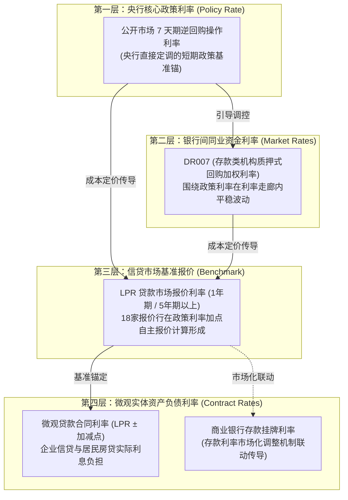
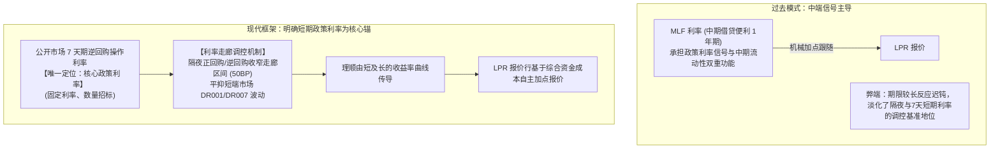
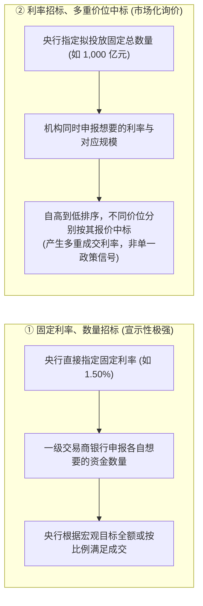
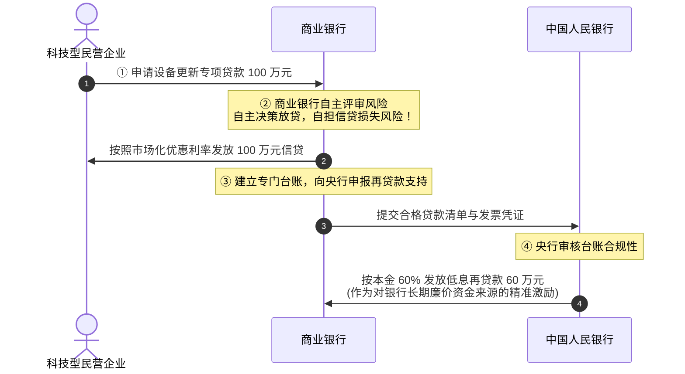

# 20 中国央行政策：从操作利率到 LPR，再到实际借款

[上一章：信用需求与供给](19-credit-supply-demand.md) · [目录](./) · [下一章：资金市场与非银](21-money-markets-nonbanks.md)

> 编写于 2026-09-26。以 2024—2025 年框架调整和操作公告作教学案例，补充 2026 年短端工具变化；利率数值均绑定原日期，不作为今日报价或全部现行工具清单。

**前置阅读：**美国篇 [11 货币政策](https://fangpings.github.io/us-econ/11-monetary-policy.html)、[16 回购与美元融资](https://fangpings.github.io/us-econ/16-money-markets.html)，中国篇 [16 银行体系](16-banks-and-deposits.md)。在财经新闻中，我们每天都会听到“央行降息了”的呼声。但许多人不知道的是：**央行下调 7 天期逆回购利率，并不等于明天的房贷月供立刻减少；而每个月 20 日公布的 LPR，也绝不是央行直接红头文件下达的行政利率。** 从央行的公开市场操作台，到普通购房者和实体企业的贷款合同，利率是如何一环扣一环传导过去的？近年来央行调控框架发生了哪些重大革新？

---

## 1. 拆解“降息”：中国利率体系的多层坐标谱系

一则新闻宣告“降息”，专业经济分析师的第一反应绝不是盲目兴奋，而是追问三个具体限定词：**谁降了哪个利率？针对的是什么交易？在什么时间影响哪批存量合同？**

| 利率层次 | 交易双方与定价主体 | 核心代表指标 | 最容易产生的混淆误区 |
| :--- | :--- | :--- | :--- |
| **央行政策利率** | 中国人民银行 $\leftrightarrow$ 一级交易商银行 | **公开市场 7 天期逆回购操作利率** | 误把 MLF（中期借贷便利）仍当成唯一的最高政策信号 |
| **银行间资金利率** | 商业银行 $\leftrightarrow$ 商业银行 / 非银金融机构 | **DR007**、隔夜 DR001 等 | 误以为资金利率单日跳升就代表央行在加息紧缩 |
| **贷款基准报价** | 18 家大中型报价行 $\rightarrow$ 交易中心计算发布 | **LPR（1 年期与 5 年期以上）** | 误以为 LPR 是央行行长直接拍板决定的官定利率 |
| **实体合同利率** | 商业银行 $\leftrightarrow$ 借款企业与家庭个人 | 新发企业贷款加权利率、存量按揭合同利率 | 误以为 LPR 下调当天，所有历史存量房贷月供同步减少 |

---

## 2. 框架现代变革：从“MLF-LPR”双锚到突出短期政策利率

在 2019 年 LPR 改革初期，市场形成了一种固定的线性思维：“每月月中看 MLF 利率降不降，MLF 降多少，月末的 LPR 就跟着降多少。”

但随着金融市场的发展，多重期限政策信号并存容易引发市场预期的混乱。自 2024 年下半年起，中国人民银行对货币政策调控框架实施了历史性的**由短及长现代化改革**：[中国人民银行：2024 年第四季度货币政策执行报告](https://www.pbc.gov.cn/goutongjiaoliu/113456/113469/5587716/2025022618190099812.pdf)

### 2.1 2024—2026 年的三大标志性改革动作

1. **确立 7 天逆回购为唯一核心政策利率**：2024 年 7 月，央行宣布 7 天期逆回购操作调整为**“固定利率、数量招标”**，明确其作为央行政策利率的基准地位；
2. **淡化 MLF 的政策色彩**：自 2025 年 3 月起，MLF 操作全面改为**“固定数量、利率招标、多重价位中标”**方式，将其还原为纯粹向银行提供中期流动性的中性工具，彻底打破了“MLF 必须指导 LPR”的教条；
3. **收窄利率走廊与推出隔夜操作**：2026 年年中，央行在公开市场增加隔夜逆回购品种，并将临时正、逆回购走廊区间收窄至 $50\text{ 个基点}$，显著提升了短端资金利率（DR001、DR007）对政策利率的黏合度。[2026 年上半年货币政策发布会实录](https://cn.chinagate.cn/webcast/2026-07/16/content_118651470.shtml)

---

## 3. 招标机制解构：数量招标 vs 利率招标

在阅读央行公开市场操作公告时，很多读者分不清公告里的各种名词。招标机制是理解央行意志的关键密码：

- **固定利率、数量招标**（如当前 7 天逆回购）：价格是央行给定的政策信号，数量体现银行体系的自发流动性需求；
- **利率招标、多重价位中标**（如当前 MLF、买断式逆回购）：数量是央行锁定的总供给，价格由市场竞争机构竞价形成，出现的加权中标利率是机构博弈的结果，不可直接当成央行下达的主动降息指令。

---

## 4. 央行流动性工具箱：从逆回购、买断式逆回购到国债买卖

央行调节全社会基础货币与银行流动性，拥有功能各异的工具组合：

| 操作工具 | 资产法律实质 | 期限特征 | 核心宏观功能 |
| :--- | :--- | :--- | :--- |
| **公开市场逆回购** | 质押式证券回购（债券作为质押品冻结，所有权不转移） | 7 天、隔夜等极短期 | 对冲税期、政府债缴款等短期资金摩擦，引导即期资金利率 |
| **买断式逆回购 (2024年底推出)** | **债券所有权真实发生过户转移**，到期反向卖回 | 1 个月、3 个月、6 个月等中短期 | 盘活全市场优质担保品，精准平抑跨季中短期流动性波动 |
| **中期借贷便利 (MLF)** | 质押式向银行发放合格抵押品中期借款 | 通常为 1 年期 | 为商业银行提供稳定中长期负债资金支持 |
| **央行国债净买卖 (二级市场)** | 在二级市场上与其他金融机构开展现券双向买卖 | 涵盖 1 年至 30 年全期限品种 | 调节全市场基础货币，兼顾国债收益率曲线斜率与金融防风险 |

> **流动性净投放精准核算**：
> 某日，中国人民银行开展公开市场 7 天期逆回购操作投放 $500\text{ 亿元}$，当天有历史逆回购到期 $450\text{ 亿元}$；同日有一笔 1 年期 MLF 到期 $100\text{ 亿元}$ 且央行当天未开展续作。
> - 逆回购单项净投放：$500 - 450 = +50\text{ 亿元}$；
> - **两类操作合并计算的央行口径净回笼**为：
>   $$\text{净投放额} = 500\text{ (投放)} - 450\text{ (逆回购到期)} - 100\text{ (MLF到期)} = \mathbf{-50\text{ 亿元}}$$
> 
> *注意*：虽然央行口径净回笼了 $50\text{ 亿元}$，但这依然不等于商业银行准备金当天一定减少 $50\text{ 亿元}$，因为还需考虑财政部当天的财政支出划拨、企业缴税以及现金出入境的综合影响。

---

## 5. LPR 的生成公式与具体借款合同的重定价

贷款市场报价利率（LPR）由全国银行间同业拆借中心于每月 20 日（遇节假日顺延）公布，包含 **1 年期**（主要参考实体短期贷款与消费贷）和 **5 年期以上**（主要参考中长期制造业投资与居民购房按揭）。[中国货币网：LPR 编制与报价规则](https://www.chinamoney.org.cn/chinese/bklpr/)

### 5.1 LPR 的去极值截尾算术平均算法

每个月报价日，18 家具有代表性的全国性商业银行在公开市场 7 天逆回购利率的基础上，结合自身资金成本与信贷供求进行加点报价。

全国银行间同业拆借中心收集 $N = 18$ 个报价后，**剔除一个最高报价与一个最低报价**，对其余 $N - 2 = 16$ 个报价进行**算术平均**，并按 $0.05\%$ 的最小步长取整发布：

$$\text{LPR} = \frac{1}{N - 2} \sum_{k=2}^{N-1} \text{Quote}_{(k)}$$

> **教学简化版计算演示**：
> 设某次教学模拟中仅有 5 家银行参与报价，提交的报价分别为：$3.00\%$、$3.05\%$、$3.10\%$、$3.15\%$、$3.20\%$。
> 1. 剔除一个最高价（$3.20\%$）和一个最低价（$3.00\%$）；
> 2. 对中间保留的 3 个报价求算术均值：
>    $$\text{LPR} = \frac{3.05\% + 3.10\% + 3.15\%}{3} = \frac{9.30\%}{3} = \mathbf{3.10\%}$$
> 
> 该计算结果天然落在 $0.05\%$ 步长上，最终公布的参考报价为 $3.10\%$。

### 5.2 合同执行与按揭重定价时滞

银行向企业或购房者发放贷款时，合同利率采用**“浮动基准 + 加减点”**的形式固化：

$$\text{合同执行利率} = \text{基准 LPR} \pm \text{加减点 (固定不变)}$$

> **按揭利息节省算例推导**：
> 某购房者拥有一笔 $100\text{ 万元}$ 的 30 年期等额本息房贷，合同约定利率为“5年期以上 LPR 加 $80\text{ 个基点}$”。
> 初始基准 LPR 为 $3.50\%$，该家庭执行利率为 $3.50\% + 0.80\% = 4.30\%$。
> 某月央行引导 LPR 报价下调 $20\text{ 个基点}$ 至 $3.30\%$。
> - 在重定价日到来后，该家庭的新执行利率降为：
>   $$3.30\% + 0.80\% = \mathbf{4.10\%}$$
> - 若本金按 $100\text{ 万元}$ 简易折算，一年全额节省的利息支出约为：
>   $$100\text{ 万元} \times (4.30\% - 4.10\%) = 100\text{ 万元} \times 0.20\% = \mathbf{2{,}000\text{ 元}}$$

**现实中的时滞陷阱**：国内绝大多数个人房贷合同约定的重定价日为**“每年 1 月 1 日”**或**“贷款发放合同对应日”**。如果央行是在 5 月份下调了 LPR，而该业主的重定价日在每年元旦，那么该家庭在当年的 6 至 12 月仍需按原高利率支付月供，**降息利好必须等到次年 1 月 1 日才会正式落地生效！**[中国银行：存量浮动利率房贷重定价公告](https://www.boc.cn/big5/pbservice/bi2/202410/t20241031_25186010.html)

---

## 6. 结构性货币政策工具：“先贷后借”的激励相容逻辑

除了总量上的降准降息，中国央行还创设了庞大的**结构性货币政策工具箱**（如科技创新和技术改造再贷款、碳减排支持工具、普惠小微贷款支持工具）。

很多初学者容易误以为“结构性再贷款是央行直接替特定高科技企业还钱或提供担保”。**在法律与会计上，这是完全错误的！**[中国政府网：科技创新再贷款设立说明](https://app.www.gov.cn/govdata/gov/202404/08/513745/article.html)

通过这一机制：
1. **实体企业实际借到的钱始终是 $100\text{ 万元}$**，绝对不能因为央行向银行提供了 $60\text{ 万元}$ 再贷款支持，就错误地把企业融资算成 $100 + 60 = 160\text{ 万元}$；
2. **银行承担 $100\%$ 的违约信用风险**：如果企业未来破产倒闭无法还钱，商业银行依然必须按期全额归还向央行借入的 $60\text{ 万元}$ 再贷款本息。央行提供的是激励资金，绝非财政兜底！

---

## 7. 真实公告实战研读：读懂央行操作语言

### 7.1 公告一：公开市场 7 天期逆回购操作（2025-09-03）
查阅中国人民银行官网当日发布的[公开市场业务交易公告](https://www.pbc.gov.cn/zhengcehuobisi/125207/125213/125431/125475/5826477/index.html)：
> *“为维护银行体系流动性合理充裕，2025 年 9 月 3 日人民银行以固定利率、数量招标方式开展了 2,291 亿元 7 天期逆回购操作，中标利率为 1.40%。”*

- **信息层确认**：操作期限为 7 天，政策操作利率锁定为 $1.40\%$，属于公开市场标准短期流动性投放；
- **未包含信息识别**：该公告无法单独说明当天全社会总准备金是增是减，需调取当日逆回购到期规模以及国库资金出入数据。

### 7.2 公告二：买断式逆回购操作预告（2025-06-05）
查阅中国人民银行官网当日发布的[买断式逆回购操作公告](https://www.pbc.gov.cn/zhengcehuobisi/125207/125213/125431/5492845/5733750/index.html)：
> *“中国人民银行拟于 2025 年 6 月 6 日开展 2025 年第 6 期买断式逆回购操作，操作规模 10,000 亿元，期限 3 个月（91 天），采用固定数量、利率招标、多重价位中标方式。”*

- **信息层确认**：期限为 91 天，属于中短期流动性置换工具；
- **机制理解**：采用利率招标与多重价位中标，说明最终将产生分布在不同利率区间的一批成交结果，其公布的加权利率并不构成央行下达的新政策信号。

---

## 8. 课后自测与逐步推导

1. 某交易日，中国人民银行开展公开市场 7 天期逆回购投放 $600\text{ 亿元}$，当天有历史逆回购到期 $700\text{ 亿元}$。能否因为公开市场操作规模高达 $600\text{ 亿元}$，就得出“央行当天在向市场净投放流动性”的结论？
2. 某借款人的企业贷款合同约定利率为“1年期 LPR 加 $60\text{ 个基点}$”。某月公布的 1 年期 LPR 从 $3.40\%$ 下调至 $3.20\%$。要准确计算该企业当期实际节省的利息金额，还必须调取哪些合同关键信息？
3. 某商业银行向重点绿色环保企业发放了 $80\text{ 亿元}$ 项目贷款。随后，该行凭借该笔贷款台账向央行申请碳减排支持工具，获得央行发放的 $40\text{ 亿元}$ 低息再贷款支持。请问：这笔业务使实体企业获得的融资增量究竟是 $80\text{ 亿元}$ 还是 $120\text{ 亿元}$？
4. 中期借贷便利（MLF）全面改用“利率招标、多重价位中标”方式后，这对宏观分析师解读公告中的“单期中标加权平均利率”提出了什么审慎要求？
5. 某次教学模拟测算中，5 家报价行提交的 1 年期 LPR 加点后报价分别为：$2.90\%$、$3.00\%$、$3.05\%$、$3.10\%$、$3.20\%$。请按全国银行间同业拆借中心的去极值规则计算最终基准 LPR。
6. 为什么在二级市场上中国人民银行净买入国债，不能直接推断为“财政支出等额扩张”或“实体贷款等额增加”？

点击展开逐步参考答案与解析

1. **绝对不能，属于净回笼**：
   $$\text{净投放额} = 600\text{ (新发投放)} - 700\text{ (到期收回)} = \mathbf{-100\text{ 亿元}}$$
   央行在公开市场上净回笼了 $100\text{ 亿元}$ 资金。总操作规模大不代表净投放为正。
2. **所需合同信息核查清单**：
   - **合同重定价条款**：合同约定的重定价周期是一年一次（固定在特定月份），还是在 LPR 调整当月立刻按月联动调整；
   - **加减点是否动态调整**：合同约定的 $+60\text{ BP}$ 在整个生命周期是否保持固定不变；
   - **本金及还本进度**：企业当期的贷款本金余额分布，以及是否发生提前还本。若未到重定价日，当期执行利率依然维持原基准不变。
3. **实体融资增量是 80 亿元，非 120 亿元**：
   - 实体企业获得的真实信贷资金始终只有商业银行发放的 $80\text{ 亿元}$；
   - 央行向商业银行划拨的 $40\text{ 亿元}$ 是央行对商业银行的债权，属于**金融体系内部的资金批发再融资**，绝不能与实体贷款重复加总。
4. **多重价位中标下的审慎要求**：
   - 必须明确：加权平均中标利率是由各家一级交易商银行自主竞争投标形成的综合市场均价，包含了银行对中长期资金的供求博弈，**不再代表央行主动下达的行政性政策基准信号**；
   - 应当将其视作中长期资金市场的供求指标，而不能机械套用旧思维将其作为月末 LPR 变动的硬性预告。
5. **截尾平均标准计算推导**：
   - 排序并剔除极值：剔除最低的 $2.90\%$，剔除最高的 $3.20\%$；
   - 剩余 3 家报价计算算术均值：
     $$\text{LPR} = \frac{3.00\% + 3.05\% + 3.10\%}{3} = \frac{9.15\%}{3} = \mathbf{3.05\%}$$
   - 结果恰好落在 $0.05\%$ 步长上，最终基准参考报价为 $3.05\%$。
6. **金融交易与实体财政/信贷的边界隔离**：
   - **国债买卖是二级市场货币操作**：央行买债是从二级市场交易对手（通常是商业银行）手中购买存量国债，交易直接改变的是商业银行在央行的准备金余额，资金并未直接进入财政部账户；
   - **财政支出有严格预算安排**：财政支出的节奏由人大预算批准和财政实际项目施工进度决定，央行买债不等于财政直接发钱；
   - **信贷取决于商业银行决策**：银行手里准备金充裕，仍需实体提出有效信贷申请并满足风控条件才能转化为企业贷款。

---

[上一章：信用需求与供给](19-credit-supply-demand.md) · [目录](./) · [下一章：资金市场与非银](21-money-markets-nonbanks.md)
