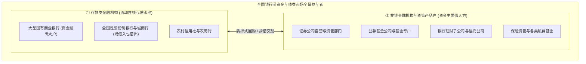
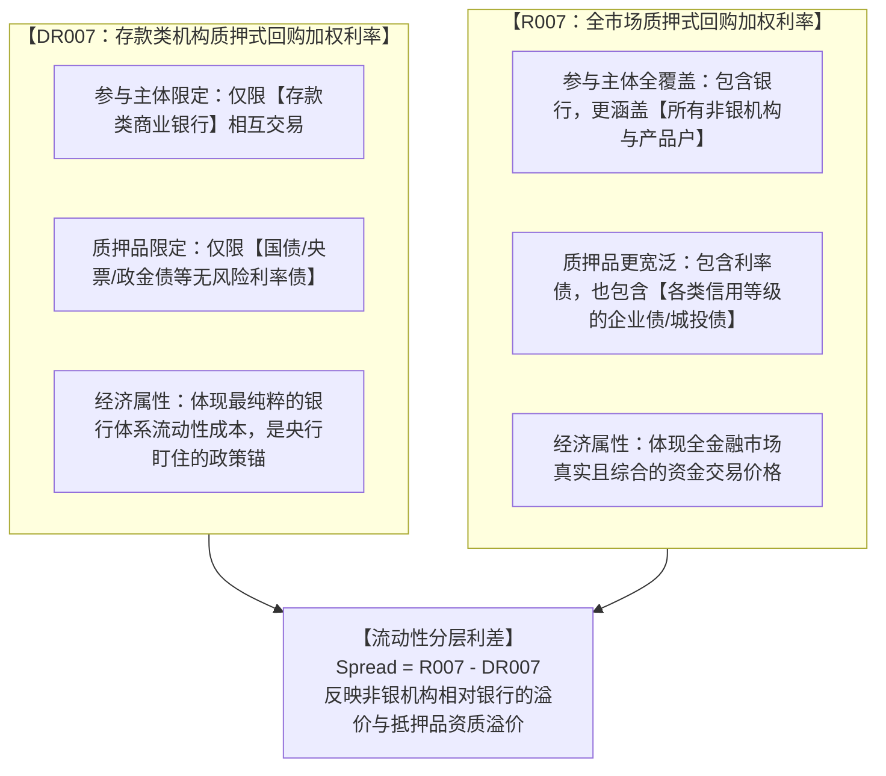
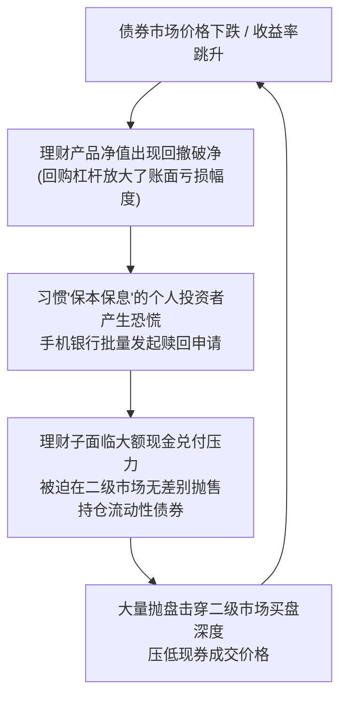
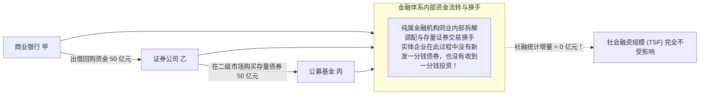

# 21 中国资金市场与非银：DR007、回购与资管链条

[上一章：央行政策传导](20-monetary-transmission.md) · [目录](./) · [下一章：四本预算](22-four-budgets.md)

> 编写于 2026-09-26。基准方法按所引官方资料；交易与综合作业均为教学假设，不表示当前市场行情。

**前置阅读：**美国篇 [16 回购、SOFR 与美元融资](https://fangpings.github.io/us-econ/16-money-markets.html)，中国篇 [16 银行体系](16-banks-and-deposits.md)、[18 社融](18-social-financing.md)。回购现金流、质押抵押折扣与期限错配原理作为已知。本章将深入中国宏观金融的“深水区”——**银行间市场与非银资管生态**。为什么在同一个交易日里，银行向银行借钱利率很低（DR007 平稳），而证券公司和公募基金借钱却可能面临利率跳升（R007 飙涨）？资管新规后的银行理财产品，是如何通过回购加杠杆的？当债券市场价格剧烈波动时，非银机构的“净值回撤与赎回踩踏”是如何形成的？

---

## 1. 机构图谱：银行间市场绝非只有商业银行

在很多初学者的概念里，“银行间市场”顾名思义就是只有银行才能进出的市场。**但在现代中国金融体系中，银行间市场是一个汇聚了全社会各类金融中介的综合性批发市场**：

在日常运转中：
- **资金供给主力**：大型商业银行依托网点吸收了海量低成本居民存款，且在央行拥有充裕的法定与超额准备金，通常是银行间市场的**主要资金融出方（净出借人）**；
- **资金需求主力**：非银机构（公募基金、券商自营、理财子）需要通过质押手中的债券借入短期资金，用于日常资产配置或跨期撮合，是**主要的资金融入方（净借款人）**。

因此，在资金市场上分析“钱紧不紧”，核心是问：**谁手里有多余准备金头寸想出借？谁手里的抵押品合格？借款期限是 1 天还是 7 天？不同机构之间存在怎样的流动性利差？**

---

## 2. DR007 与 R007 的双轨密码：流动性分层

中国资金市场上有两组名字极其相似、但经济学含义大相径庭的加权成交利率——**DR007 与 R007**：[中国人民银行：基准利率体系白皮书](https://www.pbc.gov.cn/zhengcehuobisi/125207/125213/125440/125835/1be3793689194793915ffe8a80f1984f/2020083117120579027.pdf)

### 2.1 利差核算与流动性分层机制

> **算例推导演示**：
> 设某交易日银行间 7 天期质押式回购市场发生两批典型交易：
> 1. 第一批：商业银行与商业银行之间，以记账式国债为质押物，成交规模为 $80\text{ 亿元}$，成交利率为 $1.50\%$（完全符合 DR 条件）；
> 2. 第二批：证券公司资管计划以某企业信用债为质押向银行借款，成交规模为 $20\text{ 亿元}$，因信用抵押品折价要求，成交利率为 $3.00\%$。
> 
> 在这个无其他交易的简化市场中：
> - **DR007 指标（仅统计第一批）**：
>   $$\text{DR007} = \mathbf{1.50\%}$$
> - **R007 指标（按全市场金额加权平均）**：
>   $$\text{R007} = \frac{80 \times 1.50\% + 20 \times 3.00\%}{80 + 20} = \frac{1.20 + 0.60}{100} = \frac{1.80}{100} = \mathbf{1.80\%}$$
> - **两者的流动性溢价分层差额为**：
>   $$\text{Spread} = \text{R007} - \text{DR007} = 1.80\% - 1.50\% = 0.30\% = \mathbf{30\text{ 个基点 (BP)}}$$

**宏观诊断指引**：
- **当 DR007 保持平稳，而 R007 显著走高、利差走阔时**：表明银行体系自身准备金并不匮乏，但银行对非银机构的信用风险偏好下降、低评级抵押品接受度降低，或者非银机构（如理财子加杠杆）对跨季资金的需求过分旺盛，出现了典型的**非银流动性摩擦**；
- **当 DR007 与 R007 同步大幅冲高时**：表明面临税期大额缴税、政府债券密集缴款或央行公开市场大额净回笼，全社会银行体系的基础货币总量面临全局性收紧。

---

## 3. 常见基准指标辨析：FDR、Shibor、NCD 与美国 SOFR

在资金市场研读中，必须建立严谨的指标坐标系，不可混淆字母缩写：

| 指标全称 | 数据生成机制 | 抵押品与信用属性 | 核心应用场景与辨认要点 |
| :--- | :--- | :--- | :--- |
| **DR007 / R007** | 全天符合条件交易的**金额加权平均利率** | 质押式回购（DR 限利率债，R 含信用债） | 衡量全天综合资金成本的主流基准 |
| **FDR007 / FR007 (定盘利率)** | 依据上午 9:00—11:30 窗口成交样本，按排序算法提取中位数 [中国货币网方案](https://www.chinamoney.com.cn/chinese/bkfrr/) | 质押式回购（FDR 为银行利率债，FR 为全市场） | 利率互换（IRS）等金融衍生品浮动端现金清算基准 |
| **Shibor (上海银行间同业拆借利率)** | 报价行自主提交拆借报价，去极值后算术平均 [Shibor报价规则](https://www.chinamoney.org.cn/chinese/bkshibor/) | **纯信用无担保拆借**（无任何债券质押物） | 跨期限无担保信用资金基准（隔夜至 1 年期） |
| **同业存单发行利率 (NCD)** | 商业银行向同业发行的标准化记账式债务凭证发行定价 | 发行银行自身的主体信用 | 衡量商业银行主动负债与中短期批发融资成本 |
| **美国 SOFR (担保隔夜融资利率)** | 全美回购交易**交易量加权中位数**编制 [纽约联储 SOFR 说明](https://www.newyorkfed.org/markets/reference-rates/sofr) | 隔夜美国国债质押回购 | 全球美元无风险短端基准（与中国 DR 算法不同） |

### 3.1 定盘利率的抽样与排序规则

按照中国货币网规则，回购定盘利率（如 FR007、FDR007）对提取的样本利率自低到高排序，选取排序序号为 $\lfloor N/2 \rfloor + 1$ 处的利率（偶数笔时取中间偏高位置，并非简单求算术均值）：

> **定盘算例演示**：
> 某上午窗口保留了 4 笔符合条件的有效交易利率：$1.40\%$、$1.50\%$、$1.80\%$、$2.20\%$。
> 笔数 $N = 4$。计算位置序号：
> 
> $$\text{序号} = \left\lfloor \frac{4}{2} \right\rfloor + 1 = 2 + 1 = 3$$
> 
> 排序后的第 3 个位置对应的数值是 **$1.80\%$**。最终定盘利率发布为 $1.80\%$（而不是中间两笔的算术平均值 $1.65\%$）。

---

## 4. 资管新规时代的穿透原则：理财并非银行存款

在 2018 年《关于规范金融机构资产管理业务的指导意见》（资管新规）出台前，市场上普遍存在银行保本理财和预期收益型产品。

自资管新规全面落地后，**银行理财全面转向净值化管理，彻底打破了“刚性兑付”与“资金池多层嵌套”**：[中国人民银行：资管新规答记者问](https://www.pbc.gov.cn/jinrongwendingju/146766/146770/c2e228ad641d4a85acdc9142da4f955d/index.html)

### 4.1 穿透原则与杜绝重复计算

> **穿透教学案例**：
> 某居民用自己在工商银行的银行存款 $100\text{ 万元}$ 申购了理财子公司的“稳健增长系列理财产品”；
> 该理财产品将这笔资金认购了一家信托公司的资管计划份额 $100\text{ 万元}$；
> 该资管计划最终在银行间债券市场上全额购买了某民营制造企业新发行的公司债券 $100\text{ 万元}$。
> 
> - **实体经济获得的最终融资增量**：**仅仅是这笔企业债券 $100\text{ 万元}$**；
> - **杜绝重复计算**：在统计全社会融资与信用时，绝对不能把“居民理财规模 100 万 + 信托资管规模 100 万 + 企业债券 100 万”机械相加，得出荒谬的“全社会获得了 300 万元融资”！穿透底层，资产管理外壳的层层嵌套被还原为唯一的底层债权。

---

## 5. 杠杆放大与净值回撤：理财赎回踩踏的负反馈螺旋

资管产品（包括债券型理财产品、公募纯债基金）为了增厚投资收益，普遍会采用**“回购借钱加杠杆”**的策略：用手中的债券作为质押品借入短期回购资金，再去购买收益率更高的长期债券。

**杠杆是一把锋利的双刃剑，它在放大收益的同时，成倍放大了净值波动的损失！**

### 5.1 杠杆放大的数学原理与资产负债表推导

设资管产品的总资产为 $A$，负债端回购借款为 $L$，所有者净资产（产品份额净值基数）为 $\text{NAV}$：

$$\text{NAV} = A - L, \quad \text{杠杆比率} = \frac{A}{\text{NAV}}$$

当底层资产市值发生变动率 $\Delta A / A$ 时，产品净资产的变动率为：

$$\frac{\Delta \text{NAV}}{\text{NAV}} = \frac{\Delta A}{\text{NAV}} = \left( \frac{\Delta A}{A} \right) \times \left( \frac{A}{\text{NAV}} \right)$$

> **基准算例推导**：
> 某银行固收类理财产品期初总资产为 $A = 120\text{ 亿元}$（全部配置中长期信用债），负债端通过银行间质押式回购借入短期资金 $L = 20\text{ 亿元}$，所有者净资产为：
> 
> $$\text{NAV}_0 = 120 - 20 = 100\text{ 亿元} \quad (\text{杠杆率} = 120 / 100 = 1.20)$$
> 
> 现因宏观政策调整或资金利率上升，债券市场价格出现小幅回调，该产品持有的债券资产市值整体下跌了 $2.0\%$。
> - 资产总值变为：
>   $$A_1 = 120 \times (1 - 2.0\%) = 120 \times 0.98 = 117.6\text{ 亿元}$$
> - 负债端借款是刚性的契约，到期必须偿还，金额维持 $20\text{ 亿元}$ 不变；
> - 产品的最新净资产变为：
>   $$\text{NAV}_1 = 117.6 - 20.0 = \mathbf{97.6\text{ 亿元}}$$
> - 该理财产品份额净资产的实际跌幅为：
>   $$\text{净值变动率} = \frac{97.6 - 100}{100} = \mathbf{-2.40\%}$$
> 
> 底层债券仅下跌了 $2.0\%$，**但在杠杆放大效应下，产品净值亏损扩大至 $-2.40\%$！**

### 5.2 赎回踩踏的负反馈循环（Feedback Loop）

在赎回高峰期，若产品管理人抛售债券造成流动性折价，或者银行间资金融出方要求压缩回购借款规模，负反馈链条就会迅速在整个非银与资金市场扩散蔓延。这正是金融监管部门近年来严密监控**理财产品流动性匹配、现金类资产占比以及杠杆率上限**的深层制度原因。

---

## 6. 辨析界限：银行间融资增加 $\ne$ 社会融资规模增加

初学者最容易混淆的另一个概念是：“今天银行间市场质押式回购成交量突破了 8 万亿元，是不是意味着社融大增了 8 万亿元？”

**答案是：两者毫无关系！**

社融衡量的是**实体经济从金融市场获得的增量资金**。银行借钱给券商、券商买入基金持有的存量旧债券，全程都是金融市场内部资产负债的换手，实体企业既没有新增筹资，也没有形成当期购买力，**社融增量严格为零**。

---

## 7. 第四模块综合大作业：从央行操作台到微观资产负债表穿透

### 7.1 教学假设情景与综合输入资料（除利率外单位均为亿元）

某分析机构跟踪了某宏观时点的一组完整金融数据（忽略未列项的细微估值调整）：
1. **央行公开市场操作**：央行当天开展 7 天期逆回购操作投放 $500\text{ 亿元}$，当天有逆回购到期 $450\text{ 亿元}$；同日有一笔 1 年期 MLF 到期 $100\text{ 亿元}$ 且未作续作。
2. **银行间回购市场**：存款类机构之间符合 DR 条件的 7 天期回购成交 $80\text{ 亿元}$，利率为 $1.50\%$；较宽 R 样本中非银机构以信用债质押成交 $20\text{ 亿元}$，利率为 $3.00\%$。
3. **实体信贷与社融**：商业银行本月对实体经济发放的人民币贷款净增 $80\text{ 亿元}$（其中包含票据贴现融资净增 $30\text{ 亿元}$）；当月企业间未贴现银行承兑汇票净减少 $30\text{ 亿元}$；非金融企业发行债券净融资 $20\text{ 亿元}$；政府债券净融资 $50\text{ 亿元}$；其他社融分项暂无变动。
4. **地方隐性债务化解置换**：已知在上述发行的政府债券资金中，有 $20\text{ 亿元}$ 被全额用于偿还城投公司原在统计范围内的银行项目贷款；该笔贷款的结清减少已经包含在上述前述贷款净增 $80\text{ 亿元}$ 之中。
5. **货币口径变动**：在 2025 年新 M1 口径下，某大型企业通过网银向其全体员工个人活期账户发放工资奖金合计 $10\text{ 亿元}$。
6. **信贷审批调查**：季度银行家问卷关于信贷审批条件的回答中，认为“放松”的占比 $30.0\%$，“基本不变”占 $50.0\%$，“收紧”占 $20.0\%$。
7. **非银理财加杠杆**：某固收理财产品持有债券资产规模为 $120\text{ 亿元}$，通过银行间质押式回购负债融资 $20\text{ 亿元}$；受市场收益率波动影响，该产品资产价格整体下跌了 $2.0\%$。

### 7.2 待审计的荒谬市场评论

> *“央行今日逆回购狂掷 500 亿元，货币大水漫灌！社融增量暴增至 80 + 30 + 20 + 50 = 180 亿元，实体需求已全面回春。发工资让全社会狭义货币 M1 惨遭净流失 10 亿元。银行审批指数证明有高达 55% 的企业轻松贷到了款。底层债券只跌了 2%，理财净值损失也绝不可能超过 2%。”*

### 7.3 请完成以下精准推导与专业修正简报

1. 计算两类央行操作的合计净投放（回笼）额，并说明为何不能据此直接得出总准备金变动结论；
2. 计算当期 DR007、R007 的加权利率数值及两者之间的流动性分层利差；
3. 准确核算本期的社会融资规模真实增量，说明政府用于偿还旧贷的 $20\text{ 亿元}$ 是否需要再次二次扣减；
4. 阐述工资转账对新 M1 口径的实际影响；
5. 计算银行信贷审批扩散指数以及美联储风格的净收紧比例，纠正其含义误读；
6. 利用杠杆方程式精确测算该理财产品的份额净资产变动率；
7. 撰写一段不超过 $250\text{ 字}$ 的专业审计修正简报。

点击展开大作业逐步标准推导与解析

**第一项：央行操作净额核算**
- 合计净投放：
  $$\text{净投放} = 500\text{ (投放)} - 450\text{ (逆回购到期)} - 100\text{ (MLF到期)} = \mathbf{-50\text{ 亿元}}$$
- 央行合计净回笼资金 $50\text{ 亿元}$，绝非“放水 500 亿”；总准备金还受国库财政存款划拨、企业缴税与现金漏损等综合支配，不可单一归因。

**第二项：资金市场利率推导**
- $\text{DR007} = \mathbf{1.50\%}$；
- $\text{R007} = \frac{80 \times 1.50\% + 20 \times 3.00\%}{100} = \mathbf{1.80\%}$；
- 流动性分层利差：$\text{Spread} = 1.80\% - 1.50\% = \mathbf{0.30\% (30\text{ BP})}$，反映非银机构面临结构性抵押成本溢价。

**第三项：社融真实增量核算**
- 真实社融增量公式：
  $$\Delta \text{TSF} = 80\text{ (实体贷款)} - 30\text{ (未贴现汇票)} + 20\text{ (企业债券)} + 50\text{ (政府债券)} = \mathbf{120\text{ 亿元}}$$
- *错误审计纠偏*：原评论把贷款项下已经包含的票据融资（$+30$）重复加了一次，又漏减了表外未贴现汇票的流失（$-30$）；
- *债务置换处理*：政府偿还存量贷款的 $-20\text{ 亿元}$ 已经包含在贷款公布的净增 $+80\text{ 亿元}$ 之中，**绝对不可再次重复扣除**，否则会导致同一笔还款被双重扣减。

**第四项：新 M1 影响分析**
- 企业活期（新 M1）与个人活期（新 M1）均属于新口径范畴。工资转账属于部门间等额划转，**全社会新 M1 净变动为零**，没有发生货币流失。

**第五项：信贷审批指数推导**
- 中国央行审批扩散指数：$30.0\% \times 1.0 + 50.0\% \times 0.5 = \mathbf{55.0\%}$（高于荣枯线，反映整体倾向于偏松）；
- 美联储风格净收紧比例：$20.0\% - 30.0\% = \mathbf{-10.0\%}$；
- 误区纠正：$55\%$ 描述的是问卷回答概率分布，绝非有 $55\%$ 的企业获得了贷款。

**第六项：理财杠杆净值回撤测算**
- 资产变为：$A_1 = 120 \times (1 - 2.0\%) = 117.6\text{ 亿元}$；
- 负债保持 $20\text{ 亿元}$ 不变；
- 净资产变为：$\text{NAV}_1 = 117.6 - 20 = 97.6\text{ 亿元}$；
- 份额净值跌幅为：
  $$\frac{97.6 - 100}{100} = \mathbf{-2.40\%}$$
  在 $1.2$ 倍杠杆放大下，亏损幅度达到 $2.4\%$，超过资产端跌幅。

**第七项：专业审计修正简报示范**
> *“题设央行逆回购与 MLF 合并计算净回笼 50 亿元，绝非流动性大水漫灌。较宽样本回购利率高于银行间质押利率 30 个基点，反映出非银机构的流动性分层摩擦。本月社融真实增量为 120 亿元，包含表外票据转入贴现的渠道替代，且存量债务置换已在贷款净增中平抑，不可重复扣减，社融修复并不等同于新增物理投资同步扩张。新口径下工资发放不改变 M1 总额。审批指数反映银行风控态度边际趋松，但不能等同于获贷率。受 1.2 倍回购杠杆反噬，理财净资产亏损达 2.4%，后续需防范净值回撤引发的被动赎回踩踏风险。”*

---

## 8. 课后自测与逐步推导

1. 为什么在资金市场分析中，R007 与 DR007 的差额（R007 - DR007）不能被严格等同于“所有非银机构面对的纯粹信用风险溢价”？试列出至少两个干扰混淆因素。
2. 某交易日上午窗口保留的四笔符合条件的有效定盘回购利率分别为：$1.20\%$、$1.40\%$、$1.60\%$、$2.00\%$。请严格按照中国货币网官方回购定盘利率方案计算当期的定盘利率。
3. 某商业银行在银行间市场发行的 1 年期同业存单（NCD）利率大幅下行了 $30\text{ 个基点}$，能否由此断言该行对所有民营小微企业的实际企业贷款利率也会同步下调 $30\text{ 个基点}$？
4. 某高净值投资者用现金 $100\text{ 万元}$ 申购了某券商发行的集合资管计划，该资管计划在交易所二级市场上向另一家私募基金买入了其持有的存量某公司债券 $100\text{ 万元}$。请问：在整个业务闭环中，当期实体经济获得的社会融资规模增量是多少？
5. 某债券型基金持有债券总资产 $150\text{ 万元}$，通过银行间质押式回购融入短期借款 $50\text{ 万元}$。若底层债券资产市场价格平均下跌 $1.0\%$，求该基金产品份额净资产的变动幅度（百分比）。
6. 如果需要为中美两国的回购市场基准利率（中国 DR007 与美国 SOFR）建立一套严谨的数据库比较表格，除利率数值本身外，至少还需要固定哪四个底层统计元数据字段？

点击展开逐步参考答案与解析

1. **不能直接等同于纯非银信用溢价**：
   - **质押品异质性混合**：DR 限用国债等利率债，而 R 样本中混合了高等级信用债、中低等级城投债甚至资产支持证券，利差中包含了显著的**抵押品流动性与违约折扣溢价**；
   - **参与者多元与时点博弈**：R 样本包含了不同类型的非银机构以及具有特定流动性诉求的跨季跨月交易，并非单一控制变量的科学双盲实验。
2. **定盘中位数排序标准推导**：
   - 排序样本：$1.20\%$、$1.40\%$、$1.60\%$、$2.00\%$（笔数 $N = 4$）；
   - 取值位置序号：
     $$\text{序号} = \left\lfloor \frac{4}{2} \right\rfloor + 1 = 2 + 1 = 3$$
   - 对应序号 3 的数值为 **$1.60\%$**。最终定盘利率确认为 $1.60\%$（非中间两项算术平均值 $1.50\%$）。
3. **不能直接推断小微信贷等额降息**：
   - 同业存单只是商业银行批发负债的一部分，银行综合负债成本还受核心零售存款利率与沉淀期限支配；
   - 对小微民营企业的信贷定价还受到抵押担保条件、企业违约概率风险补偿、运营管理成本以及贷款供求竞争的刚性约束。
4. **实体社融增量严格为 0 万元**：
   - 资金在二级市场上完成的是私募基金与资管计划之间的存量现券交易换手；
   - 债券发债主体（实体企业）在这一流转环节既没有发行新债券，也没有新收到任何投资款，因此**不计入当期社会融资规模**。
5. **杠杆乘数与净值回撤测算**：
   - 期初所有者净资产：$\text{NAV}_0 = 150 - 50 = 100\text{ 万元}$（杠杆率为 $150/100 = 1.5$ 倍）；
   - 资产下跌后总值：$A_1 = 150 \times (1 - 1.0\%) = 148.5\text{ 万元}$；
   - 负债保持 $50\text{ 万元}$ 刚性不变；
   - 最新净资产：$\text{NAV}_1 = 148.5 - 50 = 98.5\text{ 万元}$；
   - **份额净资产变动率**：
     $$\frac{98.5 - 100}{100} = \mathbf{-1.50\%}$$
     底层资产仅跌 $1.0\%$，受 $1.5$ 倍杠杆反噬，净资产亏损扩大至 $-1.50\%$。
6. **中美回购基准元数据对比字段**：
   - **期限结构与计息方式**（中国 DR007 为 7 天期，美国 SOFR 为隔夜 Overnight）；
   - **交易结算币种**（人民币 CNY vs 美元 USD）；
   - **交易样本与抵押品范围**（DR 限存款类银行利率债质押，SOFR 覆盖全美三方及双边国债质押回购）；
   - **数学统计算法**（金额加权平均值 Volume-weighted Mean vs 交易量加权中位数 Volume-weighted Median）。

---

## 第四模块完成标准

至此，你已经完成了宏观金融第四模块的全面学习：
- 能够清晰穿透商业银行通过贷款创造存款的信用派生机制，分清准备金清算、流动性考核与资本充足率的本质区别；
- 熟练掌握新 M1 口径变革与社会融资规模四大支柱的流转与去重逻辑；
- 理解央行突出 7 天逆回购短期政策利率调控、利率走廊收窄与多重价位招标的现代化框架演进；
- 能够熟练解读银行间资金流动性分层（DR007/R007），剖析非银资管在回购加杠杆与净值赎回踩踏中的微观反馈机制。

下一模块我们将进入财政与政府信用：**四本预算、地方政府专项债、国债收益率曲线与主权债务传导**，探索财政政策与货币金融体系的宏观交响。

---

[上一章：央行政策传导](20-monetary-transmission.md) · [目录](./) · [下一章：四本预算](22-four-budgets.md)
