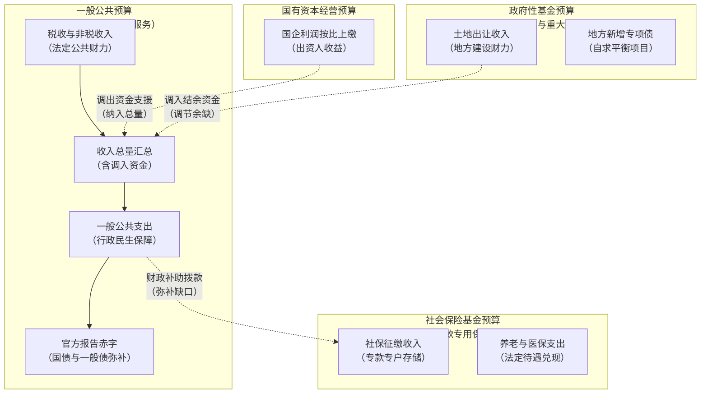
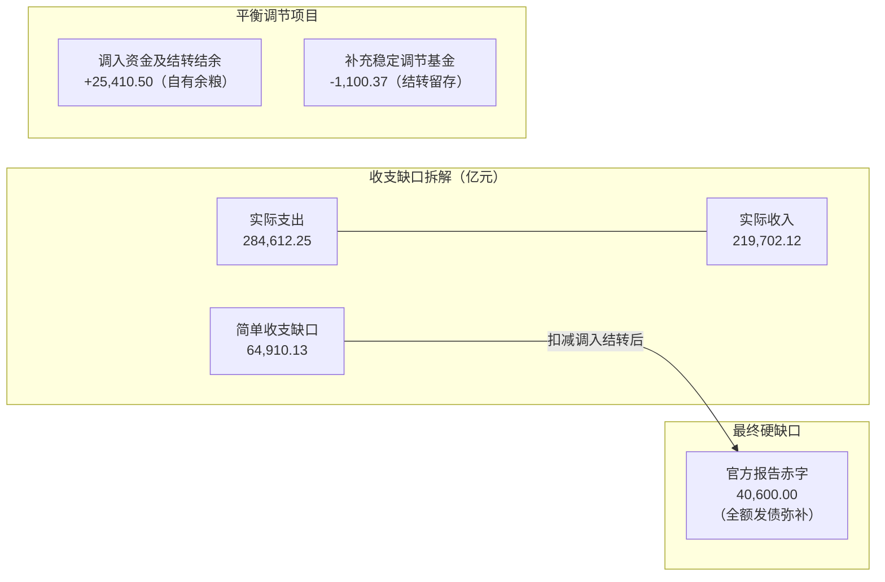

# 22 中国财政四本预算：收入、支出与赤字怎样对上账

[上一章：资金市场与非银](21-money-markets-nonbanks.md) · [目录](./) · [下一章：地方财政与债务](23-local-government-debt.md)

> 编写于 2026-09-26。真实算例固定使用 2025 年公布的 2024 年预算执行资料；执行报告、预算和决算不得混接。

**前置阅读：**美国篇 [14 财政、国债发行与 TGA](https://fangpings.github.io/us-econ/14-fiscal-policy.html)，中国篇 [05 GDP](05-gdp.md)。预算、融资和现金支付的区别作为已知。本章深入剖析中国财政“四本账”的勾稽逻辑，解释为什么新闻里看到的财政收支差额往往不等于政府工作报告公布的官方赤字。

---

## 1. 四本预算分的是资金性质，不是四个政府

打开中国的财政账本，初学者常会感到困惑：为什么政府不是一张收支表算到底，而是分成“四本预算”？这四本预算究竟是什么关系？

中国现行的全口径预算体系由**一般公共预算**、**政府性基金预算**、**国有资本经营预算**和**社会保险基金预算**组成，依据[《预算法实施条例》](https://app.www.gov.cn/govdata/gov/202008/20/461993/article.html)分别编制、协同运作。四本预算划分的核心是**资金性质与法定用途**，而不是存在四个平行的政府机构。

| 预算账本 | 核心资金来源 | 主要法定用途 | 初学者最易混淆的边界 |
| :--- | :--- | :--- | :--- |
| **一般公共预算** | 税收与行政事业性收费、罚没等非税收入 | 保障国家安全、公共服务、民生福祉与行政运转 | 不等于政府全部收入；不包含大部分土地出让和专项债 |
| **政府性基金预算** | 国有土地使用权出让收入、专项规费 | 征地拆迁、城市建设、特定专项公用事业与基础设施 | “基金”不是证券投资公募基金；专项债本息在此核算 |
| **国有资本经营预算** | 国企上缴的税后利润、股利股息与产权转让收益 | 支持国企战略转型、资本金注入与调出至一般预算 | 不等于国企全部营业收入，不是企业总产值或全部资产 |
| **社会保险基金预算** | 企业与个人缴纳的社保费、一般公共预算财政补贴 | 发放基本养老金、失业金、工伤和医疗保险待遇 | 专款专用，不能用于普通基建；不得直接弥补公共财政赤字 |

中国不仅拥有广阔的公共服务需求，还拥有庞大的国有土地要素市场与经营性国有资产。如果仅看税收驱动的“一般公共预算”，就会漏掉土地出让金和专项债对地方基建的巨大驱动力；但反过来，四本账各自受到严格的法律约束，绝不能随意将社保基金拿去填补工程款。

---

## 2. 从一笔税款到月度财政数字：经济发生 vs 现金入库

企业在生产经营中产生应纳税款，但这笔经济活动的发生，并不等于财政部门立即收到了可支配现金：

1. **税种申报与缴库周期**：增值税按月或按季申报，企业利润所得税按季预缴、次年 5 月底前汇算清缴。因此，四季度的企业利润波动，可能要到次年二季度汇算清缴时才集中反映在国库入库数字中。
2. **退税与缓缴时滞**：留抵退税或阶段性税费缓缴政策落地时，当期入库数字会显著低于根据经济产出估算的理论税额。
3. **财政支出拨付的链条**：从人大会议批准预算指标、财政部下达指标额度、预算单位签署采购合同，到国库集中支付将款项拨入企业账户，中间存在层层确认环节。

**教学小算例**：
假设某制造企业当年生产经营形成的应纳税额为 $100$ 万元。由于以前年度投资形成的增值税留抵退税政策落地，企业本期收到留抵退税款 $10$ 万元，当期实际缴纳现金 $90$ 万元。
此时，企业实际贡献的当期入库财政收入为：
$$
\text{当期现金入库税款} = 90 - 10 = 80\text{ 万元}
$$
这清楚说明了：**经济统计上的当期税基变动，与财政国库当期的现金流水之间存在时间和政策处理上的天然时滞**。税收增速偶尔低于名义 GDP 增速，不能简单臆断为“征管流失”，必须先核实税基价格变动、退税规模与缴库节奏。

---

## 3. 中央对地方转移支付：合并报表不能重复计算

在我国财政格局中，中央政府汇集了全国约一半的一般公共预算收入，但全国约 $85\%$ 的实际财政支出发生在地方基层（用于教育、医疗、治安、基层运转等）。中央与地方之间的巨大收支差额，依赖**中央对地方转移支付机制**（包括均衡性转移支付、专项转移支付等）进行再平衡。

在统计全国财政支出时，必须严格遵守会计合并抵销原则：**中央对地方的转移支付是一笔政府部门内部的资金调度，不能算作两笔外部最终需求**。

**教学预算模型**：
假设中央本级收入为 $100$ 亿元，地方本级收入为 $80$ 亿元。中央本级直接开展公共服务支出 $50$ 亿元，另外将 $50$ 亿元转移支付给地方；地方政府将本级收入 $80$ 亿元与中央转移支付 $50$ 亿元合计 $130$ 亿元全部支出。

| 项目 | 中央本级视角 | 地方本级视角 | 全国合并报表 | 会计抵销说明 |
| :--- | :---: | :---: | :---: | :--- |
| **本级自有收入** | $100$ | $80$ | $180$ | 外部企业与居民缴款汇总 |
| **转移支付往来** | 支出 $50$ | 收入 $50$ | $0$ | **内部转移往来，合并时完全抵销** |
| **最终公共支出** | $50$ | $130$ | $180$ | 实际流入实体经济形成的总需求 |

如果有人错误地将中央全部支出账面数（本级 $50 +$ 转移 $50 = 100$）与地方全部支出（$130$）机械相加，就会得出 $230$ 亿元的荒谬结论，整整将那笔 $50$ 亿元的转移资金重复计算了一次！

---

## 4. 跨预算调入与财政补贴的勾稽与抵销

不仅中央与地方之间存在资金转移，**四本预算之间也存在常态化的资金调剂与补足机制**：

1. **国资预算调入一般公共预算**：国有资本经营预算按规定比例调出资金（通常为调出比例 $30\%$ 左右），调入一般公共预算统筹用于民生与发展。
2. **政府性基金结余调入**：地方政府性基金的部分特定结余资金，按预算法规定调入一般公共预算弥补收支缺口。
3. **一般公共预算补贴社保基金**：当养老保险等社保基金面临当期收支缺口时，一般公共预算会依法拨付财政补助资金注入社保专户。

**跨预算合并教学模型**：
某地一般公共预算取得外部税费收入 $100$ 亿元，向社会公众采购公共服务支出 $80$ 亿元，另向本地社保基金拨付法定财政补贴 $20$ 亿元。社保基金当年收到企业与居民社保缴费 $50$ 亿元，加上该笔财政补贴 $20$ 亿元，总共向退休人员支付养老待遇 $60$ 亿元，实现期末账面结余 $10$ 亿元。

我们用严格的合并方程进行核对：
$$
\text{合并口径外部总收入} = 100 + 50 = 150\text{ 亿元}
$$
$$
\text{合并口径外部总支出} = 80 + 60 = 140\text{ 亿元}
$$
$$
\text{政府部门综合结余} = 150 - 140 = 10\text{ 亿元}
$$

如果未加抵销地将两本账的账面收入直接相加（$100 + 70 = 170$），账面支出直接相加（$100 + 60 = 160$），虽然差额碰巧也是 $10$ 亿元，但却虚增了 $20$ 亿元的财政收支体量。在评估政府对实体经济的真实宏观购买规模时，必须剥离这些内部往来。

---

## 5. 最关键的算例：2024 年收支差额为什么不是官方赤字

这是所有宏观经济分析初学者最容易踩坑的经典问题：**新闻媒体报道的“财政收支差额”往往达到 6 万多亿元，为什么官方公布的全国财政赤字却只有 40,600 亿元？**

我们以财政部 2025 年 3 月公布的《2024 年预算执行情况与 2025 年预算草案报告》真实数据为例逐步拆解（单位：亿元）。[财政部报告原文链接](https://www.mof.gov.cn/zhengwuxinxi/caizhengxinwen/202503/t20250314_3959885.htm)

| 财政平衡科目 | 2024 年决算执行金额（亿元） | 科目经济含义解析 |
| :--- | ---: | :--- |
| **一、一般公共预算收入** | **219,702.12** | 当年全国征收的税收与非税收入实际入库数 |
| 加：调入资金及使用结转结余 | 25,410.50 | 从政府性基金、国资预算调入及动用历年结余资金 |
| **全国收入总量** | **245,112.62** | 当年可供一般公共预算安排支配的全部财力池 |
| **二、一般公共预算支出** | **284,612.25** | 当年全国一般公共预算实际完成的各项开支 |
| 加：补充中央预算稳定调节基金 | 1,100.37 | 年终将超收或特定统筹资金存入国家财政“蓄水池” |
| **全国支出总量** | **285,712.62** | 当年一般公共预算总占用资金盘子 |
| **三、全国财政报告赤字** | **40,600.00** | **官方报告赤字（必须发行国债与地方一般债弥补的缺口）** |

我们分别计算两个截然不同的收支差额公式：

### 维度 A：新闻媒体口径的“简单收支差额”
$$
\text{简单收支差额} = \text{一般公共预算支出} - \text{一般公共预算收入}
$$
$$
= 284,612.25 - 219,702.12 = 64,910.13\text{ 亿元}
$$

### 维度 B：国家法定的“官方报告赤字”（Deficit）
$$
\begin{aligned}
\text{官方预算赤字} &= \text{全国支出总量} - \text{全国收入总量} \\
&= (\text{支出} + \text{补充稳定调节基金}) - (\text{收入} + \text{调入资金及使用结转结余}) \\
&= (284,612.25 + 1,100.37) - (219,702.12 + 25,410.50) \\
&= 285,712.62 - 245,112.62 = 40,600.00\text{ 亿元}
\end{aligned}
$$

**核心逻辑洞见**：
简单收支差额高达 $6.49$ 万亿元，但其中有整整 $2.54$ 万亿元是由**跨预算调入资金（如国资预算与政府性基金调入）以及动用历年结转结余储备**所平抑的！
国家不需要为这 $2.54$ 万亿元额外向市场发债借钱；真正需要通过向社会公开发行**国债**与**地方政府一般债券**来填补的纯借贷缺口，正是官方公布的 $40,600$ 亿元（$4.06$ 万亿元）。

按照 2024 年预算设定名义 GDP 计算：
$$
\text{官方赤字率} = \frac{40,600}{1,349,084} \approx 3.0\%
$$
如果不理解平衡项目的勾稽，把 $6.49$ 万亿元直接除以 GDP 得出“赤字率将近 $5\%$”，就完全误读了中国财政的会计制度与发债约束。

---

## 6. 土地收入与国企收益：出资人、出让人与征税者的角色分离

在传统西方财政学中，财政收入几乎等同于各种形式的税收。但在中国，政府身兼三重经济角色：

1. **主权征税者（Tax Authority）**：依法凭借政治权力强制无偿征收税款，列入**一般公共预算**。
2. **土地所有权出让人（Land Owner）**：代表国家出让国有土地使用权，取得土地出让收入，列入**政府性基金预算**。[财政部关于土地收入管理的历史制度说明](https://www.mof.gov.cn/zhuantihuigu/czjbqk2011/czsr2011/201208/t20120831_679821.htm)
   - **注意毛利与净额**：土地出让金是**毛收入**，其中超过 $70\%-80\%$ 必须刚性支付给农民征地补偿、拆迁安置和土地前期开发成本，只有扣除成本后的净收益才能用于城市基础设施。
3. **企业国有出资人（Capital Owner）**：作为国有企业与金融机构的股东，按出资比例获取股利分红与经营利润上缴，列入**国有资本经营预算**。
   - **国企营收不是财政收入**：不能将国企数万亿的营业收入算作政府财政财力。国企必须在扣除原材料、员工工资、设备折旧、利息与依法纳税后，根据法定比例将部分留存利润上缴国库。

**算例对比**：
某大型省属国企当年营业收入 $1,000$ 亿元，成本税费总计 $900$ 亿元，实现税后净利润 $100$ 亿元。经国资委与财政部门核定，利润上缴比例为 $30\%$。
此时，国有资本经营预算确认的财政收入仅为：
$$
\text{国资预算入库收入} = 100 \times 30\% = 30\text{ 亿元}
$$
其余 $70$ 亿元留在企业内部用于资本开支和技术研发，绝不能将 $1,000$ 亿元营业收入与政府财力混为一谈。

---

## 7. 中美财政体系比较：结构差异与可比口径

在进行中美宏观政策对比时，绝不能拿中国的“一般公共预算”直接对比美国的“联邦总预算”。[美国财政部：月度财政报告（Monthly Treasury Statement）](https://fiscaldata.treasury.gov/static-data/published-reports/mts/MonthlyTreasuryStatement_202412.pdf)

| 比较维度 | 中国财政核心口径 | 美国财政对应口径 | 跨国对比核心陷阱 |
| :--- | :--- | :--- | :--- |
| **中央政府赤字** | 中央一般公共预算报告赤字（国债净融资） | 联邦预算赤字（Unified Federal Deficit） | 美国联邦预算包含了社会保障信托基金（Social Security）；中国社保为独立第四本账 |
| **地方政府债务** | 地方一般债（列入赤字）+ 专项债（列入基金账） | 州与地方政府市政债券（Municipal Bonds） | 美国地方债分为一般责任债（GO）与收益债（Rev），中国专项债规模不计入一般公共预算赤字 |
| **自然年度与财年** | 1 月 1 日至 12 月 31 日（公历自然年一致） | 10 月 1 日至次年 9 月 30 日（联邦财年 FY） | 两国年度数据存在 3 个月的跨期错位 |
| **广义政府收支** | 四本预算经内部抵销后的合并资金流 | 联邦、州与地方三级政府合并国民账户（NIPA） | 随意将中国一般预算与美国三级政府混比会严重误判两国的财政脉冲强弱 |

---

## 8. 官方财政资料带读指南

阅读中国财政权威数据，建议按以下三步层层递进：

1. **第一步：看月度收支快报**
   - 访问[财政部财政收支月度汇总栏目](https://bgt.mof.gov.cn/zhuantilanmu/rdwyh/ysbgjyszx/202501/t20250124_3955083.htm)，重点观察：全国一般公共预算收入累计增速、税收收入占一般预算收入比重（反映财力质量）、主要税种（增值税、企业所得税、个税）的累计变化，以及支出进度百分比。
2. **第二步：看两会年度执行报告**
   - 每年 3 月全国人大审议的《关于预算执行情况与预算草案的报告》，提取本章第 5 节的“平衡项目全貌”（调入资金、结转结余、稳定调节基金、赤字额度及限额分配）。
3. **第三步：看年中全国财政决算**
   - 每年 7-8 月公布的[全国财政决算表](https://yss.mof.gov.cn/2024zyjs/)，核对决算终值与年初预算执行数之间的最终微调。

---

## 9. 自测题与逐步参考答案

### 思考与练习

1. 中央本级支出 $40$ 亿元，对地方转移支付 $60$ 亿元；地方政府本级最终支出 $160$ 亿元。请计算全国合并后的实际财政总支出。
2. 某省一般公共预算本级收入 $100$ 亿元，实际支出 $140$ 亿元。期末通过调入结余资金 $25$ 亿元，同时按规定补充预算稳定调节基金 $5$ 亿元。按照法定勾稽关系，该省当年报告的预算赤字是多少？
3. 两本预算之间发生内部调拨 $15$ 亿元。若未经抵销直接将两本账的账面收支相加，为什么即使轧差后的净结余数字相同，仍然会对经济分析造成严重误导？
4. 某国有控股制造企业当年实现销售额 $500$ 亿元，净利润 $50$ 亿元，按股东决议向财政国资预算实际上缴股利 $10$ 亿元。国有资本经营预算应当将哪一个数字确认为财政收入？
5. 某地级市本级税收收入远小于本级财政支出，这是否能说明该市政府存在严重的“预算违法超支”？
6. 在对比中美两国的政府赤字率时，如果仅仅把中国的一般公共预算赤字率与美国的联邦赤字率并列，需要补充哪些关键口径说明？

---

点击展开逐步参考答案与解析

1. **计算过程**：
   $$
   \text{全国合并支出} = \text{中央本级最终支出} + \text{地方本级最终支出} = 40 + 160 = 200\text{ 亿元}
   $$
   *常见错误*：将中央账面总支出（$40 + 60 = 100$）加地方支出（$160$）算出 $260$ 亿元。这重复计算了中央拨给地方的 $60$ 亿元转移支付。

2. **计算过程**：
   $$
   \begin{aligned}
   \text{报告预算赤字} &= (\text{本级支出} + \text{补充稳定基金}) - (\text{本级收入} + \text{调入结转}) \\
   &= (140 + 5) - (100 + 25) = 145 - 125 = 20\text{ 亿元}
   \end{aligned}
   $$
   简单账面收支缺口为 $140 - 100 = 40$ 亿元，但由于调入了 $25$ 亿元自有结转，最终需通过法定举债弥补的赤字为 $20$ 亿元。

3. **解析**：
   直接相加会使合并总收入和总支出两端同时虚增 $15$ 亿元。在宏观经济建模中，这将错误地夸大政府支配经济资源的总规模以及财政乘数的初始冲击基数。

4. **答案**：
   确认为 $10$ 亿元。销售额 $500$ 亿是商品生产流通周转额，净利润 $50$ 亿是企业留存与分配的基础，只有依法进入国库的 $10$ 亿元股息才是财政出资人取得的当期预算收入。

5. **解析**：
   不能得出违法超支的结论。中国地方政府承担了大量的民生和基建支出职责，其资金来源不仅包括地方本级收入，还依法包含：中央对地方的返还与转移支付（最主要支柱）、经批准发行的地方政府一般债券与专项债券、调入资金和上年结转资金。必须查看涵盖所有转移收入后的全口径预算平衡表。

6. **解析**：
   至少需要补齐四点说明：
   - **预算范围不同**：美国联邦预算涵盖了社保信托基金，中国一般公共预算不含独立的社保基金预算；
   - **地方债务处理不同**：中国地方政府用于基建的庞大专项债券（自求平衡）未计入一般公共预算赤字；
   - **统计级次不同**：美国联邦赤字仅代表联邦一级，中国合并赤字包含了中央和地方一般债务限额；
   - **会计年度差异**：中国采用公历自然年，美国采用跨年的 10 月至次年 9 月联邦财政年度。

---

[上一章：资金市场与非银](21-money-markets-nonbanks.md) · [目录](./) · [下一章：地方财政与债务](23-local-government-debt.md)
