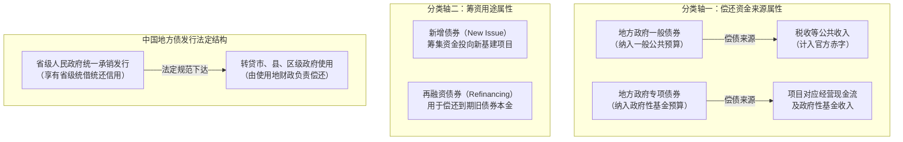
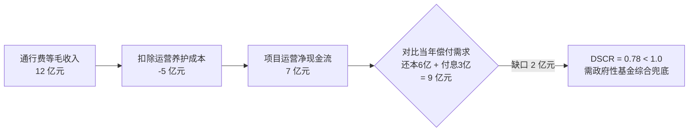
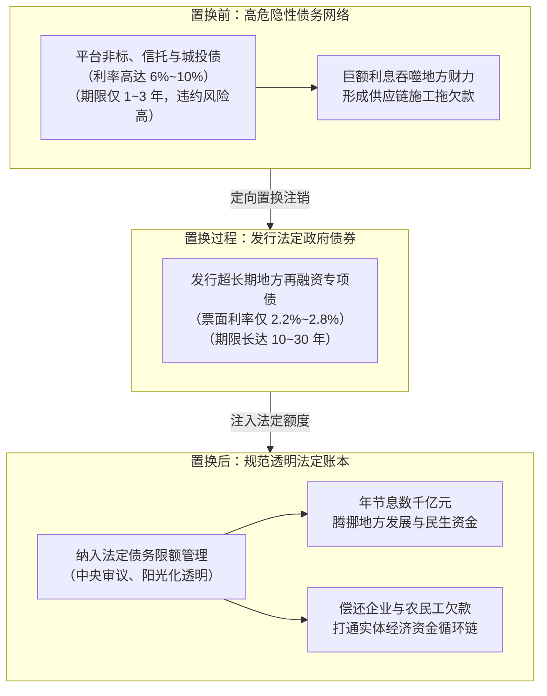

# 23 地方财政与债务：土地收入、专项债和融资平台

[上一章：四本预算](22-four-budgets.md) · [目录](./) · [下一章：财政融资与需求](24-fiscal-transmission.md)

> 编写于 2026-09-26。制度演变使用注明年份的官方文件；化债案例固定讨论 2024 年公布的权威安排，不将当时化债额度当作今日余额。

**前置阅读：**美国篇 [14 财政与政府债务](https://fangpings.github.io/us-econ/14-fiscal-policy.html)，中国篇 [36 房地产](36-housing-development.md)、[18 社融](18-social-financing.md)、[22 四本预算](22-four-budgets.md)。本章聚焦中国地方政府、城投平台与投资项目之间的三元网络，剖析法定地方债与隐性债务的制度分界、专项债的收益平衡机制，以及近年来规模宏大的化债方案的运作底层。

---

## 1. “地方欠了多少钱”至少有四种问法

在探讨中国地方政府债务时，媒体和市场经常抛出数十万亿元的惊人数字。但如果你直接问一个专业审计员“地方政府究竟欠了多少钱”，他一定会反问你：“你指的是哪一种口径？”

混淆不同维度的概念，是造成地方债务恐慌或误判的最常见原因：

| 口径分类 | 法律与统计定义 | 对应主体与资金池 | 绝对不能直接划等号的数字 |
| :--- | :--- | :--- | :--- |
| **① 法定地方政府债务** | 全国人大及其常委会批准限额内、由省级政府规范发行并纳入预算管理的债券余额 | 省级及转贷各级政府财政；一般债务由公共税收偿还，专项债务由基金或项目收益偿还 | 不等于地方国有企业全部有息负债 |
| **② 政府隐性债务** | 地方政府在法定限额之外，违法违规或变相承诺以财政资金偿还、担保的债务 | 地方融资平台（城投）、企事业单位代政府举借，但财政承担偿还或托底兜底责任 | 不等于市场上全部存续的“城投债”总和 |
| **③ 平台经营性债务** | 城投及地方国企作为独立法人，为自身具有商业现金流的项目举借的市场化商业债务 | 独立企业法人承担有限责任；依据商业合同与银行贷款、企业债运作 | 不等于政府财政赤字，不属于法定主权债务 |
| **④ 广义公共部门或有债务** | 包含前三者并穿透考量各类影子兜底、施工垫资、供应链欠款的综合宏观偿债风险池 | 宏观审慎监管视角的金融系统性风险汇总敞口 | 不能将企业自负盈亏的商业负债无脑加总为政府主权信用直接违约 |

财政部在回顾 2014 年新《预算法》及国发〔2014〕43 号文改革时曾明确强调：**开前门、堵后门，严格规范政府举债融资机制，剥离融资平台公司的政府融资职能**。[财政部地方债务管理改革答记者问](https://www.mof.gov.cn/zhengwuxinxi/caizhengxinwen/201410/t20141008_1146850.htm)

因此，看到一家叫“XX 城市建设投资公司”的企业发债，绝不能因为其股东是地方国资委，就自动将其负债等同于政府法定主权国债。

---

## 2. 地方财政与土地出让：收入入库不等于自由现金流

土地出让收入曾被称为地方财政的“第二财政支柱”，其收支全额纳入**政府性基金预算**管理。关于土地交易出让的完整历史机制、开发周期与实证核算，可参阅 [39 土地、地方财政与住房周期](39-housing-land-finance.md)。

在这里必须牢记的核心原则是：**土地出让毛收入绝不等于政府可随意自由支出的“净利润”**。

在实际执行中，土地出让金的绝大部分（通常占比 $70\%-80\%$ 以上）必须刚性用于支付：
1. 被征地农民的征地补偿款与社保安置费；
2. 拆迁补偿与居民安置房建设支出；
3. 土地“七通一平”的前期土地开发与整理成本。

扣除这些法定硬性支出后，剩余的净土地出让收益才能按规定提留用于农田水利建设、教育资金补充和城市基础设施。当房地产市场调整导致土地出让毛收入下降时，由于前端土地开发前期的固定成本具有极强刚性，地方可支配的自由发展财力所承受的边际收缩压力往往更为剧烈。

---

## 3. 一般债与专项债：两个正交分类轴的解构

阅读地方政府债券发行公告时，初学者经常被“一般债”、“专项债”、“新增债”、“再融资债”绕晕。其实只要理清两个正交的分类维度，结构就一目了然：

| 维度 | 分类项目 | 核心定义与资金闭环 | 宏观分析意义 |
| :--- | :--- | :--- | :--- |
| **偿还来源轴** | **一般债券** | 为没有直接收益的公益性事业发展举借；本息由一般公共预算税收偿还 | 发行额直接计入当年全国财政赤字与法定赤字率 |
| | **专项债券** | 为有一定收益的公益性项目举借；本息由项目未来经营现金流与基金收益偿还 | 纳入政府性基金预算管理，不计入官方一般预算赤字 |
| **资金用途轴** | **新增债券** | 募集资金用于新增公益性资本开支、重大工程与设备购置 | 代表真实的增量投资与当期实体需求拉动 |
| | **再融资债券** | 募集资金“借新还旧”，定向用于偿还到期旧债券或合规置换存量债务 | 代表债务期限展期与风险腾挪，不产生新的施工实物量 |

**关键制度细节**：我国地方政府债券依法由**省级人民政府**（含计划单列市）统一在公开市场发行，之后通过“转贷”（Relending）方式下达给具体的市、县、区财政使用。这意味着无论项目在哪个偏远县城，债券的法律发行人都是省级财政厅，从而在制度上消除了基层政府分散违约的流动性踩踏风险。

---

## 4. 专项债项目的“自求平衡”：穿透现金流与覆盖率

专项债发行的核心法定前提是**项目能够产生持续的经营性现金流，实现项目收益与融资自求平衡（Self-Financing）**。[财政部关于一般与专项债务预算管理答记者问](https://m.mof.gov.cn/zcjd/201611/t20161130_2470246.htm)。

但“有收益”并不意味着项目“不需要政府操心”。在现实中，项目的现金流能否按期覆盖债务本息服务，需要用严格的**偿债备付率（Debt Service Coverage Ratio, DSCR）**进行压力测试。

**经典教学案例**：
某地级市获批发行专项债 $100$ 亿元建设一条公用收费公路，年综合票面利率为 $3\%$。公路历经两年建设期后正式通车运营。
在运营期首年：
- 预计当年通行费收费收入为 $12$ 亿元；
- 公路日常养护、人员工资及收费系统维护等必要运营支出为 $5$ 亿元；
- 运营产生的扣除成本后净现金流为：$12 - 5 = 7$ 亿元。

假设该专项债采取分期摊还本金结构，运营首年需要偿还到期本金 $6$ 亿元，同时支付全额年利息 $100 \times 3\% = 3$ 亿元。
则当年的**项目债务本息服务总额（Debt Service）**为：
$$
\text{当年还本付息需求} = \text{还本} + \text{付息} = 6 + 3 = 9\text{ 亿元}
$$

我们计算运营首年的偿债现金流覆盖率：
$$
\text{偿债备付率 } (DSCR) = \frac{\text{运营净现金流}}{\text{当年还本付息需求}} = \frac{7}{9} \approx 0.78
$$

因为 $DSCR = 0.78 < 1.0$，意味着该项目当期的运营收益根本无法全额支付自身的债务服务！差额的 $9 - 7 = 2$ 亿元必须依赖政府性基金预算调剂其他土地储备或专项资金兜底，否则就会面临流动性缺口。

**专项债作项目资本金的红线**：
国务院在规范专项债券管理时明确要求：**专项债可以用作重大国家战略项目的资本金，但必须严格执行正面清单管理**（如国家重大铁路、高速公路、新能源充电网络等），并设定了不超过本省专项债总额一定比例的硬性上限。[国务院办公厅关于完善地方政府专项债券管理机制的意见](https://zwgls.mof.gov.cn/zcgz/202511/t20151102_3975537.htm)。专项债充当资本金后，剩余资金方可依法撬动商业银行配套贷款；但必须清醒看到，专项债在政府总账上仍然是一笔债务，不能因为在项目层列为“股本”就抹去公共部门的偿付义务。

---

## 5. 隐性债务置换：资产负债表的大重塑

2024 年 11 月 8 日，全国人大常委会批准了一揽子近年来力度最大的化债组合拳方案。[财政部 2024 年 11 月 8 日化债发布会权威实录](https://www.mof.gov.cn/zhengwuxinxi/caizhengxinwen/202411/t20241109_3947230.htm)

这套方案构成了“三箭齐发”的化债资源池：
1. **第一支箭**：一次性增加地方政府债务限额 **6 万亿元**，用于置换存量隐性债务，分三年（2024—2026 年）每年安排 2 万亿元实施；
2. **第二支箭**：从 2024 年开始，连续 5 年每年从新增地方政府专项债券中安排 **8,000 亿元**，专门用于化债，累计可置换隐性债务 **4 万亿元**；
3. **第三支箭**：2029 年及以后到期的棚户区改造隐性债务 **2 万亿元**，仍按原合同由各级地方财政依法偿还。

总计直接协同腾挪化债资源高达 **10 万亿元**（$6万亿 + 4万亿$）！

### 教学小案例：置换怎样重塑企业与财政现金流
某地级市原有一笔平台公司借入的信托与非标隐性债务本金为 $100$ 亿元，年综合融资成本为 $6\%$，期限仅剩半年。该市财政每年光支付该笔债务利息就要消耗 $6$ 亿元，面临极大的违约踩踏与借新还旧风险。

通过化债政策，该市依法获得转贷发行的超长期地方政府再融资专项债券 $100$ 亿元，年发行利率为 $3\%$，期限为 20 年。定向全部用于偿还注销原 $100$ 亿元的非标旧债。

我们计算置换前后的财务变化：
$$
\text{原年利息支出} = 100 \times 6\% = 6\text{ 亿元}
$$
$$
\text{新债券年利息支出} = 100 \times 3\% = 3\text{ 亿元}
$$
$$
\text{每年净节约利息支出} = 6 - 3 = 3\text{ 亿元}
$$
$$
\text{本金偿还周期} = \text{由“半年内集中到期”延长为“20年平滑分摊”}
$$

**化债的本质洞察**：
- **总本金并没有凭空消失**（仍然是 $100$ 亿元债务）；
- **债务性质由“暗”转“明”**：原先游离于监管之外的高息隐性债务，转化为阳光化、法治化、纳入预算报表考核的法定地方债；
- **流动性危机解除**：每年净省下 $3$ 亿元利息，地方财政不再被高息讨债逼入绝境，能够抽出资金清理长期拖欠民营企业的账款和工程款，进而迅速改善实体微观主体的资产负债表。

---

## 6. 平台公司的资产负债表：为什么不能只看“净资产”

在分析城投平台信用时，许多初学者经常犯一个严重错误：看到某城投公司总资产 $300$ 亿元，负债 $180$ 亿元，账面净资产高达 $120$ 亿元，就断言该公司“资金充裕、绝无偿债风险”。

让我们穿透真实的资产构成看一看：

**教学简要资产负债表**：
某城投平台账面总资产 $300$ 亿元，其构成如下：
1. **货币资金**：$10$ 亿元（其中受限保证金有 $3$ 亿元，完全自由现金仅 $7$ 亿元）；
2. **应收账款与应收地方政府款**：$90$ 亿元（取决于财政当期调度能力，难以及时套现）；
3. **在建工程与土地开发成本**：$120$ 亿元（在建的管网、桥梁、未平整土地，流动性极差，无法立即变卖）；
4. **经营性经营资产**：$80$ 亿元（供水厂、公用停车场、收费公路等）。

而在负债端：
- **有息债务总额**：$180$ 亿元；
- **一年内到期必须偿付的刚性债务本息**：$40$ 亿元。

我们测算未来一年该平台可调动的现金流情况：
假设经营性资产全年贡献净利润与现金流 $8$ 亿元，应收款通过多方催收预计收回 $12$ 亿元，自由货币资金 $7$ 亿元全部动用：
$$
\text{一年内最大可动用现金流} = 7 + 8 + 12 = 27\text{ 亿元}
$$
而当期刚性偿付缺口为：
$$
\text{当期偿债现金缺口} = 40 - 27 = 13\text{ 亿元}
$$

由此可见：**哪怕账面净资产高达 120 亿元，只要短期流动性现金缺口达到 13 亿元，无法成功续发债券或取得银行展期，平台就将面临严峻的技术性流动性违约风险！**

资产负债表上的账面资产总值，不能代替对资产变现时效、受限条件与实际现金流生成能力的严苛审计。

---

## 7. 中美地方债对比：发行主体与信用契约差异

与美国市政债券市场相比，中美地方债制度呈现出根本性的制度结构差异。[美国证监会（SEC）关于地方市政债券投资者指南](https://www.investor.gov/introduction-investing/investing-basics/investment-products/bonds-or-fixed-income-products-0)

| 核心制度维度 | 中国地方政府债券市场 | 美国市政债券（Municipal Bonds）市场 |
| :--- | :--- | :--- |
| **法定发行层级** | 严格集中于**省级人民政府**统一发行；基层市县无权自主发债 | 极其分散：州政府、县政府、市政府、学区、港口管理局等数万个独立发债主体均可发债 |
| **违约与破产机制** | 不存在地方政府破产制度；强调“中央不救助原则”下的地方主权规范化化解与再融资统筹 | 依据美国破产法第 9 章（Chapter 9），底特律等城市可依法申请市政破产清算 |
| **税收政策支持** | 地方政府债券利息收入对机构投资者免征企业所得税和增值税 | 联邦所得税通常免税（Tax-Exempt），部分符合条件的州内免除州所得税 |
| **土地与财政依赖** | 土地出让收益主要作为政府性基金预算的专用开发来源 | 主要依赖每年持续课征的财产税（Property Tax，对保有环节房产估值征收） |

---

## 8. 财政部原表带读：发行利率与存量成本的动态演化

查阅财政部 2025 年 1 月 24 日发布的[《2024 年地方政府债券发行和债务余额情况》](https://yss.mof.gov.cn/zhuantilanmu/dfzgl/sjtj/202501/t20250124_3955049.htm)，记录了关键的年度总量数据：
- **全年发行总量**：$97,936$ 亿元；
- 其中：新增债券 $47,193$ 亿元，再融资债券 $50,743$ 亿元；
- **年末债务余额**：地方政府债务法定余额约为 $475,371$ 亿元（$47.54$ 万亿元）；
- **发债利率 vs 存量利率**：2024 年新发债券平均利率为 $2.29\%$，而年末全部存量债券的平均利率为 $3.05\%$。

我们核算发行的内部构成：
$$
47,193 + 50,743 = 97,936\text{ 亿元}
$$
再融资债券占比超过了一半（$51.8\%$），清晰反映了中国地方债券市场进入了“既筹集新建设资金、又大规模还本展期旧债”的成熟存量管理阶段。同时，新发利率（$2.29\%$）大幅低于存量加权成本（$3.05\%$），意味着随着低息新债对高息旧债的持续置换，地方财政的利息负担将呈现长期的边际下行通道。

---

## 9. 自测题与逐步参考答案

### 思考与练习

1. 某地级市土地出让总收款为 $120$ 亿元，其中必须刚性支付的征地补偿与安置成本为 $90$ 亿元，其他规定计提支出 $10$ 亿元。次年若土地出让收款下滑至 $100$ 亿元，而刚性拆迁安置成本因历史合同无法压缩仍需支出 $100$ 亿元，该市可供自由支配的土地净财力发生了怎样的百分比变化？
2. 某投资者在银行间市场看到一期债券代码，发行说明书中同时标明为“专项债券”与“再融资债券”，这是否存在逻辑矛盾？
3. 某城投公司拥有存量隐性债务本金 $200$ 亿元，年利率 $5\%$。经省级化债额度支持，以年利率 $3\%$ 的地方政府债券全额置换。在置换完成当年（假设本金规模不变），每年可减少多少利息开支？本金总额减少了多少？
4. 某专项债投资的园区厂房项目，当年扣除运营人工费后的净现金流为 $15$ 亿元。当年该项目对应专项债需偿付到期本金 $14$ 亿元，支付利息 $4$ 亿元。请计算当年的偿债备付率（DSCR），并说明其经营风险。
5. 为什么说“只要城投平台的总资产远大于总负债，哪怕不借新还旧也能高枕无忧”是一个危险的错觉？
6. 对比中国专项债与美国市政收益债（Revenue Bonds）时，除收益来源外，还应核查哪些制度差异？

---

点击展开逐步参考答案与解析

1. **计算与解析**：
   - 第一年净财力：$120 - 90 - 10 = 20\text{ 亿元}$；
   - 第二年净财力：$100 - 100 = 0\text{ 亿元}$；
   - 净财力变化率：从 $20$ 亿元降至 $0$，降幅为 $100\%$！
   *经济学启示*：毛收入仅下降了 $\frac{120 - 100}{120} \approx 16.7\%$，但由于成本刚性，扣减后的边际自由可用财力瞬间归零。

2. **解答**：
   完全不矛盾。这是两个不同维度的分类：
   - “专项债券”代表其偿债来源归属于政府性基金预算，依托特定项目或资产收益；
   - “再融资债券”代表其发行募集资金用途不是开工新项目，而是用于偿还到期的存量债务本金。

3. **计算与解析**：
   $$
   \text{原年利息支出} = 200 \times 5\% = 10\text{ 亿元}
   $$
   $$
   \text{新年利息支出} = 200 \times 3\% = 6\text{ 亿元}
   $$
   $$
   \text{年节约利息支出} = 10 - 6 = 4\text{ 亿元}
   $$
   **本金总额完全未变**，依然为 $200$ 亿元。置换解决的是**高息负担与短期展期流动性风险**，而不是消灭借款本金。

4. **计算与解析**：
   $$
   \text{还本付息总需求} = 14 + 4 = 18\text{ 亿元}
   $$
   $$
   DSCR = \frac{15}{18} \approx 0.833
   $$
   因为 $DSCR < 1.0$，该项目自身当期产生的经营现金流无法覆盖还本付息需求，存在 $3$ 亿元的兑付缺口，需要地方政府调剂其他财政资金或统筹基金预算补足。

5. **解析**：
   这是将“会计存量账面净资产”与“当期金融流动性”混为一谈。城投平台的资产中包含大量变现周期极长或受限的公益性基建资产（如道路、管网、安置房、未平整土地），无法在债券到期当天迅速折现为货币现金。债务到期偿付依赖的是实打实的自由现金流，资产多但现金断流同样会导致流动性违约。

6. **解析**：
   至少需要核查：
   - **法律发行主体**：中国由省级政府统发统管转贷，美国由具体项目或地方机构独立发行；
   - **预算衔接关系**：中国纳入政府性基金预算统筹管理，美国依循独立的信托契约（Bond Indenture）；
   - **破产保护制度**：美国收益债对应项目可能走向破产清算，中国专项债享有省级综合信用担保与转贷统筹机制；
   - **市场投资者与税收待遇**：两国的税收减免制度及流动性深度存在显著结构差异。

---

[上一章：四本预算](22-four-budgets.md) · [目录](./) · [下一章：财政融资与需求](24-fiscal-transmission.md)
