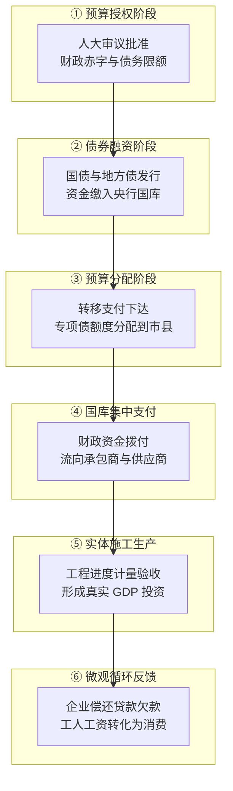
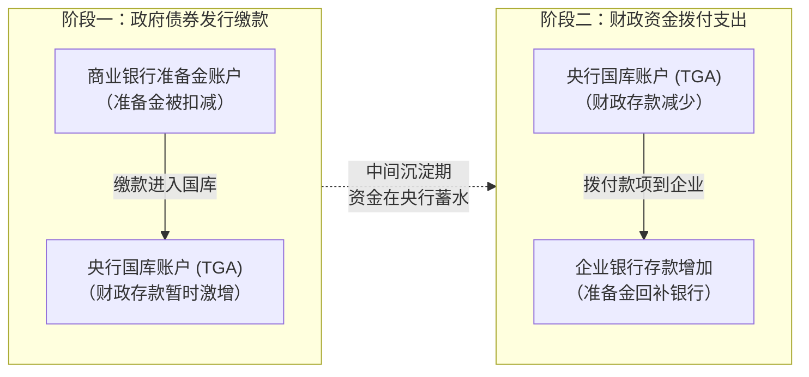
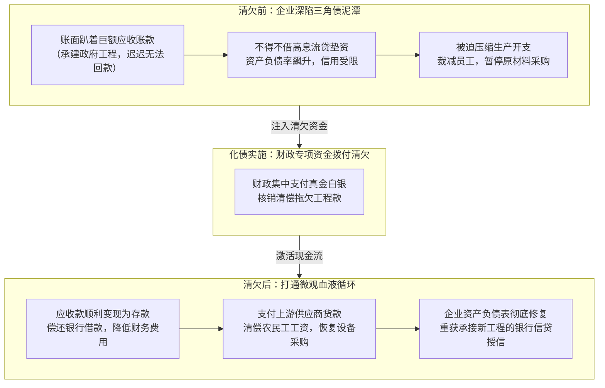

# 24 财政融资怎样形成需求：从国库到账款

[上一章：地方财政与债务](23-local-government-debt.md) · [目录](./) · [下一章：国债收益率](25-government-bond-yields.md)

> 编写于 2026-09-26。政策文件与发布会采用注明日期的历史版本；所有项目时间表和金额算例均为教学假设。

**前置阅读：**美国篇 [14 财政政策](https://fangpings.github.io/us-econ/14-fiscal-policy.html)、[17 国债与财政账户](https://fangpings.github.io/us-econ/17-treasury-plumbing.html)，中国篇 [10 投资](10-investment.md)、[16 银行](16-banks-and-deposits.md)、[18 社融](18-social-financing.md)。在宏观经济分析中，“财政发力”绝不是一条单向直达的管道。从中央人大批准额度，到国库资金划拨，再到施工现场搅拌机轰鸣、民营企业收到货款，中间跨越了预算授权、货币结算、项目审批和工程计量等多道关卡。本章带你穿透这套复杂的传导机制。

---

## 1. 为什么“财政发力”不能只看一个总数

打开财经新闻，我们每天都能看到“积极财政政策加力提效”、“数万亿资金落地”等宏大叙事。但在专业经济分析师眼中，“财政发力”至少包含了六个完全不同的时钟与账户：

| 传导环节 | 留下的官方权威记录 | 能够确认什么 | 绝不能提前确认什么 |
| :--- | :--- | :--- | :--- |
| **① 授权** | 人大决议、预算草案报告、地方债务限额文件 | 政府拥有了合法的支出和举债额度空间 | 尚未拿到任何一分钱真金白银现金 |
| **② 融资** | 债券发行中标公告、国库收支月报、社融政府债增量 | 债券已完成簿记建档，资金已入央行国库 | 资金还躺在国库，尚未流向施工现场 |
| **③ 分配** | 中央对地方转移支付下达指标、专项债项目清单批文 | 明确了哪个省、市、具体单位可以使用多少指标 | 施工单位和民营企业尚未收到银行汇款 |
| **④ 支付** | 财政国库集中支付流水、预算支出执行累计进度 | 财政资金已从国库划出，借记财政、贷记银行 | 支付可能包含预付款或欠款，不等于当期完工实物 |
| **⑤ 生产** | 统计局固定资产投资（FAI）、工程进度监理验收单 | 现场完成了挖掘、钢筋混凝土浇筑等物理实物量 | 工程并不自动保证盈利；可能仍存在账款拖欠 |
| **⑥ 反应** | 企业采购订单恢复、员工薪酬发放、下游消费数据 | 资金注入微观实体，打通供应链资金循环 | 需结合反事实模型测算财政净增量乘数 |

许多初学者常说“专项债发行放量了，下周经济数据一定大涨”，这种判断忽视了从②到⑤之间漫长的项目审批与施工周期。研究报告必须明确区分：是**发债进度提速**、**资金拨付加快**，还是**现场实物工作量增加**。

---

## 2. 中央出钱、地方执行：不能把两次记录算成两份需求

中国财政体制的一大鲜明特征是“中央统筹宏观规划、地方负责落地执行”。中央财政通常通过**转移支付**或**转贷地方债**的方式向地方注资。

**教学模型演示**：
假设中央财政向市场发行特别国债 $100$ 亿元，随后全额以转移支付方式拨付给某省；该省财政将资金层层下达给各市县，市县当年实际向基建企业采购了价值 $60$ 亿元的新建工程服务，剩余 $40$ 亿元结转至次年合规使用。

在此情境下：
- 中央财政账面上记录了对地方转移支付支出 $100$ 亿元；
- 地方财政账面上记录了来自中央的转移支付收入 $100$ 亿元，以及本级实际采购支出 $60$ 亿元；
- 全国合并报表中，转移支付 $100$ 亿元作为内部往来完全抵销。

当年真正形成全社会宏观货物与服务购买需求的，只有地方实际花出去的 **$60$ 亿元**！如果有人将“中央安排的 $100$ 亿”加上“地方支出的 $60$ 亿”算成“全国形成了 $160$ 亿需求”，就是对财政会计合并规则的严重践踏。

---

## 3. 发债先改变谁的账户：TGA 国库蓄水与银行准备金

当财政部发行国债、地方政府发行专项债时，资金在金融体系内部是怎样流动的？我们来看两类典型的情形（假设简化模型中资金全额缴入中央银行国库单一账户 TGA，暂不考虑央行公开市场对冲）：

### 情形 A：商业银行用自有超额准备金购买新发国债 $100$ 亿元
1. **缴款阶段**：商业银行在央行的“法定/超额准备金”减少 $100$ 亿元，资产端转为新增“政府债券投资” $100$ 亿元。央行资产负债表负债端内部发生结构调整：商业银行准备金减少 $100$ 亿元，政府财政存款（TGA）增加 $100$ 亿元。此时，**全社会非金融企业和居民的银行存款（M2）没有任何变化**！
2. **支出阶段**：财政部下达指令将国库资金 $100$ 亿元拨付给承建重大水利工程的中铁某局。央行借记财政存款 $100$ 亿元，贷记该局开户行的准备金账户 $100$ 亿元；开户行同时在其负债端确认该局的“企业活期存款”增加 $100$ 亿元。此时，**M2 真实增加 $100$ 亿元**。

### 情形 B：非银机构或普通企业用已有存款认购国债 $100$ 亿元
1. **缴款阶段**：企业存款被扣减 $100$ 亿元，商业银行代理向央行缴款并扣减同额准备金，央行财政存款增加 $100$ 亿元。此时，**M2 账面立即减少 $100$ 亿元**！
2. **支出阶段**：财政将 $100$ 亿元支付给另一家环保设备供应商，商业银行准备金回补 $100$ 亿元，供应商的企业存款增加 $100$ 亿元。
3. **最终结果**：在封闭系统中，非银存款总量一减一增，净变化为零，但资金的持有者和流动性分布发生了深刻再分配。

**宏观启示**：
政府债券的大规模集中发行缴款，在短期内会实质性“抽水”银行体系的超额准备金，导致银行间市场资金面趋紧（如 DR007 利率抬升）。只有当财政部门将这笔钱实打实拨付出去时，流动性才会重新灌溉实体经济。因此，**发行提速与资金投放之间的时间差，是衡量短期货币市场流动性波动的重要密码**。

---

## 4. 专项债资金为什么没有立即变成现场施工

有时地方政府发行了大量专项债，但水泥、挖掘机等微观高频指标并未同步好转。为什么专项债资金会“滞留”？一个基础设施项目从规划到形成实物量，必须同时攻克三道门槛：

1. **项目合规与土地要素门槛**：包括项目可行性研究批复、用地规划许可、环评审批、征地拆迁交付等。资金到位无法凭空替代土地拆迁，手续未完备决不能违规抢跑。
2. **融资闭环门槛（资本金与配套贷款）**：专项债资金通常只能充当项目总投资的一部分。如果银行配套中长期贷款因评估风险未批复，项目就会因资金链不闭环而停滞。
3. **工程计量与支付节点门槛**：建筑施工行业遵循严格的工程监理制度。一般先由施工企业垫资开工，达到特定里程碑（如地下基础完工）经监理核验后，财政才按进度拨付进度款，最后还会留存质保金。

### 教学算例：严禁将资本金、贷款与总投资重复混算

假设某跨江大桥工程总投资为 $100$ 亿元。依据项目资本金管理规定：
- 地方政府发行专项债，将其中 $20$ 亿元作为合规的项目资本金（Equity Capital）；
- 项目公司以此资本金为依托，成功向商业银行银团申请中长期配套贷款 $80$ 亿元；
- 银行贷款与资本金全额到位，项目计划总投资额即为 $100$ 亿元。

我们用标准算式列示资金关系：
$$
\text{项目总融资来源} = \text{专项债充当资本金} (20) + \text{银行配套贷款} (80) = 100\text{ 亿元}
$$
$$
\text{项目计划建设总投资} = 100\text{ 亿元}
$$

绝对不能错误计算为：
$$
\text{错误口径：} 20 (\text{专项债}) + 80 (\text{贷款}) + 100 (\text{总投资}) = 200\text{ 亿元（荒谬重复计算！）}
$$

假设当年该大桥施工进展顺利，实际完成并经工程监理核准的建安工程量为 $40$ 亿元：
- 当年计入全社会固定资产投资与 GDP 固定资本形成的实际金额只能是 **$40$ 亿元**；
- 剩余筹集的 $60$ 亿元资金以工程预付款或监管户存款形式沉淀在商业银行，留待次年继续支付。

**关于“财政杠杆”的澄清**：
本例中总投资与专项债的比例为：
$$
\text{融资杠杆倍数} = \frac{\text{总融资 100}}{\text{专项债 20}} = 5\text{ 倍}
$$
这个“$5$ 倍”仅仅是工程财务上的**资金拼盘比例（Financing Leverage）**，绝对不等于宏观经济学中所说的**财政乘数（Fiscal Multiplier）**！财政乘数衡量的是政府额外支出 $1$ 元钱最终拉动的全社会产出增量（$\Delta Y / \Delta G$），需要考虑边际消费倾向、挤出效应和闲置产能等复杂变量。

---

## 5. 同一笔财政支付，在 GDP 核算中的不同归宿

财政花出去的每一分钱，在国民经济核算中扮演着截然不同的角色：

| 财政支付性质与经济行为 | 国民经济核算（GDP）的真实归宿 | 常见宏观分析误区 |
| :--- | :--- | :--- |
| **政府发放公务员工资、购买行政办公用品** | **政府最终消费支出**（属于最终消费的一部分） | 误以为所有财政支出都直接属于“投资” |
| **政府出资新建公办学校、高速公路、防洪堤坝** | **固定资本形成总额**（属于三大需求中的投资） | 误以为只要是政府花的钱，在中国 GDP 表中都叫政府消费 |
| **向低保户、困难群体发放现金生活补贴** | **政府转移支付**（不直接计入当期 GDP；直到居民花掉才形成消费） | 误以为发钱当天立即产生 $100\%$ 等额的当期 GDP |
| **财政拔款用于清偿历史拖欠企业的工程欠款** | **非生产性资产负债表清偿**（应收款转现金，不计入当期 GDP） | 误以为回款当年把去年的工程产出又重新算了一遍 |
| **财政出资回购存量商品房作为保障房** | **存量非生产性资产与既有资产所有权转移**（不包含新增实物建筑） | 误以为回购存量资产的总金额都是当期新增建筑业产值 |
| **偿还到期地方政府债券本金** | **纯金融负债偿付**（资金在金融体系回流，绝非宏观商品采购） | 误以为还本支出也是积极财政刺激实体需求 |

**特别提示：中美 GDP 报表中字母“G”的巨大统计陷阱**：
- 在美国 BEA 国民收入核算（NIPA）中，总需求公式 $Y = C + I + G + NX$ 里的 **$G$（Government Consumption Expenditures and Gross Investment）**，直接合并包含了政府的最终消费与全部政府公共固定资产投资！[美国经济分析局（BEA）关于政府支出的说明](https://www.bea.gov/help/faq/552)
- 在中国国家统计局的支出法 GDP 表中，“三大需求”中的**政府消费**仅包含公共服务等经常性运营开支；而政府的基建等公共投资，全部归入**资本形成总额**（与民间企业投资混编在资本项下）。[国家统计局支出法 GDP 核算概述](https://www.stats.gov.cn/zs/tjws/zytjzbqs/gnsczz/202409/t20240909_1956324.html)

如果有人简单拿中国的“政府消费占 GDP 比例（约 $16\%$）”与美国的“政府开支 $G$ 占 GDP 比例（约 $17\%-18\%$）”对比，并草率得出“中国政府直接主导需求比美国还小”，就是彻底混淆了两国国民账户对公共投资的切分方式。

---

## 6. 化债与清欠：当期产出没增加，为什么能救活微观企业

很多初学者容易提出这样一个尖锐质疑：“地方政府发债置换隐性债务、清偿拖欠企业账款，并没有盖新的大楼、修新的马路，为什么宏观政策会把它视为重大利好？”

我们通过微观企业的资产负债表链条，看清楚化债清欠是怎样“救活”实体经济的：

### 教学全流程推演：
假设某民营园林绿化工程承包商，去年已完工并经验收了一项价值 $30$ 亿元的市政生态公园工程，该产出已全额计入去年的 GDP 资本形成。但由于地方财政资金紧张，工程款拖欠至今。
今年，地方政府通过发行再融资专项债券获得额度，全额将这笔 $30$ 亿元欠款打入该承包商的银行账户：

1. **第一步（资产负债表转换）**：
   $$
   \Delta \text{企业应收账款} = -30\text{ 亿元}, \quad \Delta \text{企业银行活期存款} = +30\text{ 亿元}
   $$
   全社会的实物工程量去年已经完成，**今年并没有发生新的施工产出，因此当年直接 GDP 增量为零**。

2. **第二步（微观现金再分配）**：
   该企业收到 $30$ 亿元现金后，立即展开自主资金调度：
   - 偿还去年为垫资而借入的银行流动资金贷款 $18$ 亿元；
   - 支付长期拖欠钢材、苗木供应商的货款 $7$ 亿元；
   - 补发施工工人工资与留存自由现金储备 $5$ 亿元。

3. **第三步（宏观正外部性释放）**：
   - 银行收回 $18$ 亿元贷款，不良资产隐患消除，信贷额度被释放出来；
   - 苗木供应商收到 $7$ 亿元欠款，解除了濒临倒闭的绝境，开始向农户收购新一批苗木；
   - 农民工拿到补发工资，增加了日常家用消费支出；
   - 该园林承包商资产负债表恢复健康，银行解除了对其信贷禁令，企业得以参与新项目的公开竞标。

**结论**：清欠和化债虽然在当期 GDP 支出法核算中不体现为新的建筑投资，但它**彻底打破了实体经济中致命的“三角债”锁死状态，防止了微观企业资产负债表衰退，是恢复全社会信心与内生信贷循环的关键一步**。

---

## 7. 财政部原表带读：2024 年 10 月发布会的“2.3 万亿元”

在 2024 年 10 月 12 日国务院新闻办公室举行的高规格财政发布会上，财政部负责人表示：**“截至目前，待发额度加上已发未用资金，后三个月各地共有 2.3 万亿元专项债券资金可安排使用。”**[发布会官方实录全文链接](https://m.mof.gov.cn/czxw/202410/t20241012_3945410.htm)

如何专业地解读这“2.3 万亿元”？
1. **核验资金构成**：这 $2.3$ 万亿元并不是凭空天降的新增举债，而是由两部分组成：
   - 一部分是年初全国人大已批准但尚未在市场公开发行的**待发专项债额度**；
   - 另一部分是前三季度虽然已经发行上市、但资金尚滞留在各级国库专户中的**已发未拨付资金**。
2. **界定政策含义**：它表达的是四季度各地财政**具有 $2.3$ 万亿元的充裕支付调度空间**，督促地方政府加快项目进度，但决不能将其直接等同于“四季度 GDP 立即净增 2.3 万亿元”。
3. **追踪后续落地**：分析师应持续追踪 11-12 月的地方债发行节奏与基建投资月度累计增速，观察这笔巨额储备资金有多少真正转化为了年末的实际实物工作量。

---

## 8. 专业分析师怎样撰写一份“财政脉冲”报告

在顶级宏观投研中，专业研究员绝不会仅凭某一个月财政收支增速的上下起伏就轻率下结论。一份严谨的中国财政脉冲（Fiscal Impulse）评估应遵循以下分析框架：

> **专业审计备忘清单**：
> 1. **额度审计**：年初人大法定赤字、新增专项债额度、超长期特别国债与历年结转；
> 2. **发行节奏**：月度政府债净融资（Net Financing），识别是新增投资债还是借新还旧置换债；
> 3. **库款监测**：监测央行口径“财政存款”月度变动，观察资金沉淀在 TGA 还是净投放流出；
> 4. **支出性质**：拆解一般公共预算中基建类支出（节能环保、农林水利、交运）与民生类支出的占比；
> 5. **投资转换**：对比固定资产投资中的国家预算内资金增速与建筑安装工程实物投资增速；
> 6. **账款闭环**：结合企业应收账款平均账期与民营中小企业清欠成效，综合研判政策真实微观触达力。

---

## 9. 自测题与逐步参考答案

### 思考与练习

1. 某商业银行在银行间市场使用其持有的央行超额准备金，全额认购新发行的国债 $100$ 亿元。在财政部尚未向实体项目拨付这笔资金前，全社会的非金融企业存款总额、商业银行超额准备金总额以及央行负债端的财政存款分别发生什么变化？
2. 某境内非金融实体企业用其商业银行活期存款 $100$ 亿元认购新发地方债，随后财政部门将该笔款项全额拨付给另一家轨道交通施工企业。在封闭金融系统下，客户银行存款总量最终发生了什么变化？
3. 某省当年获得中央财政专项转移支付资金 $80$ 亿元，省财政厅将其全额统筹，并在当年实际向环保施工企业购买当期生态治理服务 $50$ 亿元。在全国合并核算层面，这能否计作全国新增购买需求 $130$ 亿元？
4. 某综合产业园区项目计划总投资 $100$ 亿元，其中专项债作为合规资本金注入 $20$ 亿元，配套银行贷款 $80$ 亿元。当年项目实际完成并经验收的土建工程量为 $40$ 亿元。哪些数字属于融资筹资来源？哪些属于当期 GDP 固定资本形成？为什么不能把总投资与专项债的比例 $100 / 20 = 5$ 称为该项目的“财政乘数”？
5. 某地级市今年安排专项债券资金，全额清偿了某路桥工程承包商去年已完工并核算的 $30$ 亿元拖欠工程款。该承包商收到款项后全额偿还了银行流动资金借款。为什么在 GDP 核算中今年不能多算 $30$ 亿元产出，但微观企业与金融机构的实际处境却得到了极大改善？
6. 在比较中美两国政府对宏观经济的直接拉动作用时，看到中国“政府消费占 GDP 比例”低于美国国民账户中的“政府开支 $G$”，能否直接推断中国政府对实体经济的直接投资与拉动规模小于美国？

---

点击展开逐步参考答案与解析

1. **账户变动解析**：
   - **非金融企业存款**：完全不变（$0$），因为本笔交易发生在商业银行自身自营资金与央行国库之间；
   - **商业银行超额准备金**：净减少 $100$ 亿元（从银行资产端转为政府债券投资）；
   - **央行负债端财政存款（TGA）**：净增加 $100$ 亿元（国库资金蓄水）。
   *启示*：发债缴款阶段直接回笼了银行间流动性，资金尚未流入实体。

2. **解答**：
   客户银行存款**最终净变化为零**（$\Delta M2 = 0$）。第一步认购时扣减该企业存款 $100$ 亿元（$M2$ 暂时减少 $100$ 亿），第二步财政支出时向施工企业注入存款 $100$ 亿元（$M2$ 回补 $100$ 亿）。存款总量平底回升，但资金从投资型企业流转到了施工型企业手中。

3. **解答**：
   绝不能计作 $130$ 亿元。
   - $80$ 亿元是中央与地方政府部门内部的资金调度（转移支付），在全国合并报表中被全额抵销；
   - 真正流向实体经济、形成全社会当期最终货物与服务采购需求的，只有地方实际花出去的 **$50$ 亿元**。

4. **解答**：
   - **融资筹资来源**：专项债资本金 $20$ 亿元 $+$ 银行贷款 $80$ 亿元 $= 100$ 亿元；
   - **当期实物产出（GDP 固定资本形成）**：经核验的工程实物量 **$40$ 亿元**；
   - **乘数概念辨析**：$100 / 20 = 5$ 仅仅是工程金融学中的**资金杜邦杠杆倍数（资本金杠杆）**，反映的是 1 元财政资本金能撬动多少元信贷。而经济学中的**财政乘数**衡量的是每一单位政府净支出对全社会最终产出（GDP）的边际拉动倍数（包含边际消费、投资拉动与挤出效应等），二者概念截然不同。

5. **解答**：
   - **为什么 GDP 不能重计**：该工程的物理建造成果在去年完工时已经全额计入去年的 GDP 生产与支出核算中，今年仅仅是债权债务的货币结算，没有发生新的实物生产，绝不能跨期重复计算产出；
   - **微观处境如何改善**：企业原先趴在账上的坏账/呆账风险解除，变成实打实的银行存款；全额还贷后消除了巨额年化利息支出，降低了资产负债率，恢复了在金融市场的授信资质；银行端不良贷款风险彻底拆弹，信贷流动性重新被激活。

6. **解答**：
   绝不能这样草率推断。
   - **统计口径重大差异**：美国国民账户中的 $G$ 同时包含了政府部门的“经常性消费”与“全部政府公共固定资产投资”；而中国支出法 GDP 表中的“政府消费”仅包含经常性公共服务开支，规模庞大的交通、水利、市政等政府公共资本投资，全额归入**资本形成总额**中；
   - 必须先将中国的政府经常性消费加上全部政府主导的固定资产投资后，才能在同等全口径口径下与美国的 $G$ 进行科学可比。

---

[上一章：地方财政与债务](23-local-government-debt.md) · [目录](./) · [下一章：国债收益率](25-government-bond-yields.md)
