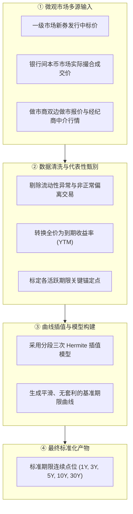
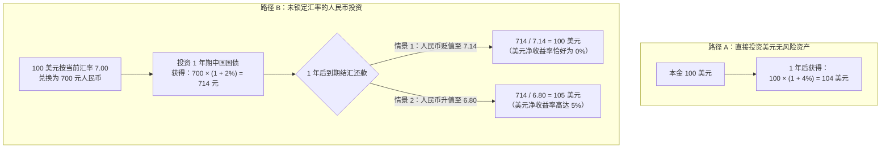
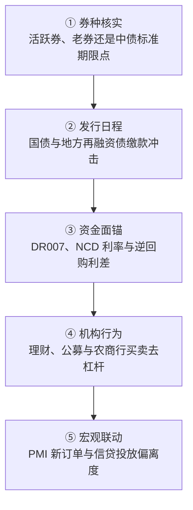

# 25 中国国债与收益率曲线：同一个利率数字，不同的形成过程

[上一章：财政融资与需求](24-fiscal-transmission.md) · [目录](./) · [下一章：信用风险与金融稳定](26-credit-risk-stability.md)

> 编写于 2026-09-26。发行案例固定为 2025 年文件，不表示当前行情；曲线方法对应所引说明。市场假设均为教学用途。

**前置阅读：**美国篇 [12 债券与曲线](https://fangpings.github.io/us-econ/12-bonds-and-curves.html)、[13 收益率分解](https://fangpings.github.io/us-econ/13-yield-decomposition.html)、[17 国债市场](https://fangpings.github.io/us-econ/17-treasury-plumbing.html)，中国篇 [20 央行传导](20-monetary-transmission.md)、[21 资金市场](21-money-markets-nonbanks.md)。债券价格与收益率的反向关系、久期、短期利率预期与期限溢价框架在各国通用。但在中国债券市场，不同品种的制度边界、做市报价模式、收益率曲线的插值加工以及特殊的机构资产配置偏好，赋予了中国国债利率独特的形成机制。

---

## 1. 先问你看到的是哪一种“中国债券利率”

在分析中国利率走势时，初学者很容易笼统地说“中国债券利率下降了”。但在中国银行间与交易所市场中，债券品种繁多，它们代表的法律责任、信用风险与流动性截然不同：

| 债券品种类别 | 法律发行主体与信用后盾 | 市场核心定价特征 | 分析中严禁混淆的边界 |
| :--- | :--- | :--- | :--- |
| **中国国债（CGB）** | 中华人民共和国财政部代表中央政府发行 | 国家最高主权信用，人民币无风险资产基准，免征利息所得税 | 活跃的“关键期限新券”流动性极佳，但非关键券存在老券折价 |
| **地方政府债（LGB）** | 省级人民政府（及计划单列市）发行并转贷 | 省级信用，按一般债与专项债管理，享有免税待遇 | 机构主要买入持有到期，二级市场换手率显著低于国债 |
| **政策性金融债（政金债）** | 国开行、进出口行、农发行三大政策性银行发行 | 准主权信用支持（享有中央信用托底），通常不享受全部企业所得税免税 | 流动性可媲美甚至超越国债，因税收差异通常比同期限国债高数十个基点 |
| **城投债与企业信用债** | 地方城投平台及国有/民营工商业企业发行 | 企业法人信用，依赖自身偿债能力与潜在支持，无免税待遇 | 属于独立企业信用风险范畴，绝不能改头换面计入国家主权国债 |
| **国债期货（T / TF / TS）** | 中国金融期货交易所挂牌的标准化衍生品合约 | 采用名义标准券定价，包含交割期空头转换期权与基差博弈 | 其价格是衍生品点位，必须通过转换因子（CF）还原为可交割券现券收益率 |
| **中债国债收益率曲线** | 官方中债估值中心基于全市场成交与报价插值拟合 | 代表标准期限点（如 1Y、5Y、10Y、30Y）的基准收益率 | 曲线上的点是数学拟合估计值，不等于某一只特定老券当天的成交价 |

在开展任何国际或宏观比较时，**必须以中国国债作为主权无风险基准**，绝不能把包含企业信用溢价的城投债或免税口径不同的政金债与美国联邦国债直接并列。

---

## 2. 一份真实续发行通知：1.42% 到底是什么

为了看清国债发行的微观账目，我们来仔细研读财政部办公厅于 **2025 年 9 月 16 日**印发的《2025 年记账式附息（十五期）国债第一次续发行通知》。[财政部通知原文链接](https://m.mof.gov.cn/tzgg/202509/t20250919_3972668.htm)

| 核心通知字段 | 官方通知记载内容 | 债券金融学实务含义 |
| :--- | :--- | :--- |
| **债券品种** | 2025 年记账式附息（十五期）国债 | 3 年期固定利率记账式附息国债 |
| **票面年利率（Coupon）** | **1.42%** | 原券发行时确定的法定票面年利率，全存续期保持固定 |
| **原起息日** | 2025 年 8 月 15 日 | 债券合同计息的起始基准日，并非本次续发行招标日 |
| **到期日** | 2028 年 8 月 15 日 | 本息最终兑付日，本次投资者买入后的实际剩余期限少于 3 年 |
| **招标方式** | 2025 年 9 月 26 日，竞争性**价格招标** | 承销团通过投报“百元面值净价”竞争，由价格决定实际中标收益率 |
| **上市安排** | 与原发行的同期国债合并上市交易 | 增加该期老券的市场存量规模，提升现券流动性 |

### 关键概念辨析：票面利率 $\neq$ 到期收益率
1. **票面利率确定的是法定现金流**：持有面值 $100$ 元的该债券，每年固定兑付利息 $1.42$ 元，直到 2028 年 8 月 15 日返还 $100$ 元本金。
2. **市场决定的是成交买入价格**：在续发行招标中，如果市场对 3 年期资金要求的回报率上升至 $1.60\%$，投标机构就会把投标价格打压到面值以下（如投报净价 $99.50$ 元）。投资者以折价买入，实际获得的**到期收益率（YTM）就会高于票面利率 1.42%**。
3. **净价与全价的结算**：由于 8 月 15 日至 9 月 26 日之间已经过去了 42 天，中标机构买入时还必须为这段时间的“应计利息”（Accrued Interest）向财政部先行买单：
   $$
   \text{结算全价 (Dirty Price)} = \text{中标净价 (Clean Price)} + \text{应计利息 (Accrued Interest)}
   $$
   $$
   \text{应计利息} = 100 \times 1.42\% \times \frac{42}{365} \approx 0.1634\text{ 元}
   $$

阅读财政部通知，切忌把通知里的票面利率（$1.42\%$）直接当作当天的市场成交收益率。

---

## 3. “10 年国债收益率”怎样从市场记录变成一个点

当我们在万得、彭博或财经软件看到“中国 10 年期国债收益率报 2.15%”时，这个数字到底来自哪里？在微观上，它可能源自三种不同的统计口径：
- **活跃券（On-the-run）成交收益率**：市场上最新发行、流动性最充裕的那一只特定 10 年期国债在当刻的撮合成交价；
- **做市商双边报价中间价**：一级做市商向市场报出的买入价（Bid）与卖出价（Ask）的算术平均值；
- **官方中债收益率曲线的标准化期限点**：中债估值中心通过拟合算法生成的标准 10.0 年期理论无风险利率。

### 中美官方收益率曲线编制的核心差异

| 比较维度 | 中国中债国债收益率曲线（ChinaBond） | 美国财政部官方收益率曲线（US Treasury） |
| :--- | :--- | :--- |
| **编制机构** | 中央国债登记结算有限责任公司（中债估值中心） | 美国财政部（U.S. Department of the Treasury） |
| **曲线数学模型** | [分段三次 Hermite 样条插值法](https://yield.chinabond.com.cn/cbweb-czb-web/czb/bzcxsmDown?locale=) | [单调凸（Monotone Convex）平滑样条法](https://home.treasury.gov/policy-issues/financing-the-government/interest-rate-statistics/treasury-yield-curve-methodology)（2021 年底改版） |
| **底层核心输入** | 兼顾一级发行、二级真实撮合成交与做市商综合报价 | 采用纽约联储每日美东时间下午 3:30 收集的**指示性买方收盘报价** |
| **理论收益率类型** | 现券到期收益率曲线（Yield-to-Maturity Curve） | 票面平价收益率曲线（Par Yield Curve，假设价格等于 100 时的理论票面） |

进行中美利差比较时，如果不注意时区对齐（北京时间收盘与纽约时间收盘跨越半天时差）以及曲线口径（实际成交 vs 平价报价拟合），就会把纯粹的统计口径误差误读为宏观经济意外冲击。

---

## 4. 中国收益率曲线为何不能直接套用美联储倒挂经验

在美国宏观经济学中，“10 年期与 2 年期（或 3 个月）美债利差倒挂”几乎是预测经济衰退最著名且屡试不爽的先行指标。然而，**直接将这一倒挂规律机械套用在中国国债市场上，会产生严重的认知偏差**。

中国国债收益率曲线的形态演变，受到中国独特的金融机构资产负债表与监管环境的深刻塑造：

1. **商业银行的“资产荒”与配债诉求**：在中国，商业银行持有超过 $60\%$ 的国债存量。当宏观经济面临有效信贷需求不足、企业中长期贷款意愿偏弱时，银行为了获取稳定利息收入、覆盖其庞大的负债端存款成本，会集中将流动性腾挪至债券市场增配国债，从而快速压低长端国债利率。这种长债下行反映的是**银行信贷传导阻塞与资金泛滥配置**，不单是海外市场那类单纯的通胀衰退交易。
2. **长久期资金的刚性欠配（保险与年金）**：随着中国居民寿险保单持续高增，保险公司负债久期长达 15-25 年。在低利率环境下，保险公司面临极其严峻的“利差损”风险，必须在二级市场上不计成本地疯狂抢购 30 年、50 年超长期国债以匹配久期缺口。长端与超长端利率被强烈压低，往往带有极其鲜明的**制度性负债久期驱动属性**。
3. **央行宏观审慎调控与“敲警钟”**：中国央行高度重视金融机构在单边牛市中过度积累的期限错配与利率风险（吸取类似硅谷银行资产端久期爆仓的教训）。央行通过公开市场借券卖出、向市场提示长期国债收益率风险等宏观审慎干预手段，主动引导长端利率在合理区间内双向波动，维护收益率曲线向上倾斜的合理形态。

---

## 5. 算例：长债收益率下行，金融条件未必全面放松

**教学情景数据**（单位：年化百分比）：

| 监测基准指标 | 周期前点（$T_0$） | 周期后点（$T_1$） | 绝对变动幅度（基点 BP） | 宏观金融含义 |
| :--- | :---: | :---: | :---: | :--- |
| **2 年期国债收益率** | $2.00\%$ | $1.90\%$ | $-10\text{ bp}$ | 短端流动性充裕，预期稳健 |
| **10 年期国债收益率** | $2.60\%$ | $2.20\%$ | $-40\text{ bp}$ | 机构疯狂抢配长债，长端加速下行 |
| **期限利差（10Y - 2Y）** | $60\text{ bp}$ | $30\text{ bp}$ | **$-30\text{ bp}$** | **国债收益率曲线大幅平坦化（Flattening）** |

我们进一步引入微观信用债进行对照观察：
假设同期限的某民营高端制造企业债券，其二级市场收益率从 $4.00\%$ 微降至 $3.80\%$（名义融资成本确实下降了 $20\text{ bp}$）。
我们测算其相对国债基准的**信用风险溢价（Credit Spread）**：
$$
\text{前期信用利差} = 4.00\% - 2.00\% = 2.00\% = 200\text{ bp}
$$
$$
\text{后期信用利差} = 3.80\% - 1.50\% = 2.30\% = 230\text{ bp}
$$
$$
\Delta \text{信用利差} = 230 - 200 = +30\text{ bp}
$$

**分析结论**：
虽然国债收益率大幅下降、企业名义发债利率也微降了 $20\text{ bp}$，但企业相对国债基准的**信用利差却反而走阔了 30 个基点**！这说明在无风险利率大幅下行的同时，金融机构对实体企业的风险防备心理反而增强了。如果中小企业本身无法发行债券、高度依赖商业银行信贷，在银行风险偏好回落时，中小企业面临的真实融资约束可能反而更加严峻。

---

## 6. 中美利差为什么不是无风险的免费午餐

当 10 年期美债收益率为 $4.0\%$、中国 10 年期国债收益率为 $2.0\%$ 时，两国存在高达 $200\text{ bp}$ 的名义利差。许多非专业投资者常问：“为什么不把人民币换成美元，白白赚取这高出 2% 的利差？”

答案是：**在开放经济中，只要没有完成汇率锁汇，利差完全被汇率波动风险所暴露！**

### 严格数学算例演示：
投资者初始拥有 $100$ 美元流动资金。
- **方案一（持有美元资产）**：以 $4\%$ 利率投资 1 年期美债：
  $$
  \text{到期收回本息} = 100 \times (1 + 0.04) = 104\text{ 美元}
  $$
- **方案二（兑换为人民币投资）**：假设初始即期汇率 $E_0 = 7.00$（每美元兑换 7.00 元人民币）。
  1. 兑换为人民币：$100 \times 7.00 = 700$ 元人民币；
  2. 投资于收益率为 $2\%$ 的 1 年期中国国债，到期本息为：
     $$
     700 \times (1 + 0.02) = 714\text{ 元人民币}
     $$
  3. **情景 1（人民币对美元贬值至 $E_1 = 7.14$）**：
     $$
     \text{换回美元本息} = \frac{714}{7.14} = 100\text{ 美元} \implies \text{美元实际收益率} = 0\% < 4\%
     $$
     虽然人民币资产赚取了 $2\%$ 的本币收益，但由于人民币贬值了 $2\%$，换回美元后分文未赚，收益率远输给直接持有美元资产！
  4. **情景 2（人民币对美元升值至 $E_1 = 6.80$）**：
     $$
     \text{换回美元本息} = \frac{714}{6.80} = 105\text{ 美元} \implies \text{美元实际收益率} = 5\% > 4\%
     $$
     汇率升值带来的汇兑收益反而使得美元总回报超越了美债！

如果机构想要彻底锁死汇率风险，就必须在远期外汇市场（Forward Market）买入反向对冲合约。在**抛补利率平价（Covered Interest Parity, CIP）**成立的无套利均衡下，远期外汇升贴水点数会精准抵销这 $200\text{ bp}$ 的利差，对冲后的跨国无风险超额收益将几乎归零。

---

## 7. 屏幕上能算出中国真实的“实际利率”吗

许多宏观研报为了偷懒，直接用“10 年期名义国债收益率减去最新单月的 CPI 同比”来声称这是中国的“实际无风险利率（Real Rate）”。例如，当 10 年期国债收益率为 $2.0\%$，当月 CPI 同比为 $0.5\%$ 时，算出实际利率为 $1.5\%$。

**这种计算在金融计量学上存在两大逻辑硬伤**：
1. **期限严重错配**：10 年期国债贴现的是**未来 10 年（120 个月）的预期现金流**；而当月 CPI 同比反映的是**过去 12 个月已经发生的物价历史变动**。拿未来 10 年的长期贴现率去减过去一年的历史通胀，是不匹配的。
2. **缺乏直接可观测的通胀保值公债**：美国市场拥有庞大且流动性极佳的通胀保值国债（TIPS），其二级市场交易价格直接反映了市场定价的真实实际利率，两者的差额形成了盈亏平衡通胀率（Breakeven Inflation）。中国目前尚未发行公开发行的国债 TIPS，因此中国真实的长期预期实际利率无法通过简单的屏幕加减法直接得到，只能依赖央行调查问卷、经济学家一致预期或仿射期限结构计量模型进行估计。

---

## 8. 专业债券分析师的“看盘五步法”

面对中国国债收益率的异动，建议按以下标准化清单建立观察框架：

> **看盘核心清单**：
> 1. **券种核实**：当前异动的是活跃券（如 240011）、老券，还是中债标准曲线插值点？
> 2. **发行日程**：本周是否有超大规模国债或地方再融资债缴款？国库库款变动是否造成流动性冲击？
> 3. **资金面锚**：DR007、大行同业存单（NCD）利率是否与央行 7 天逆回购政策利率保持合理利差？
> 4. **机构行为**：理财子、公募基金、农商行在二级市场上是在净买入还是净卖出？是否存在集中去杠杆踩踏？
> 5. **宏观联动**：对比 PMI 新订单、银行中长期贷款投放节奏，检验长端利率定价与实体基本面的偏离度。

---

## 9. 自测题与逐步参考答案

### 思考与练习

1. 某期 3 年期固定利率国债进行续发行招标，原券票面年利率为 $1.42\%$。某银行在招标中以净价 $99.80$ 元中标。能否认定该银行持有该债券到期的实际年化回报率恰好等于 $1.42\%$？
2. 在比对中美债券市场走势时，研究员将上午 11:30 银行间市场某只 10 年期国债成交价与前一个交易日纽约收盘的美国财政部官方 Par Yield 曲线并列对比，指出“中美利差在过去两小时内收窄了 10 个基点”。这种表述存在什么致命错误？
3. 第 5 节中，10 年期国债与 2 年期国债利差从 $60\text{ bp}$ 收窄至 $30\text{ bp}$。能否仅凭这一曲线变平的现象，断言“市场预期未来通胀率将确定性下行 30 个基点”？
4. 商业银行在资产端大幅增配国债，同时该月企业中长期贷款增长乏力。这是否能单独作为“商业银行主动压缩实体经济信贷、搞资金脱实向虚”的铁证？
5. 投资者持有 $100$ 美元，在初始即期汇率 7.00 时全额兑换为人民币并投资于 1 年期利率为 $2\%$ 的中国国债。若 1 年后人民币对美元贬值到 7.14，投资者的美元最终收益率是多少？若 1 年后升值到 6.80，投资者的美元最终收益率是多少？
6. 某研报写道：“当前 10 年期国债收益率为 2.0%，扣除当前单月 CPI 同比 0.5% 后，实体经济承担的高达 1.5% 的真实无风险实际利率抑制了投资意愿。”请指出该分析在统计与理论上的主要缺陷。

---

点击展开逐步参考答案与解析

1. **解答**：
   绝不能。票面利率 $1.42\%$ 只决定了未来的利息现金流。银行以 $99.80$ 元的折价（低于面值 $100$ 元）买入，到期按 $100$ 元面值偿还，不仅能每年获得票息，还能额外获得资本利得收益。其实际到期收益率（YTM）必然高于票面利率 $1.42\%$。

2. **解答**：
   存在严重的**时间与统计口径错配**：
   - **时间错配**：北京时间上午 11:30 对应的美国美东时间为深夜，美债市场处于休市阶段，引用的美债数据是前一日历史收盘价，时间并不同步；
   - **口径错配**：单只中国国债成交收益率受个券流动性与微观撮合扰动，而美国官方 Par Yield 曲线是基于模型生成的全市场标准化平价曲线，不能混为一谈。

3. **解答**：
   不能。国债期限利差的平坦化是多元宏观力量交织的结果：
   - 它可能源于长期经济增长预期放缓；
   - 也可能源于寿险、年金机构对长久期资产的集中抢筹压制了期限溢价（Term Premium）；
   - 还可能源于商业银行“资产荒”下的大类资产轮动。绝不能武断地将全部利差收窄直接等同于通胀预期下行。

4. **解答**：
   不能。信贷是供需双方共同决定的结果：
   - 如果宏观经济面临需求收缩，实体企业投资意愿低迷，导致银行面临**合格有效信贷需求不足（借款人缺乏）**；
   - 银行吸收了大量居民储蓄存款，负债端存在沉重的刚性利息成本，必须通过在债券市场增配国债以稳定生息资产收益。国债增配通常是实体信贷需求疲软的“结果”，而非银行主动挤出信贷的“原因”。

5. **计算过程**：
   - 兑换人民币：$100 \times 7.00 = 700$ 元；
   - 投资 1 年到期本息：$700 \times (1 + 2\%) = 714$ 元人民币；
   - **当汇率变为 7.14 时**：
     $$
     \text{换回美元} = \frac{714}{7.14} = 100\text{ 美元} \implies \text{收益率} = \frac{100 - 100}{100} = 0\%
     $$
   - **当汇率变为 6.80 时**：
     $$
     \text{换回美元} = \frac{714}{6.80} = 105\text{ 美元} \implies \text{收益率} = \frac{105 - 100}{100} = 5\%
     $$

6. **解答**：
   主要缺陷有二：
   - **期限错配**：10 年期国债反映的是市场对未来 10 年长期资金成本与长期通胀的综合预期，而单月 CPI 仅代表过去 12 个月的短期物价变动，不能用当期短期滞后通胀代替长期预期通胀；
   - **借款主体错配**：国债利率代表中央主权无风险借贷成本，实体经济微观企业（尤其是民企和中小微企业）借款还需承担高昂的信用风险溢价和商业银行贷款加点，不能直接用国债名义利率等同于微观企业的实际借贷成本。

---

[上一章：财政融资与需求](24-fiscal-transmission.md) · [目录](./) · [下一章：信用风险与金融稳定](26-credit-risk-stability.md)
