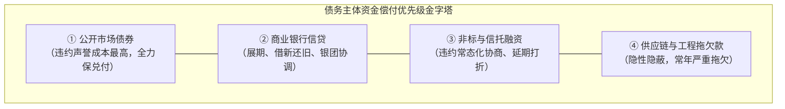
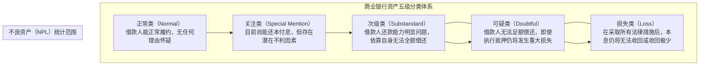
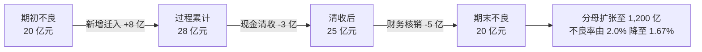
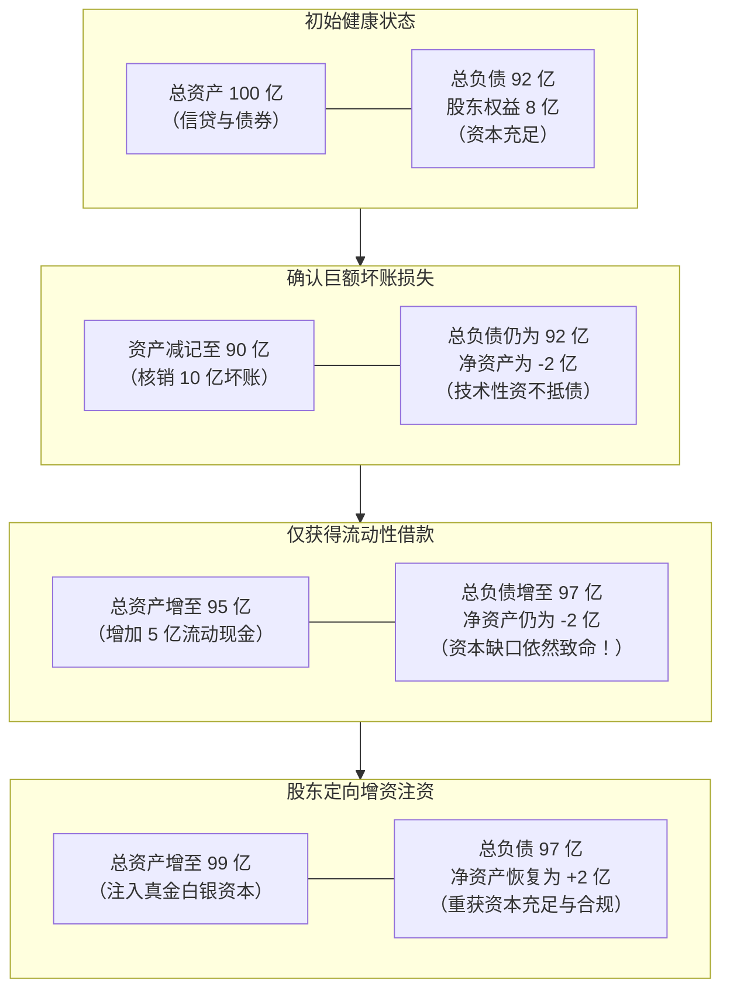

# 26 中国信用风险与金融稳定：谁欠钱、谁回款、谁承担损失

[上一章：国债收益率](25-government-bond-yields.md) · [目录](./) · [下一章：贸易与国际收支](27-trade-balance-payments.md)

> 编写于 2026-09-26。监管方法采用 2023 年发布的《商业银行金融资产风险分类办法》及官方解读，注明实施与过渡安排；算例与模块综合材料均为教学假设，不对应某家现实机构。

**前置阅读：**美国篇 [19 信用风险](https://fangpings.github.io/us-econ/19-credit-risk.html)、[15 资产负债表](https://fangpings.github.io/us-econ/15-balance-sheets.html)，中国篇 [36 房地产](36-housing-development.md)、[16 银行](16-banks-and-deposits.md)、[21 非银](21-money-markets-nonbanks.md)、[23 地方债](23-local-government-debt.md)。信用损失、流动性危机与资本缓冲的会计原理放之四海而皆准。但在中国特殊的金融与信用生态中，政府与企业的信用边界、隐性支持预期、银行资产风险分类制度以及复杂的债务重组安排，构成了理解中国信用风险与金融稳定的核心底层逻辑。

---

## 1. “没有公开债券违约”能说明全部真相吗

在固收研究中，常常听到“某地城投平台迄今保持公募债券零违约记录，信用坚如磐石”的论调。但从金融审计与微观流动性视角看，**公开债券按时兑付，绝不等于企业没有深陷信用危机**。

一个典型的中国地方平台或大型企业，其融资渠道通常呈多层分布：
1. **公开市场债券**：因信息高度透明、违约会立即引发全市场评级下调和声誉崩塌，偿债优先级往往被提到最高；
2. **银行信贷**：规模最大，但可通过银团协调、借新还旧、自主展期或调整还本付息节奏进行表内平滑；
3. **非标融资（信托、定融、租赁）**：成本最高、抵押担保复杂，当现金流紧张时，往往最早出现违约延期与协商打折；
4. **经营性应付账款（拖欠施工方与供应商账款）**：对公众隐蔽性最强，极易被动拖欠数年，成为微观经济“三角债”的堰塞湖。

因此，分析任何信用主体的资产负债表，必须首先穿透回答四个核心字段：

“拥有国企背景”、“战略地位极其重要”、“拥有很多土地储备”等模糊定性标签，绝对不能替代对上述四要素的严格事实核验。

---

## 2. 国有身份、支持预期与法定担保：三件截然不同的事

许多投资者有一种根深蒂固的信仰：“国企绝不会真正违约，因为政府一定会兜底。”然而，现代公司法与预算法律制度清晰界定了出资人责任：**股东对企业的负债以其认缴的出资额为限承担有限责任，国有股权不等于无限主权担保**。

在研判外部支持可能性时，必须将逻辑拆解为严格的三层闭环：

| 评估层次 | 必须核查的硬性证据 | 资本市场常见致命误读 |
| :--- | :--- | :--- |
| **① 支持意愿（Willingness）** | 债务人的核心公共职能定位、系统重要性、违约对区域金融稳定的连锁冲击外溢效应 | 误以为只要是国资委控股的企业，政府就必然无条件救助 |
| **② 支持能力（Capacity）** | 支持方（如地方财政）的实际可用财力、国资运营公司流动现金、可处置优质金融资产 | 看到地方政府有海量未开发土地，就误以为有随时可用的现钱 |
| **③ 支持实现（Execution）** | 法律合规程序完备性、预算调剂人大批文、资金实际交割划拨凭证与到账时限 | 将一纸口头表态或不具法律约束力的合作意向函误当真金白银 |

### 教学案例：尚未到账的“拟支持资金”
某城投平台未来一年内需刚性偿付到期本息 $50$ 亿元。经过审慎资产盘点：
- 账面完全自由不受限货币资金：$8$ 亿元；
- 保守测算未来一年经营性净现金流入：$12$ 亿元；
- 已经各方确认并已下达支付计划的应收账款回款：$10$ 亿元。

我们计算其已落实的内部偿债资金池：
$$
\text{已落实自筹资金} = 8 + 12 + 10 = 30\text{ 亿元}
$$
$$
\text{硬性刚性偿付缺口} = 50 - 30 = 20\text{ 亿元}
$$

此时，平台在募集说明书中注明：“当地国资股东拟协调提供 20 亿元专项流动性支持”。作为合格的审计师或分析师，绝不能因为看到了这一行字，就直接认定缺口为零！必须核实：这 $20$ 亿元是否列入当年财政预算？资金是否已经存入托管专户？如果支持资金最终因合规瑕疵或上级审批未通过而迟滞，这 $20$ 亿元的缺口就足以触发公开债券违约。

---

## 3. 信用利差：融资成本下降与风险溢价上升可以并存

在债券市场中，一个常见的反直觉现象是：**某家企业的发债票面利率下降了，但它的真实信用处境反而进一步恶化了**。

**教学情景数据**（单位：年化百分比）：

| 观察指标 | 周期前点（$T_0$） | 周期后点（$T_1$） | 实际变动幅度 |
| :--- | :---: | :---: | :---: |
| **某企业信用债收益率** | $4.00\%$ | $3.80\%$ | $-20\text{ bp}$（名义融资成本微降） |
| **对应同期限国债基准** | $2.00\%$ | $1.50\%$ | $-50\text{ bp}$（无风险基准快速下行） |
| **简单信用利差（Credit Spread）** | $200\text{ bp}$ | $230\text{ bp}$ | **$+30\text{ bp}$（风险补偿溢价走阔）** |

我们用公式展示信用利差的变动：
$$
\text{前期利差} = 4.00\% - 2.00\% = 2.00\% = 200\text{ bp}
$$
$$
\text{后期利差} = 3.80\% - 1.50\% = 2.30\% = 230\text{ bp}
$$
$$
\Delta \text{信用利差} = 230 - 200 = +30\text{ bp}
$$

**核心金融学逻辑**：
名义利率由两部分组成：
$$
\text{企业发债利率} = \text{同期限国债无风险利率} + \text{信用风险溢价 (利差)}
$$
当宏观货币政策宽松、无风险利率大幅下行 $50\text{ bp}$ 时，该企业仅仅享受了 $20\text{ bp}$ 的下行红利，另外 $30\text{ bp}$ 被市场对其信用担忧所扩大的风险溢价所吞噬！这表明投资者对其违约风险的担忧不是减轻了，而是加重了。

---

## 4. 中国境内 AAA 评级 $\neq$ 标普/穆迪全球尺度 AAA

很多初涉中国债券市场的境外投资者常被“满屏 AAA 级”所震撼：中国公募信用债市场上，发行量超过 $80\%$ 都集中在 AAA 和 AA+ 评级。

为什么中国 AAA 评级不能直接等同于标普（S&P）或穆迪（Moody's）的全球尺度 AAA？
1. **国内尺度（National Scale）vs 全球尺度（Global Scale）**：[标准普尔国家尺度评级说明](https://www.spglobal.com/ratings/en/products/nat-l-regional-scale-credit-ratings)。中国境内的信用评级采用的是**国别内部相对排序系统**。AAA 代表该发行人在中国境内工商企事业单位中处于违约概率极低的顶端梯队；而国际三大评级机构采用全球统一基准尺度，一个国家的最高主权评级直接给该国境内所有企业设定了“主权评级上限（Sovereign Ceiling）”。
2. **外部支持假定的权重不同**：中国境内评级机构往往给予地方政府或母集团的“潜在外部救助支持”极高权重，只要存在较强的支持预期，就可以将主体评级向上调升数个子级；而国际评级体系对外部救助的独立约束条件更为苛刻。
3. **评级中枢与违约率的历史分布**：中国境内评级体系的违约样本集中在 AA- 以下，AA 级以上历史平均违约率极低；而国际评级中，BBB- 才是投资级（Investment Grade）的分水岭。两套体系的评级字母虽然形式一致，但分布分位数与违约概率的经验映射完全不同。

---

## 5. 中国银行“不良贷款率”的生成机制与分类新规

新闻报道经常引用“某银行业机构不良贷款率仅为 1.25%”。这个“不良率”究竟是如何在银行内部风控流程中生成的？

我国自 2023 年 7 月 1 日起正式施行由银保监会与人民银行联合印发的《商业银行金融资产风险分类办法》。[两部门官方发布及答记者问实录](https://jrj.beijing.gov.cn/jrgzdt/202302/t20230214_2916481.html)。新规重塑了风险识别的底层规则：

### 关键监管穿透原则：
1. **不良贷款的法定范围**：仅包括**次级类、可疑类、损失类**三类。关注类贷款不计入不良贷款分母，但属于高危“潜在不良后备军”。
2. **逾期天数的硬性红线**：新规明确要求，原则上**本金、利息或收益逾期超过 90 天的所有资产，必须至少归入不良（次级类以上）**；逾期超过 270 天必须至少归入可疑，逾期超过 360 天必须归入损失。
3. **重组资产（Restructured Assets）的严监管**：因借款人发生财务困难，银行调整还本付息条款（展期、借新还旧）的重组资产，**不得直接分类为正常类，至少归为关注类**，并设立至少 6 个月的观察期，防止银行通过“借新还旧”蓄意掩盖真实风险。

---

## 6. 算例解密：不良率下降，坏账压力为什么可能反而加重

**经典教学算例推演**：
某城商行期初各项贷款总额为 $1,000$ 亿元，期初不良贷款余额为 $20$ 亿元，期初不良贷款率为：
$$
\text{期初不良率} = \frac{20}{1,000} = 2.00\%
$$

在当期经营周期内，该行发生以下信贷流量变动：
1. 当期新发生逾期恶化、从关注类**新迁入不良贷款**：$+8$ 亿元；
2. 催收部门通过现金清收与抵债资产变现，**收回前期不良贷款**：$-3$ 亿元；
3. 经总行董事会批准，使用前期计提的贷款损失准备进行**呆账核销（Write-off）**：$-5$ 亿元；
4. 该行为了稀释资产风险与支持实体，当期大力投放优质普惠与按揭贷款，使得期末各项贷款总额激增至 $1,200$ 亿元。

我们计算期末账面数据：
$$
\text{期末不良贷款余额} = 20 + 8 - 3 - 5 = 20\text{ 亿元}
$$
$$
\text{期末不良贷款率} = \frac{\text{期末不良余额}}{\text{期末贷款总额}} = \frac{20}{1,200} \approx 1.67\%
$$

**极其深刻的审计洞见**：
- **账面不良率从 2.00% 显著降至 1.67%**，新闻通稿宣称“资产质量全面好转”；
- **但真相是**：当期实质性产生了高达 **$8$ 亿元的新增不良资产**！
- 不良率之所以下降，主要归功于两点：一是银行通过**财务核销（抹去 5 亿元）**主动出清了账面坏账；二是**大幅做大贷款总规模分母（从 1000 亿扩至 1200 亿）**实现了“分母稀释效应”。如果微观经济环境没有根本改善，新增不良形成率（NPL Formation Rate）高企，未来的坏账冲销压力将极其巨大。

### 拨备覆盖率与拨贷比的精确核算
假设该行期末账面上提取的**贷款损失准备（Loan Loss Provisions）余额**为 $40$ 亿元：

1. **拨备覆盖率（Provision Coverage Ratio, PCR）**：
   $$
   \text{拨备覆盖率} = \frac{\text{贷款损失准备余额}}{\text{不良贷款余额}} = \frac{40}{20} = 200\%
   $$
   *含义*：银行准备金是不良贷款的 2 倍，代表每 1 元已确认的不良贷款有 2 元损失准备作为会计防护垫。
2. **贷款拨备率 / 拨贷比（Provision-to-Total-Loans Ratio）**：
   $$
   \text{拨贷比} = \frac{\text{贷款损失准备余额}}{\text{各项贷款总额}} = \frac{40}{1,200} \approx 3.33\%
   $$
   *含义*：全部贷款总盘子中有 $3.33\%$ 的比重被留存为防御拨备。

---

## 7. 中美银行资产质量指标的口径映射

在跨国对比银行资产质量时，不能直接把中国的不良贷款率与美国的某项指标生搬硬套。[美国联邦存款保险公司（FDIC）季度银行报告指南](https://archive.fdic.gov/view/fdic/14421/fdic_14421_DS1.pdf)

| 核心比较维度 | 中国银行业体系（NFRA 监管标准） | 美国商业银行体系（FDIC / 联储标准） |
| :--- | :--- | :--- |
| **核心问题资产口径** | **不良贷款（NPL）**（次级、可疑、损失三类余额） | **非正常贷款（Noncurrent Loans）**（逾期 90 天以上贷款加非应计贷款 Nonaccrual） |
| **宽口径监控指标** | 不良贷款 $+$ 关注类贷款（Special Mention） | 逾期 30-89 天仍计息贷款 $+$ Noncurrent（统称 PDNA） |
| **坏账核销速度** | 需满足严格的法定核销税务条件并经董事会逐笔审批，核销周期偏审慎平滑 | 遵循美国 GAAP 规则，消费信贷逾期 120-180 天强制全额冲销（Charge-off）出表 |
| **利润表核销流量** | 计提资产减值损失（Impairment Losses）计入当期损益 | 净核销率（Net Charge-off Rate, NCO），直观反映已确认的净损失流量 |

由于美国银行的核销速度极快（信用卡与消费贷逾期数月即强制核销），其存量 Noncurrent 贷款余额往往被迅速压低；而中国银行的不良贷款在账面留存化解时间更长。直接对比两国的存量比率，而不比较包含核销金额的**真实净不良生成率**，属于典型的断章取义。

---

## 8. 资产负债表推演：流动性借款为什么救不了银行资本

当某家中小金融机构陷入信用坏账风暴时，中央银行或大行提供同业借款（流动性救助），是否能使该银行彻底脱离危险？

我们用精简的资产负债表推演看透本质：

### 逐步财务等式核对：
1. **状态 1（初始）**：
   $$
   \text{资产 } 100 = \text{负债 } 92 + \text{净资产 (所有者权益) } 8
   $$
2. **状态 2（遭受 10 亿元未计提坏账冲击）**：
   资产端扣减损失 $10$ 亿元变更为 $90$ 亿元，直接击穿资本：
   $$
   \text{净资产} = 90 - 92 = -2\text{ 亿元（资不抵债，核心一级资本充足率归负！）}
   $$
3. **状态 3（央行提供再贷款或同业拆借流动性资金 $5$ 亿元）**：
   银行借入现金 $5$ 亿元，资产端现金增加 $5$ 亿元变成 $95$ 亿元，但负债端同业借款也同步增加 $5$ 亿元变成 $97$ 亿元：
   $$
   \text{净资产} = 95 - 97 = -2\text{ 亿元（毫无改变！）}
   $$
   *结论*：**流动性支持只能防止银行发生当天的挤兑踩踏，绝对无法修复资不抵债的资本硬缺口！**
4. **状态 4（财政或战略股东依法全额认购增发新股，注入普通股核心一级资本 $4$ 亿元）**：
   资产端增加现金 $4$ 亿元变为 $99$ 亿元，负债不变（$97$ 亿元），所有者权益恢复为：
   $$
   \text{净资产} = 99 - 97 = +2\text{ 亿元}
   $$
   银行成功走出资不抵债阴影，重新达到资本充足率监管红线。

---

## 9. 自测题与逐步参考答案

### 思考与练习

1. 某城投平台一年内面临刚性到期债务本息 $50$ 亿元，公司账面自由现金 $8$ 亿元，年化经营净流入 $12$ 亿元，已确认财政应收回款 $10$ 亿元，同时获得市国资委签署的一份“拟在年内协调 20 亿元流动性贷款支持”的战略备忘录。在严格金融审计标准下，该平台已确证的当期刚性偿债资金缺口是多少？
2. 某 5 年期民营企业债券收益率从 $4.00\%$ 下降至 $3.80\%$，同期 5 年期国债收益率从 $2.00\%$ 下降至 $1.50\%$。请计算该企业债券的信用利差变动，并阐释其背后的真实宏观信用信号。
3. 某海外对冲基金经理在其中国投资研报中写道：“由于中国某央企获得国内最高 AAA 评级，其信用违约风险等同于标普评级为 AAA 的微软公司债券。”请从评级尺度角度驳斥该观点。
4. 某银行期初贷款 $1,000$ 亿元，不良贷款 $20$ 亿元。当期新迁入不良贷款 $8$ 亿元，现金清收收回不良 $3$ 亿元，核销不良贷款 $5$ 亿元；期末贷款总规模扩充至 $1,200$ 亿元。为什么说该行不良贷款率从 $2.0\%$ 降至 $1.67\%$ 并不代表没有发生新的信贷风险？
5. 某银行公布其拨备覆盖率为 $200\%$。一名储户据此认为：“即使发生系统性大挤兑，这家银行也可以偿付两倍于全部居民存款的资金。”请指出该储户的常识性错误。
6. 一家小型农商行在发生信贷严重暴雷后，净资产变为 $-2$ 亿元。主发起行向其紧急拆借了 $5$ 亿元低息同业存款，农商行柜面取款恢复正常。该农商行是否已经彻底恢复了监管合规的“资本充足”？

---

点击展开逐步参考答案与解析

1. **计算与解析**：
   $$
   \text{已确证自由资金池} = 8 + 12 + 10 = 30\text{ 亿元}
   $$
   $$
   \text{真实刚性偿债缺口} = 50 - 30 = 20\text{ 亿元}
   $$
   国资委的战略备忘录不属于具备法律执行力的已到账资本或不可撤销担保，不能将其提前列入已落实资金，硬性缺口依然为 $20$ 亿元。

2. **解答**：
   $$
   \text{原信用利差} = 4.00\% - 2.00\% = 200\text{ bp}
   $$
   $$
   \text{新信用利差} = 3.80\% - 1.50\% = 230\text{ bp}
   $$
   $$
   \Delta \text{信用利差} = +30\text{ bp}
   $$
   名义融资利率虽然下降，但信用利差反而走阔了 $30$ 个基点。这表明企业的名义收益率下行纯粹是享受了央行货币宽松推动无风险基准利率深跌的被动外溢红利，资本市场对该企业的信用风险补偿溢价不降反升。

3. **解答**：
   存在严重的**评级尺度体系混淆**：
   - 中国国内 AAA 评级基于**国别内部相对排序尺度（National Scale）**，衡量的是该主体在中国国内法人机构中的信用排序；
   - 微软公司的 AAA 评级是标普基于**全球主权尺度（Global Scale）**评定的世界最高信用级别，其违约概率经受了跨国全球极端经济危机的历史回测；
   - 两者评级标尺的分母与违约率经验区间完全不可比，绝不能凭相同英文字母简单等同。

4. **解答**：
   $$
   \text{期末不良余额} = 20 + 8 - 3 - 5 = 20\text{ 亿元}
   $$
   $$
   \text{期末不良率} = \frac{20}{1,200} \approx 1.67\%
   $$
   不良率虽然下降了 $33\text{ bp}$，但本期**实质性新产生了高达 8 亿元的新增不良贷款**！期末不良率的走低，一方面得益于银行动用真金白银的拨备主动核销了 $5$ 亿元坏账，另一方面得益于分母（总贷款）从 $1,000$ 亿强劲扩张到 $1,200$ 亿的数学稀释效应。潜在信用风险仍在实质性累积。

5. **解答**：
   这是对拨备覆盖率指标分母与分子定义的完全误解：
   - **拨备覆盖率的分母是不良贷款（NPL）**，分子是针对这笔不良资产计提的风险准备金；$200\%$ 仅意味着每 $1$ 元已确认的不良贷款有 $2$ 元的会计准备金防备其违约损失；
   - 银行的负债端由庞大的全社会存款构成（规模通常数十倍于不良贷款），拨备覆盖率绝不是用银行总现金去除以存款总额，与应对全社会全面挤兑的流动性储备属于完全不同的监管指标。

6. **解答**：
   完全没有。
   - 拆借的 $5$ 亿元低息同业存款是商业银行负债端的借款，资产端增加现金 $5$ 亿元，负债端同时增加债务 $5$ 亿元，**净资产（所有者权益）依然为 $-2$ 亿元**；
   - 该笔借款仅解决了当天的柜面现金流动性支付危机，银行依然处于**资不抵债**的破产边缘，监管核心一级资本充足率依然严重不达标。必须由股东注入真金白银的股权资本（或留存利润转增）以修复净资产。

---

## 10. 第五模块综合作业：审计一份“财政金融全面改善”研报

以下为一组逻辑环环相扣的**教学投研综合材料**（金额单位除特别注明外均为亿元）：

### 材料包详情

| 宏观材料编号 | 涵盖的官方执行数据与具体交易口径 |
| :--- | :--- |
| **材料 A：一般公共预算** | 全国一般公共预算收入合计 $180$ 亿元（中央本级 $100$、地方本级 $80$）。中央本级支出 $50$ 亿元，中央对地方转移支付 $50$ 亿元，地方本级最终支出 $150$ 亿元。 |
| **材料 B：地方债务置换** | 省级政府合规发行再融资置换专项债 $40$ 亿元，全额置换偿还已纳入广义公共部门债务边界的平台城投贷款 $40$ 亿元；原贷款综合利率为 $6\%$，新债券发行利率为 $3\%$（以完整年度计息）。 |
| **材料 C：重大项目投资** | 某新设产业基础设施工程，地方发行专项债充当合规项目资本金 $20$ 亿元，同时撬动银行银团配套贷款 $80$ 亿元；当年经监理验收完成的建安工程量为 $40$ 亿元。 |
| **材料 D：账款清欠化债** | 地方财政统筹调拨专项资金，全额清偿了某路桥企业以前年度已完工并核算的工程拖欠款 $15$ 亿元；该企业收到资金后，用其中 $10$ 亿元偿还银行贷款，用 $5$ 亿元支付上游供货商旧欠款。 |
| **材料 E：债券信用利差** | 某 5 年期民营制造企业债收益率由 $4.00\%$ 下行至 $3.80\%$；同期限 5 年期国债基准收益率由 $2.00\%$ 下行至 $1.50\%$。 |
| **材料 F：银行信贷质量** | 某主要商业银行贷款总额由 $1,000$ 亿元扩张至 $1,200$ 亿元；账面不良贷款由 $20$ 亿元保持在 $20$ 亿元（当期新迁入不良 $8$ 亿元、现金清收 $3$ 亿元、财务核销 $5$ 亿元）。 |

---

### 待审计的草率研报原文

> **【某机构宏观研报摘要】**：
> “本年财政发力极其迅猛！全国财政支出为中央支出 100 亿元加地方支出 150 亿元，合计支出 250 亿元；减去收入 180 亿元，官方赤字高达 70 亿元。置换债 40 亿元与项目专项债 20 亿元合计形成直接新增购买需求 60 亿元；再加上项目总投资 100 亿元与财政清欠 15 亿元，累计拉动当年新增 GDP 高达 175 亿元！置换后地方政府法定债务增加 40 亿元，说明全社会政府总债务在被动扩大。同时，企业发债利率下行 20 个基点，证明微观企业信用风险显著消除；银行不良率从 2.0% 降至 1.67%，证明实体经济没有任何新增坏账产生。这展现了财政金融的全面改善，中国各项指标可无缝对标美国。”

---

### 专业审计任务清单

1. **核算全国合并真实财政支出与简单收支差**：根据材料 A，剔除内部往来，计算全国合并支出，并阐述为什么不能直接将其称为“官方赤字”。
2. **审计债务置换对广义公共债务与利息的影响**：根据材料 B，分别分析置换对法定地方债、平台负债与广义公共部门净负债的影响，并计算年利息节约额。
3. **辨析项目投资与清欠对 GDP 的真实贡献**：根据材料 C 和 D，穿透融资、实物工程量、清欠与还贷，逐一驳斥“拉动 GDP 175 亿元”的荒谬加总。
4. **重算信用利差与不良贷款生成率**：计算材料 E 的真实信用利差变动与材料 F 的微观资产质量真相。
5. **纠正中美指标映射的两个致命硬伤**。
6. **撰写一份不超过 200 字的专业客观审计结论**。

---

点击展开综合作业权威审计报告与解析

#### 任务 1：财政合并支出与赤字审计
- **真实合并支出**：中央本级实际支出 $50$ 亿元，地方本级实际支出 $150$ 亿元（中央对地方转移支付 $50$ 亿元作为政府内部往来全额抵销）：
  $$
  \text{全国合并真实支出} = 50 + 150 = 200\text{ 亿元}
  $$
  草率研报将中央账面总支出（$50 + 50 = 100$）加地方支出（$150$）算成 $250$ 亿元，**重复计算了 50 亿元转移支付**！
- **简单收支差额**：$200 - 180 = 20\text{ 亿元}$。
- **为什么不能叫官方赤字**：官方赤字还必须考虑从政府性基金调入资金、动用历年结转结余以及补充稳定调节基金等平衡调节项，不能用 $20$ 亿元或 $70$ 亿元简单冒充全国预算赤字。

#### 任务 2：债务置换的本质穿透
- **法定地方政府债**：账面法定余额增加 $40$ 亿元；
- **平台企业银行贷款**：全额清偿减少 $40$ 亿元；
- **广义公共部门对外总债务**：本金净变动为 **$0$**（$+40 - 40 = 0$），总债务没有增加！
- **年利息节约计算**：
  $$
  \text{原年利息} = 40 \times 6\% = 2.4\text{ 亿元}, \quad \text{新年利息} = 40 \times 3\% = 1.2\text{ 亿元}
  $$
  $$
  \text{每年净节约利息支出} = 2.4 - 1.2 = 1.2\text{ 亿元}
  $$

#### 任务 3：GDP 贡献剥离与算式纠错
- **材料 C（重大项目）**：专项债资本金 $20$ 亿元与银行贷款 $80$ 亿元构成了总计 $100$ 亿元的项目融资池，不能与 $100$ 亿元总投资再次重复累加。当年实际形成的 GDP 资本形成总额仅为**经核准完工的建安实物量 40 亿元**。
- **材料 D（清欠账款）**：$15$ 亿元工程早已在往年核算为 GDP，清欠属于存量债权债务资金清偿，当年新增 GDP 贡献为 **$0$**。企业还贷 $10$ 亿元属于金融去杠杆，付上游货款 $5$ 亿元属于供应链存量结算，均不属于当期新增实物工作量。
- **结论**：两项合计对当年 GDP 的直接产出拉动仅为 **$40$ 亿元**，绝非荒谬拼凑的 $175$ 亿元！

#### 任务 4：金融微观风险真实重估
- **信用利差走阔**：企业债利差由 $4.00\% - 2.00\% = 200\text{ bp}$ 走阔至 $3.80\% - 1.50\% = 230\text{ bp}$，利差逆势走阔 $30\text{ bp}$，风险补偿要求上升。
- **不良贷款生成真相**：期末不良率由 $2.0\%$ 降至 $1.67\%$ 纯粹源于核销 $5$ 亿元与分母贷款扩张 $200$ 亿元的稀释；当期实质新迁入不良贷款高达 **$8$ 亿元**，信贷风险并未消失。

#### 任务 5：中美指标映射纠错
- **错误一**：中国支出法 GDP 的“政府消费”不包含政府主导的基础设施投资（计入资本形成），而美国国民账户 $G$ 包含了政府投资，二者不可直接比大小；
- **错误二**：中国境内 AAA 评级属于国内相对尺度（National Scale），包含较强外部隐性支持假定，不能等同于标普全球尺度的跨国企业 AAA 评级。

#### 任务 6：专业审计结论示范（190 字）
> 经审计，全国合并实际财政支出为 200 亿元，收支差 20 亿元，不可径称赤字。债务置换使广义政府总债务保持不变，年节约利息 1.2 亿元。重大工程与清欠当年形成 GDP 仅为 40 亿元，研报存在严重重复加总与跨期错算。微观上，民企信用利差走阔 30 个基点，银行期内实质新迁入不良 8 亿元，资产风险仍在累积。中美宏观口径混淆严重，简报判断不成立。下一步应核查完整预算平衡表、建安投资发票与银行业净核销数据。

---

## 第五模块完成标准

学完本模块后，读者应能：
1. 建立中国四本预算与央行国库单一账户的勾稽全貌，严谨消除中央对地方转移支付及跨预算调入的内部往来；
2. 彻底厘清法定地方债、隐性债务与城投平台经营性负债的法律制度分界，掌握隐性债务化解与置换的资产负债表传导；
3. 将财政资金从发债缴款、国库沉淀、转移下达到实物投资、供应链清欠等各个环节准确归入国民经济核算（GDP）的对应账户；
4. 熟练掌握中国国债收益率曲线的插值形成机制，理性辨析中美利差与汇率风险的无套利平价关系；
5. 熟练运用五级分类新规对商业银行的不良贷款率、不良生成率、拨备覆盖率与资本充实性进行穿透式专业审计。

下一模块我们将跨越国境，深入探讨贸易平衡、国际收支（BOP）、人民币汇率形成机制与外部宏观冲击传导！

---

[上一章：国债收益率](25-government-bond-yields.md) · [目录](./) · [下一章：贸易与国际收支](27-trade-balance-payments.md)
