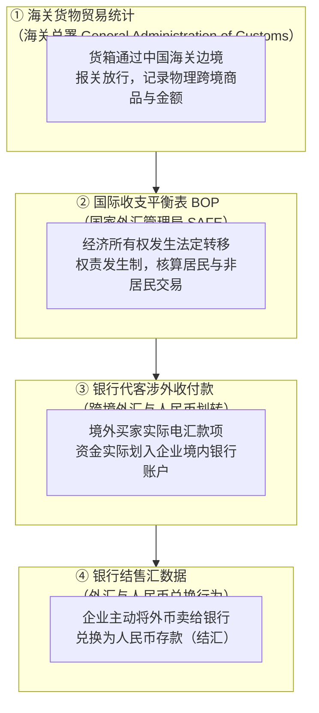
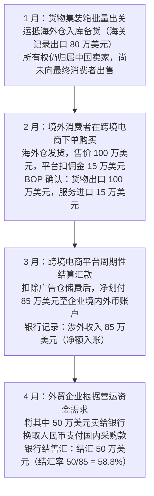
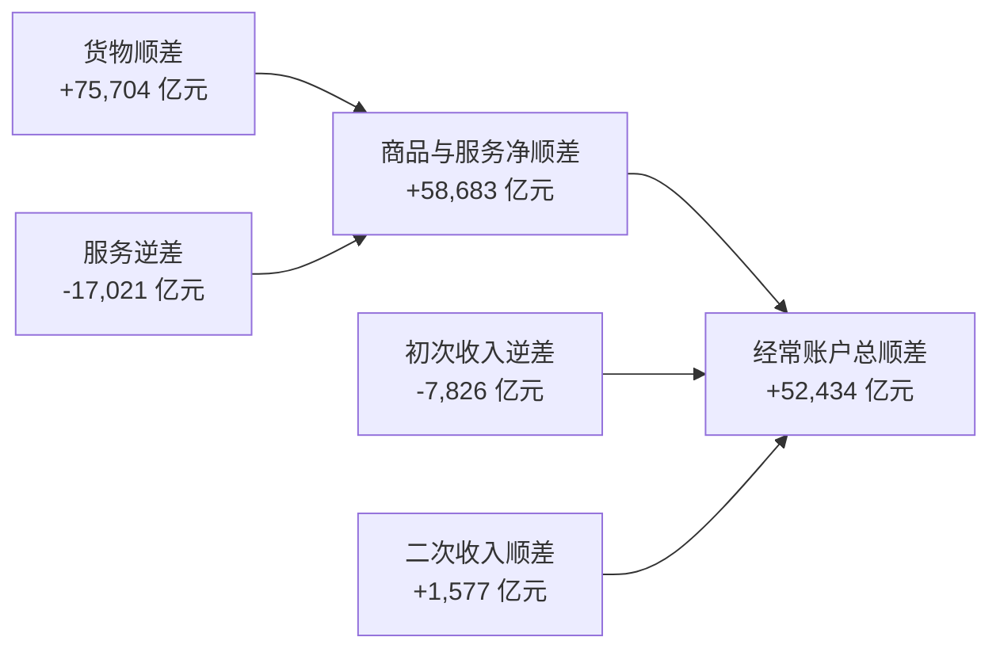
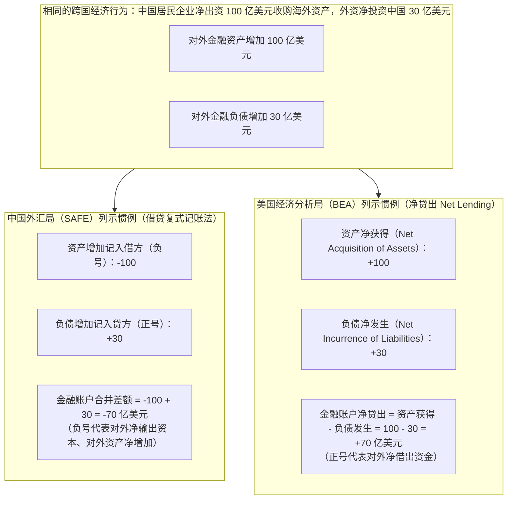

# 27 中国贸易与国际收支的统计桥接

[上一章：信用风险与金融稳定](26-credit-risk-stability.md) · [目录](./) · [下一章：人民币与跨境资金](28-renminbi-cross-border.md)

> 编写于 2026-10-03。真实数据固定采用国家外汇管理局 2026-03-27 发布的 2025 年国际收支平衡表正式数，不代表此后的最新修订值。其余微观企业交易与金额均为教学假设。

**前置阅读：**美国篇 [21 离岸美元与国际收支](https://fangpings.github.io/us-econ/21-global-dollar.html)，中国篇 [05 GDP](05-gdp.md)、[08 月度生产](08-production.md)。居民与非居民概念、复式记账法以及存量与流量的会计恒等式在国际收支中完全适用。在中国宏观经济研究中，投资者经常看到海关公布的“外贸顺差近万亿美元”，但外汇储备却没有同幅增加，甚至银行结售汇还出现了小幅逆差。为什么四套看似相同的“外贸数据”会对不上账？本章带你打通这套统计桥接。

---

## 1. 四套数字分别记录了什么：从物理出关到银行结汇

一家中国外贸企业将一集装箱光伏组件卖到欧洲，从商品出关到人民币落袋，在不同的统计系统中留下了四个截然不同的观察窗口：

| 观察统计窗口 | 主管编制发布部门 | 核心记录对象与统计标准 | 关键记录时点 | 资本市场常见致命误读 |
| :--- | :--- | :--- | :--- | :--- |
| **① 海关货物贸易** | 海关总署（GACC） | 跨越中国海关关境的**物理实体货物移动**（报关单汇总） | 货物通关放行时点 | 误以为海关出口额就等于企业当月收到的现金货款 |
| **② 国际收支货物（BOP）** | 国家外汇管理局（SAFE） | 境内**居民与非居民**之间的经济所有权（Ownership）买卖转移 | 权责发生制所有权转移日 | 误以为国际收支表只是海关报关单换了个抬头抄写一遍 |
| **③ 银行代客涉外收付款** | 外汇局／商业银行系统 | 境内非银行主体通过银行系统与非居民发生的**实际现金收付** | 银行电汇资金到账日 | 误以为所有涉外收入都是美元，且全部源于货物贸易 |
| **④ 银行结售汇** | 外汇局／外汇交易中心 | 客户与商业银行之间发生的**外币与人民币双向兑换** | 兑换交易交割日 | 误以为收到外汇就必须全部结汇，不结汇就等于资金外逃 |

**特别提示：统计上的“中国居民”边界**：
在国际收支平衡表（BOP）中，“居民（Resident）”是一个**经济统计归属概念，不等于国籍，也不等于公司注册地**。[外汇局国际收支编制原则与指标说明](https://www.safe.gov.cn/safe/2015/1230/6080.html)。
- 中国内地在统计上构成独立经济体（不含香港、澳门和台湾地区）。因此，一家内地企业与一家香港注册企业之间的经济往来，全额属于国际收支的居民与非居民交易；
- 外商投资企业（如特斯拉上海工厂）在中国内地长期设立经营，属于**中国居民企业**；其向境外母公司的分红，在国际收支中记作向非居民支付的初次收入。

---

## 2. 海关数据怎样桥接到国际收支货物账户

海关报关单忠实记录了集装箱在物理意义上的进出口。但要将其转入国际收支平衡表（BOP）的“货物”账户，必须经过专业统计调整。[外汇局数据诠释文件](https://www.safe.gov.cn/safe/file/file/20250103/3d46d84085bf43abbbae8c007f615152.pdf)

### 调整一：剥离没有货权转移的“来料加工”
在传统来料加工（Processing with Imported Materials）模式下，原材料和加工后的成品所有权始终归属于境外委托方。
**教学微观算例**：
境外委托商运来价值 $100$ 万美元的芯片原材料，中国加工厂组装成智能手机后运出境，报关货物离岸价值为 $130$ 万美元。中国工厂仅向外方收取加工服务费 $30$ 万美元。

在两套口径下的记录截然不同：
- **海关统计**：记录货物进口 $100$ 万美元，货物出口 $130$ 万美元，显示海关进出口总额为 $230$ 万美元；
- **国际收支 BOP**：因为原材料与手机的**经济所有权从未转移给中国居民**，两笔货物的物理过境不属于中国居民与非居民之间的商品买卖！因此，BOP 既不记货物进口，也不记货物出口，而是在**服务贸易**项下记录一笔“对非居民提供加工服务”的**服务出口 $30$ 万美元**！

两个口径虽然轧差后的净顺差碰巧都是 $30$ 万美元，但国际收支的货物进出口总规模大幅低于海关口径，贸易结构也从“货物”还原成了真实的“服务”。

### 调整二：运保费计价统一（FOB vs CIF 桥接）
- **海关口径**：海关出于征税需要，**出口按离岸价（FOB）**统计，而**进口按到岸价（CIF）**统计（包含了国际海运费与货运保险费）；
- **国际收支口径**：国际货币基金组织（IMF）《国际收支和国际投资头寸手册》（BPM6）统一要求，**进口与出口货物必须全额按离岸价（FOB）入账**。
- **桥接剥离**：外汇局必须将海关进口 CIF 中的国际运保费剥离出来。如果承运船舶是外国非居民船运公司，剥离出来的海运费计入**服务贸易项下的“运输服务进口”**；如果是中远海运等中国居民航运企业承运，则属于居民对居民交易，直接从对外支出中扣除。

### 调整三：无跨境物流的“离岸转手买卖”
随着中国跨国贸易商崛起，中国居民企业在智利采购铜矿后直接运至东南亚销售，货物全程没有进入中国海关关境，海关报关单为零。但在 BOP 中，中国企业取得了商品所有权并转售给非居民，必须全额确认为国际收支下的货物贸易。

---

## 3. 海外仓与跨境电商：平台净额结算的追踪

随着 Shein、Temu、速卖通等跨境电商与海外仓模式爆发，传统的“一票报关对应一笔即期电汇”被彻底打破：

**教学启示**：
1. **时间错位**：海关在 1 月货物出关时就已经记录了出口，但真实消费者的销售发生在 2 月，现金货款直到 3 月才汇入境内，企业直到 4 月才去银行结汇；
2. **总额 vs 净额**：银行流水只看到电汇进来的净额 $85$ 万美元，绝不能误以为商品总货值只有 $85$ 万。在 BOP 核算中必须将其还原为商品总出口 $100$ 万美元与平台服务进口 $15$ 万美元。

---

## 4. 国际收支表的编制与数据修订逻辑

国际收支平衡表绝非一个简单的银行流水汇总表。外汇局的数据源涵盖了海关报关单、银行代客跨境交易申报系统、跨境直接投资企业抽样调查以及外币金融资产申报等多维体系。[外汇局关于国际收支平衡表诠释说明](https://www.safe.gov.cn/safe/2017/0707/6082.html)。

**编制过程遵循严格的“初步数 $\to$ 正式数 $\to$ 历史回溯修订”机制**：
- **季度初步数**：在季后一个月左右发布，主要基于海关高频数据与银行跨境收付估算；
- **年度正式数**：在次年 3 月底发布，结合了更完备的企业年度财务决算、涉外航运保险专业核查以及税收交叉审计；
- **历史追溯修订**：例如在 2026 年 3 月发布的年度报告中，外汇局根据最新的大规模企业运保费抽样调查成果，对历史年度的运输服务支出与货物贸易剥离参数进行了系统性追溯回溯调整。

分析宏观经济时，必须保留相同版本的数据库，切忌将未经追溯的历史旧数据与最新口径混合拼接。

---

## 5. 官方原表带读：走进 2025 年国际收支平衡表

我们查阅国家外汇管理局于 **2026 年 3 月 27 日**正式公布的《2025 年中国国际收支平衡表》（人民币列，单位：亿元）。[外汇局官方发布页面](https://www.safe.gov.cn/safe/2026/0327/27297.html)

| 国际收支项目（BOP） | 2025 年全年正式差额（亿元人民币） | 账户经济性质与资金流动解析 |
| :--- | ---: | :--- |
| **一、经常账户（Current Account）** | **52,434** | **我国实体部门对外取得的净经常性综合顺差** |
| 1. 货物贸易 | 75,704 | 居民与非居民货物进出口差额（BOP 口径顺差） |
| 2. 服务贸易 | -17,021 | 服务进出口差额（主要逆差源于跨境旅游、知识产权与运输） |
| 3. 初次收入 | -7,826 | 对外投资收益（股息利息）与跨境劳动报酬净额 |
| 4. 二次收入 | 1,577 | 经常性单方面转移（海外侨汇、政府捐赠与援助净额） |
| **二、资本和金融账户（Capital & Financial）** | **-55,171** | **对外资产与负债的净交易配置（含储备资产变动）** |
| **三、净误差与遗漏（Net Errors & Omissions）** | **2,737** | **不同数据源与统计时间错配产生的会计平衡残差** |

我们用标准的 BOP 账户勾稽公式核对经常账户的生成过程：
$$
\begin{aligned}
\text{货物与服务总顺差} &= \text{货物差额} + \text{服务差额} \\
&= 75,704 + (-17,021) = 58,683\text{ 亿元}
\end{aligned}
$$
$$
\begin{aligned}
\text{经常账户差额} &= \text{货物和服务差额} + \text{初次收入} + \text{二次收入} \\
&= 58,683 + (-7,826) + 1,577 = 52,434\text{ 亿元}
\end{aligned}
$$

**核心分析结论**：
1. 货物贸易创造了高达 $7.57$ 万亿元的巨额盈余；
2. 但其中被中国居民出境旅游留学（服务逆差 $1.70$ 万亿）以及外商投资企业在华利润分配汇出（初次收入逆差 $7,826$ 亿）部分抵销；
3. 最终留存在经常账户上的真实净购买力盈余为 **$52,434$ 亿元**（约合 7,000 多亿美元），牢牢奠定了中国宏观外部经济的坚固安全垫。

---

## 6. 中美金融账户的正负号：完全相反的列示习惯

许多阅读中美两国国际收支报表的初学者经常产生严重误解：“为什么中国国际收支平衡表里的金融账户是负数？是不是代表中国资金在疯狂外逃？”

答案是：**这是中美两国在国际收支金融账户符号列示上的会计惯例差异！**[美国经济分析局（BEA）国际经济账户指南](https://apps.bea.gov/scb/issues/2021/07-july/0721-iea-primer.htm)

**极度重要的会计准则**：
- 在中国外汇局发布的官方平衡表中，**金融账户的负数（如 2025 年的 -55,171 亿元），绝不代表资产亏损，更不代表资金非法撤离，而是代表中国居民在对外配置资本、对外金融资产发生了净增长！**
- 国际收支恒等式为：
  $$
  \text{经常账户} + \text{资本和金融账户} + \text{净误差与遗漏} = 0
  $$
  在 2025 年：
  $$
  52,434 + (-55,171) + 2,737 = 0
  $$
  经常账户赚取的 $5.24$ 万亿元顺差，通过企业走出去对外直接投资、购买海外有价证券、持有离岸银行外币存款等渠道，平稳对称地配置到了全球金融资产端！

---

## 7. 顺差与民间对外投资：为什么不用全部变成外汇储备

在 2000-2010 年间，中国曾实行“强制结售汇”和以央行结汇为主的机制，企业出口赚到美元后几乎全额卖给商业银行，商业银行再全额转卖给中国人民银行，央行资产负债表上的外汇储备快速暴增至近 4 万亿美元。

但在当前更加市场化的外汇体制下，**顺差实现了“藏汇于民”的资产多元化再平衡**：

**教学算例演示**：
中国某外贸企业通过货物出口净赚经常账户外汇 $100$ 亿美元。该企业没有将这笔资金兑换为人民币，而是选择自主投资配置：
1. 用其中 $40$ 亿美元在墨西哥投资建设新能源汽车零部件工厂（**对外直接投资 FDI 资产增加**）；
2. 用其中 $30$ 亿美元认购中国优质企业发行的离岸中资美元债（**证券投资 Portfolio 资产增加**）；
3. 将剩余 $30$ 亿美元作为外币企业活期存款存放在渣打银行香港分行账户（**其他投资存款资产增加**）。

在国际收支平衡表中的复式记账如下：
- **经常账户**：货物贸易出口贷记 $+100$ 亿美元；
- **金融账户**：对外资产获得增加（借记）借记 $-100$ 亿美元；
- **央行储备资产**：变动恰好为 **$0$**！

顺差完完全全转化为中国微观企业在全球布局的多元化金融资产，根本没有也不需要倒逼央行被动扩表吞吐外汇储备。

---

## 8. 外汇储备余额与国际投资头寸（IIP）：流量 vs 存量

外汇储备月度公布的“3.2 万亿美元”是一个**时点存量（Stock）**概念，而国际收支平衡表记录的是**时期交易流量（Flow）**。两者之间的桥梁是**国际投资头寸表（International Investment Position, IIP）**。

其严格的动态演化核算等式为：
$$
\text{期末头寸余额} = \text{期初头寸余额} + \text{真实交易流量} + \text{资产价格变动} + \text{汇率折算变动} + \text{其他调整}
$$

**教学资产推演**：
假设国家外汇储备某投资组合期初美元折算余额为 $100$ 亿美元：
1. 本月央行在公开市场净买入外汇并进行实际资产配置：**真实交易流量增加 $+5$ 亿美元**；
2. 投资组合中持有的美国国债与全球股票因利率下行价格上涨：**资产价格估值贡献 $+3$ 亿美元**；
3. 本月美元指数强势上涨，储备中持有的欧元、日元资产在折算为美元计价时发生账面汇兑损失：**汇率折算贡献 $-4$ 亿美元**；
4. 暂无其他不可抗力调整。

我们计算期末资产负债表上的外汇储备官方报告存量：
$$
\text{期末余额} = 100 + 5 + 3 + (-4) = 104\text{ 亿美元}
$$

**核心警示**：
官方公布的外汇储备余额环比增加了 $4$ 亿美元（从 $100$ 亿增至 $104$ 亿），但这绝对不等于央行本期在市场上净买入了 $4$ 亿美元外汇！真实的交易买入额是 $5$ 亿美元，其余是被全球股债估值与非美货币汇率波动所对冲。阅读外储月度涨跌，必须剥离资产估值与汇率折算效应。

---

## 9. 中美贸易与外部部门指标权威对照表

| 宏观经济分析领域 | 中国数据源与核心入口 | 美国对应数据源与入口 | 跨国对比必须核查的口径 |
| :--- | :--- | :--- | :--- |
| **物理货物贸易** | 海关总署月度快讯（按美元／人民币） | 美国人口普查局（Census Basis 贸易数据） | 检查是否包含加工贸易、海关关税估价基准（FOB vs CIF） |
| **经济交易贸易** | 外汇局国际收支平衡表（BOP 货物与服务） | 美国 BEA 国际交易账户（ITA BOP Basis 贸易） | 检查离岸转手买卖、海外仓时滞与服务归属 |
| **经常账户全貌** | 外汇局 BOP 季度与年度经常账户正式数 | 美国 BEA 季度经常账户（Current Account） | 检查初次收入中的跨国公司留存利润再投资处理 |
| **金融资产交易** | 外汇局金融账户资产与负债细项（含直接投资、证券投资） | 美国财政部 TIC 跨境资本流动报告与 BEA 金融账户 | 检查正负号列示定义、是否包含官方储备资产 |
| **对外存量头寸** | 外汇局国际投资头寸表（IIP，每季末发布） | 美国 BEA 国际投资头寸表（U.S. Net IIP） | 检查外国持有本国国债比重与对外净债权/净债务地位 |

---

## 10. 自测题与逐步参考答案

### 思考与练习

1. 境外某高科技公司将一批价值 $60$ 万美元的精密芯片送至中国深圳保税区某代工厂，委托其组装为通讯终端。成品出境时报关离岸价为 $75$ 万美元。中国工厂依约收取加工代工费 $15$ 万美元，芯片与成品货权从未转移给中国工厂。请写出海关统计与国际收支平衡表（BOP）分别如何记录该笔交易。
2. 某跨境跨境电商卖家 1 月将一批价值 $80$ 万元的服饰运往美国海外仓备货，2 月在亚马逊平台全额卖出得到 $100$ 万元（平台扣佣金 $15$ 万元），3 月收到平台扣除费用后的净结算款 $85$ 万元，4 月向银行结汇 $50$ 万元。为什么不能把这四个动作累加成“出口了 $315$ 万元”？
3. 根据第 5 节外汇局 2025 年正式数据，货物贸易顺差为 $75,704$ 亿元，服务贸易逆差为 $-17,021$ 亿元，初次收入逆差为 $-7,826$ 亿元，二次收入顺差为 $1,577$ 亿元。请列式计算货物服务总差额及最终经常账户差额。
4. 某国居民当年在海外净买入股票与外债 $80$ 亿美元，同时吸引外国战略资本来华直接投资 $25$ 亿美元。在中国外汇局的国际收支平衡表概览与美国 BEA 净贷出列示方式中，金融账户分别记录为什么数值？
5. 某主权外币资产池期初美元余额为 $200$ 亿美元。当期通过市场交易净配置买入 $10$ 亿美元，持有的全球固定收益资产因牛市价格增值 $+4$ 亿美元，由于非美货币对美元贬值造成汇率折算账面损失 $-7$ 亿美元。请计算期末外币资产池的官方报告余额，并指出余额增量与真实交易增量的差异。
6. 某月海关公布中国实现货物贸易顺差高达 $800$ 亿美元，但同月银行结售汇却录得 $50$ 亿美元逆差。请结合本章机制，至少提出三条合理解释这一背离现象的微观机制。

---

点击展开逐步参考答案与解析

1. **记录说明**：
   - **海关统计**：记录货物进口 $60$ 万美元，货物出口 $75$ 万美元（体现货物的真实物理跨境出入关）；
   - **国际收支 BOP**：由于物权从未向中国居民转移，BOP 货物贸易项下**均不记录货物买卖**；在服务贸易项下记录**加工服务出口 $15$ 万美元**。

2. **解答**：
   这是将同一批商品的物流物理出境、商业法律所有权销售、跨境银行回款与国内换汇四个不同维度的流程动作重复相加：
   - 1 月出关仅属于存货移转（未形成销售）；
   - 2 月向海外消费者销售才在 BOP 确认货物出口 $100$ 万元和服务进口 $15$ 万元；
   - 3 月的 $85$ 万元是应收账款现金结算；
   - 4 月的 $50$ 万元是境内结汇。全部经济产出只有 2 月确认的 $100$ 万元出口，绝不能跨时点重复累加。

3. **计算过程**：
   $$
   \text{货物和服务差额} = 75,704 + (-17,021) = 58,683\text{ 亿元}
   $$
   $$
   \text{经常账户差额} = 58,683 + (-7,826) + 1,577 = 52,434\text{ 亿元}
   $$
   初次收入（外资在华分红利息）与二次收入的加入，使得经常账户最终盈余与纯货物进出口顺差产生明显区分。

4. **解答**：
   - **中国外汇局（借贷法）**：对外资产增加记负（$-80$），对外负债增加记正（$+25$），金融账户差额为：
     $$
     -80 + 25 = -55\text{ 亿美元}
     $$
   - **美国 BEA（净贷出法）**：资产净获得（$+80$）减负债净发生（$+25$），金融账户净贷出为：
     $$
     80 - 25 = +55\text{ 亿美元}
     $$
   两套数字符号完全相反，但描述的是同一个“对外净输出资本 55 亿美元”的跨国经济投资事实。

5. **计算与解析**：
   $$
   \text{期末官方报告余额} = 200 + 10 + 4 + (-7) = 207\text{ 亿美元}
   $$
   - 报告余额账面净增量：$207 - 200 = 7\text{ 亿美元}$；
   - 真实交易净买入量：**$10$ 亿美元**；
   - 两者的 $3$ 亿美元差异完全是由全球金融资产价格上涨（$+4$ 亿）与非美汇率贬值折算损失（$-7$ 亿）等非交易性重估因素引起的。

6. **解答**：
   至少存在以下三条真实机制导致海关顺差与结售汇逆差背离：
   - **机制一（结算时滞与账期）**：外贸企业采用远期信用证或赊销模式，货物虽然报关离境，海外买家尚未到期付款，资金尚未回流；
   - **机制二（藏汇于民与企业留存外汇）**：企业收到美元货款后，因预期人民币可能贬值或因美元存款利率显著高于人民币存款利率，主动将美元保留在银行外币账户中，未向银行结汇；
   - **机制三（非贸易项下的外汇支出对冲）**：同月中国居民出境旅游留学购汇（服务贸易支出）、或者外资企业集中向境外母公司汇出股息红利（初次收入支出），导致全社会总体购汇规模反超了企业出口结汇规模。

---

[上一章：信用风险与金融稳定](26-credit-risk-stability.md) · [目录](./) · [下一章：人民币与跨境资金](28-renminbi-cross-border.md)
