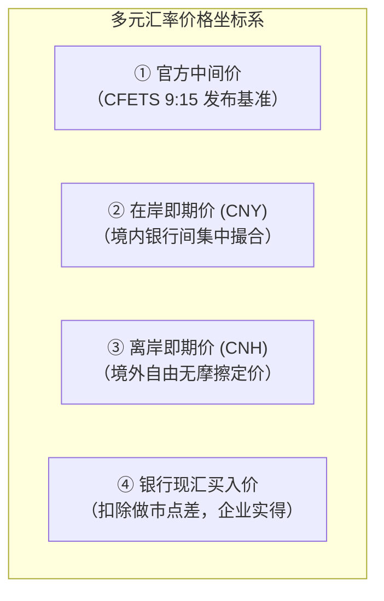
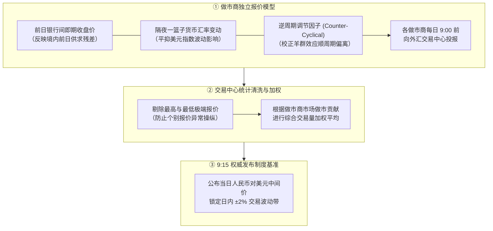
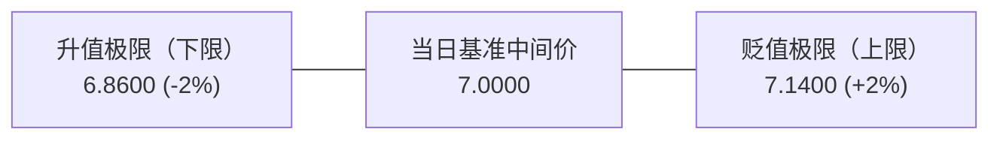
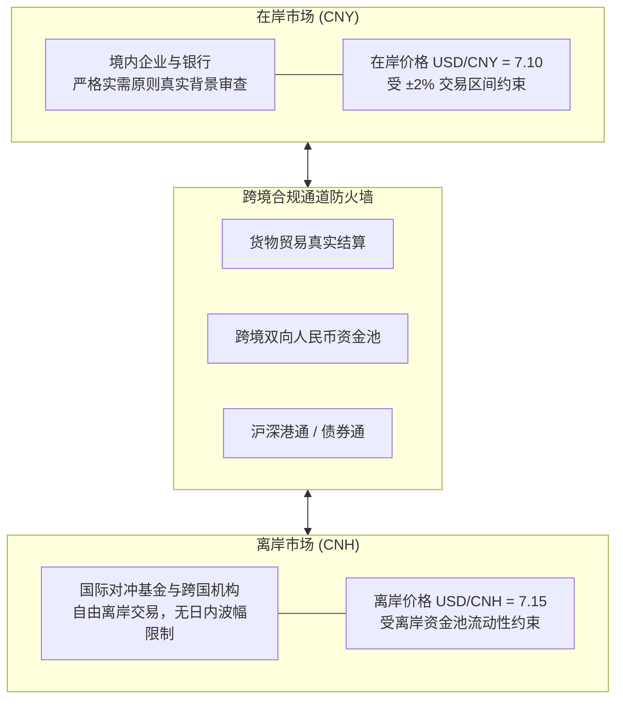

# 28 人民币汇率与跨境资金的形成机制

[上一章：贸易与国际收支](27-trade-balance-payments.md) · [目录](./) · [下一章：资产价格与外部冲击](29-assets-external-shocks.md)

> 编写于 2026-10-03。中间价及指数方法按官方最新说明，历史规则明确标年；银行结售汇数据固定为 2025 年全年权威发布值。微观案例中的汇率、利率、权重均为教学假设。

**前置阅读：**美国篇 [20 外汇与美元定价](https://fangpings.github.io/us-econ/20-fx-and-dollar.html)、[21 离岸美元](https://fangpings.github.io/us-econ/21-global-dollar.html)，中国篇 [17 货币口径](17-money-aggregates.md)、[25 国债利差](25-government-bond-yields.md)、[27 国际收支](27-trade-balance-payments.md)。即期、远期、买卖双向价差与汇率风险对冲的微观金融原理在各国相通。但人民币汇率拥有独特的“中间价形成机制”、“日内上下 2% 交易区间”、“在岸（CNY）与离岸（CNH）双轨市场”以及“逆周期因子调控”，构成了中国开放宏观金融的核心支柱。

---

## 1. 一家外贸企业面对的并不是一个汇率

假设你是一家中国外贸制造企业的财务总监，刚刚收到海外客户电汇到账的 $100$ 万美元货款。为了给国内工人发放工资和支付钢材货款，你准备将美元换成人民币。

此时你打开手机或交易终端，会看到一连串各不相同的人民币报价：

| 汇率报价名称 | 市场定价主体与产生机制 | 微观财务或宏观分析的核心用途 |
| :--- | :--- | :--- |
| **人民币对美元中间价** | 央行授权中国外汇交易中心（CFETS）每日 9:15 权威发布 | 银行间外汇市场的制度性官方基准与日内浮动区间中枢 |
| **在岸即期汇率（USD/CNY）** | 中国境内银行间外汇市场做市商与机构集中撮合成交价 | 反映境内实体贸易结售汇与受监管境内资本流动供需 |
| **离岸即期汇率（USD/CNH）** | 中国香港、新加坡、伦敦等离岸金融中心自由撮合成交价 | 反映国际对冲基金、跨国企业与离岸离散资金的无摩擦预期 |
| **银行客户现汇买入价** | 商业银行向柜面或网银企业客户买入外币现汇的挂牌价 | **外贸企业卖出美元、换回人民币时适用的真实微观成交价格** |
| **远期结售汇合约价** | 约定在未来特定到期日（如 3 个月后）按固定汇率交割的锁汇价 | 帮助涉外企业提前锁定汇率成本、彻底规避未来汇率波动风险 |

**报价方向铁律**：
中国外汇市场统一采用**直接标价法**（每 1 美元折算多少元人民币）。
- 当报价从 $7.00$ 变为 $7.14$ 时，意味着购买 1 美元需要支付更多的人民币，**代表人民币贬值（走弱）、美元升值**；
- 当报价从 $7.14$ 变为 $7.00$ 时，**代表人民币升值（走强）、美元贬值**。
在银行柜台，“买入价”是站在银行作为做市商的视角：企业卖出外汇时，银行是“买方”，适用较低的**现汇买入价**，万不可把银行卖出外币的较高“卖出价”当成自己的收款标准。

---

## 2. 人民币中间价是怎样生成的：从做市商报价到逆周期因子

每天北京时间上午 9:15，中国外汇交易中心（CFETS）都会公布当日的人民币对美元汇率中间价。[中国外汇交易中心中间价机制官方说明](https://www.chinamoney.com.cn/chinese/bkccpr/)。

这个基准价不是拍脑袋定出来的，而是经历了一套严密的数学清洗与宏观审慎调控过程：

### 中间价三因子定价数学模型：
$$
\text{当日做市商报价} = \text{前日收盘价} + \Delta \text{一篮子货币汇率变动} + \text{逆周期因子}
$$

1. **前日收盘价（Closing Rate）**：反映境内银行间市场截至前一交易日 16:30 的外汇实际供求结售汇力量；
2. **一篮子汇率变动（Basket Movement）**：参考 CFETS、BIS、SDR 等一篮子货币隔夜波动，确保人民币在保持一篮子货币基本稳定的前提下跟随国际外汇市场同步调整；
3. **逆周期调节因子（Counter-Cyclical Factor, CCF）**：由做市商在市场出现单边非理性贬值或升值超调预期（“羊群效应”）时主动引入。[中国货币网关于中间价报价引入逆周期因子的说明](https://www.chinamoney.com.cn/chinese/rdgz/20170526/1004571.html)。当市场存在强烈的无序做空贬值冲动时，逆周期因子通过向升值方向修正，有效过滤非理性的市场恐慌噪音。

**教学截尾加权演示**：
假设 5 家做市商报出的中间价分别为：$6.98$、$7.00$、$7.02$、$7.04$、$7.08$。
- 交易中心首先剔除最高值（$7.08$）与最低值（$6.98$）；
- 对剩余的三家（$7.00$、$7.02$、$7.04$）按核定权重（假设为 $20\%$、$50\%$、$30\%$）进行加权：
$$
\text{当日中间价} = 7.00 \times 20\% + 7.02 \times 50\% + 7.04 \times 30\% = 7.0220
$$

---

## 3. 日内浮动区间约束的是哪一个价格

依据中国人民银行 2014 年 3 月发布的公告，**银行间即期人民币兑美元交易价围绕当日中间价上下 2% 的浮动区间内波动**。[中国人民银行公告〔2014〕第 5 号](https://www.chinamoney.com.cn/chinese/zgrmyh/20140317/1002330.html)。

**浮动带数学边界计算**：
假设今日外汇交易中心公布的人民币对美元中间价为 $7.0000$：
$$
\text{日内交易上限（贬值极限）} = 7.0000 \times (1 + 2\%) = 7.1400
$$
$$
\text{日内交易下限（升值极限）} = 7.0000 \times (1 - 2\%) = 6.8600
$$

**理解区间的两大关键细节**：
1. **只约束当日在岸银行间即期成交**：日内即期价格无论如何剧烈波动，都不能击穿 $[6.8600, 7.1400]$ 的硬边界；如果市场贬值压力极大触及 $7.1400$（俗称“触顶”），大行做市商会挂出巨额美元卖单提供流动性；
2. **中间价每日动态移动**：区间绝不意味着人民币全年的最高点只能是 $7.14$！随着次日中间价根据一篮子和供求微调（例如次日中间价调整为 $7.01$），次日的 $\pm 2\%$ 浮动区间会自动平移展开。

---

## 4. 在岸（CNY）与离岸（CNH）市场的价差与跨境防火墙

为什么离岸人民币（CNH）与在岸人民币（CNY）会出现价差？两者是否可以无缝搬砖套利？

### 为什么会出现价差？
- **市场参与者不同**：在岸市场主要由境内进出口企业和中资大行构成，严格遵循“实需原则”（必须凭真实贸易合同和报关单换汇）；离岸市场参与者主要是国际对冲基金、跨国金融机构，交易更为灵活敏锐，对外部宏观冲击（如美联储加息、地缘变局）反应更剧烈。
- **流动性池独立**：离岸人民币资金池规模有限（如香港离岸人民币存款约 1 万亿元左右）。当海外投机力量集中借入离岸人民币做空时，离岸人民币同业拆借利率（CNH HIBOR）可能会急速飙升至 $10\%-20\%$，极高的隔夜做空借贷成本会迅速逼退空头。

### 为什么看似有价差却不能自由套利？
假设某一时刻：在岸 $USD/CNY = 7.10$，离岸 $USD/CNH = 7.15$。
初学者常想：“为什么不在离岸把 1 美元卖出换成 7.15 元人民币，再把 7.15 元人民币拿回在岸按 7.10 买回 1.007 美元，白白无风险赚取 0.05 元？”

**现实套利的四大硬约束**：
1. **实需原则管制**：在岸银行买入美元必须提供真实的贸易单证和报关凭据，金融套利资本无法将资金随意转回境内；
2. **跨境清算通道合规限制**：跨境人民币划转受到企业资金池额度、QDII/QFII 宏观审慎参数等严格调控；
3. **资金交割时间敞口（T+2）**：跨市场划转需要数天，在这期间如果即期汇率发生反向剧烈波动，套利利润会被瞬间抹平甚至产生巨额亏损；
4. **两地做市点差与手续费**：实际买卖价差（Bid-Ask Spread）会吃掉微小的套利空间。

---

## 5. 对美元走弱 vs 对一篮子走强：如何看懂 CFETS 人民币汇率指数

外贸从业者经常面对这样一个现象：“明明人民币对美元贬值了 1%，为什么商务部和央行却说人民币对一篮子货币升值了、汇率更坚挺了？”

这是因为评估一国货币的综合购买力，不能仅仅盯着单一美元，而必须看它对主要贸易伙伴货币加权构成的**有效汇率指数（CFETS 人民币汇率指数）**。[中国货币网关于 CFETS 汇率指数的编制说明](https://www.chinamoney.org.cn/chinese/bkrmbidx/)。

CFETS 指数采用几何加权平均法编制（以 2014 年 12 月 31 日为基期，基点为 100）：
$$
I_t = I_0 \times \prod_{i=1}^n \left( \frac{R_{i,t}}{R_{i,0}} \right)^{w_i}
$$

### 教学双货币极简加权模型：
假设我国贸易伙伴只有美国和欧洲，权重各占 $50\%$（$w_{\text{USD}} = 0.5, w_{\text{EUR}} = 0.5$）。
在某一时段内：
- 国际市场上美元指数全面暴涨，非美货币全线下跌；
- 人民币对美元价值下降了 $2\%$（贬值 $2\%$）；
- 欧元对美元暴跌了 $6\%$，导致人民币对欧元反而相对**升值了 $4\%$**。

我们计算人民币汇率一篮子指数的变动率：
$$
\frac{I_{\text{新}}}{I_{\text{旧}}} = (1 - 0.02)^{0.5} \times (1 + 0.04)^{0.5} = \sqrt{0.98 \times 1.04} = \sqrt{1.0192} \approx 1.00955
$$
$$
\text{指数涨跌幅} = 1.00955 - 1 \approx +0.96\%
$$

**结论**：
虽然人民币对美元双边汇率贬值了 $2\%$，但由于人民币相对欧元等其他非美货币更为坚挺，**全篮子有效汇率指数反而逆势上涨了 0.96%**！在分析我国出口综合价格竞争力时，CFETS 一篮子指数比单纯的对美元双边汇率具有更全面的宏观解释力。

---

## 6. 银行结售汇数据是怎样产生的

国家外汇管理局每月发布的“银行结售汇”与“银行代客涉外收付款”，是观察外汇市场微观资金博弈的最重要温度计。[外汇局 2025 年 12 月统计发布及指标说明](https://www.safe.gov.cn/beijing/2026/0129/2695.html)。

我们通过一家外贸企业的微观资金流水看清其记账原理：

**教学全流程流水**：
某高新技术出口企业本月实际收到境外买家电汇支付的货款 $100$ 万美元：
1. 企业当月根据运营资金需求，在银行柜面将其中 $40$ 万美元兑换为人民币：**即期结汇录得 $40$ 万美元**；
2. 企业预期未来可能需要进口芯片，将 $30$ 万美元保留在企业境内美元活期账户：**外汇存款留存 $30$ 万美元（未结汇）**；
3. 企业因采购境外软件，直接从该外币账户向境外非居民软件商电汇划转 $30$ 万美元：**代客涉外付款 $30$ 万美元**；
4. 企业为防止未来 3 个月人民币升值侵蚀利润，与银行新签订了一份“3 个月后按 7.05 结汇 20 万美元”的远期合约（尚未到期交割）：**远期结汇签约录得 $20$ 万美元**。

本月在官方统计报表中的准确记录为：
$$
\text{本月银行代客涉外收入} = 100\text{ 万美元}
$$
$$
\text{本月银行代客涉外付款} = 30\text{ 万美元}
$$
$$
\text{本月实际完成即期结汇} = 40\text{ 万美元}
$$
$$
\text{本月新增远期签约额} = 20\text{ 万美元（属于表外承诺，不可混入本月即期结汇！）}
$$

企业当月的真实**结汇率（Foreign Exchange Settlement Ratio）**为：
$$
\text{客户结汇率} = \frac{\text{实际结汇金额}}{\text{涉外外汇收入}} = \frac{40}{100} = 40.0\%
$$

---

## 7. 官方原表带读：结售汇差额 vs 涉外收付款差额

我们查阅外汇局公布的 **2025 年全年正式银行数据**：
- **银行结售汇数据**：全年银行结汇 $25,949$ 亿美元，银行售汇 $23,983$ 亿美元，**银行结售汇顺差为 1,966 亿美元**；
- **银行代客涉外收付款**：涉外收入 $79,725$ 亿美元，涉外付款 $76,704$ 亿美元，**涉外收付款顺差为 3,021 亿美元**。

我们计算两套差额：
$$
\text{结售汇顺差} = 25,949 - 23,983 = 1,966\text{ 亿美元}
$$
$$
\text{涉外收付款顺差} = 79,725 - 76,704 = 3,021\text{ 亿美元}
$$

**为什么两者相差高达 1,055 亿美元？**
1. **币种范围完全不同**：代客涉外收付款统计中，**有将近一半直接采用人民币进行跨境结算**（不需要发生外币兑换）；而结售汇仅仅统计外币与人民币之间的真实现金兑换交易；
2. **银行自身业务差异**：结售汇包含了银行自身资本金结售汇及代客业务，而涉外收付款仅统计非银行客户群体；
3. **不能胡乱相除**：绝对不能拿 $1,966$ 亿美元除以 $3,021$ 亿美元来算所谓的“结汇率”，因为分子和分母的币种与统计口径完全脱节！

---

## 8. 中美利差与远期定价：抛补利率平价（CIP）实务

当企业与银行签订 1 年期远期锁汇合同时，银行报出的远期汇率是如何确定的？

依据**抛补利率平价（Covered Interest Parity, CIP）**，在没有套利空间的理想金融市场中，以“每美元折合人民币”表示的一年期远期汇率 $F$ 严格由即期汇率 $S$ 以及两国的无风险融资利率决定：
$$
F = S \times \frac{1 + r_{\text{CNY}}}{1 + r_{\text{USD}}}
$$

### 经典教学计算：
假设当前在岸即期汇率 $S = 7.0000$。
- 境内人民币 1 年期无风险融资利率 $r_{\text{CNY}} = 2.0\%$；
- 境外美元 1 年期无风险拆借利率 $r_{\text{USD}} = 4.0\%$。

我们计算理论远期锁汇汇率：
$$
F = 7.0000 \times \frac{1 + 0.02}{1 + 0.04} = 7.0000 \times \frac{1.02}{1.04} \approx 6.8654
$$
$$
\text{远期升贴水点数 (Forward Points)} = F - S = 6.8654 - 7.0000 = -0.1346\text{ 元}
$$

**至关重要的交易学启示**：
- 远期汇率折价 $1346$ 个基点（点数贴水），锁定为 $6.8654$；
- **这个“6.8654”仅仅反映了两国 2% 的利差贴息关系，绝对不代表外汇市场一致预期 1 年后人民币必然升值到 6.8654！**
- 企业在锁定汇率时，必须理性接受利差贴水成本，结合自身生产利润率统筹规划对冲策略。

---

## 9. 人民币国际化进程的四大核心功能维度

在探讨人民币国际化时，不能仅凭某一个排行榜单就夸大或低估人民币的真实全球地位。[中国人民银行人民币国际化报告 2025](https://www.pbc.gov.cn/huobizhengceersi/214481/3871621/5885243/2025122616492523798.pdf)。

国际化货币的地位必须严格分解为四个不可替代的维度：

| 货币核心功能 | 对应微观观察对象与官方报表 | 常见偷换概念与误区 |
| :--- | :--- | :--- |
| **① 计价货币（Unit of Account）** | 跨境贸易合同发票与国际大宗商品合约计价币种 | 误以为只要用人民币付款，合同就一定是用人民币计价 |
| **② 支付结算货币（Medium of Exchange）** | SWIFT 国际支付份额、人民币跨境支付系统（CIPS）金额 | 仅以某一局部报文系统的排名代替全口径跨国结算全貌 |
| **③ 投融资货币（Financing / Investment）** | 国际商业贷款、点心债、熊猫债发行额与外资持债规模 | 误以为只要经常账户结算多，资本项下融资就同步发达 |
| **④ 官方储备货币（Reserve Currency）** | IMF 官方外汇储备货币构成（COFER）中人民币资产占比 | 误以为跨国央行持有人民币的比例等同于双边贸易份额 |

中国跨境收付款中人民币占比已超过 $50\%$，显著降低了境内企业的汇率兑换风险；但在全球外汇储备与跨境金融投资配置中，人民币的国际化仍处于从“贸易结算为主”向“全球安全资产与流动性储备”稳步演进的深水区。

---

## 10. 自测题与逐步参考答案

### 思考与练习

1. 某日外汇交易中心公布的人民币对美元中间价为 $7.0000$。根据银行间即期交易规则，当日银行间在岸即期市场（USD/CNY）允许成交的最高价与最低价分别是多少？这个区间是相对于昨天的收盘价计算的吗？
2. 某一交易时刻，在岸即期价为 $USD/CNY = 7.1000$，离岸即期价为 $USD/CNH = 7.1500$。能否直接断定境内外投资者每买卖 1 美元就能无风险净赚 $0.05$ 元套利收益？请列出至少三道现实阻碍。
3. 假设构建一个人民币汇率一篮子指数，其中美元权重为 $50\%$，欧元权重为 $50\%$。在特定观察期内，人民币对美元贬值 $2\%$，而人民币对欧元升值 $4\%$。请列式计算该一篮子指数的相对变动百分比。
4. 某外贸企业本月涉外出口收汇 $100$ 万美元，当期在银行即期结汇 $40$ 万美元，同时新签约了一份 $20$ 万美元的 6 个月远期结汇合约。该企业本月在官方结售汇统计中计入的真实即期结汇额是多少？
5. 根据 2025 年官方正式数，银行结售汇顺差为 $1,966$ 亿美元，而银行代客涉外收付款顺差为 $3,021$ 亿美元。能否用 $1,966 / 3,021$ 算出当年的“全社会外贸出口结汇率”？为什么？
6. 在即期汇率为 $7.0000$、人民币利率为 $2\%$、美元利率为 $4\%$ 的市场环境下，一年期远期理论汇率约为 $6.8654$。这是否证明外汇市场一致预期 1 年后人民币对美元即期汇率必然会升值到 $6.8654$？

---

点击展开逐步参考答案与解析

1. **计算与解析**：
   $$
   \text{日内最高成交价（贬值极限）} = 7.0000 \times (1 + 2\%) = 7.1400
   $$
   $$
   \text{日内最低成交价（升值极限）} = 7.0000 \times (1 - 2\%) = 6.8600
   $$
   **不是相对于昨天收盘价**。波幅区间严格以当日 9:15 交易中心发布的**当日中间价**为中枢计算。

2. **解答**：
   绝不能断定。现实跨市场套利面临多重无法逾越的刚性摩擦：
   - **实需原则约束**：在岸市场购汇必须具备真实经贸背景与报关单证，金融套利资本无法合规进出；
   - **跨境资金通道额度限制**：两地人民币资金划转受宏观审慎参数管制，资金无法无限量、无障碍瞬间跨境调拨；
   - **交割时滞风险与做市点差**：跨境调拨存在结算时间差（通常 T+1 或 T+2），两地银行双向买卖价差（Spread）及离岸融资借贷成本会吞噬绝大部分纸面价差。

3. **计算过程**：
   $$
   \frac{I_{\text{新}}}{I_{\text{旧}}} = (1 - 0.02)^{0.5} \times (1 + 0.04)^{0.5} = \sqrt{0.98 \times 1.04} = \sqrt{1.0192} \approx 1.00955
   $$
   $$
   \Delta I = 1.00955 - 1 \approx +0.96\%
   $$
   该一篮子指数逆势上涨约 $0.96\%$。

4. **解答**：
   真实的即期结汇额仅为 **$40$ 万美元**。新签的 $20$ 万美元远期合约属于衍生品信用承诺，在未到期实际执行交割前，绝不能混入当月现货结售汇统计中。

5. **解答**：
   绝不能这样计算。
   - **口径严重脱离**：代客涉外收付款中包含大规模**跨境人民币直接收付**（占比近半），不发生任何外汇兑换；而银行结售汇仅核算外汇兑换成人民币的交易；
   - **主体范围差异**：结售汇包含了商业银行自身资本金与营运资金的兑换，而收付款仅包含非银行实体客户；
   - 两个差额属于不同账户口径，直接相除在经济学上没有任何统计学意义。

6. **解答**：
   完全不能证明。根据抛补利率平价（CIP），远期汇率 $F = 6.8654$ 仅仅是**消除跨国无风险无套利机会的理论资金定价均衡结果**，本质上是反映了中美两国当前存在 $2\%$ 的利差。远期贴水点数是对利差的补偿，不代表市场对未来即期走势的确定性预期。

---

[上一章：贸易与国际收支](27-trade-balance-payments.md) · [目录](./) · [下一章：资产价格与外部冲击](29-assets-external-shocks.md)
