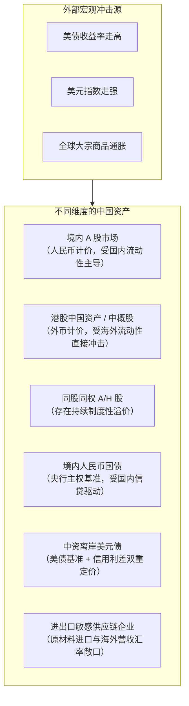
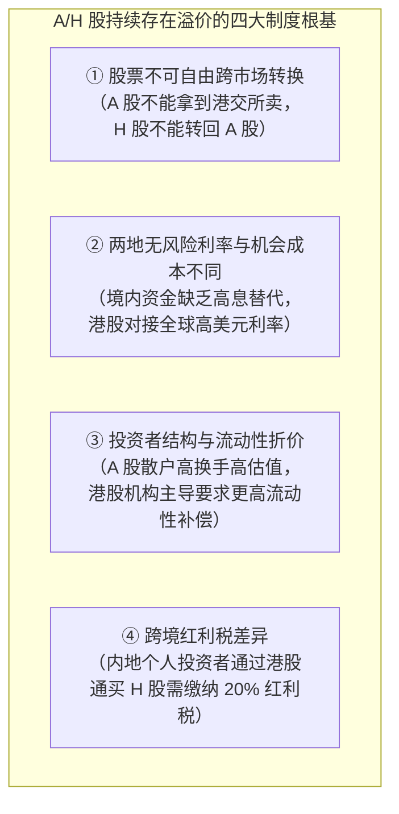
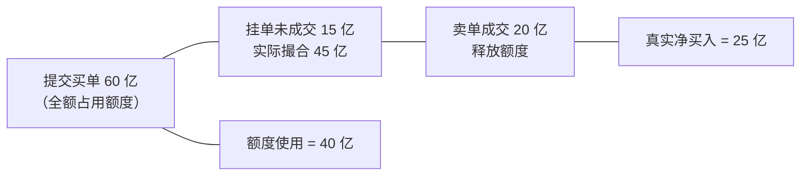
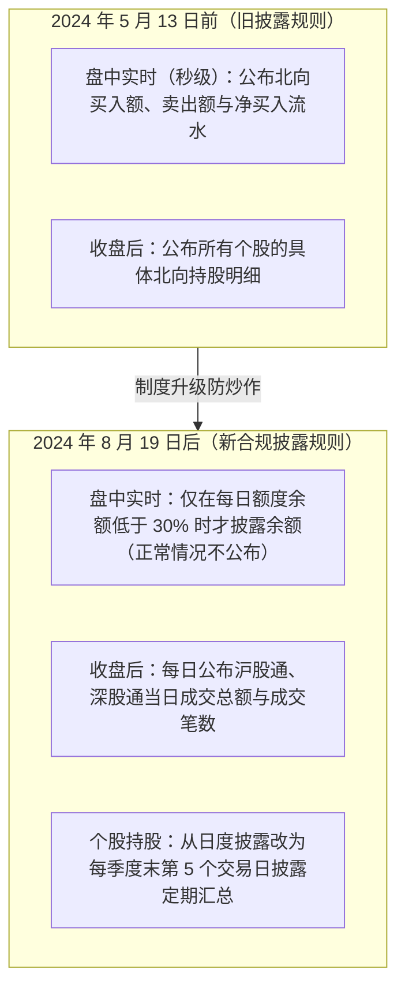
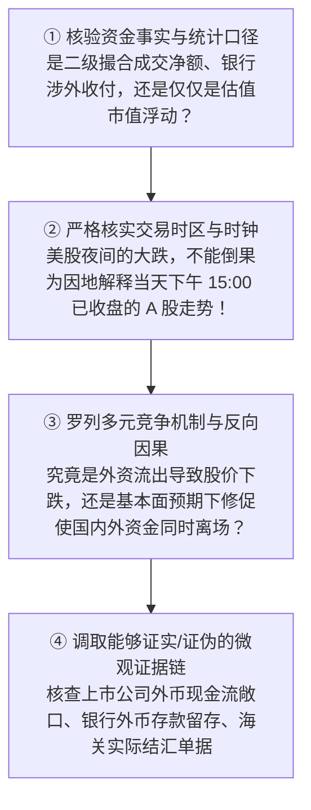

# 29 中国资产价格与外部冲击的传导

[上一章：人民币与跨境资金](28-renminbi-cross-border.md) · [目录](./) · [下一章：A 股指数](30-equity-indices.md)

> 编写于 2026-10-03。沪深港通披露带读固定讨论 2024 年公告及实施节点，不将旧规则自动外推为永久规则。其余价格、微观企业财务数据和持仓数据均为教学假设。

**前置阅读：**美国篇 [22 股票与指数](https://fangpings.github.io/us-econ/22-assets-and-global.html)、[24 估值与宏观传导](https://fangpings.github.io/us-econ/24-equity-valuation.html)、[25 资金与波动](https://fangpings.github.io/us-econ/25-equity-flows-and-volatility.html)、[26 商品与跨资产](https://fangpings.github.io/us-econ/26-commodities-and-cross-asset.html)，中国篇 [25 国债](25-government-bond-yields.md)、[26 信用风险](26-credit-risk-stability.md)。企业盈利、贴现率、风险溢价与撮合成交的资产定价原理全球相通。但在中国开放经济环境中，离岸与在岸的市场分割、特殊的跨境资金通道、外币计价现金流以及数据披露规则的演进，使得外部宏观冲击向中国资产的传导具备了独特的制度轨迹。

---

## 1. 先确定哪一种中国资产受到冲击

在金融媒体的标题党中，常常出现“美联储加息，中国资产全线承压”这类大而化之的叙事。但在资产配置实务中，“中国资产”绝不是一个同质化的单一品种：

| 观察细分资产类别 | 资产定价核心驱动因素 | 常见跨市场混淆与分析硬伤 |
| :--- | :--- | :--- |
| **境内 A 股** | 境内宏观经济基本面、上市公司人民币盈利、国内银行间流动性（DR007、央行政策） | 误以为海外市场下跌，A 股企业就必然发生同等基本面恶化 |
| **香港上市中资股（H 股/红筹）** | 港币或美元计价，海外机构风险偏好，离岸全球流动性折现 | 误以为港币报价就代表企业只受香港本地微观经济影响 |
| **同一公司的 A 股与 H 股** | 股份不可跨市场直接跨所自由转让，两地做市点差与税费 | 误以为两地价格存在差异就一定存在无风险即时搬砖套利机会 |
| **境内人民币国债** | 中国人民银行货币政策立场、商业银行资产配置需求、国内通胀中枢 | 误以为中美利差扩大，中国国债收益率就必须无条件跟随美债暴涨 |
| **中资境外美元债** | 同期限美国国债基准收益率 $+$ 企业信用违约利差（Spread） | 仅关注发行人的中国母公司背景，忽视其美元再融资成本暴增 |
| **进口原材料依赖型企业** | 国际大宗商品美元报价 $\times$ 人民币即期汇率的双重成本共振 | 误以为单纯的人民币贬值就必然对所有外贸企业构成纯利好 |

因此，分析外部冲击时，必须同时锁定六大属性：**法律发行人、并表上市架构、营收结算币种、负债借款币种、交易市场规则与持有人结构**。

---

## 2. 指数走势差异：先从行业构成与样本权重寻找答案

当我们看到“美股纳斯达克大涨，而代表中国市场的某指数表现平平”时，切忌立刻得出“中国企业技术落后”的草率结论。很多时候，**指数走势的巨大分化纯粹是由行业编制权重的数学结构决定的**。

### 教学指数权重对比模型：
假设构建两个完全覆盖相同两家企业的指数，但编制权重不同：
- **甲指数（重资产制造占主导）**：高端制造业权重为 $70\%$，互联网平台服务业权重为 $30\%$；
- **乙指数（平台服务占主导）**：高端制造业权重为 $30\%$，互联网平台服务业权重为 $70\%$。

某日，全球资本市场迎来人工智能浪潮，平台服务业股票暴涨 $10\%$，而制造业股票因原材料价格扰动收盘不涨不跌（涨幅 $0\%$）。

我们计算两只指数当天的回报率：
$$
\text{甲指数回报} = 70\% \times 0\% + 30\% \times 10\% = 3.0\%
$$
$$
\text{乙指数回报} = 30\% \times 0\% + 70\% \times 10\% = 7.0\%
$$
$$
\text{两指数收益率差距} = 7.0\% - 3.0\% = 4.0\text{ 个百分点}
$$

**核心洞见**：
两个指数整整相差了 4 个百分点！但底层没有任何一家具体公司的表现更好或更差。沪深 300 包含了大量的银行、白酒、传统能源和高端制造等重资产现金流实体，而恒生科技指数或纳斯达克中国金龙指数则高度由互联网与生物医药巨头构成。在做跨市场对比前，**必须先完成行业结构的基准对齐（Sector Neutralization）**。

---

## 3. A 股与 H 股的价差：同一家公司为什么有两个价格

“同股、同权、同分红”的同一家中国上市公司（如工商银行、中石油、比亚迪），在内地 A 股以人民币交易，在香港 H 股以港币交易。两者的价格为何长期存在显著的“A/H 股溢价”？[香港交易所关于内地发行人规则的咨询报告](https://www.hkex.com.hk/-/media/HKEX-Market/News/Market-Consultations/2016-Present/February-2023-Mainland-China-Regulation/Conclusions-%28Jul-2023%29/cp202302cc.pdf)。

### A/H 股溢价率的标准算式：
假设某大型央企：
- A 股每股现价 $P_{\text{A}} = 12.00$ 元人民币；
- H 股每股现价 $P_{\text{H}} = 10.00$ 港元；
- 当日人民币对港元汇率中间价为：每 1 港元兑换 $0.90$ 元人民币（汇率 $E = 0.90$）。

#### 第一步：将港币计价的 H 股折算为等价人民币价格
$$
P_{\text{H (折合人民币)}} = 10.00 \times 0.90 = 9.00\text{ 元人民币}
$$

#### 第二步：计算 A 股相对 H 股的真实溢价率（Premium）
$$
\text{A/H 溢价率} = \frac{P_{\text{A}}}{P_{\text{H (折合人民币)}}} - 1 = \frac{12.00}{9.00} - 1 \approx 33.33\%
$$

*致命计算错误*：如果直接用 $(12 - 10) / 10 = 20\%$，就是彻底漏掉了港币与人民币之间的汇率折算！

**结论**：A/H 溢价是两地资本流动边界、法币流动性成本和交易制度摩擦的综合产物。不能看到 $33.33\%$ 的溢价就认定港股一定存在“超额套利送钱机会”。

---

## 4. 北向与南向资金：通道数据不是全口径跨境资本

在财经自媒体上，“北向资金（聪明钱）大买 100 亿”常常被奉为主力操盘的圣经。然而从金融统计学来看，**互联互通渠道（Stock Connect）仅仅是跨境投资的一个特定子集**。[香港交易所互联互通机制权威指南](https://www.hkex.com.hk/Mutual-Market/Connect-Hub/Stock-Connect?sc_lang=en)。

### 澄清一：额度使用额（Quota Balance）$\neq$ 真实成交净买入（Net Turnover）
在互联互通日常运行中，港交所公布的“每日额度余额”与“实际成交金额”往往存在显著差距：

**教学算例拆解**：
某交易日上午 10:30，北向每日额度总上限为 $100$ 亿元：
- 境外投资者累计提交的买入有效申报订单为 $60$ 亿元（系统撮合前全额占用额度）；
- 其中实际撮合成交的买单为 $45$ 亿元，其余 $15$ 亿元订单仍在交易所主机排队挂单；
- 境外投资者实际撮合成交的卖出金额为 $20$ 亿元。

我们计算当时的指标差异：
$$
\text{当时系统额度占用} = 60 - 20 = 40\text{ 亿元}
$$
$$
\text{当时额度剩余余额} = 100 - 40 = 60\text{ 亿元}
$$
$$
\text{微观真实成交净买入} = \text{买入成交} (45) - \text{卖出成交} (20) = 25\text{ 亿元}
$$

额度使用（$40$ 亿）与真实净买入（$25$ 亿）相差了整整 $15$ 亿元！因为额度管理遵循的是审慎风控原则（只要申报挂单就必须冻结额度），未成交的委托单不能直接等同于落袋的真实股票购买。

### 澄清二：二级市场买卖不为上市公司增加任何资本金
境外资金在二级市场通过北向买入 100 亿元中国上市公司股票，交易对手是境内卖出股票的基金或散户。资金在买卖双方之间完成结算，**上市公司的银行账户没有因此多出一分钱现金**，决不能将其与一级市场“企业直接融资”混为一谈。

---

## 5. 官方资料带读：2024 年北向资金披露制度重大改革

为了引导市场树立长期价值投资理念、防止高频量化机构利用盘中“北向资金异动”制造非理性的跟风踩踏，沪深港三家交易所于 **2024 年 4 月 12 日**联合公布了互联互通信息披露机制的系统性调整方案，并分别于当年 **5 月 13 日**和 **8 月 19 日**分阶段平稳实施。[港交所关于信息披露调整的公告及实施通知](https://www.hkex.com.hk/-/media/HKEX-Market/Services/Circulars-and-Notices/Participant-and-Members-Circulars/HKSCC/2024/ce_HKSCC_NOM_217_2024.pdf)。

**数据分析专业警示**：
如果你在 2024 年下半年之后的某金融终端上，仍然看到声称是“今天盘中实时北向资金净流入曲线”，你必须高度警惕：这绝对不再是官方交易所提供的原始成交数据，而是数据服务商基于盘口报价自编的第三方估计模型！在专业严肃研究中，不得使用这类估算数据冒充官方披露。

### 持仓市值增加 $\neq$ 资金主动净买入
假设期初某外资主权基金持有某 A 股龙头公司 $100$ 万股，期初股价为 $10$ 元，持仓市值为 $1,000$ 万元。
期末该基金一股未动（持股仍为 $100$ 万股），但由于国内宏观政策利好，该股票二级市场价格涨至 $12$ 元。
此时：
$$
\text{期末持仓市值} = 100 \times 12 = 1,200\text{ 万元}
$$
$$
\text{持仓市值增加额} = 1,200 - 1,000 = +200\text{ 万元}
$$
$$
\text{真实资金净买入流量} = 0\text{ 元！}
$$

市值增长完全来自**存量资产价格重估（Capital Gain）**，没有任何新资金流入。如果不剔除股价涨幅，直接把持仓市值的增加当作“外资净流入”，就会造成巨大的虚假因果倒置。

---

## 6. 人民币汇率变动怎样进入外贸企业的微观利润

在传统认知中，“人民币贬值必然利好出口企业”被当成金科玉律。但在全球供应链深度交织的今天，汇率传导必须用企业微观损益表严格计算：

### 教学情景模型：
某精密仪器出口企业本期生产经营财务如下（假设所有交易同期现金结算，无外汇对冲）：
- 出口海外确认的**美元销售收入**：$100$ 万美元；
- 制造该产品必须从日本和德国进口关键精密元器件，发生**美元进口采购成本**：$40$ 万美元；
- 在国内支付的工人工资、厂房租金及水电等**人民币本地固定成本**：$350$ 万元人民币。

我们对比汇率变动前后的企业税前营业利润：

#### 情形一：基准即期汇率 $USD/CNY = 7.00$
$$
\text{人民币总营业收入} = 100 \times 7.00 = 700\text{ 万元}
$$
$$
\text{进口原材料人民币成本} = 40 \times 7.00 = 280\text{ 万元}
$$
$$
\text{企业净利润} = 700 - 280 - 350 = 70\text{ 万元}
$$

#### 情形二：人民币贬值至 $USD/CNY = 7.14$（物理销量与美元售价不变）
$$
\text{人民币总营业收入} = 100 \times 7.14 = 714\text{ 万元}
$$
$$
\text{进口原材料人民币成本} = 40 \times 7.14 = 285.6\text{ 万元}
$$
$$
\text{企业净利润} = 714 - 285.6 - 350 = 78.4\text{ 万元}
$$
$$
\Delta \text{净利润} = 78.4 - 70 = +8.4\text{ 万元}
$$

我们通过**外汇净敞口（Net FX Exposure）**验算利润增量：
$$
\Delta \text{利润} = (\text{美元销售收入} - \text{美元进口成本}) \times \Delta E = (100 - 40) \times (7.14 - 7.00) = 60 \times 0.14 = 8.4\text{ 万元}
$$
利润增加额只有 $8.4$ 万元，绝对不是媒体渲染的“收入增加了 14 万元”！因为进口原材料同样因为贬值而变贵了 $5.6$ 万元。

#### 情形三（致命情景）：汇率贬值伴随海外需求萎缩与订单滑坡
假设海外因通胀滞胀陷入衰退，该企业海外订单缩减 $10\%$，美元收入降至 $90$ 万美元，进口元器件按比例降至 $36$ 万美元，但国内人员工资与厂房折旧 $350$ 万元具有刚性无法压缩：
$$
\text{恶化情景下的企业净利润} = (90 - 36) \times 7.14 - 350 = 54 \times 7.14 - 350 = 385.56 - 350 = 35.56\text{ 万元}
$$
此时，**哪怕人民币贬值到了 7.14，企业的净利润反而从 70 万元腰斩至 35.56 万元！**
*结论*：对于外贸制造业而言，**海外最终有效需求的景气度（订单量），其重要性往往压倒单一汇率变动带来的微弱折算红利**。

---

## 7. 外部利率与信用利差的剥离：境外中资美元债案例

当中资企业在香港或新加坡发行境外美元债时，其综合融资利率受制于海外双重宏观力量的夹击：
$$
\text{中资境外美元债到期收益率} = \text{同期限美国国债无风险利率} + \text{企业信用违约溢价 (Spread)}
$$

**教学资产异动数据**：
某中国优质民营企业发行了一期 3 年期境外美元债：
- **前期基准状态**：3 年期美债收益率为 $4.0\%$，该企业国际信用利差为 $3.0\%$，综合发债融资成本为：
  $$
  r_0 = 4.0\% + 3.0\% = 7.0\%
  $$
- **后期异动状态**：美联储为应对经济下行开启降息，3 年期美债收益率下调至 $3.5\%$（美债基准下降 $50\text{ bp}$）；但由于国际资本对该企业所在行业的信用担忧加剧，其二级市场信用利差大幅走阔至 $5.0\%$（利差恶化 $200\text{ bp}$）。
- **后期综合融资成本**：
  $$
  r_1 = 3.5\% + 5.0\% = 8.5\%
  $$
  $$
  \Delta r = 8.5\% - 7.0\% = +1.5\% = +150\text{ bp}
  $$

**分析结论**：
虽然美联储降息了 $50$ 个基点，但该企业的真实美元发债成本反而**暴涨了 150 个基点**！海外基准利率的下行，完全无法掩盖微观信用基本面恶化带来的风险溢价激增。分析海外融资条件，绝不能只盯着美联储议息决议。

---

## 8. 大宗商品与汇率的双重成本冲击：拒绝简单线性相加

中国作为全球最大的原油、铜铁矿石等基础资源净进口国，当下游制造业面临国际商品暴涨和本币贬值同时发生时，面临严酷的“双重输入型成本冲击”。

**教学算例演示**：
假设某化工厂进口生产用化工原料：
- 原美元单价：每吨 $80$ 美元，当日汇率为 $USD/CNY = 7.00$；
- 国际商品市场因地缘冲突，原料美元价格暴涨 $10\%$ 至每吨 $88$ 美元；
- 同期在岸人民币对美元汇率贬值 $2\%$，即期汇率变动至 $USD/CNY = 7.14$。

我们计算微观企业每吨原材料的人民币实际采购成本：
$$
\text{原每吨采购成本} = 80 \times 7.00 = 560\text{ 元人民币}
$$
$$
\text{新每吨采购成本} = 88 \times 7.14 = 628.32\text{ 元人民币}
$$
$$
\text{实际综合涨幅} = \frac{628.32}{560} - 1 = \frac{628.32 - 560}{560} \approx 12.20\%
$$

用复利数学公式验证：
$$
(1 + 10\%) \times (1 + 2\%) - 1 = 1.10 \times 1.02 - 1 = 1.122 - 1 = 12.20\% \neq 12.00\%
$$
实际成本增幅达到 **$12.2\%$**，高于直接线性相加的 $12\%$。这种成本上升会直接侵蚀下游中游工业企业的毛利率，通过 PPI 向工业出厂端传导，但它是否会推高终端 CPI，还取决于消费品竞争格局与居民有效购买力的吸纳能力。

---

## 9. 怎样审计一条“外部冲击引发股汇双杀”的宏观研报

在面对自媒体或研报中天花乱坠的叙事时，建议按以下四步进行专业事实审计：

---

## 10. 自测题与逐步参考答案

### 思考与练习

1. 教学模型中，甲指数由制造（$70\%$）与服务（$30\%$）构成，乙指数由制造（$30\%$）与服务（$70\%$）构成。在制造涨跌为 $0\%$、服务上涨 $10\%$ 时，两只指数收益率各为多少？能否仅凭这一数据断言“甲指数所代表的实体经济经营陷入停滞”？
2. 某公司 A 股现价为 $12.00$ 元人民币，H 股现价为 $10.00$ 港元，港元兑人民币汇率为 $0.90$。请计算该公司的 A/H 溢价率。如果两地存在持续的溢价，能否成为普通境内投资者立竿见影的“无风险发财密码”？
3. 某日北向资金每日初始额度为 $100$ 亿元，盘中累计提交买入申报 $60$ 亿元，其中实际撮合成交 $45$ 亿元，挂单未成交 $15$ 亿元；累计卖出撮合成交 $20$ 亿元。请分别计算当时盘中展示的“额度占用额”与微观真实的“成交净买入额”。
4. 某外资机构期初持有某 A 股白酒龙头 $100$ 万股，期末股数未变仍为 $100$ 万股。股价由 $10$ 元涨至 $12$ 元，持仓市值净增 $200$ 万元。为什么研报中绝不能将这 $200$ 万元写成“外资当期净流入买入 200 万元”？
5. 某企业出口销售 $100$ 万美元，进口元器件支出 $40$ 万美元，国内固定成本 $350$ 万元。当人民币对美元由 $7.00$ 贬值到 $7.14$ 时，企业的微观净利润为什么只增加了 $8.4$ 万元，而不是按总收入增加的 $14$ 万元？
6. 某大宗商品进口美元价格上涨 $10\%$，同日人民币对美元汇率贬值 $2\%$。请计算企业承担的人民币综合采购成本涨幅，并说明为什么不能把这个涨幅直接照搬为国内的 CPI 居民消费通胀率。

---

点击展开逐步参考答案与解析

1. **计算与解析**：
   $$
   \text{甲指数涨幅} = 70\% \times 0\% + 30\% \times 10\% = 3.0\%
   $$
   $$
   \text{乙指数涨幅} = 30\% \times 0\% + 70\% \times 10\% = 7.0\%
   $$
   不能断言经营停滞。两只指数成分股的微观表现完全一致，纯粹是由行业编制权重差异造成的数学加权分化。

2. **计算与解析**：
   $$
   P_{\text{H (折人民币)}} = 10.00 \times 0.90 = 9.00\text{ 元}
   $$
   $$
   \text{A/H 溢价率} = \frac{12.00}{9.00} - 1 = \frac{3.00}{9.00} \approx 33.33\%
   $$
   不能成为无风险套利密码。两地股票不可跨市场跨所自由置换交割，且投资者面临 $20\%$ 跨境红利税差异、港币汇率敞口及两地资金流动摩擦约束，价差无法通过即时套利消弭。

3. **计算与解答**：
   $$
   \text{额度使用额} = 60 - 20 = 40\text{ 亿元}
   $$
   $$
   \text{成交净买入额} = 45 - 20 = 25\text{ 亿元}
   $$
   额度使用包含了挂单中但未实际成交的 $15$ 亿元委托单，而成交净买入仅统计实打实完成撮合结算的现金流量。

4. **解答**：
   因为这 $200$ 万元完全属于**存量持股资产的价格账面重估（Mark-to-Market Valuation Gain）**，在整个期间内该外资没有投入任何一分钱新增资金购买股票（交易流量净额为 $0$）。将市值变动直接等同于资金流入犯了严重的“流量与存量混淆”。

5. **解答**：
   因为企业存在**进口原材料外汇反向敞口**。人民币贬值导致进口元器件的人民币采购成本同步上升了：
   $$
   40 \times (7.14 - 7.00) = 40 \times 0.14 = 5.6\text{ 万元}
   $$
   总收入虽然增加了 $14$ 万元，但被成本端增加的 $5.6$ 万元侵蚀，真实的净利润增量正是净敞口的贡献：
   $$
   14 - 5.6 = 8.4\text{ 万元}
   $$

6. **解答**：
   $$
   \text{综合成本涨幅} = (1 + 10\%) \times (1 + 2\%) - 1 = 1.10 \times 1.02 - 1 = 12.2\%
   $$
   不能直接等同于 CPI 涨幅。进口大宗商品处于整个工业产业链的最上游，其成本沿“进口价格 $\to$ 工业中间品 $\to$ 工业制成品 (PPI) $\to$ 终端零售消费品 (CPI)”层层传导。在此过程中，中下游企业通过消化库存、压降自身利润缓冲、重签商业合同以及消费品综合篮子权重的稀释，使得终端 CPI 的波动通常远小于上游原材料的剧烈涨跌。

---

## 11. 第六模块综合作业：审计一份“外部冲击引发宏观大溃败”简报

以下为一组逻辑环环相扣的**教学外部冲击与跨市场材料包**（货币与交易金额按各行标注）：

### 材料包详情

| 材料编号与类别 | 涵盖的宏观业务与微观交易详细记录 |
| :--- | :--- |
| **材料 A：海外仓出海** | 某跨境电商制造企业 1 月将一批自产智能小家电运往美国海外仓入库备货，海关报关离岸价 $80$ 万美元；2 月在亚马逊平台向欧美消费者最终售出 $100$ 万美元，平台扣取佣金及仓储服务费 $15$ 万美元；3 月平台扣费后净结算 $85$ 万美元划入该企业境内银行外汇账户。 |
| **材料 B：银行结汇** | 该企业在 3 月将上述货款中的 $50$ 万美元在银行办理即期结汇换成人民币，同时为锁定下半年利润，与银行签订了一份 6 个月后交割的 $20$ 万美元远期结汇合约（尚未到期）。 |
| **材料 C：国际收支全貌** | 某经济体当年经常账户顺差 $120$ 亿美元，资本账户为 $0$；金融账户中，居民对外金融资产净增加 $150$ 亿美元，本国吸收外国资本对外负债净增加 $40$ 亿美元（均已包含相应储备资产范围）；无其他资本金融往来。 |
| **材料 D：汇率与一篮子** | 即期报价方面，美元对人民币汇率由 $7.00$ 升至 $7.14$；另给定一个独立的汇率指数情景：人民币对美元价值贬值 $2\%$，而对另一主要贸易伙伴货币升值 $4\%$（两国权重等权各占 $50\%$）。 |
| **材料 E：证券互联互通** | 某交易时刻北向资金总额度 $100$ 亿元，买入委托挂单 $60$ 亿元（其中实际撮合成交 $45$ 亿元），卖出实际成交 $20$ 亿元。某代表性外资基金期初与期末均持有某 A 股龙头 $100$ 万股，股价由 $10$ 元涨至 $12$ 元。 |
| **材料 F：进口成本与境外债** | 某进口商品美元价格由每吨 $80$ 美元暴涨至 $88$ 美元，即期汇率按材料 D 执行；某重点中资企业境外美元债收益率构成中，美国基准国债利率由 $4.0\%$ 下调至 $3.5\%$，而企业信用风险溢价由 $3.0\%$ 恶化至 $5.0\%$。 |

---

### 待审计的草率研报原文

> **【某激进策略简报摘要】**：
> “外部恶性冲击正全面击垮我国外部平衡！1 月海关出口 80 万美元，说明企业已全额赚到真金白银现金；3 月平台付款 85 万美元属于又一次新增出口，结汇 50 万加远期签约 20 万合计形成当期净结汇流入 70 万美元。国际收支金融账户录得负数，证明海外资本正在系统性全额撤离逃离中国。人民币对美元持续走弱，说明人民币对全球所有货币都已彻底丧失价值。互联互通额度使用 40 亿元就是今天外资真实净买入，外资持股市值大增 200 万元也是净流入抄底铁证。美联储降息带动美债基准下降，企业海外美元借贷全面变便宜；进口商品美元价格与汇率叠加暴涨 12%，国内终端消费 CPI 也必将发生 12% 的恶性恶化大通胀。”

---

### 专业审计任务清单

1. **理清出海全链条真实记账**：按月份严格区分材料 A、B 中的货物贸易、服务贸易、银行收付及结汇，逐一揭穿原简报存在的严重跨期重复加总。
2. **重算国际收支金融账户与净误差与遗漏**：按中国外汇局（借贷法）与美国 BEA（净贷出法）分别计算金融账户差额，驳斥“金融账户为负即代表外资全额撤资”的荒谬论调。
3. **辨析双边贬值与一篮子升值**：分别精确计算材料 D 的美元双边价值变动与独立一篮子汇率指数涨跌幅，解释二者背离的宏观机制。
4. **穿透互联互通额度与持仓市值真相**：计算材料 E 的实际成交净买入与单只股票的真实交易流量。
5. **核算进口综合成本与境外债融资真实走势**：计算材料 F 的复合进口人民币成本变动与美元债到期收益率，指出原简报在推导 CPI 与融资环境时的逻辑谬误。
6. **撰写一份不超过 200 字的客观投研审计结论**。

---

点击展开第六模块综合作业权威审计报告与解析

#### 任务 1：外贸链条记账审计
- **1 月**：仅属于自营商品出境备货，物权未转移给非居民，BOP **不确认出口销售**；
- **2 月**：向境外终端消费者完成交易，BOP 确认**货物出口 100 万美元**、**服务进口（平台费）15 万美元**；
- **3 月**：净电汇到账 $85$ 万美元属于应收货款结算，绝不是“又一次新增货物出口”；
- **结汇审计**：当期实际即期结汇仅为 **$50$ 万美元**。$20$ 万美元远期合约属于未到期履约的场外承诺，不能累加为当期现货结汇流入。简报存在极其严重的跨期重复错算。

#### 任务 2：国际收支核算与符号纠偏
- **中国外汇局口径（借贷法）**：
  $$
  \text{金融账户} = \text{对外资产增加 (-150)} + \text{对外负债增加 (+40)} = -110\text{ 亿美元}
  $$
  依据 BOP 恒等式：
  $$
  \text{经常账户 (120)} + \text{金融账户 (-110)} + \text{净误差与遗漏} = 0 \implies \text{净误差与遗漏} = -10\text{ 亿美元}
  $$
- **美国 BEA 口径（净贷出法）**：
  $$
  \text{金融账户净贷出} = \text{资产净获得 (150)} - \text{负债净发生 (40)} = +110\text{ 亿美元}
  $$
- **驳斥撤资论**：中国金融账户的 $-110$ 亿美元负值，是由于**我国居民对外净新增金融资产高达 150 亿美元（对外资本输出）**主导的；相反，境外资本对我国的投资净增加了 $40$ 亿美元（负债净发生），根本不存在全额撤资！

#### 任务 3：汇率双向变动核算
- **人民币对美元价值变动**：
  $$
  \frac{7.00}{7.14} - 1 \approx -1.96\%
  $$
- **独立一篮子指数涨跌幅**：
  $$
  \frac{I_{\text{新}}}{I_{\text{旧}}} = \sqrt{(1 - 0.02) \times (1 + 0.04)} = \sqrt{0.98 \times 1.04} \approx 1.00955 \implies \text{有效汇率指数逆势上涨 } 0.96\%
  $$
  由于其他非美货币对美元跌幅更甚，人民币对一篮子有效购买力反而显著走强，简报“对所有货币失去价值”违背统计常识。

#### 任务 4：证券通道与市值真伪辨析
- **材料 E 额度与成交**：额度使用为 $40$ 亿元（$60 - 20$），但**真实撮合成交净买入仅为 25 亿元**（$45 - 20$）；
- **市值增量辨析**：持股数量 $100$ 万股自始至终未变，**净交易流量为 0 元**！$200$ 万元市值增长全额来自二级市场股价被动升值（资本利得重估），绝不能伪称为“外资主动净流入抄底”。

#### 任务 5：复合成本与债务定价审计
- **进口成本复合增长**：
  $$
  \text{原成本} = 80 \times 7.00 = 560\text{ 元}, \quad \text{新成本} = 88 \times 7.14 = 628.32\text{ 元}
  $$
  $$
  \text{复合成本涨幅} = \frac{628.32}{560} - 1 = (1 + 10\%) \times (1 + 2\%) - 1 = 12.2\% \neq 12.0\%
  $$
  大宗商品处于产业链最上游，经中下游加工缓冲与需求博弈，绝不能将 $12.2\%$ 的上游成本直接外推为下游终端 CPI。
- **境外美元债成本恶化**：综合收益率由 $4\% + 3\% = 7\%$ 逆势激增至 $3.5\% + 5\% = 8.5\%$。美债基准虽然下调，但企业信用溢价暴涨 $200\text{ bp}$，整体融资成本加重了 $150\text{ bp}$！

#### 任务 6：专业审计结论示范（190 字）
> 经审计，外贸海外仓销售仅在 2 月确认一次出口，平台收款与结汇属后续结算，简报重复计算严重。国际收支金融账户负值源于对外资产主动配置增加，外资对华净投资仍为正。人民币对美元微贬但对一篮子有效升值 0.96%。北向额度占用不等于成交净买入，持股市值增加系价格重估而非资金流入。企业美元发债利差走阔导致成本净增 1.5%，进口复合成本涨 12.2% 无法直接传导至 CPI。简报结论严重失实。

---

## 第六模块完成标准

学完本模块后，读者应能：
1. 建立从海关报关、国际收支（BOP）、银行跨境收付到银行结售汇的四级数据桥接认知，精准剥离转手贸易、海外仓与运保费口径差；
2. 熟练掌握中间价“前日收盘价 + 一篮子汇率变动 + 逆周期调节因子”的形成逻辑，理解日内 $\pm 2\%$ 浮动区间的中枢平移；
3. 掌握抛补利率平价（CIP）在远期外汇定价中的应用，区分离岸（CNH）与在岸（CNY）市场价差的套利边界；
4. 穿透 A/H 股溢价、中资境外美元债与输入型大宗商品的定价机制，独立完成对各类外部宏观冲击叙事的事实核验与审计。

下一模块我们将正式开启中国资本市场与 A 股投资的核心版图：从股票指数编制、上市公司真实每股盈利、股东分红回购到长期估值驱动框架！

---

[上一章：人民币与跨境资金](28-renminbi-cross-border.md) · [目录](./) · [下一章：A 股指数](30-equity-indices.md)
