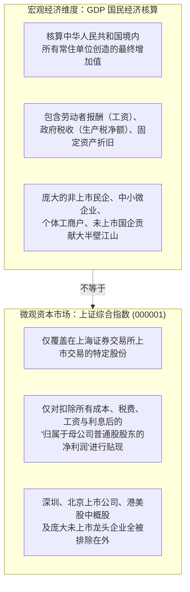
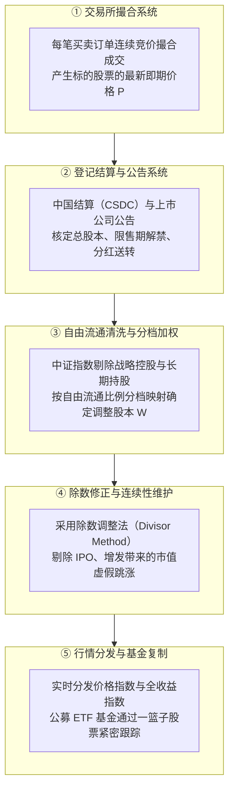
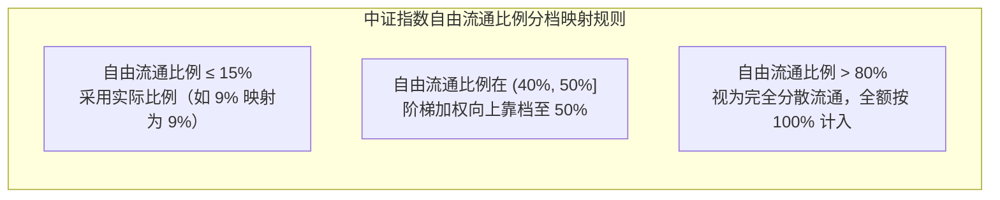
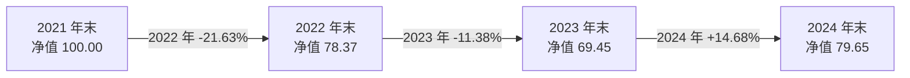

# 30 A 股指数与市场结构

[上一章：外部冲击](29-assets-external-shocks.md) · [目录](./) · [下一章：每股盈利](31-listed-earnings.md)

> 编写于 2026-10-03。历史规则与行情分别标注版本；本模块深入剖析中国资本市场的回报生成机制，所有微观案例与数据均为学术教学用途，不构成任何投资建议。

**前置阅读：**美国篇 [22 资产价格与全球传导](https://fangpings.github.io/us-econ/22-assets-and-global.html)、[24 股票估值](https://fangpings.github.io/us-econ/24-equity-valuation.html)。股票本质上是对企业未来经营剩余现金流的求偿权，而股票指数是一套基于既定数学与样本筛选规则动态维护的投资组合。在中国宏观经济与资本市场讨论中，“上证指数三千点保卫战”几乎是一个全民热议的话题。但上证点位到底在测量什么？它遗漏了什么？本章从指数的编制底层为你揭示真相。

---

## 1. 为什么不能用一个点位代表中国经济

在各类财经社交平台上，最经典的论调莫过于：“中国 GDP 二十年翻了好几倍，为什么上证综指还在三千点徘徊，说明股市完全脱离了实体经济。”

这种质问在逻辑上混淆了两个完全不同的宏观实体：

1. **核算范围的巨大脱节**：深圳证券交易所的几千家企业（包括宁德时代、比亚迪、迈瑞医疗等行业领袖）、北京证券交易所的创新型中小企业，以及在香港和美国上市的中国互联网巨头（腾讯、阿里、美团等），**自始至终没有一股属于上证综合指数的样本**！
2. **国民收入分配的结构性差异**：全社会工资上涨、企业扩大招工、政府加大征税，或者外卖小哥收入增加、消费者买到更便宜的高性价比商品，都能实打实地拉动 GDP 强劲增长；但从微观上市公司的角度看，如果激烈的市场价格竞争（如工业制造内卷）导致企业毛利率下滑、营业成本上升，**实体经济的高速运转完全可能伴随上市公司股东净利润的停滞甚至缩水**。
3. **“三千点”的伪命题**：必须首先界定：是哪个指数？是否包含巨额现金分红再投资？是名义人民币还是剔除通胀后的实际购买力？

---

## 2. 四种主流指数篮子：回答四种截然不同的问题

在分析 A 股走势时，必须依据研究目的选取科学的对照基准（Benchmark）：

| 指数代码与名称 | 编制机构与核心筛选逻辑 | 覆盖范围与代表性 | 绝不能据此轻易作出的草率推论 |
| :--- | :--- | :--- | :--- |
| **上证综合指数 (000001)** | 上海证券交易所编制；包含上交所全部上市股票（A 股与 B 股） | 仅反映上海单座交易所的综合全貌；大盘金融、石化与传统工业权重极大 | 绝不能代表全中国股市，更不能代表中国整体民营经济与新经济 |
| **沪深 300 指数 (000300)** | 中证指数公司编制；跨沪深两市挑选**规模大、流动性最好**的 300 只大蓝筹 | 覆盖中国 A 股核心资产，代表大盘蓝筹和各行业龙头的盈利中枢 | 不等于 300 家公司平均分配权重；不包含成长型中小市值创新企业 |
| **创业板指数 (399006)** | 深圳证券交易所编制；深市创业板中市值与成交居前的 100 家样本股 | 高度集中于新能源、高端装备制造、医药生物等高弹性成长板块 | 不代表中国全部高新科技全貌；个别龙头权重极高，波动剧烈 |
| **中证 500 / 1000 (000905 / 000852)** | 扣除沪深 300 后依次选取的 500 家中盘龙头与 1000 家小盘成长股 | 观察中国中坚制造企业与民营专精特新“小巨人”的最佳窗口 | 换手率极高，受市场游资与量化高频交易微观资金博弈影响更显著 |

查阅中证指数公司官方单张可知：沪深 300 的样本股每半年定期调整一次，采用**自由流通市值加权（Free-Float Market Cap Weighting）**并设定了单个样本股最高权重不超过 $10\%$ 的风控上限。[中证指数公司沪深 300 编制方案](https://oss-ch.csindex.com.cn/static/html/csindex/public/uploads/indices/detail/files/zh_CN/000300_Index_Methodology_cn.pdf)。

---

## 3. 指数是怎样从撮合成交记录中生成的

一只股票指数在交易软件中跳动，其底层经历了严格的五层现代金融工程流水线：

### 除数修正法（Divisor Adjustment）：新股上市为什么不让指数虚假暴涨
指数的核心计算公式为**拉斯贝尔／派氏调整市值加权公式**：
$$
\text{当日指数点位} = \frac{\sum_{i=1}^n (\text{股价}_i \times \text{调整股本}_i)}{\text{基准除数 (Divisor)}}
$$

**教学除数维护模型**：
假设某小型指数初始包含 10 只成分股，总调整市值为 $1,000$ 亿元，初始基准除数设为 $1.0$：
$$
\text{初始指数点位} = \frac{1,000}{1.0} = 1,000\text{ 点}
$$
次日，一家庞大的巨无霸企业完成 IPO 挂牌上市并被纳入指数样本，为指数带来了整整 $200$ 亿元的新增市值；而原先的 10 只成分股二级市场价格没有任何波动（涨跌幅为 $0\%$）。

如果指数机构不调整除数，指数就会荒唐地变成：
$$
\text{未调整除数（错误）} = \frac{1,000 + 200}{1.0} = 1,200\text{ 点（虚假暴涨 20%！）}
$$
这显然违背了客观规律——老投资者的持仓一分钱没涨，凭什么指数点位要涨 $20\%$？

为了保持指数在时间序列上的绝对连续性，指数编制机构会启动**除数修正公式**：
$$
\text{新基准除数} = \text{原除数} \times \frac{\text{新样本总市值}}{\text{原样本总市值}} = 1.0 \times \frac{1,000 + 200}{1,000} = 1.20
$$
$$
\text{修正后实际指数点位} = \frac{1,200}{1.20} = 1,000\text{ 点}
$$
指数点位依然精准保持在 $1,000$ 点！新股的纳入被除数的同等放大所完全吸收。这清晰地证伪了一个常见民间误区：“总市值变大了就代表股市指数必然大幅上涨”。

---

### 沪深 300 权重实测：自由流通比例分档与调整股本

中证指数在计算样本权重时，并不是机械地使用公司总股本，而是要剔除控股股东长期持有的不可自由交易股份，并按**自由流通比例（Free-Float Ratio）**进行阶梯分档映射。

我们直接复算中证官方编制方案中的三只典型样本股算例（股本单位：千股）：

| 样本公司代号 | 注册总股本 | 非自由流通股本（国资/大股东） | 真实自由流通比例 | 官方分档映射后的加权比例 | 最终计入指数的调整股本 |
| :---: | ---: | ---: | :---: | :---: | ---: |
| **公司 A（超大国企）** | $100,000$ | $91,000$ | $9.00\%$ | **$9.00\%$**（$\le 15\%$ 按实际比例） | $9,000$ |
| **公司 B（混合持股）** | $8,000$ | $4,500$ | $43.75\%$ | **$50.00\%$**（落在 $(40\%, 50\%]$ 档） | $4,000$ |
| **公司 C（分散民企）** | $5,000$ | $900$ | $82.00\%$ | **$100.00\%$**（$> 80\%$ 视作全流通） | $5,000$ |

### 真实市值加权 vs 调整股本加权对比演示：
假设这三家公司的股票二级市场交易价格恰好都是每股 $10.00$ 元。

1. **若按照总市值（Total Market Cap）机械加权**：
   - A 公司的总市值为 $100,000 \times 10 = 1,000,000$；
   - 三家公司总市值合计为 $1,130,000$；
   - A 公司的总市值权重高达：
     $$
     \text{权重}_{\text{A (总市值)}} = \frac{100,000}{113,000} \approx 88.50\%
     $$
2. **按照沪深 300 规则的调整自由流通市值加权**：
   - A 调整市值：$9,000 \times 10 = 90,000$（占比 $50.00\%$）；
   - B 调整市值：$4,000 \times 10 = 40,000$（占比 $22.22\%$）；
   - C 调整市值：$5,000 \times 10 = 50,000$（占比 $27.78\%$）；
   - 调整后样本总市值为 $180,000$；
   - A 公司的真实指数权重被压缩至：
     $$
     \text{权重}_{\text{A (沪深300调整)}} = \frac{9,000}{18,000} = 50.00\%
     $$

**深刻的市场含义**：
如果某天 A 公司股票因利好单独大涨 $10\%$，在总市值加权下会拉动指数大涨 $8.85\%$；但在沪深 300 的科学规则下，只能拉动指数上涨 $5.00\%$。分档加权不仅防止了大股东无法套现的限售筹码虚假扭曲指数，而且有效抑制了大盘股对指数的过度钝化。

---

## 4. “三千点”遗漏了哪些真金白银：价格指数 vs 全收益指数

这是所有中国股票投资者最容易忽视的会计常识：**上证综指（000001）和沪深 300（000300）都是纯粹的“价格指数（Price Index）”**。

当上市公司进行现金分红除息时，股票在除息日当天会自动扣减派息金额（股价开盘即被动跳空低开）。在价格指数中，这笔被扣减的现金分红就被彻底“蒸发”了！它只记录了被除息压低的股票现价，完全没有把企业分给投资者的真金白银利息再投资计入指数。

为了还原股东的全部实际回报，交易所专门编制了**全收益指数（Total Return Index）**：
- **上证综合全收益指数（代码：000888，简称“上证收益”）**：上海证券交易所于 2024 年 7 月 29 日起正式发布该指数的实时行情，将样本股的现金红利在除息日全额再投资计入指数。[上交所发布上证综合全收益指数公告及方案](https://www.sse.com.cn/market/sseindex/diclosure/c/c_20240715_10759849.shtml)。
- **沪深 300 全收益指数（代码：H00300）**。

### 教学算例：除息是怎样影响投资回报评估的
某投资者以 $100$ 元买入某高股息龙头组合。年末公司实施慷慨分红，每股派发现金红利 $4$ 元，股票在除息后收盘价为 $98$ 元。假设当年居民消费通胀率（CPI）为 $3\%$：

1. **价格指数眼中的回报（股价变动）**：
   $$
   \text{价格回报率} = \frac{98}{100} - 1 = -2.0\%
   $$
   看盘软件显示：股价下跌了 2%，投资者“被套牢”。
2. **全收益指数眼中的股东实际总回报（含分红）**：
   $$
   \text{名义股东总回报} = \frac{98 + 4}{100} - 1 = \frac{102}{100} - 1 = +2.0\%
   $$
   股东账上不仅拿到了 4 元现金分红，名义资产实际上净赚了 2%！
3. **剔除物价通胀后的实际购买力回报**：
   $$
   \text{实际回报率} = \frac{1 + 2.0\%}{1 + 3.0\%} - 1 = \frac{1.02}{1.03} - 1 \approx -0.97\%
   $$

**结论**：
三套完全不同的结论可以同时成立：**股价名义跌了、股东总财富实际上赚了、实际购买力略微缩水**。在考察 A 股长期年化回报时，中国上市公司每年上万亿元的现金分红（许多大盘蓝筹股息率常年在 4%-6%）累计数十年的复利效应极为惊人，如果抛开全收益指数只看上证价格点位，就会系统性抹杀 A 股上市公司对股东的实质性现金回馈。

---

## 5. 官方单张带读：沪深 300 历史走势同起点复原

我们打开中证指数公司发布的沪深 300 权威官方单张（Factsheet），提取其经受洗礼的历史真实年度回报：
- **基日与基点**：以 2004 年 12 月 31 日为基期，基点为 $1,000$ 点；
- **2022 年年度价格回报**：$-21.63\%$；
- **2023 年年度价格回报**：$-11.38\%$；
- **2024 年年度价格回报**：$+14.68\%$。

我们将 2021 年末的投资者初始财富设为标准化基准 $100$ 元，进行逐年资产净值连续复利跟踪：
$$
\text{2022 年末资产净值} = 100 \times (1 - 0.2163) = 78.37
$$
$$
\text{2023 年末资产净值} = 78.37 \times (1 - 0.1138) = 69.45
$$
$$
\text{2024 年末资产净值} = 69.45 \times (1 + 0.1468) = 79.65
$$

**投研复核启示**：
虽然 2024 年指数迎来了 $+14.68\%$ 的亮眼反弹，但因为前两年经历深度回撤，三年复合净值依然只有 $79.65$ 元（累计回撤 $-20.35\%$）。**在非线性复利的世界中，下跌 30% 需要上涨 43% 才能打平回本**。专业分析师绝不能孤立单看某一个上涨年份，必须还原连续时间序列的同起点财富路径。

---

## 6. 指数编制规则的重大演化不可忽视

在考察 A 股长期走势时，必须了解指数编制规则的历史变迁。[上海证券交易所关于修订上证综合指数编制方案的公告](https://www.sse.com.cn/market/sseindex/diclosure/c/c_20200619_5130635.shtml)。

在 2020 年 7 月 22 日，上交所实施了 30 年来最重要的一次指数编制方案修订：
1. **剔除风险警示股票（ST 及 *ST 股）**：被实施风险警示的退市边缘股票在实施次月第二个星期五的下一个交易日被调出指数，彻底阻断了绩差退市垃圾股持续拉低指数的现象；
2. **推迟新股纳入时间**：新股上市后第 11 个交易日纳入的旧规则，改为上市满 1 年后才纳入指数（除非该股票日均总市值排在沪市前 10 位，才可在上市满 3 个月后提前纳入），有效规避了新股在上市初期被游资非理性炒作见顶后一路单边阴跌拖累大盘的“上市即巅峰”陷阱；
3. **全面纳入科创板上市证券**：将代表中国硬科技创新的科创板红筹与普通股票全额纳入样本。

做长周期学术研究时，绝不能假定 2000 年的上证综指与 2026 年的上证综指是同一只不变的篮子。

---

## 7. 练习与逐步参考答案

### 思考与练习

1. 某微型模拟指数期初样本总市值为 $500$ 亿元，初始基准除数设为 $0.5$。现有一家市值高达 $100$ 亿元的优质新股被选入该指数，原有的其他成分股股价没有任何涨跌变动。为了保持指数点位连续不失真，该指数的基准除数应当调整为多少？
2. 某投资者以每股 $20.00$ 元买入某蓝筹股，年末该股票因除息股价收于 $19.00$ 元，期间每股实际派发含税现金分红 $1.50$ 元。不考虑交易税费，请分别计算该投资者的纯价格回报率与股东总持有期回报率。
3. 某量化研报声称：“沪深 300 指数在 2024 年录得 14.68% 的强劲上涨，因此在 2021 年末买入沪深 300 ETF 基金的投资者目前已经全面扭亏为盈并实现丰厚盈利。”请结合本章官方单张复现数据予以驳斥。
4. 某金融数据库为向客户展示其“A 股神级选股策略”，调取了当前市场上表现最优秀的 50 只各行业大白马龙头，将其成分股权重固定，直接回溯倒推这 50 家企业在过去十五年的指数收益率，宣称该策略实现了年化 25% 的惊人长期回报。请指出该回测模型存在的致命学术漏洞。

---

点击展开逐步参考答案与解析

1. **计算与解析**：
   - 纳入新股前的初始指数点位：
     $$
     \text{原指数点位} = \frac{500}{0.5} = 1,000\text{ 点}
     $$
   - 纳入新股后，样本总市值扩大为：$500 + 100 = 600$ 亿元；
   - 保持指数点位 $1,000$ 点不变，根据除数修正公式：
     $$
     \text{新基准除数} = \frac{\text{新样本总市值}}{\text{原指数点位}} = \frac{600}{1,000} = 0.60
     $$
     除数由 $0.5$ 放大至 $0.6$，完美平抑新股纳入的机械扰动。

2. **计算过程**：
   - **价格回报率**（仅看除息后股价）：
     $$
     \text{价格回报率} = \frac{19.00}{20.00} - 1 = -5.0\%
     $$
   - **股东总持有期回报率**（包含落袋分红）：
     $$
     \text{总回报率} = \frac{19.00 + 1.50}{20.00} - 1 = \frac{20.50}{20.00} - 1 = +2.5\%
     $$
     纯价格看亏损 $5\%$，但计入分红后实际实现盈利 $2.5\%$。

3. **解答**：
   该判断在数学上完全错误。根据中证指数权威单张连续连乘数据：
   - 2022 年回撤 $-21.63\%$，净值跌至 $78.37$；
   - 2023 年进一步回撤 $-11.38\%$，净值跌至 $69.45$；
   - 2024 年虽反弹 $+14.68\%$，期末净值仅回升至：
     $$
     69.45 \times (1 + 0.1468) \approx 79.65
     $$
   距离 $100$ 元的平盘本金依然有超过 $20\%$ 的巨额累计亏损缺口，绝未扭亏为盈。

4. **解答**：
   存在极度严重的**幸存者偏差（Survivorship Bias）与前瞻未来信息泄露（Look-Ahead Bias）**：
   - 该模型站在今天“开天眼”，直接挑选了经历十五年残酷商业洗礼后最终胜出、成为龙头的成功企业；
   - 彻底抹杀了十五年前在当时看似辉煌但随后陷入衰退、暴雷、退市或清算的海量失败成分股；
   - 严谨的学术回溯必须使用“历史当时截面（Point-in-Time）”的真实成分股名单与当时的编制规则逐期动态重平衡。

---

[上一章：外部冲击](29-assets-external-shocks.md) · [目录](./) · [下一章：每股盈利](31-listed-earnings.md)
