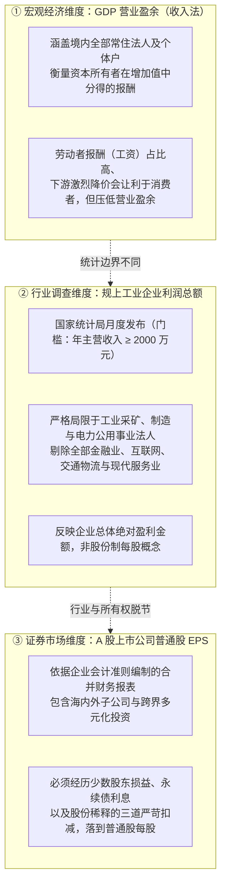
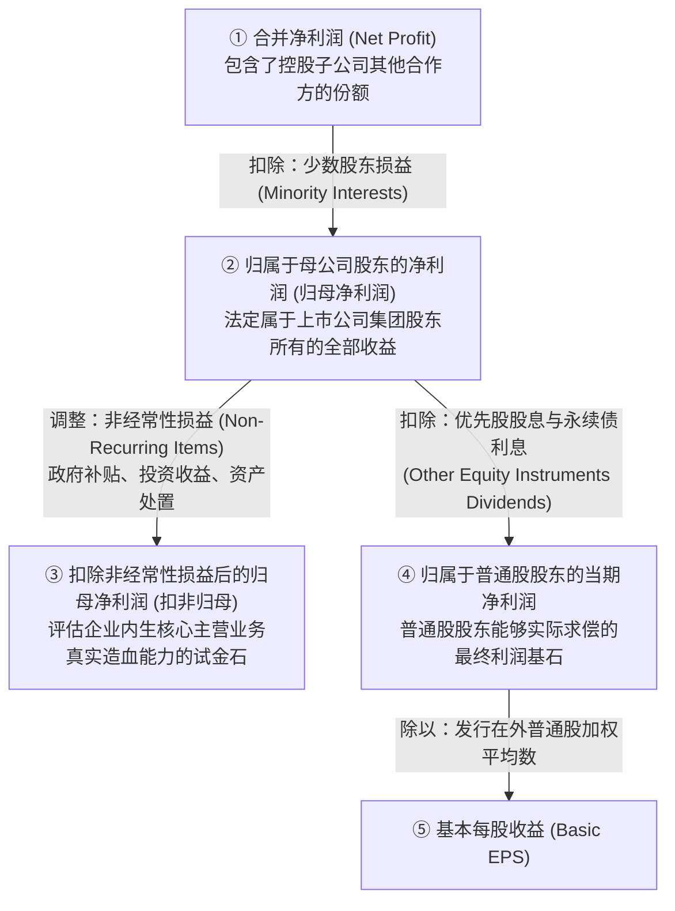
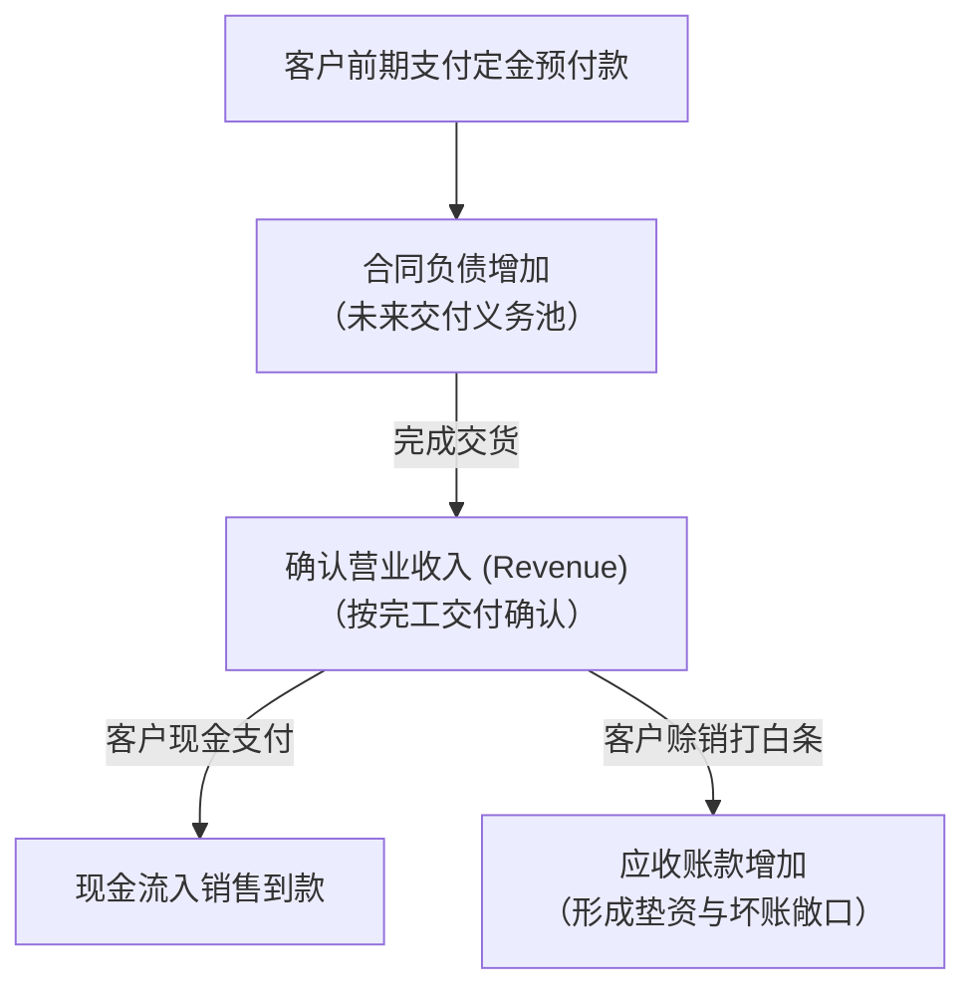
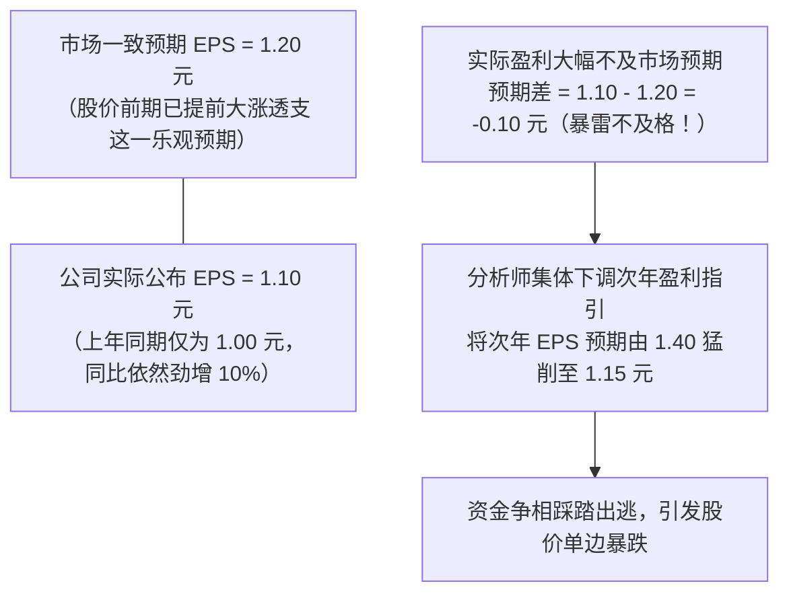

# 31 从中国经济增长到上市公司每股盈利

[上一章：指数](30-equity-indices.md) · [目录](./) · [下一章：融资与回报](32-shareholder-returns.md)

> 编写于 2026-10-03。权威财报案例使用招商银行 2024 年真实年报披露原表；微观企业算例另标教学假设。

**前置阅读：**美国篇 [23 企业盈利、财报与预期](https://fangpings.github.io/us-econ/23-corporate-earnings.html)，中国篇 [09 企业经营](09-business.md)。收入确认原则、权责发生制、合并报表与每股收益（EPS）的微观会计学逻辑全球一致。但在中国宏观研判中，投资者最常感到困惑的问题是：为什么宏观 GDP 在扩张、规上工业企业利润在增长，但对应行业上市公司的每股收益（EPS）却不增反降？从宏观经济增加值到二级市场普通股股东手里的每股真金白银，中间到底隔了多少重漏斗？本章带你层层穿透。

---

## 1. 三份利润故事来自三个完全不同的总体

在跟踪中国企业盈利时，宏观经济学家、行业研究员和二级市场股票分析师往往各说各话。这源于他们观察的是三个统计边界截然不同的微观总体：

| 利润指标体系 | 官方发布部门 | 统计总体与门槛限制 | 资本市场常见偷换概念误区 |
| :--- | :--- | :--- | :--- |
| **GDP 营业盈余** | 国家统计局核算司 | 全境所有合法经营常住实体（含无上市资质的企业） | 误以为宏观经济平稳增长，上市公司净利润就必然同步改善 |
| **规上工业企业利润** | 国家统计局工交司 | 年主营业务收入 $\ge 2,000$ 万元的独立工业企业法人 | 误以为工业利润回升，沪深 300 中的金融、消费和科技龙头就同步大赚 |
| **A 股上市公司利润** | 中国证监会／沪深北交易所 | 经合格会计师事务所审计的股份制上市公司合并实体 | 误以为公司总利润增长，原有老股东分得的每股净收益就同步增长 |

在跨市场对比时，必须建立严谨的“宏观行业增加值 $\to$ 规上工业调查样本 $\to$ 上市公司合并报表 $\to$ 指数样本股”的四级映射网络。

---

## 2. 中国上市公司财报是怎样生成的

一家 A 股公司的财务报表不是交易所编制的，而是企业在严格会计准则与证券监管约束下自主报送的产物：

### 投资者必须识别的三类业绩披露文件：
1. **业绩预告（Earnings Guidance）**：公司在会计年度结束后、正式财报披露前，依据规则对净利润大幅变动（如净利润同比增减 $50\%$ 以上、扭亏为盈或发生亏损）作出的前瞻性区间提示。它给出的只是预估区间，未经审计；
2. **业绩快报（Preliminary Financial Data）**：在正式年报披露前，抢先发布的较为详尽的初步营业收入与利润汇总。虽然未经最终核准，但数据完整性显著高于预告；
3. **正式定期报告（Annual/Quarterly Reports）**：包含经注册会计师审计签字的完整报表、董事会经营讨论与深度会计附注。

**核心阅读法则**：
专业投资人绝不能只看财经新闻推关的“净利润暴涨 $100\%$”大标题，必须立即翻开年报看三张硬表和附注：**少数股东损益扣了多少？非经常性政府补贴占了多少？优先股与永续债分了多少？应收账款计提了多少？**

---

## 3. 净利润的三次严苛筛选：归母、扣非与普通股利润

许多非专业投资者看到某公司利润表最底行的“净利润（Net Profit）”有 1.2 亿元，就直接用它除以公司总股本计算 EPS，这是严重的财务低级失误。

在企业会计准则中，利润必须经历三次层层剥离的“漏斗筛选”：

### 经典教学全流程算例（单位：百万元）：
某上市公司当年实现合并报表总净利润 $120$ 百万元：
1. **第一次筛选（扣除少数股东份额）**：
   公司旗下某高利润子公司中有 $30\%$ 股权属于地方合作国企（少数股东），当年分得少数股东损益 $20$ 百万元：
   $$
   \text{归母净利润} = \text{合并净利润} - \text{少数股东损益} = 120 - 20 = 100\text{ 百万元}
   $$
2. **第二次筛选（扣除非经常性损益）**：
   公司当年获得地方政府高新技术一次性财政补贴 $15$ 百万元（税后净额）：
   $$
   \text{扣非归母净利润} = \text{归母净利润} - \text{非经常性净损益} = 100 - 15 = 85\text{ 百万元}
   $$
   主营业务实际创造的核心利润是 $85$ 百万元，绝非 $100$ 百万元。
3. **第三次筛选（扣除其他权益工具利息）**：
   公司资产负债表所有者权益中，发行了 $200$ 百万元的永续债（在会计上计入“其他权益工具”）。依据发行契约，当年必须向永续债机构投资者强制支付利息分红 $10$ 百万元：
   $$
   \text{归属于普通股股东的净利润} = \text{归母净利润} - \text{永续债利息支出} = 100 - 10 = 90\text{ 百万元}
   $$
4. **第四步（计算普通股每股收益 Basic EPS）**：
   假设公司全年发行在外的普通股加权平均股数为 $50$ 百万股：
   $$
   \text{普通股基本 EPS} = \frac{\text{归属于普通股股东的净利润}}{\text{普通股加权股数}} = \frac{90}{50} = 1.80\text{ 元/股}
   $$
   $$
   \text{扣非普通股基本 EPS} = \frac{85 - 10}{50} = \frac{75}{50} = 1.50\text{ 元/股}
   $$

只有 $1.50$ 元与 $1.80$ 元，才是真正穿透到达二级市场普通股投资者手中的每股盈利基石！

---

## 4. 招商银行 2024 年真实年报带读：归母增长 $\neq$ EPS 增长

我们翻开招商银行股份有限公司于 **2025 年 3 月 25 日**向全球披露的《2024 年年度报告摘要》（港交所与上交所同步官方披露文件）。[招商银行 2024 年报摘要链接](https://www.hkexnews.hk/listedco/listconews/sehk/2025/0325/2025032501341_c.pdf)。

在摘要第 4—5 页，记录了以下经过毕马威严谨独立审计的权威核心财务数据：

| 官方财报指标名称 | 2023 年度执行数 | 2024 年度执行数 | 官方公布变动幅度 |
| :--- | ---: | ---: | :---: |
| **归属于本行股东的净利润（百万元）** | **146,602** | **148,391** | **+1.22%** |
| **普通股基本每股收益（EPS，元/股）** | **5.63** | **5.66** | **+0.53%** |
| 扣除非经常性损益后普通股基本 EPS（元/股） | 5.61 | 5.65 | +0.71% |
| **经营活动产生的现金流量净额（百万元）** | **357,753** | **447,023** | **+24.95%** |

### 极具教学价值的深度质问：
为什么归母净利润增长了 **$1.22\%$**，而普通股每股收益（EPS）却仅仅微增了 **$0.53\%$**？这相差的将近一半增速去哪儿了？

很多非专业分析师习惯性地瞎猜：“肯定是招商银行在 2024 年增发新股、稀释了股本。”
但翻看年报股本附注：招商银行 2023 年与 2024 年的普通股加权平均股数**自始至终精准保持在 25,220 百万股（252.2 亿股），没有增发任何一股普通股！**

我们直接穿透招商银行《2024 年度报告全文》印刷版第 257 页的“附注 53 每股收益计算过程”，调取官方完整的桥接算式（金额：百万元）：
$$
\begin{aligned}
\text{2023 年普通股利润} &= \text{归母净利润} (146,602) - \text{优先股股息} (996) - \text{永续债利息} (3,562) \\
&= 142,044\text{ 百万元}
\end{aligned}
$$
$$
\begin{aligned}
\text{2024 年普通股利润} &= \text{归母净利润} (148,391) - \text{优先股股息} (996) - \text{永续债利息} (4,585) \\
&= 142,810\text{ 百万元}
\end{aligned}
$$

我们核对加权每股收益：
$$
\text{2023 年普通股基本 EPS} = \frac{142,044}{25,220} \approx 5.6322 \to 5.63\text{ 元}
$$
$$
\text{2024 年普通股基本 EPS} = \frac{142,810}{25,220} \approx 5.6626 \to 5.66\text{ 元}
$$

### 审计破案真相：
归母净利润在 2024 年虽然净增加了 $1,789$ 百万元（$+1.22\%$），但是在分配端，**由于招行前期发行的永续债票面重置与新发，支付给永续债机构投资者的利息从 3,562 百万元激增到了 4,585 百万元（单项被永续债多切走了整整 1,023 百万元！）**。
最终留在普通股股东盘子里的利润仅增加了：
$$
142,810 - 142,044 = 766\text{ 百万元} \implies \text{真实普通股利润增速仅为 } \frac{766}{142,044} \approx 0.539\%
$$
正是这笔永续债的硬性分流，将 EPS 的名义增速生生腰斩压低到了 $0.53\%$！

此外，招商银行经营活动现金流净额暴增了 $24.95\%$（从 3578 亿增至 4470 亿元），这并不代表普通股股东分红能力暴增 25%。商业银行的经营现金流受客户存款吸收与贷款投放周期的巨大扰动，银行能够向股东分红的上限受到严格的**核心一级资本充足率（Basel III）**监管约束，绝不能套用工业制造企业的“自由现金流等于可分红现金”。

---

## 5. 扩股稀释与盈利质量：增发到底是福是祸

除了其他权益工具的分流，上市公司最常见的股东价值损耗来自**过度股权再融资（Refinancing）带来的股本稀释**。

### 教学算例演示：
某科技制造企业上年实现归属于普通股股东净利润 $100$ 百万元，发行在外的普通股总数为 $100$ 百万股：
$$
\text{上年基本 EPS} = \frac{100}{100} = 1.00\text{ 元/股}
$$
当年初，上市公司为了进军新能源业务，向特定机构投资者定向增发新股 $25$ 百万股（股本扩张 $25\%$），募集资金投入新工厂建设。新业务当年实现投产，推动公司全年净利润强劲增长至 $110$ 百万元（净利润同比大涨 $10\%$）。

我们计算当年老股东面临的每股收益：
$$
\text{当年普通股总股本} = 100 + 25 = 125\text{ 百万股}
$$
$$
\text{当年基本 EPS} = \frac{110}{125} = 0.88\text{ 元/股}
$$
$$
\Delta EPS = \frac{0.88 - 1.00}{1.00} = -12.0\%
$$

**财务学沉思**：
新闻通报大肆宣传“公司业绩大捷，净利润强劲增长 $10\%$”，但原有老股东手中的每一股含金量却**生生被稀释暴跌了 12%**！
增发并不一定是坏事，但关键取决于：新投入资本创造的**边际投资回报率（ROIC）是否高于股权资本成本（Cost of Equity）**。如果上市公司通过不断在二级市场圈钱配股增发来换取账面营收与总利润的虚胖增长，而每股收益（EPS）却常年停滞甚至萎缩，这就是典型的“毁损股东价值的资本毁灭”。

---

## 6. 应收账款、合同负债与现金流：中国制造企业的资金链审计

在实体制造与工程行业中，“赚了利润”绝不等于“收到了现金”。许多暴雷企业的教训表明：纸面上的巨额净利润，可能全是被客户拖欠的应收账款（甚至是无法收回的坏账借条）！

### 教学制造企业现金转换全景推演（单位：百万元）：
某高端环保装备上市公司本年度经营发生以下事项：
- 期初资产负债表：应收账款余额 $20$ 百万元，合同负债（预收客户工程定金）余额 $10$ 百万元；
- 当年按照设备交付验收标准，累计确认**营业收入 100 百万元**；
- 当年从客户处实际收到的全部现金结算款为 **$90$ 百万元**（其中包含新签订单的预付款）；
- 期末资产负债表：应收账款激增至 $45$ 百万元，合同负债增至 $25$ 百万元；
- 当年确认的各项原材料与人工营业成本为 $70$ 百万元，实际通过银行转账支付的现金成本为 $65$ 百万元（其余 $5$ 百万元体现为对上游供货商的应付账款增加）。

我们分别计算其微观指标：

#### 维度一：权责发生制下的会计利润
$$
\text{会计税前营业利润} = \text{营业收入} - \text{营业成本} = 100 - 70 = 30\text{ 百万元}
$$

#### 维度二：现金流量表中的销售收现勾稽
$$
\begin{aligned}
\text{销售商品提供劳务收到的现金} &= \text{营业收入} - \Delta \text{应收账款} + \Delta \text{合同负债} \\
&= 100 - (45 - 20) + (25 - 10) \\
&= 100 - 25 + 15 = 90\text{ 百万元}
\end{aligned}
$$

#### 维度三：间接法经营活动现金流量净额（CFO）
$$
\begin{aligned}
\text{经营活动现金流量净额} &= \text{净利润} - \Delta \text{应收账款} + \Delta \text{合同负债} + \Delta \text{应付账款} \\
&= 30 - 25 + 15 + 5 = 25\text{ 百万元}
\end{aligned}
$$

**微观财报洞察**：
企业利润看似有 $30$ 百万元，但其中有整整 $25$ 百万元是未见现钱的应收账款！如果客户是资金周转困难的地方平台或高杠杆民企，一旦这些应收账款在次年发生大额坏账信用减值计提，这 $30$ 百万元的账面利润就会被瞬间吞噬殆尽。**在分析 A 股制造业时，没有充沛自由现金流支撑的纸面利润，是极度脆弱的虚假繁荣**。

---

## 7. 业绩“超预期”与预期差：为什么好财报反而大跌

在资本市场中，常常上演一幕看似吊诡的闹剧：“某芯片龙头公布了同比暴涨 50% 的极佳季报，次日股价却惨遭跌停开盘砸盘。”

这背后遵循的是金融学中的**理性预期与价格贴现原理（Expectation Gap）**：

**核心交易学逻辑**：
1. **股价是对未来的折现，不是对过去的颁奖**：当期 $10\%$ 的利润增长早已在过去的上涨行情中被充分计入买盘价格（Priced-in）；
2. **买预期、卖事实（Sell the News）**：当公布的实际数字（$1.10$）低于分析师最保守的预期（$1.20$）时，机构投资者看到的是盈利增速见顶放缓的危险信号，进而全面砍低对未来数年的盈利预测，引发强烈的多头止盈踩踏。

---

## 8. 练习与逐步参考答案

### 思考与练习

1. 某综合控股集团当年合并净利润为 $150$ 百万元，其中归属于非全资子公司的少数股东损益为 $30$ 百万元。集团账面上发行有永续优先股，当年需强制向优先股股东派发约定股息 $12$ 百万元。若该集团全年发行在外的普通股加权平均股数为 $60$ 百万股，请严格计算其当年的普通股基本每股收益（EPS）。
2. 某上市公司年初发行在外的普通股总数为 $100$ 百万股，7 月 1 日公司完成定向增发新股 $20$ 百万股，当年没有其他股本变动。当年实现的归属于普通股股东的净利润为 $121$ 百万元。请计算其全年的发行在外普通股加权平均数以及最终的基本每股收益（EPS）。
3. 某券商策略研报指出：“由于国家统计局公布的规上工业企业利润总额当月同比大幅反弹 15%，因此沪深 300 指数接下来的成分股每股盈利（EPS）也将确定性录得 15% 左右的同幅高增。”请指出该判断存在的逻辑硬伤。
4. 招商银行 2024 年财报显示其“经营活动产生的现金流量净额”高达 $4,470$ 亿元，同比暴涨 $24.95\%$。某散户投资者据此认为：“招商银行下年度向普通股股东派发的分红金额必将同幅上涨 25%！”请驳斥该错误推论。

---

点击展开逐步参考答案与解析

1. **计算过程**：
   - 归属于母公司股东的净利润（归母净利润）：
     $$
     \text{归母净利润} = 150 - 30 = 120\text{ 百万元}
     $$
   - 扣除优先股利息后的归属于普通股股东净利润：
     $$
     \text{普通股净利润} = 120 - 12 = 108\text{ 百万元}
     $$
   - 基本每股收益（Basic EPS）：
     $$
     \text{基本 EPS} = \frac{108}{60} = 1.80\text{ 元/股}
     $$

2. **计算过程**：
   - 增发的 $20$ 百万股仅在下半年存在了 6 个月（占全年的权重为 $6 / 12 = 0.5$）；
   - 普通股加权平均股数：
     $$
     \text{加权平均股数} = 100 + 20 \times \frac{6}{12} = 100 + 10 = 110\text{ 百万股}
     $$
   - 基本每股收益（Basic EPS）：
     $$
     \text{基本 EPS} = \frac{121}{110} = 1.10\text{ 元/股}
     $$

3. **解答**：
   存在极度严重的**样本总体与微观结构错配**：
   - **行业覆盖严重脱节**：规上工业利润严格局限于采矿、制造等工业企业，完全排除了金融地产、互联网平台和高端服务业；而沪深 300 中银行、非银金融、白酒消费、互联网科技占据大半壁权重；
   - **统计口径差异**：规上工业利润是法人总体绝对利润总额（未扣税费利息及少数股东），而沪深 300 是股份制上市公司普通股净利润；
   - **股本稀释影响**：上市公司若存在配股增发或永续债利息分配，总利润增长会被股本扩张进一步摊薄，无法直接平移到 EPS。

4. **解答**：
   该散户彻底混淆了商业银行独特的流动性报表与资本充足监管约束：
   - **银行现金流的特殊性**：银行经营现金流暴增 $25\%$，主要是由于当期居民储蓄存款大规模净流入（吸收存款增加体现为经营现金流入），这笔钱本质上是银行对储户的**负债**，绝不是企业自有的自由净收益；
   - **分红能力的硬约束**：商业银行向普通股股东分配现金红利，严格受制于巴塞尔协议 III 及中国金融监管部门设定的**核心一级资本充足率（Core Tier 1 Ratio）**红线。银行吸收的利润很大一部分必须留存转增核心一级资本，以支撑未来的资产信贷扩张，绝不可能任由经营现金流的起伏同幅提高分红。

---

[上一章：指数](30-equity-indices.md) · [目录](./) · [下一章：融资与回报](32-shareholder-returns.md)
