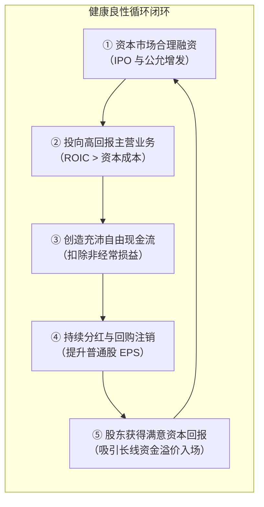
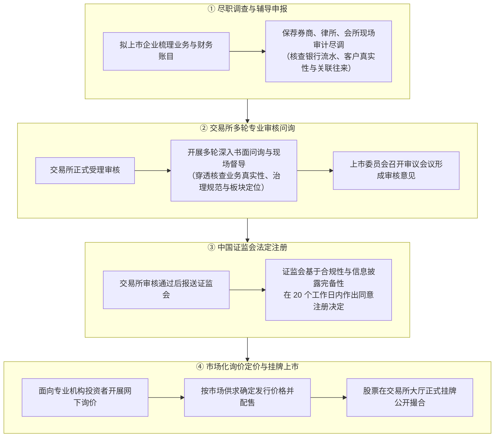
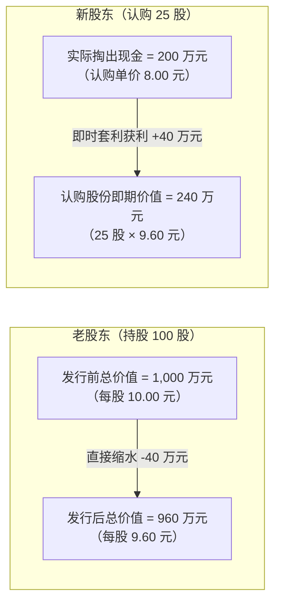
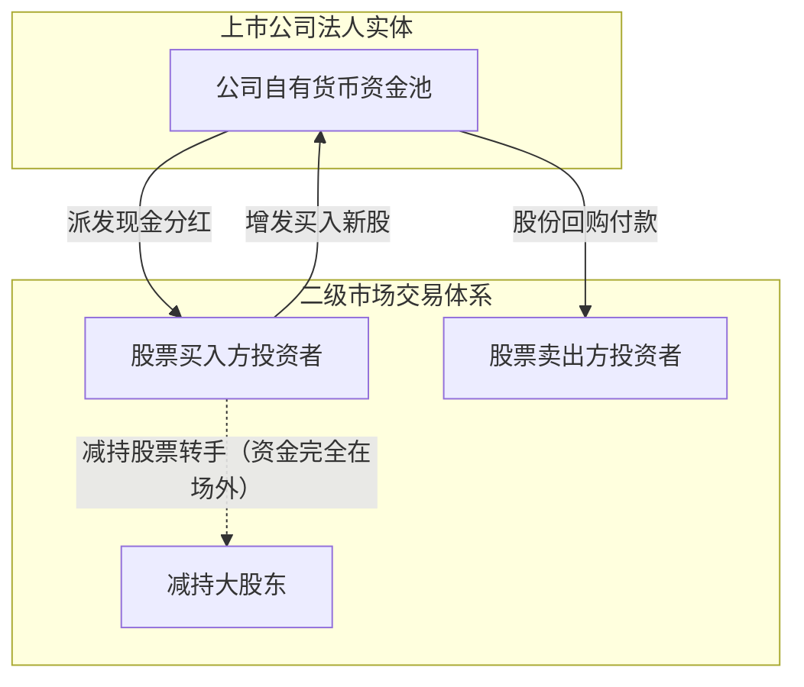
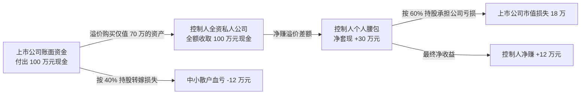
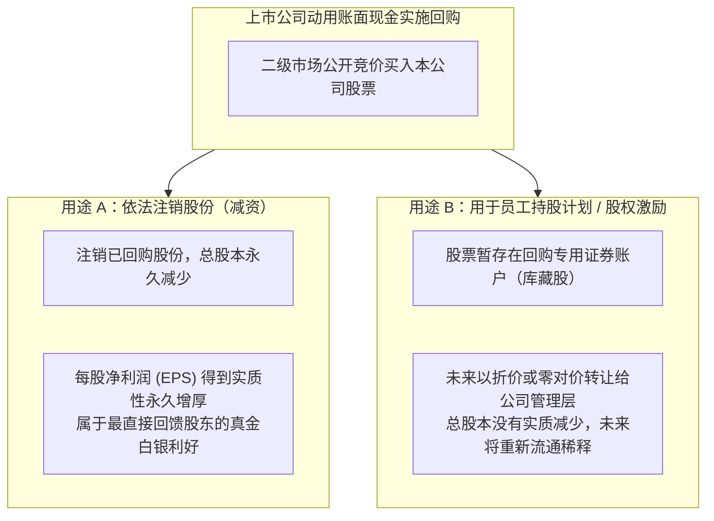

# 32 融资制度、公司治理与股东回报

[上一章：每股盈利](31-listed-earnings.md) · [目录](./) · [下一章：估值](33-equity-valuation.md)

> 编写于 2026-10-03。制度案例深入剖析 2023 年全面注册制改革、现金分红与股份回购规则，以及 2024 年新“国九条”减持监管新规。所有微观企业算例均为学术教学用途。

**前置阅读：**美国篇 [23 企业盈利](https://fangpings.github.io/us-econ/23-corporate-earnings.html)、[24 股票估值](https://fangpings.github.io/us-econ/24-equity-valuation.html)。资本所有权、外部融资、再投资与现金分红回报构成了现代公司金融的核心链条。在探讨中国资本市场时，投资者经常产生一个灵魂拷问：为什么有些上市公司营业收入连年翻倍、融资百亿，但二级市场中小股东手里的股票却长期不赚钱？股市的“企业融资功能”与“投资者回报功能”究竟应当如何闭环？本章为你拆解背后的制度与治理密码。

---

## 1. 融资与回报的完整闭环：从资金募集到股东现金流

股票市场的基本经济功能可以抽象为两座桥梁：
- **企业融资之桥（Financing）**：帮助优秀实体企业向社会募集真金白银，用于购置先进机器设备、攻关核心技术研发或收购优质产业资产；
- **股东投资之桥（Return）**：企业凭借新增资产创造出充沛的经营现金流，再通过**高比例现金分红**或**股份回购注销**，将商业利润实打实地回馈给承担风险的普通股股东。

然而在现实中，这一闭环在任何一个环节发生断裂，都会演变为“重融资、轻回报”的畸形生态：
- **盲目圈钱与资金闲置**：大额再融资募集的资金趴在账上买理财，甚至用于违规盲目跨界多元化并购；
- **投资收益率极度低下**：盲目扩产导致全行业产能过剩，边际投资回报率（ROIC）暴跌至无风险利率以下；
- **大股东掏空与代理冲突**：控股股东通过隐秘的关联交易侵占上市公司资金，中小股东沦为买单者。

---

## 2. 全面注册制：一家中国企业怎样走到公开交易

2023 年 2 月 17 日，中国证监会正式发布并全面实行股票发行注册制系列制度规则，标志着中国资本市场迎来了具有里程碑意义的制度跃升。[证监会全面实行股票发行注册制发布说明](https://www.csrc.gov.cn/csrc/c100028/c7123213/content.shtml)。

在《首次公开发行股票注册管理办法》框架下，一家实体企业走向上市公开交易必须经受以下严密程序的检验：

### 关键理念澄清：注册制 $\neq$ 政府为投资价值背书
1. **审核主体的分工明确**：上交所、深交所、北交所承担起全面的上市实质性审核职责；中国证监会聚焦于宏观合规性与信息披露法定注册；
2. **以信息披露为核心（Disclosure-Centric）**：监管机构的职责是确保企业把真实财务数据、经营风险和关联交易毫无保留地摊在阳光下，绝不替投资者保证“这家公司买了一定能赚钱”；
3. **中美注册制的制度映射**：美国证券交易委员会（SEC）同样对 S-1 注册声明开展多轮深度的“审阅并提供修改意见（Comment Letters）”[美国 SEC 关于 IPO 注册流程的投资者指南](https://www.investor.gov/introduction-investing/general-resources/news-alerts/alerts-bulletins/investor-bulletins-17)。中美都坚持注册不等于政府背书，但两国的多层次板块准入指标、战略配售机制与散户/机构投资者博弈生态存在显著的结构性制度差异。

---

## 3. 增发定价的数学：为什么折价增发会剥夺老股东财富

许多人以为，只要上市公司增发新股拿到了钱，老股东就一定能分享繁荣。我们用严格的资产负债表与每股内在价值公式算一算：

### 教学推演案例：折价增发的财富转移机制
某机械装备上市公司增发前的资本结构如下：
- 发行在外普通股股本：$100$ 股；
- 经过专业贴现测算的公司内在资产净价值为 $1,000$ 万元；
- 每股内在价值：
  $$
  V_0 = \frac{1,000}{100} = 10.00\text{ 元/股}
  $$

现在，上市公司为了引入某些战略投资人，以每股 $8.00$ 元的**折价（打八折）**定向增发 $25$ 股，实际向新股东募集现金：
$$
\text{增发募集现金} = 25 \times 8.00 = 200\text{ 万元}
$$

假设这笔钱暂时躺在银行账户（尚未产生额外的超额利润投资项目，净现值 $NPV = 0$）。
我们计算增发完成后公司的整体价值与每股价值：
$$
\text{发行后公司总资产价值} = 1,000 + 200 = 1,200\text{ 万元}
$$
$$
\text{发行后总股数} = 100 + 25 = 125\text{ 股}
$$
$$
\text{发行后每股内在价值} = \frac{1,200}{125} = 9.60\text{ 元/股}
$$

**极其残酷的财务事实**：
- 老股东的每股价值从 $10.00$ 元被硬生生稀释至 $9.60$ 元，老股东持有的 100 股总价值**凭空缩水了 40 万元（从 1000 万跌至 960 万）**；
- 新股东用 $200$ 万元买到了价值 $240$ 万元的股票份额，**当场白白赚取了 40 万元的超额转移财富**！
- 这 $40$ 万元并不是凭空蒸发了，而是通过**低价折价发行的制度安排，从老股东口袋无声转移到了特权新股东手中**！

**什么情况下增发才能让老股东真正受益？**
只有当这笔 $200$ 万元新资金投入到了极其卓越的高科技新项目中，创造了高达 $100$ 万元的**净现值增量（$NPV = 100$）**时：
$$
\text{公司新总价值} = 1,200 + 100 = 1,300\text{ 万元}
$$
$$
\text{此时新每股价值} = \frac{1,300}{125} = 10.40\text{ 元/股} > 10.00\text{ 元/股}
$$
只有在这个严苛前提下，老股东才能真正从增发中实现价值增长。

---

## 4. 四种“资金流出”记在四个完全不同的账户

在股民论坛上，经常有人愤怒地把各种交易混为一谈：“增发是吸血、大股东减持是抽血、分红除息是假把式、回购也是圈套！”

然而在金融会计体系中，这四种行为的资金走向完全南辕北辙：

| 资本市场交易事项 | 现金从谁手里流出 | 现金最终流向了谁 | 上市公司股数与资产变化 | 正确的宏观研究重点 |
| :--- | :--- | :--- | :--- | :--- |
| **① IPO 与定向增发** | 认购新股的机构与散户 | **上市公司银行账户** | 公司现金增加，总股本扩张 | 增发折溢价率、募集资金项目的真实内部收益率（IRR） |
| **② 大股东二级市场减持** | 承接抛盘的二级市场买方 | **卖股票的原股东个人/机构** | **上市公司资产与总股本完全不变** | 实际控制人套现动机、对公司前景预期与利益绑定 |
| **③ 上市公司现金分红** | **上市公司银行账户** | 登记在册的全部股东银行卡 | 公司现金流出，每股净资产除息下降 | 分红率可持续性、自由现金流覆盖度、资本再配置效率 |
| **④ 上市公司股份回购** | **上市公司银行账户** | 在二级市场卖出股票的投资者 | 公司现金减少；若注销则股本永久缩减 | 区分是“真金白银注销”还是“用于员工股权激励再流通” |

大股东二级市场减持，只是股份在两个投资者之间的所有权转手，**公司账面上没有流失一分钱，也没有多出一分钱**。把大股东减持金额与上市公司募资额简单相加作为“市场净失血”，在会计学上是典型的概念混淆。

---

## 5. 控股结构与隧道效应：控制权怎样侵占公众股东

在中国资本市场中，上市公司的控股结构具有鲜明特色：许多上市公司属于大型国有企业集团或家族民营集团旗下部分资产分拆上市的产物。

当控制人利益与二级市场公众中小股东利益不一致时，极其容易发生金融经济学中所说的**隧道效应（Tunneling，即大股东通过隐蔽暗道掏空上市公司）**。

### 经典教学关联交易算例：
某民营集团控股一家 A 股上市公司，总股本 $100$ 股：
- **集团控股股东持股**：$60$ 股（占 $60\%$ 控股权）；
- **二级市场中小公众股东持股**：$40$ 股（占 $40\%$ 股权）。

控股股东全资拥有另一家完全属于其私人的未上市贸易子公司。现在，上市公司在控股股东操控下，决定斥资现金 **$100$ 万元**向该私人贸易子公司购买一项老旧仓储房产：
- 经过真实独立公允评估，该房产的实际未来现金流贴现价值**仅值 70 万元**（高溢价买入垃圾资产，存在 $30$ 万元的虚高溢价）。

我们来严密计算该笔掠夺性关联交易对各方的利益分配净额：
1. **上市公司整体资产负债表损失**：
   $$
   \Delta V_{\text{上市公司}} = 70 (\text{获得资产真实价值}) - 100 (\text{付出真金白银}) = -30\text{ 万元}
   $$
2. **控股股东的“综合净账本”**：
   - 作为私人贸易公司的 $100\%$ 所有者，控股股东直接获得了暴利收入：$+30$ 万元；
   - 作为上市公司持有 $60\%$ 股份的股东，承担了上市公司资产缩水的损失：
     $$
     -30 \times 60\% = -18\text{ 万元}
     $$
   - **控股股东实际净收益**：
     $$
     \text{控股股东净赚} = +30 - 18 = +12\text{ 万元！}
     $$
3. **中小公众股东的惨烈结局**：
   $$
   \text{公众股东承担损失} = -30 \times 40\% = -12\text{ 万元！}
   $$

**公司治理的核心洞见**：
为什么控股股东有极强的动力操纵上市公司高价收购大股东自己的低劣资产？因为控制人在交易两端的利益份额不对等（在上市公司只占 $60\%$，在私人公司占 $100\%$）！
因此，阅读上市公司财报，必须把**关联交易附注（Related Party Transactions）**列为第一审计重点：资产评估参数是否激进造假？业绩承诺是否如期兑现？是否存在对大股东的巨额无偿资金拆借担保？

---

## 6. 现金分红与股息率：区分两个不同的比率

在探讨上市公司股东回报时，很多投资者常把“分红比例”与“股息率”混作一谈：

### 核心指标定义与公式对比：

1. **现金分红支付率（Dividend Payout Ratio）**：
   $$
   \text{现金分红支付率} = \frac{\text{当年每股派发现金红利 (DPS)}}{\text{当年每股基本收益 (EPS)}} = \frac{\text{现金分红总额}}{\text{归属于普通股股东净利润}}
   $$
   *经济含义*：衡量上市公司把当年赚到的利润按多大比例拿出来分给股东，分母是**会计净利润**。
2. **股息率（Dividend Yield）**：
   $$
   \text{股息率} = \frac{\text{当年每股派发现金红利 (DPS)}}{\text{当前股票二级市场交易价格 (Price)}}
   $$
   *经济含义*：衡量投资者以当前股价买入该股票所能获得的直接现金收益率，分母是**股票价格**。

### 经典案例对照：
假设招商银行每股拟派发现金红利 $2.00$ 元，基本每股收益 $EPS = 5.66$ 元，观察日二级市场股价为每股 $40.00$ 元：
$$
\text{现金分红支付率} = \frac{2.00}{5.66} \approx 35.34\%
$$
$$
\text{静态股息率} = \frac{2.00}{40.00} = 5.00\%
$$
一个回答的是“管理层的分红意愿慷慨程度（赚 100 块分出 35 块）”，另一个回答的是“投资者的现金流资产收益率（买 100 块股票年拿 5 块利息）”。

查阅上交所公布的《2024 年沪市主板年报综述》显示，沪市主板上市公司全年实现现金分红规模高达 **1.77 万亿元**，同比增长 $6\%$，实体央企与大盘金融股常年保持 $30\%-50\%$ 以上的稳健现金分红比例。这彻底打破了“A 股从来不分红”的民间荒谬谣言。

---

## 7. 股份回购（Share Repurchase）：注销 vs 员工持股的区别

近年来，越来越多的 A 股上市公司发布“数亿元股份回购方案”。依据证监会《上市公司股份回购规则》[证监会规则官方链接](https://www.csrc.gov.cn/csrc/c101954/c7449683/content.shtml)，回购股票的后续处理方式决定了其对普通股股东的实质影响：

### 教学回购算例：注销怎样改变财务数据
某公司期初净资产为 $1,000$ 万元，总股本 $100$ 股，账面每股净资产（BVPS）为 $10.00$ 元，年恒定净利润为 $100$ 万元（初始 $EPS = 1.00$ 元）。
公司动用自有现金 $200$ 万元，在二级市场以每股 $20.00$ 元（高于每股净资产）的价格回购并**全额依法注销 10 股**：

我们计算回购注销后的微观指标：
$$
\text{注销后公司净资产} = 1,000 - 200 = 800\text{ 万元}
$$
$$
\text{注销后剩余总股本} = 100 - 10 = 90\text{ 股}
$$
$$
\text{注销后每股账面净资产 (BVPS)} = \frac{800}{90} \approx 8.89\text{ 元/股}
$$
$$
\text{注销后每股收益 (EPS)} = \frac{100}{90} \approx 1.11\text{ 元/股}
$$

**核心财务启示**：
每股账面净资产从 $10.00$ 元下降至 $8.89$ 元，但由于分母股本的永久缩减，**每股收益 EPS 从 1.00 元实质性跳升至 1.11 元（增厚了 11%）**！只要回购价格合理、公司主营具有稳固壁垒，回购注销能大幅提升现有普通股股东的长期持股含金量。

---

## 8. 2024 年减持新规：扎紧资本流失的制度篱笆

2024 年 5 月 24 日，中国证监会正式发布《上市公司股东减持股份管理暂行办法》及配套规则，被称为 A 股历史上最严厉的“减持风控新规”[证监会减持新规权威发布文件](https://www.csrc.gov.cn/csrc/c100028/c7483136/content.shtml)。

新规针对长期困扰中小投资者的“上市即套现、恶意掏空”开出了三剂猛药：
1. **破发、破净不得减持**：上市公司股票连续 20 个交易日出现**跌破发行价（IPO 价格）**或**跌破每股净资产（PB < 1）**情形的，控股股东、实际控制人不得通过二级市场减持股份；
2. **分红不达标严禁减持**：最近三年累计现金分红金额低于最近三年年均净利润 $30\%$ 的，或者最近三个会计年度累计现金分红金额低于 5000 万元且分红比例低于 $30\%$ 的，控股股东不得通过二级市场减持；
3. **彻底封死“绕道减持”暗道**：对离婚分割股份、股票质押违约处置、转融通出借、融券卖出等各种曲线套现套路实施穿透式穿透合并监管，减持额度合并计算。

这一系列刚性制度安排，从法律机制上把控股股东的利益与二级市场广大中小股东的股价回报深度绑定在一起。

---

## 9. 练习与逐步参考答案

### 思考与练习

1. 某拟上市企业通过定增募资现金 $200$ 万元存入公司账户，同时原初创大股东通过大宗交易向二级市场接盘机构减持了老股 $100$ 万元。请从上市公司资产负债表视角，核算上市公司实际获得的当期净现金流入是多少？为什么不能把减持的 $100$ 万元加总到上市公司融资规模中？
2. 某白酒龙头公司公布年度现金分红方案，每股派发现金红利 $2.00$ 元。若当年基本每股收益为 $EPS = 5.66$ 元，该股票在股权登记日的收盘价为每股 $40.00$ 元。请分别计算其现金分红支付率与静态股息率。
3. 某上市公司董事会发布回购公告，宣称“拟动用最高不超过 10 亿元自有资金回购公司股份”。随后在实施期限内，公司实际花费 $3$ 亿元完成回购，并将回购的股份全额存入专用证券账户用于下年度员工股权激励。能否在宏观统计中将该项操作直接记作“上市公司完成资本减资注销 10 亿元”？
4. 为什么说“净利润增长、EPS 每股收益增长、股东内在价值增长”是三个完全不能等同的金融学概念？

---

点击展开逐步参考答案与解析

1. **计算与解答**：
   - **上市公司实际获得的净现金**：**$200$ 万元**；
   - **为什么不能加总减持**：大股东减持 $100$ 万元是原股东与新接盘方在二级市场场外的股份所有权转移交易，卖股所得款项全额进入了大股东个人的银行账户，上市公司账面没有多出一分钱。定增是公司资产负债表直接扩张，减持是股东层面的产权转让，二者账户完全隔离。

2. **计算过程**：
   $$
   \text{现金分红支付率} = \frac{2.00}{5.66} \approx 35.34\%
   $$
   $$
   \text{静态股息率} = \frac{2.00}{40.00} = 5.00\%
   $$
   前者说明公司将当年逾三分之一的经营利润拿出来向股东分红；后者说明以 40 元买入的投资者享有 5% 的年化分红现金回报率。

3. **解答**：
   绝不能这样记录。
   - **金额脱节**：10 亿元只是董事会拟定的“回购金额上限”，实际执行金额仅为 **$3$ 亿元**；
   - **用途脱节**：公司并未将这 3 亿元股票注销灭失（未发生减资），而是作为库藏股用于未来的“员工股权激励”，未来这些股份被员工行权认购后将重新流入二级市场流通，总股本自始至终没有永久缩减，绝不能伪称为“资本减资注销”。

4. **解答**：
   三者分属三个递进但可能分化的金融层次：
   - **净利润增长**仅代表公司合并报表总蛋糕变大；但如果公司通过频繁定增扩股做大总利润，**股本过度稀释可能导致 EPS 反而下滑**（如增发算例）；
   - **EPS 增长**仅代表每股分得的会计利润增加；但如果公司是通过高溢价借债回购或者削减高回报研发开支来短期拔高 EPS，企业的长期竞争壁垒与自由现金流折现（DCF）**股东内在价值可能发生实质性毁损**。
   只有当公司资本投资回报率（ROIC）超越资本成本、在不盲目稀释股权的前提下实现充沛自由现金流与合理分红时，才能真正转化为股东内在价值的真实复合增长。

---

[上一章：每股盈利](31-listed-earnings.md) · [目录](./) · [下一章：估值](33-equity-valuation.md)
