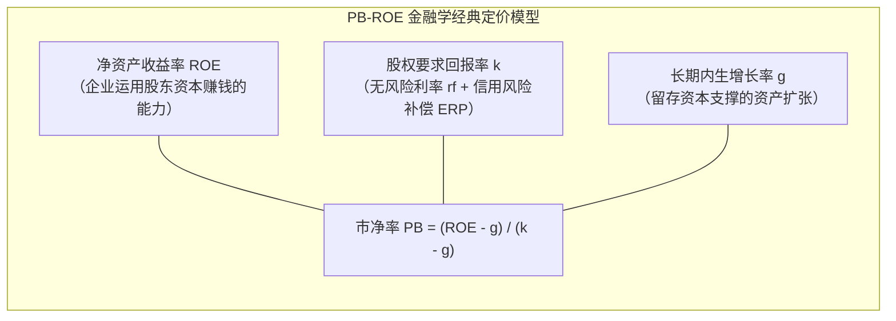
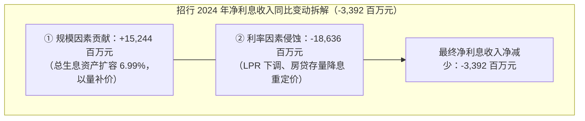
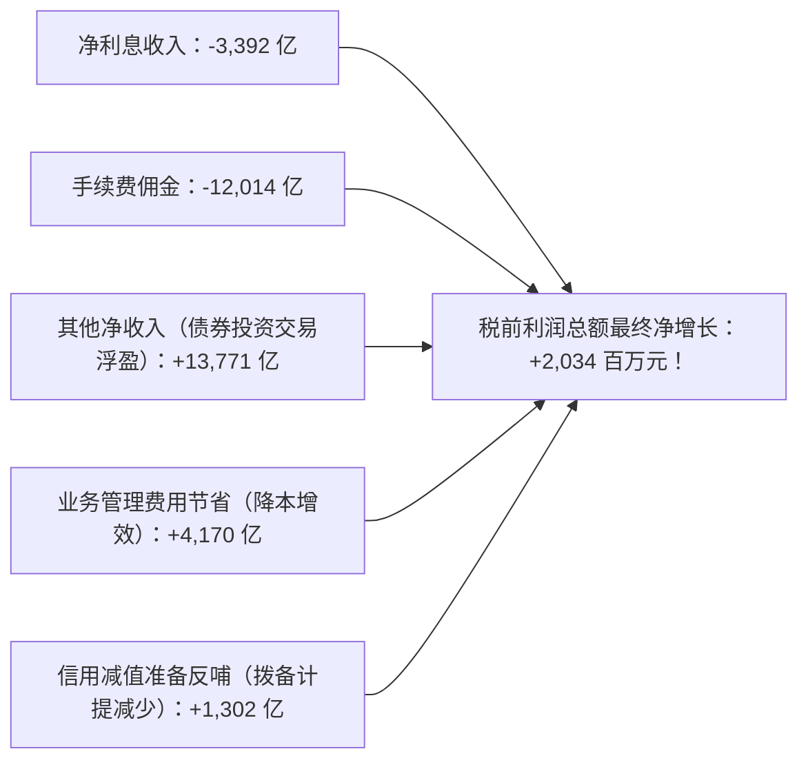
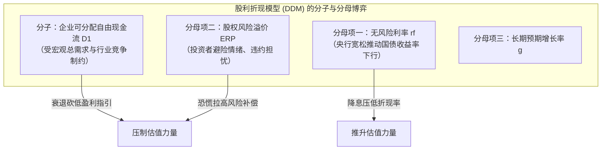

# 33 A 股估值与政策预期

[上一章：融资与回报](32-shareholder-returns.md) · [目录](./) · [下一章：交易与资金](34-trading-and-flows.md)

> 编写于 2026-10-03。权威实务案例调取招商银行 2024 年完整年度报告经审计原表；除官方编制说明外，所有估值模型参数均为学术教学用途，不作为任何投资目标参考。

**前置阅读：**美国篇 [24 股票估值与宏观传导](https://fangpings.github.io/us-econ/24-equity-valuation.html)，中国篇 [25 国债收益率](25-government-bond-yields.md)、[29 外部冲击](29-assets-external-shocks.md)。现金流折现（DCF）、终值贴现、资本资产定价模型（CAPM）与股权风险溢价（ERP）是全球资产定价的通用语言。但在 A 股市场实务中，大盘蓝筹以银行为中枢的“PB-ROE 估值框架”、大宗商品与先进制造面临的“周期低 PE 陷阱”、降息周期下资产端与负债端利差的非对称博弈，构成了中国股票估值的核心分析框架。

---

## 1. “A 股便宜”先要有一份分母说明

在财经媒体上，常常能看到“上证市盈率仅 11 倍，处于历史绝对估值洼地”的呼吁。但在严肃的量化分析师眼中，**市盈率（P/E）的高低完全取决于你用的是哪一种“分母（E）”**：

| 市盈率类型口径 | 分母（E）的选取标准 | 数据时效性与特征 | 宏观分析容易忽视的暗坑 |
| :--- | :--- | :--- | :--- |
| **静态市盈率（LYR PE）** | 上一完整公历年度已审计年报的归母净利润 | 数据真实且经过审计，但存在长达数月乃至一年的信息严重滞后 | 经济陷入下行时，上年繁荣期的高利润会虚假拉低静态 PE |
| **滚动市盈率（TTM PE）** | 过去连续 4 个季度（Trailing Twelve Months）的净利润总和 | 紧跟最新一季报动态平滑，跨周期观察最常用 | 受到个别季度非经常性投资收益暴增的临时性扭曲 |
| **动态前瞻市盈率（Forward PE）** | 卖方分析师一致预期（Consensus）对未来一至两年的净利润预测 | 反映市场最新边际定价，前瞻性最强 | 严重依赖分析师主观乐观情绪；在熊市中预测往往大幅滞后下修 |

### 聚合算法陷阱：指数 PE 是怎样算出来的？
指数的整体 PE 绝不能拿各成分股的市盈率进行简单算术平均！[上海证券交易所关于市盈率编制注释说明](https://www.sse.com.cn/aboutus/mediacenter/conference/c/10764256/files/77d5f4dd70a141ef824ac1ded0c5b55f.pdf)。

**教学对比算例**：
假设某微型组合仅包含两家企业，各占同等市值规模：
- **甲公司**：总市值 $100$ 亿元，当年净利润 $+10$ 亿元（$PE = 10$ 倍）；
- **乙公司**：总市值 $100$ 亿元，当年发生严重亏损，净利润为 $-8$ 亿元（亏损企业）。

不同的统计机构会给出三种截然不同的指数市盈率：
1. **口径 A（剔除全部亏损企业）**：仅统计盈利的甲公司，计算得：
   $$
   PE_{\text{口径 A}} = \frac{100}{10} = 10.0\text{ 倍}
   $$
2. **口径 B（包含亏损企业的真实总额法）**：用组合总市值除以净利润总代数和：
   $$
   PE_{\text{口径 B}} = \frac{100 + 100}{10 + (-8)} = \frac{200}{2} = 100.0\text{ 倍}
   $$
3. **口径 C（总市值除以正利润）**：将全体两家企业的总市值 $200$ 亿元，除以正向盈利总额 $10$ 亿元：
   $$
   PE_{\text{口径 C}} = \frac{200}{10} = 20.0\text{ 倍}
   $$

同一天、同一批股票，市盈率竟然可以在 **10 倍、20 倍与 100 倍** 之间剧烈跳跃！因此，在对比中美股市估值时，如果把 A 股剔除亏损企业的静态 PE，去对比美股标普 500 包含亏损企业且全口径合并的前瞻 PE，就是在做完全不可比的关公战秦琼。

---

## 2. 银行股为什么必须用“PB-ROE 模型”定价

在沪深 300 和上证综指中，商业银行占据了庞大的市值和利润权重。但令许多投资者百思不得其解的是：**为什么中国多数上市银行的市净率（PB）长期跌破 1.0（普遍在 0.5 - 0.7 倍徘徊），处于“深度破净”状态？这是否说明市场完全定价错误？**

在金融学中，银行这类高杠杆特许经营机构的估值，必须使用**戈登股利增长模型（Gordon Growth Model）推导出的 PB-ROE 恒等式**：

### 严格的数学推导与参数推演：
假设银行处于长期稳定经营均衡状态，资本结构保持稳定，不发生额外股权稀释：
- 设银行的利润留存率为 $b$（用于补充核心一级资本支持扩表），现金分红率为 $1 - b$；
- 银行账面净资产的内生可持续复合增长率为：
  $$
  g = b \times ROE
  $$
- 次年向普通股股东支付的现金分红为：
  $$
  D_1 = (1 - b) \times ROE \times BVPS_0 = (ROE - g) \times BVPS_0
  $$
- 将其代入股利贴现模型：
  $$
  P_0 = \frac{D_1}{k - g} = \frac{(ROE - g) \times BVPS_0}{k - g}
  $$
- 两端同时除以每股账面净资产 $BVPS_0$，得到**市净率 PB 的理论公允定价公式**：
  $$
  PB = \frac{P_0}{BVPS_0} = \frac{ROE - g}{k - g} \quad (\text{前提要求 } k > g)
  $$

### 教学参数压力测试：为什么大行破净在数学上是完全合逻辑的？
假设某大型银行：
- 长期可持续的净资产收益率预期为 $ROE = 8.0\%$；
- 长期资产与信贷合理增长率为 $g = 3.0\%$；
- 考虑到银行面临的地方债务与房地产潜在坏账敞口，二级市场机构投资者要求的综合股权资本成本为 $k = 10.0\%$。

我们计算其理论公允 PB：
$$
PB = \frac{8.0\% - 3.0\%}{10.0\% - 3.0\%} = \frac{5.0\%}{7.0\%} \approx 0.714\text{ 倍}
$$

**至关重要的金融学启示**：
当一家银行创造股东净利润的能力（$ROE = 8\%$）**实质性低于二级市场投资者承担风险所要求的必要回报率（$k = 10\%$）**时，**市净率跌破 1.0（报 0.71 倍）在资本资产定价上是极其理性和理所应当的！**
市场并不是“算错了账”，而是用打折交易的市净率来对冲银行潜在不良资产可能侵蚀账面净资产的真实风险。只有当银行切实化解了底层坏账隐患、ROE 企稳回升且风险溢价压缩时，PB 才能回归面值 1.0 以上。

---

## 3. 招商银行原表解密：息差收窄 17 个基点，净利润为什么还能增长

我们回到招商银行股份有限公司经毕马威独立审计的《2024 年年度报告全文》（印刷版第 18、21—22 页）。[招商银行 2024 年报全文](https://www.hkexnews.hk/listedco/listconews/sehk/2025/0325/2025032501329_c.pdf)。

阅读银行年报，绝对不能停留在“降息让银行难赚钱”的模糊直觉上，必须调取生息资产负债量价原表（金额单位：百万元）：

| 招行年报核心量价指标 | 2023 年度执行数 | 2024 年度执行数 | 绝对变动（基点/百万元） |
| :--- | ---: | ---: | :---: |
| **平均生息资产余额** | $9,987,796$ | $10,686,141$ | $+698,345\text{ 百万元} (+6.99\%)$ |
| **生息资产平均收益率** | $3.76\%$ | $3.50\%$ | **$-26\text{ bp}$（资产端贷款收益承压）** |
| 计息负债平均成本率 | $1.73\%$ | $1.64\%$ | **$-9\text{ bp}$（存款挂牌降息对冲成本）** |
| **净利差（NIS）** | $2.03\%$ | $1.86\%$ | **$-17\text{ bp}$（收益率减成本率）** |
| **净利息收益率（净息差 NIM）** | $2.15\%$ | $1.98\%$ | **$-17\text{ bp}$（净利息收入除以平均生息资产）** |
| **全行净利息收入** | **214,669** | **211,277** | **-3,392 百万元 (-1.58%)** |

### 极具悬念的财务审计：
净利息收入被息差收窄抹去了整整 $33.92$ 亿元，大财富管理的手续费净佣金收入也因降费减少了 $120.14$ 亿元。**但为什么招商银行 2024 年全年的税前利润总额反而逆势增加了 20.34 亿元（归母净利润逆势增加了 17.89 亿元）？**

我们逐笔还原招商银行 2024 年损益表背后的对冲法宝：

**极其精妙的利润表解剖结论**：
1. **债牛盛宴的反哺**：在 2024 年中国国债长端牛市中，招商银行敏锐运用金融投资头寸，债券交易估值收益（其他净收入）**激增了 137.71 亿元**，几乎全额填平了手续费佣金的缺口；
2. **风险拨备的调节**：前期积累的深厚拨备池发挥了“丰歉调节”的平滑蓄水池功能，信用减值损失当期**少提了 13.02 亿元**；
3. **降本增效**：精细化削减运营与管理费用 **41.70 亿元**。

正是这三项强大的综合护城河，让招商银行在息差大幅下行 17 个基点的严峻逆境中，依然达成了归母利润正增长的稳健答卷！这证明分析大行估值，决不能单凭“降息收窄息差”这一句话就武断判定银行必将利润崩盘。

---

## 4. 周期企业的“低 PE 陷阱”

在煤炭、钢铁、航运、有色金属和基础化工等周期性行业中，散户投资者最容易踩中的莫过于**低市盈率陷阱（Value Trap）**。

### 经典周期顶峰算例：
某重型海运集装箱航运公司：
- 长期常态化的年平均净利润为 $10$ 亿元；
- 某年全球突发航运运力大塞港，即期集装箱运费暴涨数倍，公司当年实现暴利净利润高达 $30$ 亿元；
- 此时二级市场投资者对其股价热捧，公司市值被推升至 $180$ 亿元。

我们计算当时的估值指标：
- **静态表面市盈率**：
  $$
  PE_{\text{静态}} = \frac{180}{30} = 6.0\text{ 倍}
  $$
  看盘软件红字闪烁：“市盈率仅 6 倍，极度低估便宜，强烈建议抄底！”
- **常态化周期的真实中枢市盈率**：
  $$
  PE_{\text{常态中枢}} = \frac{180}{10} = 18.0\text{ 倍}
  $$

**残酷的周期后市**：
次年全球塞港缓解、行业新增运力集中交付，运费断崖式崩跌，公司净利润迅速从 $30$ 亿元被打回原形降至 $5$ 亿元。
如果投资者在 $PE = 6$ 倍时贪便宜买入，随后股价一路腰斩暴跌至 $60$ 亿元，而此时的市盈率反而变成了 $60 / 5 = 12$ 倍！
*周期投资铁律*：**周期股“看似最便宜（PE 极低）之时，往往是行业利润见顶的危险逃顶时刻；看似最贵（PE 极高甚至微亏）之时，往往是行业出清的周期底部反转时刻”**。

---

## 5. 降息为什么不保证 A 股估值一定上升

许多宏观研报习惯性套用美联储教科书结论：“降息会压低无风险折现率，因此降息必然全面提振股市估值。”

但在现实经济运行中，降息往往伴随着经济基本面下行与微观企业信用风险溢价上升的复杂交织。

我们使用**经典股利折现模型（DDM）**进行严谨推演：
$$
P = \frac{D_1}{k - g} = \frac{D_1}{(r_f + ERP) - g}
$$
其中 $r_f$ 为无风险利率（如 10 年期国债收益率），$ERP$ 为股权风险溢价（Equity Risk Premium），$g$ 为长期分红增长率。

### 教学模型压力测试（假设 $g = 2.0\%$）：

| 宏观情景假设 | 下年预期分红 $D_1$ | 无风险利率 $r_f$ | 股权风险溢价 $ERP$ | 综合折现率 $k$ | 股票内在公允价值 $P$ |
| :--- | :---: | :---: | :---: | :---: | :---: |
| **基准稳态预期** | $4.00$ 元 | $3.0\%$ | $6.0\%$ | $9.0\%$ | $\frac{4.0}{9\% - 2\%} = \mathbf{57.14\text{ 元}}$ |
| **情景 A：无风险利率独立下调** | $4.00$ 元 | **$2.0\%$** | $6.0\%$ | **$8.0\%$** | $\frac{4.0}{8\% - 2\%} = \mathbf{66.67\text{ 元}} (+16.7\%)$ |
| **情景 B：降息伴随衰退与风险溢价飙升** | **$3.60$ 元** | **$2.0\%$** | **$8.0\%$** | **$10.0\%$** | $\frac{3.6}{10\% - 2\%} = \mathbf{45.00\text{ 元}} (-21.2\%)$ |

**深刻的宏观启示**：
在情景 B 中，虽然央行降息使无风险利率从 $3\%$ 降至 $2\%$，但由于宏观经济有效需求不足导致企业分红下调 $10\%$（$D_1 = 3.6$），同时投资者的避险恐慌导致风险溢价 $ERP$ 飙升至 $8\%$，综合资本成本 $k$ 反而上升至 $10\%$！
**股票公允价值不仅没有上涨，反而从 57.14 元暴跌至 45.00 元（大跌 21.2%）！**
因此，研判“政策底”与“估值底”，绝不能单线思维地把每一次降息都视为无条件的大牛市催化剂。

---

## 6. 估值与盈利的动态拆解：戴维斯双击与双杀

对于任何一家 A 股上市公司，其二级市场股价的长期涨跌，在数学上可以严格分解为**每股盈利变动（EPS 驱动）与市盈率估值倍数变动（PE 驱动）的乘法联动**：
$$
P = EPS \times PE \implies \frac{P_1}{P_0} = \frac{EPS_1}{EPS_0} \times \frac{PE_1}{PE_0}
$$

### 教学动态分解案例：
某成长型白马股期初股价为 $P_0 = 30.00$ 元，期初基本每股收益 $EPS_0 = 1.50$ 元，期初市盈率为：
$$
PE_0 = \frac{30.00}{1.50} = 20.0\text{ 倍}
$$
在经历了一年的经营后，公司主营业务表现出色，全年基本每股收益劲增至 $EPS_1 = 1.80$ 元（$EPS$ 强劲增长 $+20\%$）。但同期由于外部市场风险偏好整体下行，该股票的市盈率被市场压缩下调至 $PE_1 = 15.0$ 倍（$PE$ 估值收缩 $-25\%$）。

我们计算该股票的最终价格：
$$
P_1 = EPS_1 \times PE_1 = 1.80 \times 15.0 = 27.00\text{ 元}
$$
$$
\text{股价涨跌幅} = \frac{27.00 - 30.00}{30.00} = -10.0\%
$$

用相对乘法公式严密核算：
$$
\frac{P_1}{P_0} = (1 + 20\%) \times (1 - 25\%) = 1.20 \times 0.75 = 0.90 \implies \text{跌幅 } -10.0\%
$$

**投资学智慧**：
这家公司虽然业绩大增 $20\%$，但由于遭遇了典型的**估值压缩（PE 下降 25%）**，股价最终依然下跌了 $10\%$！
反之，当一家企业在行业底部迎来“盈利拐点向上（$\Delta EPS > 0$）”叠加“市场风险偏好提升估值修复（$\Delta PE > 0$）”时，两者将产生强大的非线性乘数共振，这就是资本市场上威力巨大的**戴维斯双击（Davis Double-Play）**！

---

## 7. 练习与逐步参考答案

### 思考与练习

1. 假设某银行类上市公司的长期可持续净资产收益率为 $ROE = 12.0\%$，长期增长率为 $g = 4.0\%$，二级市场投资者要求的股权资本成本为 $k = 10.0\%$。请根据戈登 PB-ROE 理论定价模型，列式计算该银行的理论公允市净率（PB）。在实务中应用该公式时，分析师最需要警惕哪些隐含财务假设？
2. 某公司股价在过去一年内由 $30.00$ 元下跌至 $27.00$ 元，同期的基本每股收益（EPS）却由 $1.50$ 元增长到了 $1.80$ 元。请分别计算其市盈率（PE）的变动幅度，并用乘法公式验证其股价的最终变动率。
3. 某量化研报指出：“由于 10 年期国债收益率当前仅为 2.0%，而沪深 300 的滚动盈利收益率（E/P）高达 8.0%，因此两者的差额 6.0% 说明当前 A 股的实际股权风险溢价（ERP）达到了历史最高水平，买入必赚。”请驳斥该观点的片面性。
4. 某大型央企同时在 A 股和 H 股上市，A 股对 H 股长期保持 $33.3\%$ 的溢价率。能否仅凭这一跨市场价差，得出“中国的宏观 GDP 增长完全脱离了股票市场定价”的结论？

---

点击展开逐步参考答案与解析

1. **计算与解析**：
   $$
   PB = \frac{ROE - g}{k - g} = \frac{12.0\% - 4.0\%}{10.0\% - 4.0\%} = \frac{8.0\%}{6.0\%} \approx 1.333\text{ 倍}
   $$
   *实务核查警示*：
   - 必须核查 $ROE = 12\%$ 是否依赖过度加杠杆或过低的不良贷款拨备计提；
   - 必须核查资产负债表上的账面净资产是否存在未确认的表外潜在隐性资产损失；
   - 必须核查利润是否受到监管核心资本充足率的约束而无法实际用于现金分红。

2. **计算过程**：
   - 期初市盈率：$PE_0 = \frac{30.00}{1.50} = 20.0\text{ 倍}$；
   - 期末市盈率：$PE_1 = \frac{27.00}{1.80} = 15.0\text{ 倍}$；
   - 市盈率变动率：
     $$
     \Delta PE = \frac{15.0 - 20.0}{20.0} = -25.0\%
     $$
   - 乘法公式验证：
     $$
     \frac{P_1}{P_0} = \frac{EPS_1}{EPS_0} \times \frac{PE_1}{PE_0} = \left(\frac{1.80}{1.50}\right) \times \left(\frac{15.0}{20.0}\right) = 1.20 \times 0.75 = 0.90
     $$
     股价综合跌幅为：$0.90 - 1 = -10.0\%$。

3. **解答**：
   该观点混淆了“静态会计盈利收益率”与“投资者真实可支配自由现金流回报”：
   - **会计利润不等于现金流**：$8.0\%$ 的盈利收益率包含了未变成现金的应收账款和为维持扩大再生产必须留存的资本开支，并不代表投资者到手能拿到的真实分红；
   - **缺乏增长与信用成本考量**：如果宏观经济面临通缩与信用减值压力，未来的盈利中枢可能大幅下修，静态的 $E/P$ 会被迅速侵蚀；
   - 简单的利差（$E/P - r_f$）仅能作为估值相对水位的参考信号，绝不能将其机械等同于无套利理论下的纯净股权风险溢价。

4. **解答**：
   完全不能得出这一结论。
   - A/H 股溢价反映的是**在岸市场与离岸市场之间的制度分割、资本流动管制摩擦、两地无风险基准利率差异以及投资者群体结构（散户高流动性溢价 vs 机构外资配置）的定价分歧**；
   - 两地市场对该企业未来长期的经营现金流均保持着灵敏的反应。跨市场价差属于金融微观市场结构范畴，不能随意上纲上线推导宏观 GDP 核算的失灵。

---

[上一章：融资与回报](32-shareholder-returns.md) · [目录](./) · [下一章：交易与资金](34-trading-and-flows.md)
