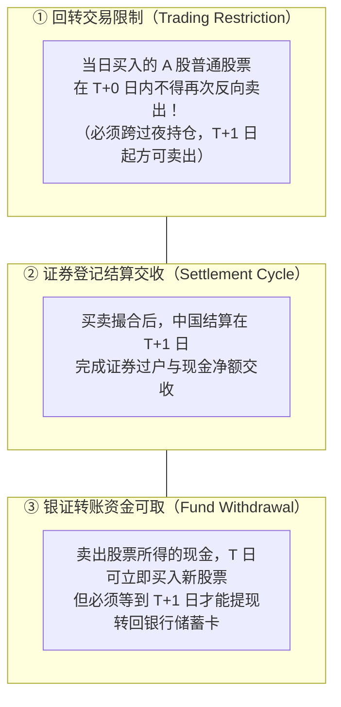
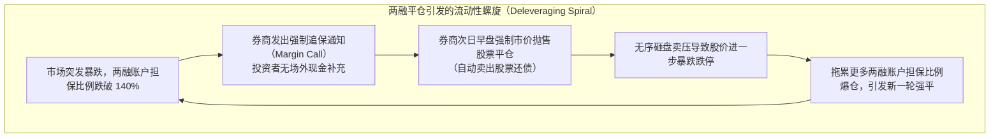
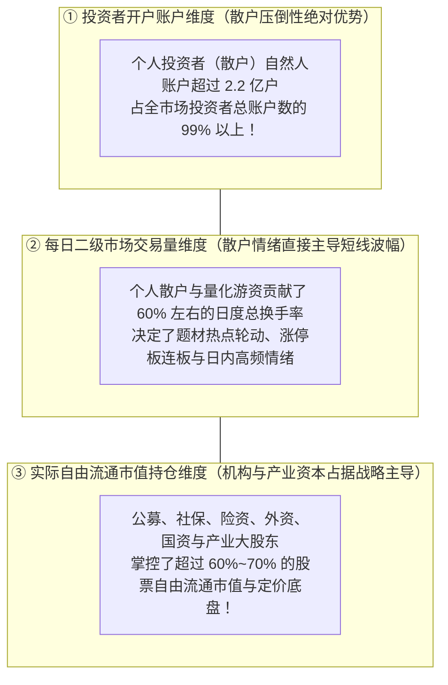

# 34 A 股交易制度与资金行为

[上一章：估值](33-equity-valuation.md) · [目录](./) · [下一章：长期回报](35-equity-long-run.md)

> 编写于 2026-10-03。交易规则依据沪深北交易所最新施行文件，历史融资融券与互换便利政策严格标明政策出台时点；所有微观交易与信用账户数据均为学术教学用途。

**前置阅读：**美国篇 [25 资金、期权与市场波动](https://fangpings.github.io/us-econ/25-equity-flows-and-volatility.html)。ETF 双层套利机制、杠杆保证金交易与衍生品对冲的微观微观结构全球共通。但在中国 A 股独特的微观市场结构中，“T+1 股票交易制度”、“10% / 20% 涨跌幅限制”、“散户高频交易与机构持仓的二元博弈”、“融资融券强平踩踏”，以及 2024 年央行创设的“证券互换便利（SFISF）与回购增持再贷款”，构成了塑造 A 股短期价格波动与流动性格局的关键力量。

---

## 1. 先分清三个“T+1”：交易、交收与资金可取

在资本市场讨论中，“T+1”经常被误用为一个笼统的口头禅。但实际上，交易员面对的是三个完全不同的约束：

| 约束维度 | 制度核心定义 | 适用范围与例外规则 | 跨国对比核心防坑指南 |
| :--- | :--- | :--- | :--- |
| **当日回转限制 （“当天不能卖”）** | 投资者在 T 日买入的证券，在 T 日收盘前不得卖出；防范日内过度高频投机 | **普通 A 股严格执行**；但跨境 ETF、港股通 ETF、债券 ETF 普遍允许日内 **T+0 实时回转交易**！ | 绝不能说“中国所有证券都不能日内回转”；必须按 ETF 基金合同确认品种 |
| **中央交收周期 （“结算过户时间”）** | 交易所撮合后，中央证券存管机构完成证券与资金法律所有权最终交收的时间 | 中国结算实行 T+1 净额交收；美国股市自 2024 年 5 月起也正式迈入 **T+1 交收时代** | 美国的“T+1”指的是**交收清算周期（Settlement）**，绝不等于美国禁止投资者做日内 T+0 交易！ |

依据上交所 2026 年最新施行规则：普通 A 股投资者如果早盘追高买入某只股票，哪怕盘中突发惊天暴雷，当天也只能眼睁睁看着浮亏扩大而**无法止损抛盘**，必须承担硬性的隔夜极端风险。

---

## 2. 涨跌幅限制怎样影响你看到的价格

中国股市为了防范股价过度暴涨暴跌，设立了鲜明的价格日内波动带限制（Price Limits）：[上海证券交易所交易规则](https://www.sse.com.cn/lawandrules/sselawsrules2025/fund/trading/c/c_20260424_10817739.shtml)、[深圳证券交易所交易规则](https://docs.static.szse.cn/www/lawrules/rule/trade/W020260424690713155663.pdf)、[北京证券交易所交易规则](https://www.bse.cn/jygl_list/200028217.html)。

| 交易所及板块 | 常规股票日常涨跌幅限制 | 新股上市初期特殊不设限窗口 |
| :--- | :---: | :--- |
| **沪深主板（Main Board）** | **$\pm 10\%$** | 首次公开发行（IPO）上市**前 5 个交易日不设涨跌幅限制** |
| **科创板 / 创业板（STAR / ChiNext）** | **$\pm 20\%$** | 首次公开发行（IPO）上市**前 5 个交易日不设涨跌幅限制** |
| **北交所（BSE）** | **$\pm 30\%$** | 公开发行上市首日不设涨跌幅限制，次日起实行 $\pm 30\%$ |
| **风险警示板（ST / *ST 股）** | **$\pm 5\%$** | 旨在警示退市风险，大幅收窄日内波幅 |

### 涨跌停板背后的价格发现与流动性阻断：
假设某主板股票前一日收盘价为 $10.00$ 元，今日允许成交的法定最低价（跌停价）为 $9.00$ 元（跌幅 $-10\%$）。
早盘该企业突发造假暴雷，理性投资者评估其内在价值仅值 $8.50$ 元。
此时市场上涌现出数千万股巨额卖单挂在跌停价 $9.00$ 元排队，但没有任何买方愿意进场接飞刀：
- 交易行情软件上显示的成交价被锁死在 **$9.00$ 元（跌停板封死）**；
- **但绝不能得出“公司只跌了 10%、资产价值很稳”的错误结论！**
- 此时跌停板事实上**完全切断了交易流动性**，挂单无法成交，排在后面的普通散户根本无法按 $9.00$ 元割肉逃生。真实的跌幅被制度平摊延后到了接下来的数个连续跌停日中释放。

---

## 3. 融资融券：维持担保比例与强制平仓的恶性负反馈

两融（Margin Financing & Securities Lending）是 A 股最具代表性的场内杠杆交易工具。投资者向券商借入资金买股票称为**融资买入**；借入股票卖出称为**融券卖出**。

### 维持担保比例（Margin Ratio）的数学定义：
$$
\text{维持担保比例} = \frac{\text{现金} + \text{信用账户内证券市值}}{\text{融资买入金额} + \text{融券卖出金额} + \text{利息及相关费用}}
$$

**杠杆账户穿透推演模型**：
某投资者自有本金现金 $100$ 万元，在券商处申请 $1$ 倍杠杆，融资借款 $100$ 万元，将合计 $200$ 万元资金全额买入某科技股票（资产端股票市值 $200$ 万元，负债端欠券商 $100$ 万元债务，忽略借贷利息）：
- 初始维持担保比例为：
  $$
  \text{初始担保比例} = \frac{200}{100} = 200\%
  $$
- 券商设定的**追保维持担保比例平仓红线为 $150\%$（1.5 倍）**。

假设该股票遭遇系统性调整，股价重挫 $30\%$：
- 信用账户内的股票市值缩水至：$200 \times (1 - 0.30) = 140$ 万元；
- 欠券商的债务依然是刚性的 $100$ 万元；
- 投资者的所有者权益（自有本金）缩水至：$140 - 100 = 40$ 万元（**自有本金暴跌 60%！**）；
- 此时账户的维持担保比例跌至：
  $$
  \text{最新担保比例} = \frac{140}{100} = 140\% < 150\%
  $$

### 投资者若没有场外追加现金，必须强制卖出多少股票？
设投资者被迫在二级市场主动市价卖出价值 $x$ 万元的股票，并将所得现金全额用于偿还券商融资借款：
- 卖出后剩余股票市值为 $140 - x$；
- 偿还后剩余负债为 $100 - x$；
- 欲使担保比例刚好恢复到警戒线 $150\%$（$1.5$ 倍）：
  $$
  \frac{140 - x}{100 - x} = 1.5
  $$
  $$
  140 - x = 1.5 \times (100 - x) = 150 - 1.5x
  $$
  $$
  0.5x = 10 \implies x = 20\text{ 万元}
  $$

投资者必须在开盘**无条件割肉抛售 20 万元股票**！
这种由数学契约驱动的被动抛盘，完全不顾企业基本面优劣。在极端单边行情中，两融踩踏与涨跌停板互为因果，是造成 A 股历史上数次“流动性急剧枯竭”的核心微观传导机制。

---

## 4. ETF 规模狂飙：如何剥离“价格暴涨”与“资金真买入”

近年来，宽基 ETF（如沪深 300 ETF、中证 500 ETF）规模突破万亿元大关。许多财经头条欢呼“某宽基 ETF 本季度资产规模暴增 21 亿元，外资疯狂抄底！”

专业量化审计师必须立刻将基金规模的增长分解为两个正交维度：

$$
\Delta \text{ETF 基金总规模} = \underbrace{\text{原有份额的价格上涨重估}}_{\text{价格净值效应}} + \underbrace{\text{新申购份额投入的现金对价}}_{\text{真金白银净流入}}
$$

### 教学分解案例：
某核心宽基 ETF：
- 期初：存量基金份额为 $100$ 亿份，单位净值为 $1.00$ 元，期初基金总资产净值为 $100$ 亿元；
- 期间大盘强劲上涨，该 ETF 单位净值攀升至 $1.10$ 元（净值上涨 $+10\%$）；
- 在净值上涨后，市场情绪被点燃，机构投资者在二级市场通过一篮子股票净申购了 $10$ 亿份新份额；
- 期末：总份额变为 $100 + 10 = 110$ 亿份，期末总资产净值为：
  $$
  110 \times 1.10 = 121\text{ 亿元}
  $$
  总规模账面暴增了 $121 - 100 = 21$ 亿元！

我们进行严格的数学增量拆解：
$$
\text{价格上涨贡献} = 100\text{ 亿份} \times (1.10 - 1.00) = 10.0\text{ 亿元}
$$
$$
\text{真实新申购净投入资金} = 10\text{ 亿份} \times 1.10\text{ 元/份} = 11.0\text{ 亿元}
$$
$$
\text{规模总增长} = 10.0 (\text{净值重估}) + 11.0 (\text{真实净流入}) = 21.0\text{ 亿元}
$$

**核心交易学铁律**：
- 如果该基金全天二级市场撮合成交额高达 $300$ 亿元，这 $300$ 亿元仅仅是投资者在场内相互把份额倒手转让，**根本不改变 ETF 的总份额与总规模**！
- 只有授权申购赎回券商（AP）通过交付一篮子股票向基金公司真正进行**一级市场申购创设**时，才会形成真实的增量配置力量。

---

## 5. 散户与机构的博弈二元性：开户人数 $\neq$ 资金主导权

很多人张口就说“A 股是个散户市，散户追涨杀跌主导一切”。这种论断只说对了一半，忽视了资本市场的**账户、交易与持仓的三维分离**：

上交所公布的《ETF 投资交易白皮书》显示：沪市 ETF 虽有 658 万持有人户数，但机构投资者的**持仓市值占比超过 70%**！
因此：**散户贡献了最大的交易换手与情绪波动，但机构资本掌控了最根本的资产定价底仓**。分析 A 股必须兼顾散户情绪驱动的短期微观微观动量，以及机构持仓驱动的长期基本面中枢。

---

## 6. 央行支持资本市场两大超级创新工具的机制穿透

2024 年 10 月，中国人民银行会同金融监管总局、中国证监会，创设了我国金融历史上首批支持资本市场的结构性货币政策工具。[中国人民银行货币政策执行报告及三部门通知](https://www.pbc.gov.cn/redianzhuanti/118742/5444129/5444142/481faf4556cb42a5b444677b9673ea5c/index.html)。

这两大工具通过独特的制度设计，打通了央行基础货币、银行流动性与资本市场权益资产之间的安全防火墙：

```mermaid
flowchart TD
    subgraph Tool1["工具一：证券、基金、保险公司互换便利 (SFISF)"]
        S_PBOC["中国人民银行"] <-->|"① 提供高流动性国债/央票互换<br/>（不投放基础货币）"| S_INST["符合条件的券商/公募/险资"]
        S_INST -->|"② 将换入的高等级国债在银行间抵押融资"| S_REPO["获取巨额低成本低息资金"]
        S_REPO -->|"③ 专款专用全额买入 A 股股票与宽基 ETF"| S_MKT["二级市场核心股票资产"]
    end

    subgraph Tool2["工具二：股票回购增持专项再贷款"]
        R_PBOC["中国人民银行<br/>（提供 1.75% 优惠再贷款资金）"] -->|"① 批发性资金供给"| R_BANK["21 家主要商业银行"]
        R_BANK -->|"② 按不超过 2.25% 利率发放专项贷款"| R_CORP["上市公司及主要大股东"]
        R_CORP -->|"③ 专项用于二级市场回购与增持本公司股票"| R_BUY["注销股票或长期持有稳定市值"]
    end
```

### 工具一：证券、基金、保险公司互换便利（SFISF，首期 5000 亿元）
- **核心原理不是央行直接买股票**：机构用自身持有的流动性较差的股票、ETF 资产作为质押，向央行换入**国债、央行票据等高流动性一级安全资产**；
- 机构再将换来的国债在银行间回购市场质押融资借出真金白银现金，**专项全部投入股票市场增持**；
- **资产负债表穿透**：机构借了钱买股票，依然承担股票下跌的投资风险；央行不直接承担股票市场波动，工具额度不等于已入市买入金额。

### 工具二：股票回购增持再贷款（首期 3000 亿元）
- 商业银行向上市公司和控股大股东发放专属贷款，年化利率极低（约 $2.25\%$）；
- 央行按贷款本金的 $100\%$ 向商业银行提供年利率仅 $1.75\%$ 的低息再贷款资金支持；
- **套利逻辑与闭环**：当大盘蓝筹公司的**股息率高达 5% 时**，大股东以 **2.25% 的低息贷款**借钱回购自家股票，光是吃股息差就能净赚 $2.75\%$ 的无风险确定性套利利润！这形成了推动上市公司回购注销、稳定股价的极其强大的内生正向激励机制。

---

## 7. 练习与逐步参考答案

### 思考与练习

1. 某主板股票早盘突发重大利好，开盘即被 $5,000$ 万股巨额买单顶死在涨停板（涨幅 $+10\%$），全天实际撮合成交量仅有 $1,000$ 手（10 万股）。能否认为市场上所有挂单的散户投资者都能按照该涨停价买到该股票？
2. 某投资者信用账户期初无负债，自有现金 $100$ 万元全额融资买入 $200$ 万元股票（借款 $100$ 万元）。当股票市值下跌至 $140$ 万元时，若券商要求维持担保比例必须达到 $150\%$，在投资者不追加任何场外现金的前提下，其必须在二级市场强制市价卖出多少万元的股票还债？
3. 某沪深 300 ETF 基金期初规模为 $100$ 亿份，单位净值为 $1.00$ 元（期初净资产 $100$ 亿元）。期末单位净值涨至 $1.20$ 元，存量总份额依然为 $100$ 亿份（没有发生新的净申购）。该基金期末总资产净值达到 $120$ 亿元。某自媒体宣称“该 ETF 本期迎来了 20 亿元真金白银的新增场外资金净买入抄底”，请驳斥该荒谬推论。
4. 某部委发布会宣布“创设规模为 5,000 亿元的证券互换便利（SFISF）工具”，某券商策略会当晚宣布：“明天开盘 A 股将迎来 5,000 亿元央行增量流动性直接入市暴拉股票！”请指出该策略分析师在央行工具机制上的致命认知漏洞。

---

点击展开逐步参考答案与解析

1. **解答**：
   绝不能这样认为。
   - 涨停板虽然展示了 $+10\%$ 的上限价格，但由于卖方惜售几乎没有人愿意卖出，买方订单在交易所撮合主机中严重积压排队；
   - 绝大多数排在队尾的普通散户订单全天根本无法撮合成交。**涨停板和跌停板在极大程度上阻断了连续撮合的市场流动性**，挂单价格不能代表全市场各方实际达成的可交易规模。

2. **计算过程**：
   设强制卖出股票金额为 $x$ 万元，卖出所得现金全额偿还融资负债：
   $$
   \text{剩余股票市值} = 140 - x
   $$
   $$
   \text{剩余融资负债} = 100 - x
   $$
   依据券商设定的 $150\%$（$1.5$ 倍）维持担保比例红线：
   $$
   \frac{140 - x}{100 - x} = 1.5 \implies 140 - x = 150 - 1.5x \implies 0.5x = 10 \implies x = 20\text{ 万元}
   $$
   该投资者必须在二级市场市价被动抛售 **$20$ 万元** 股票用于清偿债务。

3. **解答**：
   该推论完全混淆了“存量资产市值价格重估”与“增量真实资金流量”：
   - 基金存量总份额从始至终精准保持在 $100$ 亿份，**净申购创设份额为零**（真金白银净流入流量为 $0$ 元！）；
   - 规模增加的 $20$ 亿元（$120 - 100$）完全是由底层持仓股票价格上涨推动基金单位净值由 $1.00$ 元跳升至 $1.20$ 元带来的**账面净值膨胀效应（Capital Gain）**，没有任何外部新资金入场买入。

4. **解答**：
   存在极度严重的**央行货币政策工具机制误解**：
   - **额度不等于入市现金**：$5,000$ 亿元是央行授权的“互换资产业务额度总上限”，并不是央行直接印钞拨付的现金；
   - **工具不是直接入场买股**：央行通过互换便利提供的是国债和央票等高等级抵押券，非银金融机构从央行换得国债后，还必须到银行间市场寻找交易对手质押借出资金，最后由机构基于自身商业判断自主择机买入股票；
   - 整个过程存在审核准入、质押折扣率与机构建仓时机等多道环节，绝不能直接等同于次日开盘央行直接动用 5000 亿暴力拉升指数。

---

[上一章：估值](33-equity-valuation.md) · [目录](./) · [下一章：长期回报](35-equity-long-run.md)
