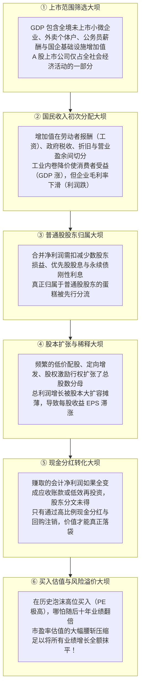
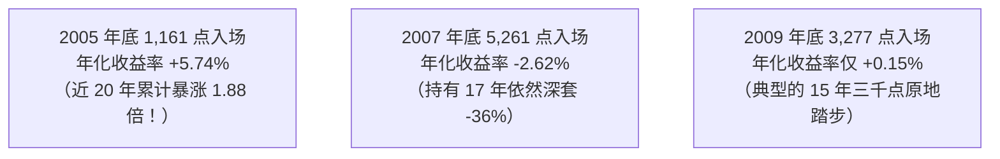
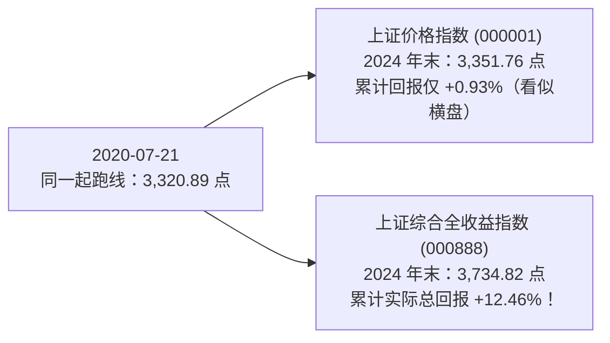
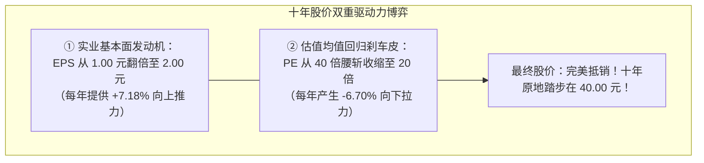
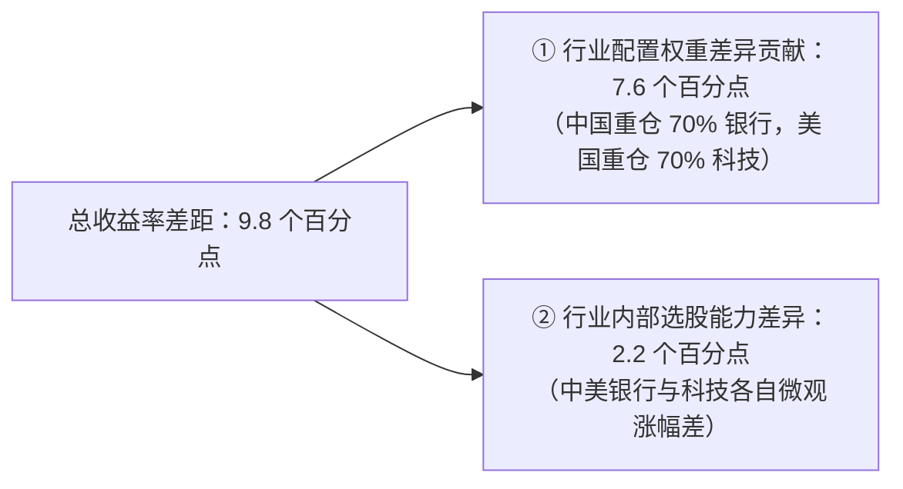

# 35 A 股长期回报与经济基本面

[上一章：交易与资金](34-trading-and-flows.md) · [目录](./) · [下一章：房地产开发](36-housing-development.md)

> 编写于 2026-10-03。所有行情与历史统计案例统一截止至 2024 年末，是对一段已载入史册历史周期的严密学术复核，不代表当前最新点位。官方统计数据、学术计量测算与教学模型推演均严格区分列示。

**前置阅读：**美国篇 [23 企业盈利](https://fangpings.github.io/us-econ/23-corporate-earnings.html)、[24 估值](https://fangpings.github.io/us-econ/24-equity-valuation.html)、[25 市场波动](https://fangpings.github.io/us-econ/25-equity-flows-and-volatility.html)，中国篇第 30 至 34 章。在学完指数编制、财报筛选、公司治理与交易制度后，我们终于来到了整个股票模块终极的核心问题：**为什么过去二十年中国名义 GDP 实现了波澜壮阔的数倍高增，而某些 A 股指数的投资者却长期感叹“未能获得相称的回报”？**“股市与基本面彻底脱节”或者“纯粹是因为没算分红”，这两种民间极端论调到底哪一个经得起数据的实证检验？

---

## 1. 宏观增长到股东回报的六道大坝

股票资产回报的底层定价锚是：**以初始买入价格购入的未来每股可支配自由现金流**。
宏观 GDP 与投资者最终落袋收益之间，从来不存在任何自动等幅转换的会计法宝。二者之间至少隔着六道层层削减或稀释的“微观大坝”：

---

## 2. “万年三千点”对买入起点的极端敏感性

翻开上交所官方发布的《上海证券交易所统计年鉴 2025 卷》（历年股票交易数据，印刷版第 7 页），以 **2024 年末收盘点位 3,351.76 点** 为统一的考核终点，我们来严谨计算不同年份买入并持有到 2024 年底的真实年化复合价格回报率（CAGR，不含分红）：

| 投资买入起点（年末收盘） | 当年年末上证点位 | 历经完整投资年限 | 截至 2024 年末累计价格回报 | 几何年化复合收益率 (CAGR) |
| :---: | :---: | :---: | :---: | :---: |
| **2005 年末（股权分置改革底）** | **1,161.06** | **19 年** | **+188.68%** | **+5.74%** |
| **2007 年末（超级大牛市顶峰）** | **5,261.56** | **17 年** | **-36.30%** | **-2.62%** |
| **2009 年末（四万亿刺激高点）** | **3,277.14** | **15 年** | **+2.28%** | **+0.15%** |
| **2014 年末（杠杆牛市启动前）** | **3,234.68** | **10 年** | **+3.62%** | **+0.36%** |
| **2021 年末（核心资产抱团高点）** | **3,639.78** | **3 年** | **-7.91%** | **-2.71%** |

### 严格的年化数学核算公式：
$$
\text{2009—2024 累计回报} = \frac{3,351.76}{3,277.14} - 1 = +2.28\%
$$
$$
\text{15 年复合年化收益率} = \left(\frac{3,351.76}{3,277.14}\right)^{\frac{1}{15}} - 1 \approx +0.15\%
$$

**极其发人深省的实证结论**：
1. **“万年三千点”现象确实真实存在于特定历史窗口中**：如果你不幸在 2009 年底（3,277 点）或 2014 年底（3,234 点）买入上证指数，持有长达 10 到 15 年，纯价格指数的涨幅确实只有微不足道的 $2\%-3\%$，近乎原地踏步；
2. **买入估值决定长期命运**：如果在 2005 年股权分置改革历史大底（$1,161$ 点）逆向布局，年化复合回报达到极其可观的 **$+5.74\%$**（累计翻了近两倍）；如果在 2007 年泡沫顶峰（$5,261$ 点）追高买入，经历 17 年漫长岁月依然亏损逾 $36\%$！
只挑一个底部吹嘘 A 股长期大牛市，或者只挑一个泡沫顶峰咒骂股市无用，都是脱离金融科学的不严肃偏见。

---

## 3. 分红到底改变了多少：被价格指数抹平的真金白银

前一章已经指出，上证综合指数（000001）是一个不含任何现金分红的纯价格指数。如果把中国上市公司每年真金白银派发的股息红利全额再投资，长期回报会发生怎样的剧烈质变？

我们调取上交所权威发布的官方数据：
- **2024 年单年回报对比**：
  - 普通上证综合指数（纯价格）：全年上涨 **$+12.67\%$**；
  - 上证综合全收益指数（000888，含红利再投资）：全年上涨 **$+16.15\%$**；
  - **仅仅一年时间，分红就为股东创造了整整 3.48 个百分点的超额确定性收益！**
- **同起点中长期回测（2020 年 7 月 21 日至 2024 年末）**：
  上交所以 2020 年 7 月 21 日为基期（基点均为 $3,320.89$ 点），同步运行两只指数：
  - 到 2024 年末，普通上证综指点位为 $3,351.76$ 点，四年半累计仅微涨 **$+0.93\%$**（给公众留下了“四年不涨”的灰暗印象）；
  - 而同期上证综合全收益指数（000888）点位攀升至 **3,734.82 点**，累计真实净值涨幅高达 **+12.46%**！

分红彻底修正了长期以来的“收益统计失真”。但作为清醒的分析师也必须看到：全收益指数虽然将四年半的回报提升到了 $12.46\%$（年化约 $2.6\%$），但这一回报率依然低于同期许多投资者买入高息银行理财或长期国债的收益。分红解释了部分统计遗漏，但无法单独掩盖全市场在某些时期的结构性估值挤压。

---

## 4. 盈利增长 vs 估值压缩：经典的“业绩翻倍、股价不涨”

很多股民经常困惑：“某龙头公司过去十年净利润翻了整整一倍，为什么股价十年后还在原位原地踏步？”

我们用最纯粹的金融学戴维斯双杀公式进行严谨复盘：

### 教学模型严密推演：
假设某优质白马制造企业，总股本 10 年内保持恒定，无增发无配股：
- **期初状态（$T_0$）**：处于牛市估值泡沫狂热期，每股收益 $EPS_0 = 1.00$ 元，市场给予高达 $PE_0 = 40.0$ 倍的高估值市盈率：
  $$
  P_0 = EPS_0 \times PE_0 = 1.00 \times 40.0 = 40.00\text{ 元}
  $$
- **经历十年的实业拼搏（$T_{10}$）**：企业管理层兢兢业业，十年间每股盈利实现了整整翻倍高增，达到 $EPS_{10} = 2.00$ 元：
  $$
  \text{EPS 十年年化复合增速} = \left(\frac{2.00}{1.00}\right)^{\frac{1}{10}} - 1 \approx +7.18\%
  $$
- **估值体系的理性均值回归**：经过十年大浪淘沙，该行业从新兴高增长迈入成熟期，二级市场给予的市盈率被理性压缩腰斩至 $PE_{10} = 20.0$ 倍：
  $$
  \text{PE 估值十年年化收缩率} = \left(\frac{20.0}{40.0}\right)^{\frac{1}{10}} - 1 \approx -6.70\%
  $$

我们计算十年后的最终股票价格：
$$
P_{10} = EPS_{10} \times PE_{10} = 2.00 \times 20.0 = 40.00\text{ 元！}
$$
$$
\text{十年股价涨跌幅} = \frac{40.00 - 40.00}{40.00} = \mathbf{0.00\%}
$$

用复合公式核算：
$$
(1 + 7.18\%) \times (1 - 6.70\%) - 1 = 1.0718 \times 0.9330 - 1 \approx 0.00\%
$$

**如果在此期间公司实施分红呢？**
假设公司在这十年中，每年年末从利润中拿出每股 $1.00$ 元现金向股东分红：
- 股东十年累计落袋现金红利：$1.00 \times 10 = 10.00$ 元；
- 股东期末总财富变更为：股票现值 $40.00$ 元 $+$ 现金红利 $10.00$ 元 $= 50.00$ 元；
- **投资者的真实十年复合年化回报率提升为**：
  $$
  \text{全收益年化回报} = \left(\frac{50.00}{40.00}\right)^{\frac{1}{10}} - 1 = (1.25)^{0.1} - 1 \approx +2.26\%
  $$

**至理名言**：**好公司不等于好股票，卓越的实业增长如果买在估值泡沫顶峰，投资者不得不耗费整整十年的业绩高增长，去消化昔日过高买入估值被腰斩的惨重代价**！

---

## 5. 跨国回报差距拆解：Brinson 行业资产配置归因

当对比中美股市过去数年的回报差异时，绝不能轻易武断地得出“全是因为制度不行”。很多时候，**两个国家的股市回报差距在极大程度上是由不同指数的‘行业编制权重’所决定的**。

我们采用现代投资组合管理中最经典的 **Brinson 绩效归因模型**，进行严格的数学定量拆解：

### 教学中美两行业模型设定：
假设全球只有两大行业：**传统银行与原材料（传统经济）** vs **新一代科技互联网（新质生产力）**。
- **中国代表性组合**：传统银行权重占 $70\%$，科技互联网占 $30\%$；
- **美国代表性组合**：传统银行权重占 $30\%$，科技互联网占 $70\%$；
- **当年各行业实际涨幅**：
  - 传统银行行业：中国银行涨 $+5.0\%$，美国银行涨 $+6.0\%$；
  - 科技互联网行业：中国科技股涨 $+20.0\%$，美国科技股涨 $+25.0\%$。

我们首先计算两个组合的总收益率：
$$
R_{\text{中国组合}} = 70\% \times 5.0\% + 30\% \times 20.0\% = 3.5\% + 6.0\% = 9.5\%
$$
$$
R_{\text{美国组合}} = 30\% \times 6.0\% + 70\% \times 25.0\% = 1.8\% + 17.5\% = 19.3\%
$$
$$
\text{总收益率差距} = 19.3\% - 9.5\% = \mathbf{9.8\text{ 个百分点}}
$$

### Brinson 严格数学归因公式分解（以美国行业收益率为参照基准）：

#### 维度一：行业资产配置差异贡献（Asset Allocation Effect）
$$
\Delta R_{\text{Allocation}} = \sum (w_{\text{US}, i} - w_{\text{CN}, i}) \times R_{\text{US}, i}
$$
$$
= (30\% - 70\%) \times 6.0\% + (70\% - 30\%) \times 25.0\%
$$
$$
= (-40\%) \times 6.0\% + (+40\%) \times 25.0\% = -2.4\% + 10.0\% = \mathbf{+7.6\text{ 个百分点}}
$$

#### 维度二：行业内部选股回报差异贡献（Stock Selection Effect）
$$
\Delta R_{\text{Selection}} = \sum w_{\text{CN}, i} \times (R_{\text{US}, i} - R_{\text{CN}, i})
$$
$$
= 70\% \times (6.0\% - 5.0\%) + 30\% \times (25.0\% - 20.0\%)
$$
$$
= 70\% \times 1.0\% + 30\% \times 5.0\% = 0.7\% + 1.5\% = \mathbf{+2.2\text{ 个百分点}}
$$

#### 综合加总验证：
$$
\text{总归因差距} = \Delta R_{\text{Allocation}} + \Delta R_{\text{Selection}} = 7.6\% + 2.2\% = 9.8\text{ 个百分点！}
$$

**极度震撼的定量洞察**：
在这 $9.8$ 个百分点的巨大收益鸿沟中，**有整整 7.6 个百分点（占比高达 77.6%）完全是由两国指数‘把钱投在哪个行业’的权重编制差异造成的！**
美股标普 500 和纳斯达克通过苹果、微软、英伟达、谷歌等科技巨头独占鳌头（科技权重超过 30%-40%），享受了全球数字科技革命的爆发红利；而中国传统主板指数中银行、基建、煤炭石化占据大半壁江山。即使中美两国的银行业、科技业各自内部的表现相差无几，单凭这一行业权重分布的结构性差异，就会造成跨国指数长期走势的巨大剪刀差！

---

## 6. 从 GDP 到老股东每股价值：一张完整的微观推演大账

为了将全书四个模块的所有财务金融知识融会贯通，我们通过一个两期微观闭环模型，彻底看清从“国家经济繁荣”到“二级市场老股东亏损”的全部严密传导路径：

**全流程教学推演数据**（金额单位：亿元）：

| 宏观与微观演化环节 | 初始基准期（$T_0$） | 发展成熟期（$T_1$） | 期间相对变动幅度 | 对应章节与金融机制解析 |
| :--- | :---: | :---: | :---: | :--- |
| **① 境内名义 GDP 增加值** | **$1,000$ 亿元** | **$1,200$ 亿元** | **+20.0%** | 第 05 章：全社会宏观货物与服务产出强劲增长 |
| **② 上市企业集团合并总营收** | $500$ 亿元 | $600$ 亿元 | **+20.0%** | 第 08 章：上市公司产品销量扩大，销售总额高增 |
| 集团销售净利润率 | $10.0\%$ | $8.0\%$ | $-2.0\text{ 个百分点}$ | 行业激烈竞争内卷，为降价保份额导致毛利压缩 |
| **③ 上市企业合并净利润总额** | **$50$ 亿元** | **$48$ 亿元** | **-4.0%** | 第 09 章：营业总收入虽然高增，但企业总利润下滑 |
| 扣减：子公司少数股东损益 | $5$ 亿元 | $8$ 亿元 | $+60.0\%$ | 第 31 章：高利润业务子公司被合作方切走更多份额 |
| **④ 归属于母公司股东净利润** | **$45$ 亿元** | **$40$ 亿元** | **-11.1%** | 归母净利润跌幅进一步扩大至 $-11.1\%$ |
| 扣减：永续债与优先股固定利息 | $5$ 亿元 | $5$ 亿元 | $0.0\%$ | 第 31 章：金融工具刚性分流优先股息 |
| **⑤ 归属于普通股股东净利润** | **$40$ 亿元** | **$35$ 亿元** | **-12.5%** | 普通股股东可分配纯利润从 40 亿跌至 35 亿元 |
| **⑥ 发行在外普通股总股本** | **$40$ 亿股** | **$50$ 亿股** | **+25.0%** | 第 32 章：低价定向增发 10 亿股，造成严重股本稀释 |
| **⑦ 基本每股收益 (EPS)** | **$1.00$ 元/股** | **$0.70$ 元/股** | **-30.0%** | $35 / 50 = 0.70$，每股收益较期初暴跌 $-30\%$！ |
| **⑧ 二级市场市盈率估值 (PE)** | **$30.0$ 倍** | **$20.0$ 倍** | **-33.3%** | 第 33 章：行业成熟期估值均值回归，PE 压缩三成 |
| **⑨ 股票二级市场收盘价** | **$30.00$ 元** | **$14.00$ 元** | **-53.3%** | $P = 0.70 \times 20.0 = 14.00$ 元，**股价惨遭腰斩！** |
| 加上：期末实施现金分红 | — | 每股分红 $0.50$ 元 | — | 第 32 章：每股收到 $0.50$ 元真金白银现金红利 |
| **⑩ 老股东持有期实际总回报** | **基准 30.00 元** | **现值 14.50 元** | **-51.67%** | $(14.00 + 0.50) / 30.00 - 1 \approx \mathbf{-51.67\%}$ |

**全书终极启示**：
**国家名义 GDP 强劲增长了整整 20%！但二级市场守株待兔的老股东却实实在在亏损了 51.67%！**
这其中没有任何假账，也没有任何黑幕违规，每一步都有经受审计的会计凭证支撑。
老股东之所以发生腰斩亏损，是由五个客观规律合力促成的：
1. **竞争让利**（利润率由 $10\%$ 降至 $8\%$）；
2. **权益分流**（少数股东切走利润）；
3. **股权稀释**（定增让股本膨胀 $25\%$，EPS 降至 $0.70$ 元）；
4. **估值均值回归**（买在 30 倍 PE 高位，跌至 20 倍估值重塑）；
5. **分红对冲有限**（$0.50$ 元分红无法抵扣十余元的资本利得暴跌）。

---

## 7. 综合作业与全模块复核报告

### 请严格审计以下自媒体研报原文：

> **【某激进自媒体宏观研报摘要】**：
> “中国经济过去十五年飞速奔跑，但上证指数自 2009 年底到 2024 年底仅仅微涨了约 2%，证明 A 股市场已经与宏观经济完全脱节！究其本质，全部罪魁祸首都是大股东无节制减持抽血和散户追涨杀跌。美股 2024 年标普暴赚 25.02%，中国上证指数仅涨 12.67%，这 12 个百分点的落后就是纯粹的中国制度损失。目前 A 股整体市盈率处于历史底部，未来必将无条件迎来翻倍报复性大补涨！”

---

### 专业审计任务清单

1. **核实时间序列起点敏感性**：调取上证综指官方历史数据，指出用“2009 年底到 2024 年底涨幅 2%”作为普遍推论存在的严重起点选择性偏误（Cherry-Picking）。
2. **纠正中美收益率口径的严重错位**：指出将美股 $25.02\%$ 与中国 $12.67\%$ 直接对比在收益口径上的常识性错误，还原 2024 年上证真实全收益。
3. **驳斥单因果甩锅论**：运用本章六大传导大坝与 Brinson 行业归因，驳斥“全怪减持和散户”的片面性。
4. **撰写一份不超过 200 字的客观投研审计结论**。

---

点击展开第七模块股票部分权威审计报告与解析

#### 任务 1：起点敏感性纠偏
2009 年底上证处于“四万亿刺激”后的阶段性高点（$3,277$ 点），持有 15 年累计涨 $2.28\%$（年化 $0.15\%$），确实呈现横盘特征；但如果以 2005 年股权分置改革大底（$1,161$ 点）为起点，至 2024 年末累计涨幅高达 **$+188.68\%$（年化复合收益率 +5.74%）**！孤立选择单一起点来代表整个 A 股历史属于典型的选择性偏差。

#### 任务 2：回报口径统一纠偏
- **严重口径错位**：美股标普 500 的 $25.02\%$ 是**全收益指数（含分红再投资 S&P 500 Total Return）**；而中国上证的 $12.67\%$ 仅仅是**未扣除分红的纯价格指数**！
- **同口径还原**：2024 年同期上证综合全收益指数（000888）真实涨幅为 **16.15%**，两者的名义回报差距大幅收窄至约 8.8 个百分点，且尚未考虑两国计价币种汇率波动与行业科技权重的差异。

#### 任务 3：多维归因驳斥
宏观 GDP 到股票回报隔着上市范围、内卷竞争利润率下降、永续债利息切分、定增股本稀释以及买入估值消化等六大客观规律。Brinson 归因显示，中美指数回报差距有近八成是由两国指数“重仓科技 vs 重仓金融”的产业编制权重所决定的，绝不能把复杂的微观跨国结构分化简单粗暴地甩锅给“大股东与散户”。“低估值未来必然暴涨”忽视了分母盈利下修与资本成本，违背基本投资常识。

#### 任务 4：专业审计结论示范（190 字）
> 经审计，2009 年高点买入确有横盘事实，但 2005 年买入年化超 5.7%，起点敏感性极高。美股 25% 属全收益口径，上证同期全收益实为 16.15%，简报混淆了分红口径。GDP 与股票回报存在上市范围、利润分配、股本稀释与估值消化六道客观转换关卡，中美收益差逾七成源自科技与金融行业配置权重差异。将长期表现单因果归咎于减持与散户缺乏数据支持，低估值不代表未来必然补涨。简报结论严重失实。

---

## 第七模块股票部分完成标准

学完本章后，读者应能：
1. 建立从宏观经济 GDP 到二级市场上市公司普通股每股自由现金流的六级完整传导认知体系；
2. 熟练掌握自由流通市值分档加权与除数修正公式，区分纯价格指数与全收益指数在衡量长期投资回报时的根本差异；
3. 熟练运用戈登 PB-ROE 理论定价模型穿透大盘金融蓝筹股的破净逻辑，掌握生息资产负债量价分解方法；
4. 熟练运用 Brinson 绩效归因模型，定量分离行业资产配置效应与微观选股效应在跨市场回报对比中的贡献度；
5. 能够独立识破并严密审计市场上各类“股市脱离基本面”、“降息必暴涨”、“低 PE 必抄底”等不严谨的宏观投资谬误。

至此，我们完整穿越了中国财政、开放经济与股票市场的十四个核心章节！下一模块我们将跨入与地方财政和宏观杠杆深度捆绑的支柱产业——中国房地产开发、土地财政与住房金融周期！

---

[上一章：交易与资金](34-trading-and-flows.md) · [目录](./) · [下一章：房地产开发](36-housing-development.md)
