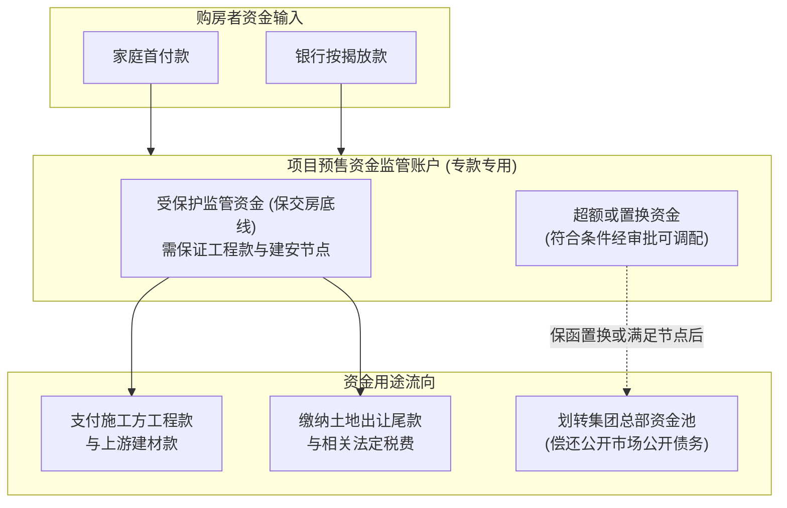
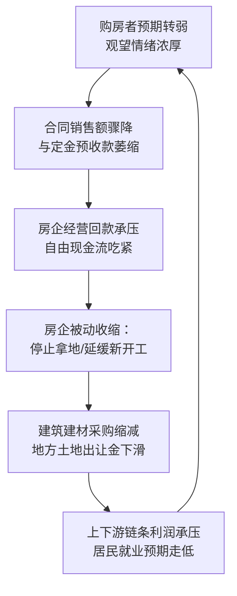

# 36 房地产开发与交付：预售资金、项目与统计

[上一章：A 股长期回报](35-equity-long-run.md) · [目录](./) · [下一章：住房价格与回报](37-housing-prices-returns.md)

**前置阅读：**美国篇 [07 房地产与企业活动](https://fangpings.github.io/us-econ/07-business-and-housing.html)、[19 偿债与信用风险](https://fangpings.github.io/us-econ/19-credit-risk.html)。

在宏观经济中，房地产绝不仅仅是“买房住”那么简单，它是一台巨大的跨部门资金循环发动机：地方政府出让土地、开发商杠杆拿地、建筑施工垫资建设、普通家庭用毕生积蓄交首付并背负三十年按揭、商业银行提供开发贷与个人房贷。这台发动机的核心纽带，就是**预售制**。

本章将带你拆解中国房地产开发的核心业务闭环，看清预售制如何让普通家庭的购房款直接化作施工建设的资金池，辨析官方统计中看似矛盾的“新开工断崖式下跌与竣工逆势上升”，并学会穿透房企报表中的“账面货币资金”，分清哪些钱能用来还债，哪些钱必须锁在工地上保交楼。

---

## 1. 预售资金池闭环：从买期房到项目交付

如果开发商必须盖好现房才能卖，房企能同时开工的楼盘将极为有限，因为盖楼需要沉淀巨额的建安成本与漫长的施工周期。

**商品房预售制**打破了这一限制：开发商在房屋结构尚未封顶、甚至刚施工到一定地上层数时，只要取得预售许可证，就可以向购房者销售期房。

### 预售制的金融本质：家庭为项目提供建设期无息负债

预售不仅是提前锁定购房需求，更是**一种极高杠杆的无息项目融资安排**：
1. **家庭承担等待交付的履约风险**：购房者在还没见到实体房屋的几年里，就已经付清了全款（自有首付加三十年商业按揭）；
2. **开发商获得几乎无利息的建设流动性**：数以亿计的购房款提前到账，极大地摊薄了开发商对银行高息施工贷款的依赖；
3. **资金池滚动依赖需求与信用的双重稳定**：一旦购房者担心楼盘停工而放慢签约，开发商的预售回款锐减；如果外部融资未能及时补充，施工现场就会因为缺钱而陷入停工，进而进一步恶化市场的交付预期。

> **中美对比视窗：美国新房也有预售吗？**  
> 许多人误以为“美国一律卖现房”。实际上，根据美国人口普查局（Census Bureau）的定义，美国新建独栋住宅（New Home Sales）同样允许在开工前（Permit Issued）或施工中（Under Construction）签订销售合同并收取定金。  
> 两者的关键差异在于**尾款支付与资金使用约束**：美国购房者通常在最终交房办理产权过户时才完成抵押贷款放款并结清全款；而中国预售制下，银行在封顶前后甚至更早就会将全部按揭贷款直接划入开发项目的资金链中。

---

## 2. 统计图谱：一条开发链上的指标各自在看什么

国家统计局每月发布的房地产指标琳琅满目，初学者极易把它们混为一谈。下表按项目推进的时间轴梳理各指标的真实含义与最易混淆的误区：

| 官方指标名称 | 观测对象与统计范畴 | 最容易产生的直觉误读 |
| :--- | :--- | :--- |
| **房地产开发投资** | 报告期内完成的开发建设投资额（含建筑工程、安装工程、设备购置及土地购置费） | **不等于** GDP 中的住宅固定资本形成，也**不等于**房企全年的现金流支出 |
| **房屋新开工面积** | 报告期内新开工的房屋建筑面积（以打桩第一天为准） | **不等于**新增购房需求套数，也**不是**规划批准的许可面积 |
| **房屋施工面积** | 报告期内进行施工的全部建筑面积（含上期跨入本期的续建与停缓建工程） | **不是**期末存量孤立数据，是报告期内活动边界的动态累计 |
| **房屋竣工面积** | 报告期内通过各项竣工验收、达到入住使用条件的建筑面积 | **不等于**同期已销售或已交付钥匙给住户的面积 |
| **新建商品房销售面积/销售额** | 报告期内正式签订网签买卖合同的房屋面积和总价款 | **不等于**房企实际到账的现金流（存在分期按揭未到账与退房差额） |
| **商品房待售面积** | 期末已经竣工、可供销售但尚未售出或出租的建筑面积 | **仅指竣工库存**！不包含在建未售的广义期房库存，也不等于社会空置房 |
| **本年实际到位资金** | 房企在报告期内实际可用于开发的各类货币资金总量 | **不等于**银行新增信贷；定金及预收款、个人按揭贷款占比往往超过过半 |

参考来源：国家统计局发布的[全国房地产市场基本情况附注](https://www.stats.gov.cn/sj/zxfb/202501/t20250117_1958328.html)。

### 为什么“施工面积 = 上期施工 + 新开工 − 竣工”不成立？

很多初学者试图在国家统计局的数据表里验算这个公式，结果发现数字完全对不上。这是因为：
- 官方“房屋施工面积”是一个报告期累计指标，包含本期正式施工的工程以及中途复工的工程；
- 项目存在停建、缓建、红线变更或注销转出，不会简单按算术恒等式自动轧平。
要建立真实的未完工在建库存模型，必须基于微观项目底表单独定义“期末在建未竣工实物存量”，而不能机械套用统计局公布的宏观汇总列。

---

## 3. 穿透房企资金链：账面资金、监管账户与集团现金

很多投资者在看房企财报时，经常疑惑：“这家房企账上躺着 500 亿货币资金，为什么连 10 亿到期美元债都还不起？”

答案在于：**开发企业账面上的钱，并不都是集团总部可以自由调用的钱。**

### 预售监管不是把钱“死死锁住”，而是专款专用

为了防止开发商在项目尚未完工前将预售款抽调去异地拿地或偿还集团高息债务，各地住建部门与商业银行建立了**预售资金监管账户**。
- **专款专用**：预售款必须打入指定监管账户；
- **节点拨付**：只有当工程完成“地下出零号高程”、“主体结构封顶”、“外立面装饰完毕”等既定工程节点，并经监理和质检核实后，监管银行才会根据施工进度将款项划拨给承包商和材料商；
- **动态保留底线**：账户内必须留足确保后续工程直至竣工验收交付所需的全部建安资金。

### 保函置换预售监管资金：银行信用替代存量现金

2022 年 11 月，三部门发布关于商业银行出具保函置换预售监管资金的通知（银保监办发〔2022〕104号）：允许优质房企以商业银行不可撤销保函，置换不超过预售资金监管额度 30% 的资金，置换后监管账户内现金留存比例不得低于额度的 70%。

#### 教学实战：保函与剩余工程动态对账

**设某教学项目（单位：亿元）：**
1. 经住建部门核定，确保项目竣工交付所需的监管资金总额度为 $100$ 亿元，监管账户中已有现金 $100$ 亿元；
2. 房企向银行申请保函置换 $30\%$（即 $30$ 亿元），监管账户留存现金 $70$ 亿元，保函额度 $30$ 亿元。房企将置换出的 $30$ 亿元调拨至总部用于补充流动性。此时总保障额度依然是：
   $$\text{保障总量} = 70 \text{（现金）} + 30 \text{（保函）} = 100 \text{ 亿元}$$
3. 随后，项目完成了主体外立面施工，监管账户获准向施工方支付工程款 $20$ 亿元。由于工程推进，该项目未来竣工交付所需的剩余建安额度同步下降至 $80$ 亿元。
4. 按照监管补足规则，企业提取的保函部分必须与工程进度同步按比例核减或补回现金，确保账户留存现金始终不低于剩余所需额度的 $70\%$（即 $80 \times 70\% = 56$ 亿元）：
   $$\text{监管账户现金} = 70 - 20 \text{（工程拨付）} + 6 \text{（企业补回）} = 56 \text{ 亿元}$$
   $$\text{剩余有效保函} = 30 - 6 = 24 \text{ 亿元}$$
   $$\text{现金占比} = \frac{56}{80} = 70\%, \quad \text{总保障} = 56 + 24 = 80 \text{ 亿元}$$

若企业当时无法拿出这 $6$ 亿元补足差额，银行保函的敞口就无法下调，甚至可能触发保函赔付垫款。这清晰地表明：**保函置换绝不是白送开发商 30 亿现金，而是在银行信用背书下的阶段性资金腾挪。**

### 四个维度的进度必须逐笔匹配

在分析房企现金流时，研究员必须区分四个不同时间戳：
1. **签约备案日**：合同销售确认（形成预售合同额）；
2. **实际到账日**：首付款与按揭贷款进入银行监管账户；
3. **付款审批日**：监管银行按工程进度向总包商转账；
4. **工程所属期**：建筑施工企业实际完成土建与安装的月份。

项目账户练习与答案

**题目：**  
某在建楼盘当月实现合同销售额 50 亿元，监管账户实际收到按揭与首付 35 亿元，经批准向施工总包划拨工程款 20 亿元（其中 5 亿元为清偿半年前拖欠的旧钢材款，15 亿元为当月新完工工程款）。请问：
1. 本月应记录的合同销售额、实际收款额、当月完成新工程量分别是多少？
2. 尚未收到的合同尾款是多少？
3. 如果下月销售额降至 0，而项目还需 15 亿元才能封顶，该项目是否会停工？

**参考答案与推理：**  
1. **当月合同销售额**为 50 亿元；**实际收款额**为 35 亿元；**当月完成新工程量**为 15 亿元（划拨的 20 亿元中，5 亿元属于前期旧欠款支付，不能计入本月新增工程产出）。
2. **未到账尾款**为 $50 - 35 = 15$ 亿元（通常处于银行按揭审批或公积金放款途程中）。
3. **交付安全评估**：账户本月净回笼现金为 $35 - 20 = 15$ 亿元。只要这 15 亿元留存在监管账户内，即使下月新增销售降为零，账户内的存量资金也刚好可以支付下月封顶所需的 15 亿元建安支出，因此只要监管资金未被违规抽挪，项目工程本身具备自闭环完工的资金条件。

---

## 4. 动态反馈链：为什么开发链条会反向冲击自身

房地产产业链具备强烈的正负反馈特征。当市场预期转向时，链条会沿着以下路径传导：

### 为什么“新开工断崖下跌”与“竣工逆势上升”会同时出现？

在 2022—2023 年的中国宏观数据中，曾出现极具代表性的反差走势：房屋新开工面积同比暴跌超 $30\%$，而房屋竣工面积却逆势录得近 $20\%$ 的正增长。

这看似矛盾的统计表象背后，正是房企在资金硬约束下的理性自救选择：
1. **断臂求生，收缩前端**：在缺乏外部融资和新增销售的情况下，开发商坚决暂停甚至放弃开辟新工地，严控土地购置与新开工面积；
2. **聚焦存量，力保交楼**：在国家“保交楼”专项借款、商业银行配套融资以及各级监管账户的强力约束下，所有可用资金被集中打向那些已经售出、接近交付的存量楼盘，推动这批工程跨越竣工验收线。

---

## 5. 真实数据带读：2024 年全国房产数据深读

以国家统计局发布的 [2024 年全国房地产市场基本情况](https://www.stats.gov.cn/sj/zxfb/202501/t20250117_1958328.html) 为例，官方公布的全年核心数据如下：
- **新建商品房销售面积**：$97,385$ 万平方米，同比下降 $12.9\%$；
- **新建商品房销售额**：$96,750$ 亿元，同比下降 $17.1\%$；
- **房地产开发投资完成额**：$100,280$ 亿元，同比下降 $10.6\%$。

### 第一步：计算当年成交均价绝对值

$$\bar{P}_{2024} = \frac{\text{销售额}}{\text{销售面积}} = \frac{96,750 \text{ 亿元}}{97,385 \text{ 万平方米}} \approx 0.9935 \text{ 万元/平方米} = 9,935 \text{ 元/平方米}$$

### 第二步：利用公布的同比增速推算均价变化率

设上年均价为 $\bar{P}_0$，当年均价为 $\bar{P}_1$：
$$1 + g_{\bar{P}} = \frac{1 + g_{\text{销售额}}}{1 + g_{\text{销售面积}}} = \frac{1 - 17.1\%}{1 - 12.9\%} = \frac{0.829}{0.871} \approx 0.95178$$
$$g_{\bar{P}} \approx 0.95178 - 1 = -4.82\%$$

### 第三步：深度辨析——这是同质住房的价格跌幅吗？

**绝对不是！**
上述 $-4.82\%$ 只是全国销售汇总后的**混合平均成交价变动率**。它的变动受到两个因子的双重驱动：
1. **纯价格效应**：具体每一套住房的市场售价下浮；
2. **结构效应（辛普森悖论）**：如果在 2024 年，均价较低的三四线城市成交占比被动上升，或者开发商推出更多低总价小户型刚需盘，全国算术平均价就会被拉低；反之，若高总价的核心一二线豪宅成交活跃，均价甚至可能逆势上涨。

要真正剔除成交结构错配、观测同一套可比住房的价格涨跌，必须使用下一章（第 37 章）将要深入拆解的 **70 个大中城市商品住宅销售价格指数（按项目、按面积段定基加权）**。

---

## 6. 中美指标映射：同名统计背后的制度鸿沟

| 宏观经济诉求 | 中国统计观察窗口 | 美国统计观察窗口 | 关键制度与口径差异 |
| :--- | :--- | :--- | :--- |
| **未来开工预期** | 土地出让建筑面积、规划规划许可 | Building Permits（建筑许可） | 美国的许可来自地方政府规划审批；中国土地成交与规划审批隔着资金与规费流程 |
| **实际进入施工** | 房屋新开工面积（平米） | Housing Starts（新屋开工套数） | 中国以建筑面积计量，多为高层住宅；美国以独立独栋与公寓单元套数计量 |
| **当期实体完工** | 房屋竣工面积（平米） | Housing Completions（完工套数） | 两国物理验收标准不同，统计单位（面积 vs 套数）无法直接平移比较 |
| **新房交易需求** | 新建商品房销售面积/金额 | New Home Sales（新屋销售套数） | 美国该指标主要聚焦为出售而建的独栋住宅；中国包含住宅、商业与办公 |
| **未售库存压力** | 商品房待售面积（竣工未售） | New Homes for Sale（在售新屋） | **口径差异极大**：美国待售库存包含“未开工已售、在建在售与竣工在售”；中国仅统计“已竣工未售” |

---

## 7. 练习与逐步答案

1. 某房企账面合并报表显示货币资金 $100$ 亿元，其中 $70$ 亿元为在建项目的预售资金监管账户存款，剩余 $30$ 亿元在集团总部资金池。当月集团有一笔 $45$ 亿元的境外优先票据到期。评级机构据此断言“企业现金足以全额偿付该票据，不存在违约风险”。请纠正该评级机构的逻辑谬误。
2. 为什么在房地产下行期，“房屋新开工面积同比暴跌”与“房屋竣工面积同比大幅上升”能够在同一个季度的宏观统计公报中并存？
3. 某城市期末统计显示：已竣工待售商品房 $20$ 万平方米，在建未售期房 $30$ 万平方米，已售出但尚未建成交付的期房 $40$ 万平方米。哪一部分最接近统计局公布的“商品房待售面积”？哪一部分直接对应保交楼的社会履约责任？

参考答案与详细推理

1. **逻辑纠正**：评级机构混淆了“账面货币资金”与“集团自由可动用现金”。在 $100$ 亿元资金中，$70$ 亿元属于受严格法律与行政监管的预售资金，必须专款用于具体工程的建安支付与工人薪酬，房企总部无法将其跨法人、跨项目调拨用于偿还公开市场债务。总部真正可动用的自由现金仅有 $30$ 亿元，面对 $45$ 亿元的到期债务，存在 $15$ 亿元的硬性流动性缺口，存在严重的违约风险。
2. **逻辑推导**：这是房企在融资紧缩和保交付压力下的结构性应对。一方面，面对疲软的新增销售预期和流动性约束，房企主动收缩战线，大幅削减新项目拿地与新开工打桩；另一方面，在国家保交楼政策支持与监管资金硬约束下，房企将有限资金集中调配至已售存量在建项目，全力推动既有楼盘完工交付，从而导致新开工与竣工出现反向分化走势。
3. **指标匹配**：
   - 官方统计局的“商品房待售面积”仅统计**已竣工但未售出或出租**的现房实物存量，因此最接近的是第一部分（$20$ 万平方米）；
   - 直接对应社会履约与保交楼刚性责任的，是第三部分**已售出但未交付的期房面积**（$40$ 万平方米），这部分承载着购房家庭的切身居住权益。第二部分（$30$ 万平方米）则是开发商未来可供推盘销售的在建货值。

---

[上一章：A 股长期回报](35-equity-long-run.md) · [目录](./) · [下一章：住房价格与回报](37-housing-prices-returns.md)
