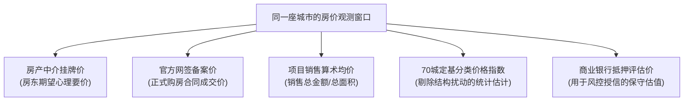
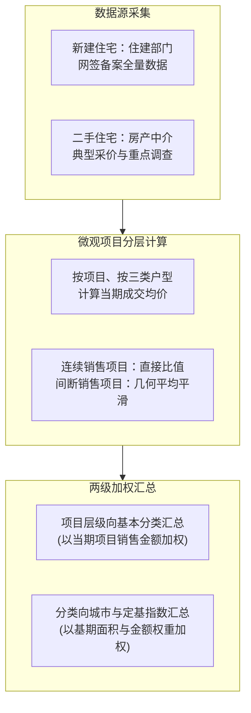

# 37 住房价格、租金与持有回报

[上一章：开发与交付](36-housing-development.md) · [目录](./) · [下一章：按揭与家庭](38-mortgages-households.md)

**前置阅读：**美国篇 [07 房地产与企业活动](https://fangpings.github.io/us-econ/07-business-and-housing.html)、[15 资产负债表](https://fangpings.github.io/us-econ/15-balance-sheets.html)。

在各类资产中，房子具有独特的双重属性：它既是为家庭遮风挡雨的**消费品**（提供居住服务），又是很多居民家庭最重要的**投资品**（承载财富储蓄与增值预期）。

然而，许多关于楼市的争论往往陷于鸡同鸭讲，核心原因在于大家讨论的根本不是同一种“房价”。本章将拆解中国 70 个大中城市房价指数的真实编制全流程，破除简单算术均价的统计陷阱，并手把手为你算清一套房产的真实租金回报率与全周期持有收益。

---

## 1. 概念澄清：同一座城市里的五种“房价”

当你走在城市的街道上，或者打开手机房产 App 时，你可能会在同一时间接触到五种完全不同的房价读数：

1. **挂牌要价（Listing Price）**：房东挂牌报价，往往包含议价空间或心理预期，未发生真实成交；
2. **网签备案价（Contract Price）**：房屋买卖双方在住建部门系统中登记备案的正式合同价格，具有法律效力；
3. **成交算术均价（Average Price）**：将全城本月所有楼盘的网签金额直接除以总面积。极易受豪宅或远郊盘成交比例变动的扭曲（辛普森悖论）；
4. **统计局 70 城价格指数（Constant-Quality Price Index）**：在微观层面上按楼盘、面积段分层，通过链式加权计算出的可比价格变动指数；
5. **银行抵押评估价（Appraisal Value）**：银行为了控制房贷信贷违约风险，委托独立评估机构出具的折价估值。

在宏观研究中，**绝不能把挂牌价异动直接等同于全城资产价格调整，更不能用销售额除以面积代替房价指数**。

---

## 2. 70 城指数生产线：从网签数据到官方发布

国家统计局每月发布的“70 个大中城市商品住宅销售价格指数”，其调查范围界定为 70 个城市的**市辖区**（不含县及县级市）。指数按物业类型细分为：
- **新建商品住宅销售价格指数**
- **二手住宅销售价格指数**

并且在每个大类下，统一按照三档建筑面积划分基本分类：
- $90 \text{ 平方米及以下}$（刚需小户型）
- $90 - 144 \text{ 平方米}$（刚改中户型）
- $144 \text{ 平方米以上}$（改善大户型）

### 微观计算四部曲

根据国家统计局公布的编制方法，新建商品住宅价格指数的计算需严格遵循以下四个步骤：

#### 第一步：项目内分户型计算均价与价格比
对每个独立开发项目 $i$ 的每个面积分类 $j$，计算当月成交均价：
$$P_{t,i,j} = \frac{\text{销售金额}_{t,i,j}}{\text{销售面积}_{t,i,j}}$$
若该项目在 $t-1$ 月也有成交，则当月价格比为：
$$R_{t,i,j} = \frac{P_{t,i,j}}{P_{t-1,i,j}}$$

#### 第二步：处理无连续成交的“间断月份”（几何平均平滑）
若某楼盘上月无成交，但前第 $n$ 个月（$n \le 3$）曾有成交，为避免跨月累积跌幅集中爆发导致数据失真，统计制度采用开 $n$ 次方的几何平均法折算为单月月度环比：
$$R_{t,i,j} = \sqrt[n]{\frac{P_{t,i,j}}{P_{t-n,i,j}}}$$

> **算例演示**：  
> 某在售楼盘两个月前成交均价为 $20,000$ 元/平方米，上月无任何成交，本月成交均价为 $19,602$ 元/平方米。  
> 两个月累积价格比为：
> $$\frac{19,602}{20,000} = 0.9801$$
> 折算为单月的几何平均月度比率为：
> $$R = \sqrt{0.9801} = 0.99 \text{（即月均环比变动率为 } -1.0\% \text{）}$$
> 这一处理避免了将两个月的总跌幅 $1.99\%$ 粗暴全算作当月断崖下跌。

#### 第三步：城市内同一基本分类的当期金额加权
将该城市内某一基本分类下所有项目的价格比，以各项目当月实际销售金额 $W_{t,i,j}$ 进行加权汇总：
$$R_{t,j} = \frac{\sum_i (R_{t,i,j} \times W_{t,i,j})}{\sum_i W_{t,i,j}}$$

> **算例演示**：  
> 某市 $90-144$ 平米分类下仅有两个代表项目。项目甲当月价格比为 $0.99$（微跌 $1\%$），销售额为 $80$ 亿元；项目乙价格比为 $1.01$（微涨 $1\%$），销售额为 $20$ 亿元。  
> 该分类的加权价格比为：
> $$R = \frac{0.99 \times 80 + 1.01 \times 20}{80 + 20} = \frac{79.2 + 20.2}{100} = 0.994 \text{（即环比下跌 } 0.6\% \text{）}$$
> 如果不顾销售额权重而直接进行简单算术平均，就会得出 $(0.99 + 1.01)/2 = 1.00$（零涨跌）的错误结论。

#### 第四步：基期权重串接定基指数
在向上汇总城市综合指数时，采用固定基期（如 2020 年基期）的权数结构 $q_{2020}$，以拉氏/帕氏改进公式形成定基指数 $L_t$：
$$L_t = L_{t-1} \times \frac{\sum_j (P_{t,j} \times q_{2020,j})}{\sum_j (P_{t-1,j} \times q_{2020,j})}$$
$$\text{环比变动率} = \left(\frac{L_t}{L_{t-1}} - 1\right) \times 100\%, \quad \text{同比变动率} = \left(\frac{L_t}{L_{t-12}} - 1\right) \times 100\%$$

官方发布指数时，通常以 $100$ 为基准线。若公布环比为 $99.9$，即代表当月价格较上月微跌 $0.1\%$。

---

## 3. 中美对比：中国 70 城网签与美国 FHFA 重复交易法

| 比较维度 | 中国国家统计局 70 城价格指数 | 美国联邦住房金融局（FHFA）HPI 指数 |
| :--- | :--- | :--- |
| **底层数据来源** | 地方住建部门网签备案全覆盖，包含新建与二手 | 两房（Fannie Mae / Freddie Mac）抵押贷款交易数据库 |
| **核心统计方法** | 项目内户型细分 + 当期金额与基期面积两级加权 | **重复交易法（Repeat-Sales Method）**，基于同套房二次成交 |
| **对新房的覆盖** | 高度覆盖新房，能敏锐反映一手房企让利促销 | 不覆盖纯新房首发（因缺乏历史成交记录），主要覆盖二手房 |
| **同质性控制** | 靠精细的面积分档与楼盘细分来控制物理异质性 | 追踪同一套不动产的多次流转，天然剔除户型与区位差异 |
| **主要局限** | 难以完全剔除赠送面积、精装修、车位捆绑等非标差异 | 忽略了业主翻新装修改造对房屋实际品质的提升 |

参考来源：[FHFA 官方方法问答与编制说明](https://www.fhfa.gov/faqs/hpi)。

---

## 4. 读表实战：环比、同比与累计平均的区别

在国家统计局发布的 2024 年 12 月 70 城房价原表中，北京与天津的新建住宅价格读数如下：
- **北京**：环比 **99.9**，同比 **94.6**，1—12 月平均 **97.6**；
- **天津**：环比 **100.2**，同比 **97.7**，1—12 月平均 **99.1**。

这三个数字各自表达什么？

$$\text{北京当月环比} = 99.9 - 100 = -0.1\% \quad \text{（相对 11 月微跌 0.1%）}$$
$$\text{北京当月同比} = 94.6 - 100 = -5.4\% \quad \text{（相对 2023 年 12 月下跌 5.4%）}$$
$$\text{北京全年平均} = 97.6 - 100 = -2.4\% \quad \text{（2024 全年均值比 2023 全年均值低 2.4%）}$$

> [!IMPORTANT]
> **天津现象的启发：**  
> 天津环比录得 $100.2$（环比上涨 $0.2\%$），但同比依然为 $97.7$（同比下跌 $2.3\%$）。  
> 这说明：**单月环比转正只代表边际止跌，不等于价格已经收复失地回到去年水平！** 观察拐点看环比，观察财富累积缺口看同比与定基指数。

---

## 5. 投资账本：从租金回报率到全周期持有总回报

许多普通人算买房账时，习惯简单地拿“年租金 / 买入总价”算出一个租金收益率。在真实世界中，房产投资的账本要复杂得多。

### 核心收益率计算公式

1. **毛租金回报率（Gross Rental Yield）**：
   $$R_{\text{gross}} = \frac{\text{名义年合同租金}}{P_{\text{buy}}}$$
2. **净租金回报率（Net Rental Yield）**：
   $$R_{\text{net}} = \frac{\text{实际租金收入} - \text{空置损失} - \text{物业费与日常维修成本}}{P_{\text{buy}} + C_{\text{buy}}}$$
3. **持有期全周期总回报率（Total Holding Return）**：
   $$R_{\text{total}} = \frac{(P_{\text{sell}} - C_{\text{sell}}) + \text{全期净租金} - (P_{\text{buy}} + C_{\text{buy}})}{P_{\text{buy}} + C_{\text{buy}}}$$

其中：$P_{\text{buy}}$ 为买入合同价，$C_{\text{buy}}$ 为契税、中介费与初始装修等购置税费；$P_{\text{sell}}$ 为卖出合同价，$C_{\text{sell}}$ 为交易个税、增值税及中介佣金。

### 教学实例：全款购房一年持有回报深度拆解

**设某套住宅（单位：万元，全款无贷款）：**
- 买入总价 $P_{\text{buy}} = 300$ 万元，购入契税及税费 $C_{\text{buy}} = 6$ 万元；
- 全年应收租金 $6$ 万元，实际出租时发生空置期损失 $0.5$ 万元，物业维修等支出 $1$ 万元；
- 年末以 $P_{\text{sell}} = 294$ 万元卖出（房价账面仅下跌 $2\%$），卖出端中介费与交易税费 $C_{\text{sell}} = 3$ 万元。

**我们来精确算账：**
1. **实际资金初始总投入**：
   $$300 + 6 = 306 \text{ 万元}$$
2. **全年净租金收入**：
   $$6 - 0.5 - 1 = 4.5 \text{ 万元}$$
3. **最终卖出净回收现金**：
   $$294 - 3 = 291 \text{ 万元}$$
4. **全周期总投资回报率**：
   $$R_{\text{total}} = \frac{291 + 4.5 - 306}{306} = \frac{-10.5}{306} \approx -3.43\%$$

不仅如此：
- 房东宣传的“毛租金回报率”为：$6 / 300 = 2.0\%$；
- 真实净租金相对初始总成本的回报率仅为：$4.5 / 306 \approx 1.47\%$。

> [!WARNING]
> **杠杆与流动性折价：**  
> 房价只下跌了 $2\%$，但叠加买卖双边摩擦成本（$6 + 3 = 9$ 万元）与空置成本后，投资者全年的净亏损率达到了 $-3.43\%$。如果这套房产带有 $70\%$ 的按揭杠杆，投资者的自有资本金亏损幅度将进一步被杠杆放大数倍！

---

## 6. 估值标尺：房价收入比与租售比的合理打开方式

在评估一个城市或区域的房价泡沫时，分析师常用的两大锚是**房价收入比**与**租售比**。

### 房价收入比：谨防分母与分子的口径错位

$$\text{房价收入比} = \frac{\text{典型标准住房总价}}{\text{典型家庭年可支配收入}} = \frac{\text{户型面积} \times \text{房屋单价}}{\text{家庭年可支配收入}}$$

**典型算例**：  
某二线城市一套刚需户型面积为 $90$ 平方米，单价为 $3$ 万元/平方米，总房款为 $270$ 万元。若当地一个双职工家庭的年可支配收入为 $18$ 万元，则房价收入比为：
$$\frac{270 \text{ 万元}}{18 \text{ 万元}} = 15 \text{ 倍}$$

**常见分析误区**：
1. **拿单价除以个人工资**：有媒体报道拿“单价 3 万”除以“社平年薪 10 万”得出“0.3”，这毫无统计意义；
2. **忽视首付与杠杆分布**：同样是 15 倍房价收入比，全款靠上一代积蓄全额付清的家庭几乎没有违约风险，而借消费贷强行凑首付的高杠杆年轻家庭则极端脆弱。

---

## 7. 练习与逐步答案

1. 天津 2024 年 12 月新房环比录得 $100.2$，同比录得 $97.7$。能否据此宣布天津房价已经全面收复失地？
2. 某房产连续两个月的价格比率分别为 $0.99$（跌 $1\%$）和 $1.01$（涨 $1\%$），请问两个月后该房产价格是否恰好回到原点？
3. 某套房产买入价为 $300$ 万元，初始购置税费为 $6$ 万元。全年合同租金为 $6$ 万元，空置损失与运维成本合计为 $1.5$ 万元。请计算该房产相对初始总现金投入的净租金回报率。
4. 某房产交易 App 发布的城市二手房挂牌均价环比上涨 $5\%$，而统计局同月公布的该市 70 城二手房价格指数却环比下跌 $0.3\%$。这是否说明两份数据中必有一方在造假？

参考答案与详细推理

1. **不能**。环比 $100.2$ 仅表示当月物价水平相对上月微幅上升 $0.2\%$；而同比 $97.7$ 清楚地表明，当前价格水平相比去年同期仍然低了 $2.3\%$。它体现的是止跌企稳的边际信号，并未回到前期高点。
2. **没有**。连乘计算：$0.99 \times 1.01 = 0.9999$。累积变动为 $0.9999 - 1 = -0.01\%$。因为下跌时的基数大于上涨时的基数（百分比不对称性），资产价格未完全回到原点。
3. **计算步骤**：
   - 净租金收入 $= 6 - 1.5 = 4.5$ 万元；
   - 初始总现金投入 $= 300 + 6 = 306$ 万元；
   - 净租金回报率 $= \frac{4.5}{306} \approx 1.4706\%$（约 $1.47\%$）。
4. **不一定**。两者的差异通常源于统计口径与样本的本质不同：
   - 商业中介的“挂牌均价”反映的是房东的意向要价，且极易受到少数改善型高端二手房新增挂牌拉高均价的影响；
   - 统计局二手房价格指数采纳的是真实成交网签记录，并通过户型分档、同质加权剔除了房龄、地段和户型结构变动的干扰。挂牌要价上涨与真实成交以价换量在楼市调整期经常并存。

---

[上一章：开发与交付](36-housing-development.md) · [目录](./) · [下一章：按揭与家庭](38-mortgages-households.md)
