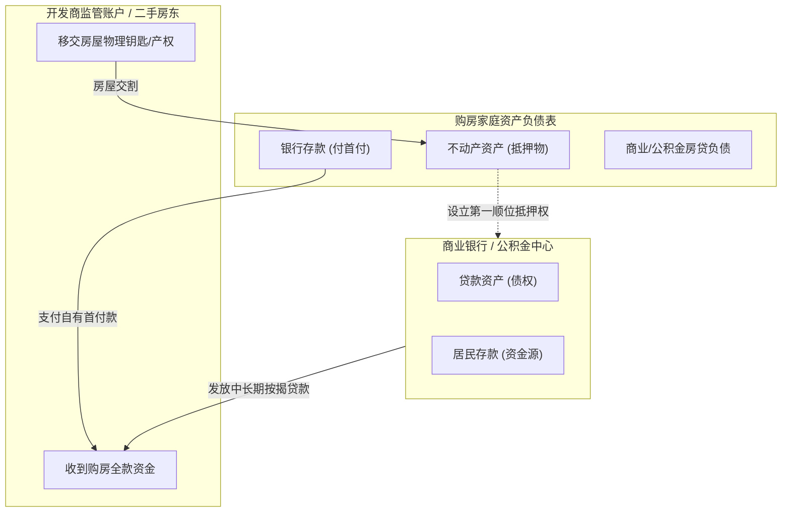
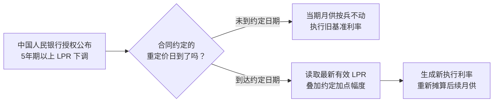
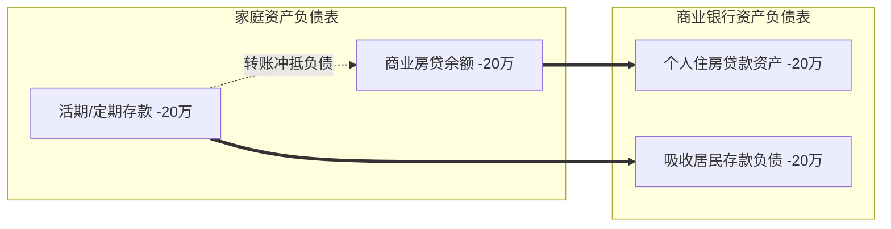

# 38 按揭与中国家庭资产负债表

[上一章：房价与回报](37-housing-prices-returns.md) · [目录](./) · [下一章：土地财政](39-housing-land-finance.md)

**前置阅读：**美国篇 [11 货币政策](https://fangpings.github.io/us-econ/11-monetary-policy.html)、[15 资产负债表](https://fangpings.github.io/us-econ/15-balance-sheets.html)、[19 信用风险](https://fangpings.github.io/us-econ/19-credit-risk.html)。

在绝大多数中国城镇家庭的资产负债表上，房产占据了家庭总资产的半壁江山，而住房抵押贷款（按揭）往往是家庭最大的一笔负债。

每当央行下调贷款市场报价利率（LPR），社交媒体上就会掀起一片“房贷减负、消费腾飞”的欢呼。然而，**降息并不等于立即减月供，减月供更不等于家庭资产负债表被瞬间修复**。本章将带你深入中国房贷合同底层，用规范的金融数学精算等额本息摊还结构、公积金与商业组合贷，并穿透提前还贷背后的宏观缩表机制。

---

## 1. 交易流向：一笔按揭贷款涉及的四个主体

很多人以为买房只是买家和卖家之间的交易。但在现代信用货币体系中，一笔按揭购房交易同时撬动了四个独立核算的账户：

1. **家庭部门**：资产端增加了沉重、流动性极差的不动产，流动性最好的银行活期存款减少（支付首付），同时负债端背负长达 20—30 年的按揭本息；
2. **银行体系**：资产端增加了优质中长期按揭资产，资金通过支付清算划转至卖方；
3. **开发商端（期房情形）**：房企不能任意支配这笔款项，资金进入预售资金监管账户（见第 36 章），按工程进度定向拨付；
4. **存量循环（二手房情形）**：新买家借入新贷款，原房东往往提取其中一部分偿还原有按揭贷款，银行体系在同一时间发生“新贷发生”与“旧贷注销”。

---

## 2. 利率传导：LPR、加点与重定价日的定价机制

自 2019 年中国贷款利率基准改革后，商业性个人住房贷款采用“LPR 锚定加点”的浮动定价模式：
$$\text{商业房贷执行利率} = \text{锚定期限品种的 LPR} + \text{合同约定加点（可正可负）}$$

中国绝大多数中长期房贷锚定 **5 年期以上 LPR**。根据人民银行 2024 年第 11 号公告及商业银行实施规则，理解房贷利率必须厘清三个时间点与规则：

### 重定价周期与日期的真实约定

- **重定价日（Reset Date）**：常见约定为每年的 $1$ 月 $1$ 日（以元旦新利率为准）或每笔贷款合同的“放款对月对日”。如果 5 年期以上 LPR 在 5 月份降息 20 个基点，而你的重定价日是次年 1 月 1 日，你在当年 6—12 月的月供不会有任何变化；
- **重定价周期改革**：2024 年底起，工行、建行等国有大行允许借款人协商将重定价周期由过去的“每年一次（12 个月）”调整为“每 3 个月”或“每 6 个月”。
  > **工行实施问答案例**：某客户原重定价日为每年 7 月 22 日。若在 2024 年 11 月 15 日申请变更为每 6 个月重定价一次，则后续重定价日将自动变为每年的 1 月 22 日和 7 月 22 日，其首次享受新基准利率的时点为 2025 年 1 月 22 日，而非申请当日立即调整。

---

## 3. 数学精算：等额本息摊还与利息/本金动态解耦

在宏观与微观分析中，最常见的房贷还款方式是**等额本息**（每月偿还固定总金额 $A$）。

### 核心精算公式

设贷款剩余本金为 $B$，年利率为 $R$，月利率 $r = R / 12$，剩余还款月数为 $n$。等额本息每月固定还款额 $A$ 的规范数学公式为：
$$A = B \times \frac{r(1+r)^n}{(1+r)^n - 1} = \frac{B \cdot r}{1 - (1+r)^{-n}}$$

每一期月供在利息与本金之间的动态切分如下：
1. **当期应付利息**（按月初尚欠本金计息）：
   $$I_t = B_{t-1} \times r$$
2. **当期偿还本金**（月供扣除利息后的净还本额）：
   $$P_t = A - I_t$$
3. **月末剩余本金**：
   $$B_t = B_{t-1} - P_t$$

### 教学精算：100 万房贷降息全周期对比

设借款人在某重定价日剩余贷款本金 $B = 1,000,000$ 元，剩余期限 $25$ 年（$n = 300$ 个月），按等额本息计算，对比执行利率从 $4.2\%$ 下调至 $3.3\%$（即下调 $90$ 个基点）的精确账目：

| 财务核算项目 | 基准情景（年利率 4.2%） | 降息情景（年利率 3.3%） | 绝对差额（财务影响） |
| :--- | ---: | ---: | ---: |
| **每月固定月供 $A$** | **5,389.42 元** | **4,899.62 元** | **减少 489.81 元** |
| **首月偿付利息 $I_1$** | $3,500.00$ 元 | $2,750.00$ 元 | **利息减少 750.00 元** |
| **首月偿还本金 $P_1$** | $1,889.42$ 元 | $2,149.62$ 元 | **多还本金 260.19 元** |
| **首年（前12个月）累计利息** | $41,558.41$ 元 | $32,606.25$ 元 | **利息节省 8,952.16 元** |
| **首年（前12个月）累计还本** | $23,114.67$ 元 | $26,189.14$ 元 | **多还本金 3,074.47 元** |
| **首年现金支出总额** | $64,673.08$ 元 | $58,795.39$ 元 | **少掏现金 5,877.69 元** |
| **12 个月后剩余本金 $B_{12}$** | $976,885.33$ 元 | **973,810.86 元** | **本金多削减 3,074.47 元** |

> [!IMPORTANT]
> **初学者必知：为什么“少掏的月供”小于“节省的利息”？**  
> 对比首月数据：利息一口气省了 $750$ 元，但月供却只少交了 $489.81$ 元，中间那 $260.19$ 元去了哪里？  
> 答案是：**它变成了你多还的本金！** 等额本息公式内在保证了在低利率环境下，每月固定还款中有更大比例直接用于削减本金。因此，降息不仅降低了当期现金负担，更在悄然加速家庭去杠杆的进度。

---

## 4. 制度特色：住房公积金与组合贷款精算

中国的住房金融制度包含独特的**住房公积金**体系：单位与职工强制按比例共同缴存，形成归职工个人所有的专款专用户，享受免税待遇与政策性低息贷款。

根据住房和城乡建设部等部门发布的 [《全国住房公积金 2024 年年度报告》](https://www.gov.cn/zhengce/zhengceku/202506/P020250601601759182303.pdf) 官方真实核算：
- **当年缴存额**：$36,317.83$ 亿元；
- **年末缴存总余额**：$109,252.79$ 亿元；
- **当年个人住房贷款发放额**：$13,043.07$ 亿元；
- **年末个人住房贷款余额**：$80,698.66$ 亿元；
- **个人住房贷款率**：
  $$\text{公积金个贷率} = \frac{\text{年末贷款余额}}{\text{年末缴存余额}} = \frac{80,698.66 \text{ 亿元}}{109,252.79 \text{ 亿元}} \approx 73.86\%$$

### 组合贷款实战精算：公积金加商业贷款

当购房所需贷款额度超出当地公积金最高授信上限时，家庭通常办理**组合贷款**。组合贷由两个独立的借款合同构成，分别按公积金与商贷规则计息。

**教学家庭组合贷模型：**  
总借款额 $100$ 万元，期限 $25$ 年（$300$ 期），等额本息：
- **公积金贷款部分**：$B_{\text{公}} = 60$ 万元，年利率 $R_{\text{公}} = 2.85\%$；
- **商业贷款部分**：$B_{\text{商}} = 40$ 万元，年利率 $R_{\text{商}} = 3.30\%$。

分别代入等额本息公式计算两笔子月供：
$$A_{\text{公}} = 600,000 \times \frac{\frac{0.0285}{12}(1+\frac{0.0285}{12})^{300}}{(1+\frac{0.0285}{12})^{300}-1} \approx 2,798.68 \text{ 元}$$
$$A_{\text{商}} = 400,000 \times \frac{\frac{0.0330}{12}(1+\frac{0.0330}{12})^{300}}{(1+\frac{0.0330}{12})^{300}-1} \approx 1,959.85 \text{ 元}$$
$$A_{\text{合计}} = A_{\text{公}} + A_{\text{商}} = 2,798.68 + 1,959.85 = 4,758.52 \text{ 元}$$

如果该家庭无法享受公积金政策、必须全部借商业贷款（$100$ 万 @ $3.3\%$），每月月供为 $4,899.62$ 元。公积金组合贷每月为该家庭节省现金支出：
$$4,899.62 - 4,758.52 = 141.09 \text{ 元}$$

---

## 5. 宏观镜像：资产重估与提前还贷潮的会计机理

### 房价下跌对家庭净资产的杠杆反噬

设一个典型家庭购入一套商品房：
- 购入原值：$200$ 万元，其中自有首付 $60$ 万元，按揭借款 $140$ 万元；
- 初始资产负债表：资产 $200$ 万，负债 $140$ 万，**净权益（Net Equity）** $= 60$ 万元（杠杆倍数 $3.33$ 倍）。

若该区域房产公允价值下跌 $10\%$，总价变为 $180$ 万元：
$$\text{家庭房产净权益} = 180 - 140 = 40 \text{ 万元}$$
$$\text{净资产变动率} = \frac{40 - 60}{60} = \frac{-20}{60} = -33.33\%$$

**房价仅下跌 10%，但在负债刚性的挤压下，家庭的住房净财富暴跌了整整三分之一！**  
如果房价下跌 $20\%$，房产价值变为 $160$ 万元，家庭净权益将进一步萎缩至 $20$ 万元（缩水 $-66.67\%$）。此时无论央行如何下调房贷利率，也无法在资产端凭空变出那失去的几十万财富。

### 提前还贷的微观决策与宏观缩表

在存量房贷与理财收益率形成倒挂的时期，大量居民选择用银行存款提前偿还房贷。

#### 全国按揭存量动态会计等式

全国商业银行个人住房贷款期末余额 $B_t$ 的变动，由四个资金流驱动：
$$B_t = B_{t-1} + \text{新发放按揭}_t - \text{合同正常摊还本金}_t - \text{居民主动提前还贷本金}_t$$

> **教学账务算例**：  
> 某银行个人房贷期初余额为 $1,000$ 亿元。当月新增购房放款 $100$ 亿元，借款人按月正常还本 $60$ 亿元，另外收到居民提前还贷 $70$ 亿元。  
> $$B_{\text{期末}} = 1,000 + 100 - 60 - 70 = 970 \text{ 亿元}$$
> 此时该行房贷余额虽然单月萎缩了 $30$ 亿元，但**并不意味着当月没有任何新购房需求**！新增放款依然有 $100$ 亿，只是被庞大的提前还贷潮（$70$ 亿）和日常摊还完全淹没了。

#### 提前还贷的得与失

假设家庭用闲置的 $20$ 万元存款提前还本：
- **当日会计影响**：资产减少 $20$ 万（存款），负债减少 $20$ 万（房贷），**净资产当场没有任何变化**；
- **未来的确定收益**：每年节省利息支出 $20 \times 3.3\% = 0.66$ 万元（$6,600$ 元）；
- **付出的隐性代价**：放弃了同等金额存款的年收益（若存款利率 $1.5\%$，放弃利息 $3,000$ 元），但更关键的是，**家庭牺牲了应对失业、突发疾病与子女教育的流动性防守垫**。宏观上，居民把本可用于消费的现金用于缩表还债，会加剧总需求的暂时性收缩。

---

## 6. 练习与逐步答案

1. 某家庭以 $200$ 万元购房，首付 $60$ 万元，银行按揭 $140$ 万元。若该房产市场估值随后下跌 $20\%$，而贷款本金尚未偿还，该家庭的房产净资产减少了多少百分比？
2. 居民李先生取出银行储蓄账户中的 $10$ 万元现金，全额提前偿还了部分房贷。请问在还款完成的当天，李先生家庭的净资产增加了多少？
3. 在借款 $100$ 万元、期限 $25$ 年的等额本息贷款中，利率由 $4.2\%$ 下调至 $3.3\%$。为什么第一年家庭少交的月供总额（$5,877.69$ 元）明显小于银行少收的利息总额（$8,952.16$ 元）？
4. 央行宣布全面下调全国新发放个人住房贷款加权平均利率 $50$ 个基点。某券商策略研报据此预测“下个月全国城镇居民可支配月供支出将立即释放千亿元进入消费品市场”。请指出该研报的两处核心硬伤。

参考答案与详细推理

1. **计算步骤**：
   - 房产估值下跌 $20\%$ 后，现值变为 $200 \times (1 - 20\%) = 160$ 万元；
   - 负债依然为 $140$ 万元不变；
   - 此时家庭净资产 $= 160 - 140 = 20$ 万元；
   - 初始净资产为 $60$ 万元，净资产减少额 $= 40$ 万元；
   - 净资产降幅 $= \frac{40}{60} \approx 66.67\%$。
2. **零增加**。当天李先生的资产减少了 $10$ 万元（银行存款），负债同步减少了 $10$ 万元（房贷），净资产 $= \text{资产} - \text{负债}$，差额保持完全不变。发生变化的是未来的现金流利息负担和当期的应急流动性储备。
3. **机理分析**：等额本息计算公式是一个联动非线性系统。当执行利率下调时，每月的应偿利息大幅减少；但在重新核算的等额月供中，本金偿还的权重被动上升，第一年借款人多偿还了 $3,074.47$ 元本金。利息节省额（$8,952.16$ 元）恰好等于少掏的现金（$5,877.69$ 元）与多还的本金（$3,074.47$ 元）之和。
4. **研报硬伤**：
   - **混淆新发与存量**：央行下调的是“新发放”房贷利率，而存量老借款人的合同利率受其自身合同约定的加点幅度和重定价日（通常为次年元旦）严格约束，绝不会在“下个月”全员统一调整；
   - **混淆现金节约与消费倾向**：即便存量房贷重定价下调了月供，在预防性储蓄动机较强或面临收入不确定性时，居民节省出的现金可能选择继续存入银行或用于提前还本，绝不能假设其 $100\%$ 线性转化为终端消费。

---

[上一章：房价与回报](37-housing-prices-returns.md) · [目录](./) · [下一章：土地财政](39-housing-land-finance.md)
