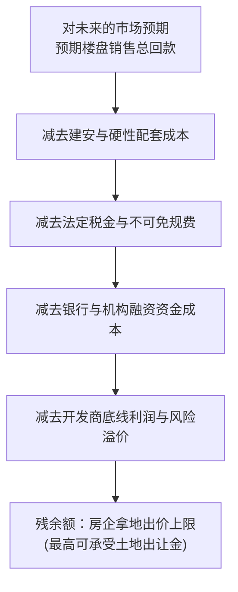
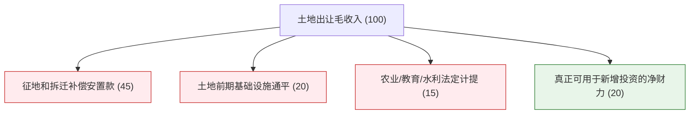
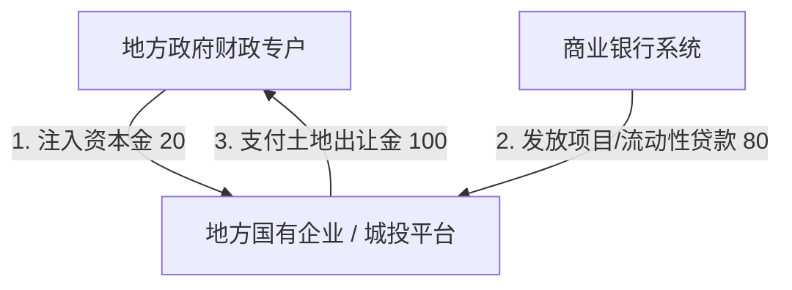

# 39 土地、地方财政与住房周期

[上一章：按揭与家庭](38-mortgages-households.md) · [目录](./) · [下一章：房地产风险](40-housing-risk.md)

**前置阅读：**美国篇 [14 财政与政府债务](https://fangpings.github.io/us-econ/14-fiscal-policy.html)，中国篇 [22 四本预算](22-four-budgets.md)、[36 开发与交付](36-housing-development.md)。

在中国宏观经济的棋盘上，土地是连接城市化实体建设与政府财政收支的超级接口。

很多人笼统地把“土地财政”当成一个贬义词，或者简单地认为“地方政府靠卖地发财”。但在经济学底层，**土地出让金本质上是将城市未来几十年的区位增值和工商业税收潜力，在今天通过资本市场和房企信用一次性贴现为建设现金**。

本章将带你厘清土地出让从拍卖到财政入库的全周期流程，揭示“地价由房价倒算”的残余价值定价机制，算清土地毛收入与可用净财力的巨额杠杆剪刀差，并穿透地方国企托底拿地的跨报表资金闭环。

---

## 1. 定价逻辑：开发商是怎样倒算地价的？

在日常谈论中，人们常有一种朴素的成本加成直觉：“地价贵，所以开发商不得不把房价卖得更贵。”

但在竞争性土地市场上，真实的决策逻辑恰恰相反：**不是地价决定未来房价，而是预期的未来房价决定了开发商今天最高愿意为这块地掏多少钱**。这就是经典的**残余价值法（Residual Valuation）**。

### 残余定价公式与价格弹性放大

$$\text{最高愿付地价} = \text{预期销售回款} - \text{建安工程配套支出} - \text{法定税费} - \text{开发融资成本} - \text{企业目标利润}$$

**教学项目算例（单位：亿元）：**  
某宗住宅用地规划可售体量预计实现销售收入 $100$ 亿元。各项开发建设刚性支出如下：
- 建安及公建配套成本：$40$ 亿元；
- 土地增值税、契税等各项税费：$10$ 亿元；
- 银行信贷与前融资金利息：$5$ 亿元；
- 房企投资决策要求的底线利润与风险补偿：$10$ 亿元。

代入公式计算，开发商在拍卖现场最高可承受的地价为：
$$\text{初始最高地价} = 100 - 40 - 10 - 5 - 10 = 35 \text{ 亿元}$$

**压力测试：若市场销售预期发生边际转向**  
如果周边二手房跌价，开发商对该项目未来的销售回款预期下调 $10\%$（降至 $90$ 亿元），而在建安和税费等刚性成本短期难以压缩的前提下：
$$\text{调整后最高地价} = 90 - 40 - 10 - 5 - 10 = 25 \text{ 亿元}$$
$$\text{地价愿付降幅} = \frac{25 - 35}{35} = \frac{-10}{35} \approx -28.57\%$$

> [!IMPORTANT]
> **杠杆放大效应：**  
> 预期终端售价仅仅下调了 $10\%$，但由于中间建安、税费和利润诉求构成了厚厚的“成本硬垫”，承受所有边际冲击的土地残余出价暴跌了近 $30\%$！  
> 这解释了为什么在楼市销售小幅降温时，土地拍卖市场就会立刻出现大面积底价成交甚至流拍。

---

## 2. 财政收支：土地毛收入与净财力缺口

当地方政府拍出土地后，这笔资金流向了哪里？

在中国的国家预算体系中，国有土地使用权出让收入并不放在**一般公共预算**（用于发公务员工资、保民生运转），而是统一计入**政府性基金预算**（见第 22 章），实行专款专用。

根据财政部公布的 [2024 年财政收支情况](https://bgt.mof.gov.cn/zhuantilanmu/rdwyh/ysbgjyszx/202501/t20250124_3955083.htm)：  
2024 年全国地方政府性基金预算本级收入为 $51,691$ 亿元，其中**国有土地使用权出让收入为 $48,699$ 亿元**，同比下降 $16.0\%$。

### 土地收入不是净利润：巨额刚性扣减

许多人误以为财政部公布的 4.8 万亿土地出让金全是地方政府可以自由支配的“零花钱”。根据《预算法》与土地出让收支管理办法，土地出让收入是一笔**毛收入（Gross Revenue）**，必须扣除巨额的前置刚性成本：

$$\text{土地出让净收益} = \text{土地出让总收入} - \text{征地和拆迁补偿支出} - \text{土地前期开发与三通一平} - \text{各类法定计提基金}$$

其中法定计提包括按规定提取的农业农村发展基金、教育资金、保障性安居工程资金等。

#### 教学收支弹性算例：净财力断崖风险

设某城市土地出让毛收入基准为 $100$ 亿元，对应的成本结构为：
- 农民与居民征地拆迁安置补偿：$45$ 亿元；
- 土地平整、道路管网等前期开发：$20$ 亿元；
- 农业水利与教育专项计提：$15$ 亿元；
- **期初可自由安排的净财力余量**：$100 - (45 + 20 + 15) = 20$ 亿元。

假设受房地产周期影响，该市次年土地出让毛收入下降 $20\%$，降至 $80$ 亿元。然而，前期已经签署拆迁协议的安置补偿款和在建通平工程欠款具有极强的法律刚性，支出仍需 $80$ 亿元（$45 + 20 + 15$）。此时：
$$\text{调整后净财力余量} = 80 - 80 = 0 \text{ 亿元}$$

**毛收入虽然仅下降了 20%，但扣除刚性成本后，地方可用于安排新增基础设施配套的自由财力直接归零（下降 100%）！**  
这就是为什么土地出让金下滑会对地方基建配套投资和企业回款造成立竿见影的流动性紧缩。

---

## 3. 统计实战：一宗土地从公示到入库的五套记录

追踪一宗土地的生命周期，绝不能单凭一条新闻就下结论。土地流转在政府治理中会经历五个先后脱节的记录节点：

### 真实土地成交公告带读

以 [许昌市自然资源和规划局 2024 年第六批国有建设用地使用权出让成交公示](https://zrzyhghj.xuchang.gov.cn/xxgg/013004/20240724/c9b57ed0-712d-42c6-93ef-4cfbf07332c6.html) 为例：
- **成交宗地编号**：东城区 26-3# 地块；
- **土地用途**：城镇住宅用地，出让年限 70 年；
- **出让面积**：$29,132$ 平方米；
- **拍卖成交总价**：$16,616$ 万元；
- **受让人**：许昌建晟企业管理有限公司；
- **成交确认时间**：2024 年 7 月 5 日。

#### 第一步：计算单位土地面积单价

$$P_{\text{土地面积}} = \frac{16,616 \text{ 万元} \times 10,000}{29,132 \text{ 平方米}} \approx 5,703.69 \text{ 元/平方米}$$

#### 第二步：辨析——这是楼面地价（Floor Price）吗？

**不是！**
- 这是**土地占地面积单价**（每平米土地平面的价格）；
- **楼面地价**衡量的是未来摊在每平方米建筑面积上的土地成本：
  $$\text{楼面地价} = \frac{\text{土地成交总价}}{\text{规划计容总建筑面积}} = \frac{\text{土地单价}}{\text{容积率（Plot Ratio）}}$$
该成交公示中未列示具体的规划容积率指标。如果我们仅做教学假设（假设容积率为 $2.0$），则计容建筑面积为 $29,132 \times 2.0 = 58,264$ 平方米，此时测算的折合楼面地价约为：
$$\frac{5,703.69}{2.0} \approx 2,851.85 \text{ 元/平方米}$$
在阅读地方土地原始公报时，绝不能将土地面积价与建筑楼面价混为一谈。

### 跨期缴款时差与财政入库

土地拍卖成交确认书签订后，房企通常按合同约定在数月甚至一年内分批缴足。
- **成交金额 $100$ 亿**：属于意向合同额，发生在市场交易端；
- **当年实际到账 $40$ 亿**：进入财政税务国库专户，形成当年政府性基金预算的实际收入；
- **剩余 $60$ 亿**：属于未来应收账款，不能用于支付当年的即期财政开支。

---

## 4. 深度穿透：地方国企托底拿地的跨账户闭环

在民营房企投资收缩的背景下，各地土地拍卖市场上经常出现地方国有企业或城投公司的身影。如何客观穿透这一经济现象？

让我们通过**独立教学沙盘（单位：亿元）**来追踪资金的跨账户流转：

### 三套报表的综合穿透对照

| 观察视角 | 账户端真实发生的资金与资产变化 | 宏观经济本质解读 |
| :--- | :--- | :--- |
| **政府财政现金账** | 支出资本金 $20$，收到土地出让金 $100$，**净增加现金 80 亿元** | 账面上政府性基金预算收入与可用财力短期得到显著改善 |
| **地方国企资产负债表** | 获得权益资本 $20$，新增银行负债 $80$，资产端增加无形资产（土地使用权）$100$ | 企业的债务杠杆率被动拉高，背负每年还本付息的硬性压力 |
| **广义合并分析视角** | 政府与企业内部的资本注入（$20$）与购地款（$100$）相互抵销，**对外净吸收银行新增信贷 80 亿元** | **本质是借银行信贷之手为财政流动性输血**，并未实现向终端家庭的真实销售 |

### 闭环的可持续性边界

这一操作的核心死穴在于**流动性回收的最终来源**：
- 如果这块土地未来顺利引入产业，或者建成高品质商品房以市场化价格卖给了终端居民，回收的销售现金流就足以全额偿还银行的 $80$ 亿元本息，闭环健康运行；
- 反之，如果该地块长期沉淀、无法产生真实的经营性回款，企业每年必须依赖借新还旧或财政兜底来维持 $80$ 亿元银行贷款的本息周转。

因此，分析土地市场时，**绝不能只看到财政账本上的出让金数字激增，必须穿透拿地买方的资金源头是产业内生资金还是外部负债加杠杆**。

---

## 5. 练习与逐步答案

1. 某市本年土地出让毛收入为 $100$ 亿元，其中征地拆迁安置支出 $45$ 亿元，通平开发支出 $20$ 亿元，其他法定计提专项支出 $15$ 亿元。若次年受市场波动影响，该市土地出让毛收入下降至 $80$ 亿元，而上述刚性支出暂时无法压减。请计算：
   - 基准期与次年该市真正可支配的土地净财力余量；
   - 土地净财力余量的降幅是多少？
2. 许昌市东城区 26-3# 地块出让面积 $29,132$ 平方米，成交总价 $16,616$ 万元。某自媒体称“该楼盘未来售价仅需 5,704 元/平即可保本盈利”，请指出该论断的常识性错误。
3. 某地政府向所属国企注资 $20$ 亿元资本金，国企向银行贷款 $80$ 亿元，合计以 $100$ 亿元竞得一宗商业住宅用地。某分析员据此宣布：“该地块直接为全社会创造了 280 亿元（注资20 + 贷款80 + 卖地100 + 购地100）的宏观新增投资总需求。”请驳斥该分析员的核算错误。

参考答案与详细推理

1. **计算步骤**：
   - 基准年净财力余量 $= 100 - (45 + 20 + 15) = 20$ 亿元；
   - 次年净财力余量 $= 80 - (45 + 20 + 15) = 0$ 亿元；
   - 净财力降幅 $= \frac{0 - 20}{20} = -100\%$。
   - **机制启示**：毛收入虽然只减少了 $20\%$，但由于成本端的刚性锁定，可用净财力余量被 $100\%$ 清零，体现了土地财政收支的高杠杆特征。
2. **错误指出**：
   - 混淆了“土地平方面积单价”与“住宅建筑楼面地价”。$5,703.69$ 元/平方米只是每平米土地表面的出让价格；
   - 测算未来售价保本线，必须首先除以规划容积率算出楼面地价，并在此基础上加上建安工程费、市政配套费、勘察设计费、销售营销费、财务利息和各项法定税金（增值税、土地增值税、企业所得税等）。直接把土地面积单价当成未来房屋保本价属于严重的常识性颠倒。
3. **错误驳斥**：
   - 该分析员犯了严重的跨账户重复计算错误；
   - 在资金链条流转中，政府注入的 $20$ 亿元资本金和银行发放的 $80$ 亿元贷款，是国企支付 $100$ 亿元土地款的**资金来源**；国企买地支付的 $100$ 亿元正是政府土地专户收到的 $100$ 亿元出让金，二者是同一笔资金在借贷双方的镜像反映；
   - 在广义合并边界下，当期真正由金融体系注入该链条的**外部新增资金仅为 80 亿元银行信贷**，绝不能将同一笔钱在不同主体的借贷流水粗暴相加。

---

[上一章：按揭与家庭](38-mortgages-households.md) · [目录](./) · [下一章：房地产风险](40-housing-risk.md)
