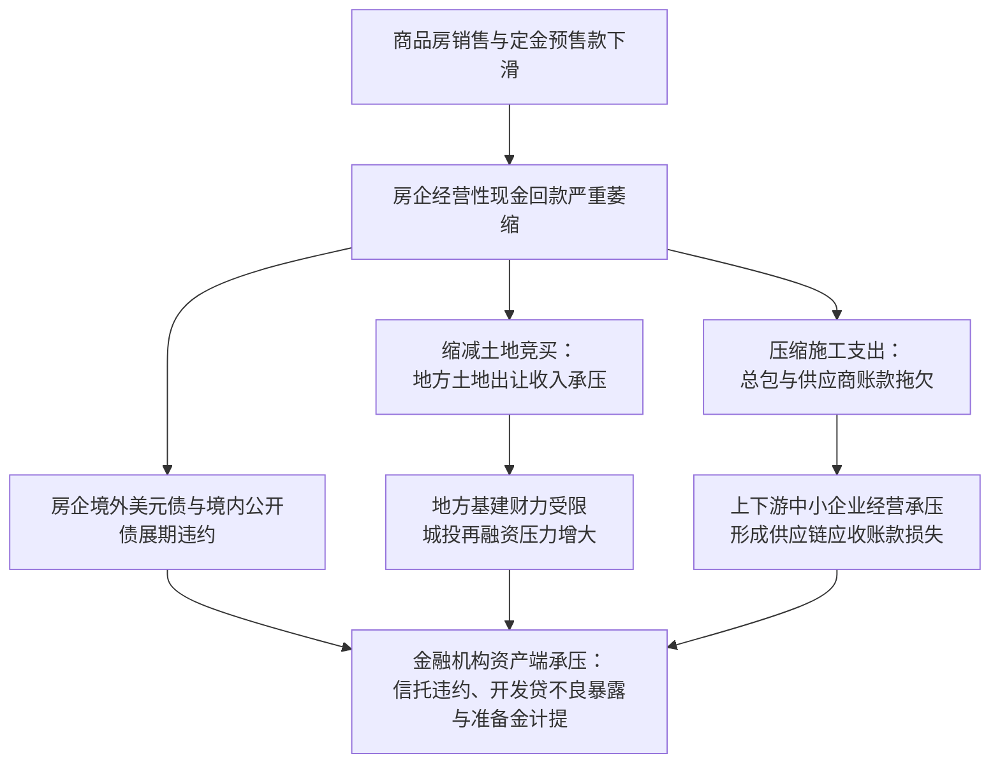
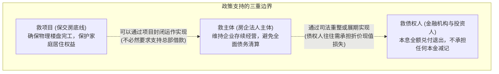
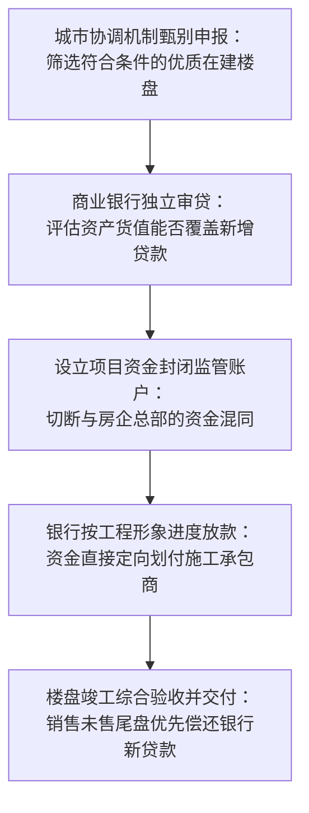

# 40 房地产风险：开发商、地方、银行与损失承担

[上一章：土地财政](39-housing-land-finance.md) · [目录](./) · [下一章：宏观再平衡](41-housing-rebalancing.md)

**前置阅读：**美国篇 [19 信用风险](https://fangpings.github.io/us-econ/19-credit-risk.html)、[15 资产负债表](https://fangpings.github.io/us-econ/15-balance-sheets.html)，中国篇 [26 信用风险与金融稳定](26-credit-risk-stability.md)、[36 开发与交付](36-housing-development.md)、[39 土地财政](39-housing-land-finance.md)。

当房地产高杠杆扩张的飞轮逐渐放缓时，整个链条上积累的债务压力开始浮出水面。

每当有大型房企出现流动性困难，市场上总会充斥着两种截然相反的极端言论：一种认为“系统性金融危机近在咫尺”，另一种则轻描淡写地认为“只要银行展期，风险就彻底消除了”。

在现代宏观金融分析中，**风险既不会凭空产生，也不会通过展期凭空蒸发，它只会在不同主体、不同时间和不同合同条款之间发生转移与分摊**。本章将为你绘制中国房地产债务化解的“权利顺位地图”，拆解城市保交房“白名单”机制的闭环运作，并用严格的现值折现与回收率模型量化风险处置的真实代价。

---

## 1. 风险链条：销售压力如何向金融系统穿透

房地产下行期的风险传导并不是杂乱无章的，而是沿着清晰的合同与现金流链条逐级展开：

这个传导过程体现出强烈的**非线性**：房企违约最先暴露在离项目资产最远的公开市场信用债上；随后传导至缺乏抵押品的上下游供应商商票；最后在多重风险隔离防火墙被击穿时，才会真正演变为商业银行表内的不良贷款。

---

## 2. 处置边界：救项目、救企业还是救债权人？

在分析救助政策时，必须分清救助的对象究竟是谁。这是三个完全不同法律边界和经济诉求的概念：

- **救项目（保交房）**：核心目标是完成实物交付，捍卫普通老百姓最关切的民生底线。资金实行“封闭管理、专款专用”，确保新注入的资金全部变成工地上砌筑的砖瓦；
- **救企业（主体信用重塑）**：只有少数资产优质、财务合规、仅面临临时性流动性错配的房企能够获得集团层面的全面授信支持；
- **救债权人（兜底兑付）**：在市场化、法治化原则下，高收益境外美元债持有人或信托投资人必须为过去追逐高收益而承担相应的投资损失，不可能由公共财政全额买单。

---

## 3. 法律权利地图：清偿顺序决定真实回收率

当一个陷入困境的房地产项目进入司法重整或清算程序时，不同债权人在法律上的清偿顺位存在本质差异：

| 权利人分类 | 核心法律依据与权利属性 | 清偿与保障优先顺位 | 对资产估值的实际影响 |
| :--- | :--- | :--- | :--- |
| **房屋买受人** | 《最高人民法院关于商品房消费者权利保护的批复》及执行异议之诉解释 | **最高顺位（超级优先权）** | 已售期房必须优先保障实物交付或全额退还已付购房款，不能列入普通破产财产分割 |
| **建筑施工总包** | 《民法典》第 807 条：建设工程价款优先受偿权 | **优于银行抵押权** | 在工程折价或拍卖价款中，工程总包方对建筑物折价款享有法定的第一顺位求偿权 |
| **商业银行等抵押债权人** | 已在不动产登记中心设立合法有效登记的第一顺位抵押权 | **抵押物范围内优先受偿** | 仅能在对应抵押地块或在建工程扣除施工优先受偿权后的剩余变现价值内优先受偿 |
| **上游供应商与普通债券人** | 普通无财产担保的合同债权与信用债券 | **最后清偿顺位（劣后）** | 往往面临极高的本金减记（Hair-cut）或极低比例的清偿率 |
| **房企股东权益** | 注册资本金与母公司股权投资 | **全额吸收损失后归零** | 在债权人本息得到完全补偿前，原股东权益不得抽逃分配 |

---

## 4. 机制创新：保交房“白名单”的闭环机制

为了解决过去“银行不敢贷、项目拿不到钱、工程无法复工”的卡脖子死结，住房和城乡建设部与国家金融监督管理总局于 2024 年初联合建立了**城市房地产融资协调机制（俗称“白名单”机制）**。

在 2024 年 5 月 17 日国务院政策例行吹风会上，金融监管总局公布：截至 5 月 16 日，商业银行已审批通过“白名单”项目贷款金额达 **9,350 亿元**。

### 为什么必须“闭环运作”？

银行之所以愿意向已经出现公开债违约的房企旗下项目提供新增白名单贷款，关键在于**资金闭环与法人隔离**：
- 新贷款不交给房企集团总部，而是直接打入由政府和银行共同监管的项目独立封闭账户；
- 专款用于采购施工材料和支付农民工工资；
- 项目剩余未售货值的变现资金，第一顺位优先偿还白名单新增贷款本息，有效防范了新增金融风险。

---

## 5. 精算实战：续建完成与资产处置的清偿模型

让我们通过一个规范的**工程资产负债重组模型（单位：亿元）**，精确计算不同处置方案下的债权回收率。

### 基础情景：项目缺口与新增贷款续建

**设某陷入停工的在建楼盘：**
- 已售出房屋尚未竣工交付；
- 项目监管账户内已有沉淀现金 $10$ 亿元；
- 要完成全部已售房屋的交付并建好剩余未售现房，尚需刚性建安支出 $30$ 亿元；
- 未售现房全部完工后，预计扣除销售税费后的净变现现金流为 $50$ 亿元；
- 原有历史遗留的旧债权（含旧抵押贷款、拖欠建材款等）合计账面余额为 $40$ 亿元。

#### 第一步：测算续建融资缺口
$$\text{完工资金缺口} = \text{后续总支出} - \text{存量可用现金} = 30 - 10 = 20 \text{ 亿元}$$
通过白名单机制，银行向该项目注入新增专项信贷 $20$ 亿元，配合存量 $10$ 亿元现金，工程顺利封顶竣工。

#### 第二步：销售回款与优先顺位分配
竣工后未售货值顺利变现 $50$ 亿元现金。按照白名单超级优先受偿约定，必须首先偿还新增白名单贷款本息合计 $22$ 亿元（$20$ 亿元本金加 $2$ 亿元建设期利息）：
$$\text{剩余可分配现金} = 50 - 22 = 28 \text{ 亿元}$$

#### 第三步：计算历史旧债权的真实回收率
$$\text{旧债权回收率} = \frac{\text{实际可分配现金}}{\text{旧债权账面面值}} = \frac{28}{40} = 70.0\%$$
此时，房屋全部保质交付，新增贷款本息全额收回，历史旧债权人获得了 $70\%$ 的较好受偿，承担了 $12$ 亿元的本金损失。

---

### 压力测试：市场价格下行导致回收率骤降

若在续建期间市场环境恶化，未售现房最终仅实现净销售回款 $35$ 亿元（低于预期的 $50$ 亿元）。
- 优先扣除新增信贷本息 $22$ 亿元后：
  $$\text{剩余可分配现金} = 35 - 22 = 13 \text{ 亿元}$$
- 此时历史旧债权的回收率骤降为：
  $$\text{压力下旧债回收率} = \frac{13}{40} = 32.5\%$$

---

### 方案对决：续建完工 vs 立即破产拍卖处置

如果当初不采取续建方案，而是在停工状态下直接组织破产清算、拍卖烂尾土地与半成品工程：
- 评估停工半成品连同账户现金 $10$ 亿元的整体拍卖变现价为 $25$ 亿元；
- 扣除资产评估、司法拍卖和破产管理人破产费用 $3$ 亿元，净变现现金为 $22$ 亿元；
- 假定这 $22$ 亿元全部由旧债权人分配：
  $$\text{直接破产拍卖回收率} = \frac{22}{40} = 55.0\%$$

**关键决策临界线测算：**  
续建方案要想在经济上优于直接破产清算（回收率高于 $55\%$），完工后的净销售回款至少需要达到多少？
$$\text{销售净回款} - 22 \ge 22 \implies \text{销售净回款} \ge 44 \text{ 亿元}$$
这一测算为金融机构和地方政府提供了极其清晰的量化决策底线：**只有当预期未售货值能卖到 44 亿元以上时，引入新增贷款推进续建在财务上才优于直接破产清算**。

---

## 6. 现值量化：展期不是无成本的时间旅行

在债务重组公告中，常常能看到“某笔 100 亿元债券成功展期 5 年、不削减本金”的喜讯。

从金融学角度看，**不付利息的名义本金展期，本质上是一次隐性的本金大幅折价减记！**

### 贴现现值公式

设名义本金为 $F$，展期年限为 $t$，基准折现率为 $r$，到期一次性还本的现值（Present Value）为：
$$\text{PV} = \frac{F}{(1 + r)^t}$$

> **量化教学演示：**  
> 某到期债务本金 $F = 100$ 亿元。原合同约定今天还款；重组方案约定展期至 $5$ 年后一次性偿还 $100$ 亿元本金，展期期间利息为零。若市场同风险资产的基准折现率为 $r = 8\%$：
> $$\text{展期后债权真实经济现值} = \frac{100}{(1 + 0.08)^5} = \frac{100}{1.4693} \approx 68.06 \text{ 亿元}$$
> $$\text{债权人实际承担的隐性价值折损} = 100 - 68.06 = 31.94 \text{ 亿元（即实质减记 } 31.94\% \text{）}$$

名义上企业没有发生“本金违约”，但在货币时间价值的规律下，债权人实际上默默承担了超过 $30\%$ 的现值财富缩水。

---

## 7. 练习与逐步答案

1. 某房企宣布“集团名下已成功进入融资白名单的项目累计获批额度突破 200 亿元”。某自媒体据此报道“该房企已获得 200 亿元充沛现金，债务危机彻底解除”。请指正该报道的两处严重误判。
2. 在前述教学项目中，项目续建需新增贷款 $20$ 亿元（本息共需偿还 $22$ 亿元），旧债权本金 $40$ 亿元。若完工后未售房屋最终仅卖出 $30$ 亿元净现金，请计算此时旧债权人的实际受偿金额与回收率。
3. 某商业银行将账面本金为 $10$ 亿元的房地产不良贷款，以 $4$ 亿元的价格折价转让给地方资产管理公司（AMC）。该行行长称“该笔处置不仅让银行收回 4 亿现金，更彻底消除了全社会的信贷信用风险”。请从全社会宏观视角指出该说法的错误之处。

参考答案与详细推理

1. **严重误判指正**：
   - **混淆审批额度与实际提款现金**：白名单额度是银行体系对具体合格项目的授信批复，并不等于已经实际打到账户上的真金白银。放款必须紧紧跟随施工进度、工程节点验收等苛刻条件分笔提款；
   - **混淆项目封闭资金与集团自由偿债现金**：白名单资金被严格锁定在项目的独立监管账户内，只能定向划付给工地施工单位，房企集团总部根本无法将其提取用于偿还母公司的公开市场债券或利息。
2. **计算步骤**：
   - 完工销售回款为 $30$ 亿元；
   - 第一顺位全额偿还白名单新增贷款本息 $22$ 亿元；
   - 剩余可用于分配给历史旧债权的资金 $= 30 - 22 = 8$ 亿元；
   - 旧债权实际受偿金额为 $8$ 亿元；
   - 旧债权回收率 $= \frac{8}{40} = 20.0\%$（承担了高达 $80\%$ 的本金折损）。
3. **错误指出**：
   - 该笔交易仅完成了**微观金融机构之间的风险资产转移与出表**，并未在宏观全社会层面彻底消灭底层资产的实质损失；
   - 商业银行在出售当日确认了 $10 - 4 = 6$ 亿元的账面核销损失；而承接该资产的 AMC 成为新的债权持有人，如果底层楼盘未来拍卖处置回收的实际现金无法达到 $4$ 亿元加上资金利息，AMC 将面临二次亏损。不良资产被移出银行资产负债表，绝不等于其潜在违约风险已经在全社会闭环中消失。

---

[上一章：土地财政](39-housing-land-finance.md) · [目录](./) · [下一章：宏观再平衡](41-housing-rebalancing.md)
