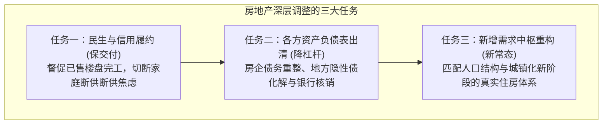
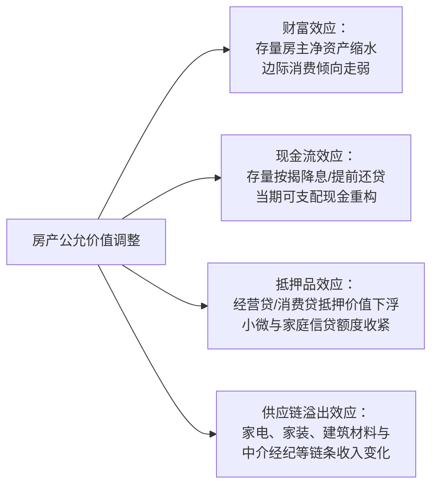
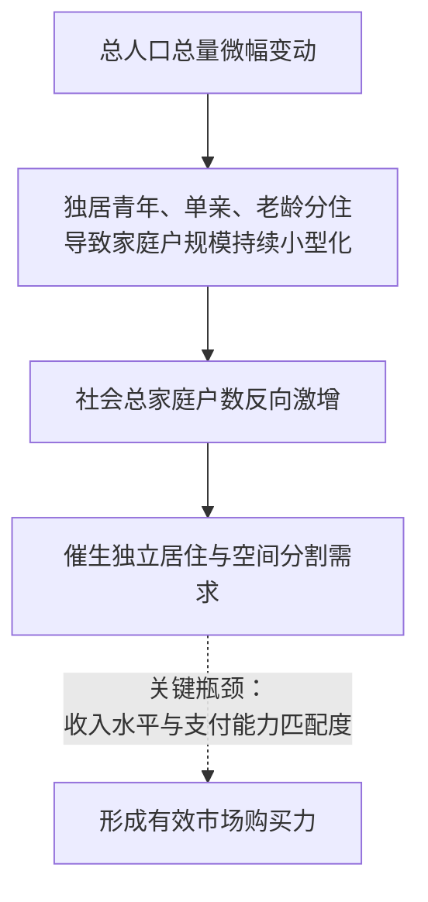

# 41 房地产调整与中国经济再平衡

[上一章：房地产风险](40-housing-risk.md) · [目录](./) · [下一章：联合诊断](42-joint-diagnosis.md)

**前置阅读：**美国篇 [04 GDP](https://fangpings.github.io/us-econ/04-gdp.html)、[15 资产负债表](https://fangpings.github.io/us-econ/15-balance-sheets.html)、[19 信用风险](https://fangpings.github.io/us-econ/19-credit-risk.html)，中国篇 36—40 章。

房地产不仅是一个行业，它是过去二十年牵引中国总需求、信贷扩张与地方财政的关键引擎。

当这一超级引擎进入深刻调整期，宏观经济面临的根本课题是：**如何实现从“房地产-土地财政-重资产”旧循环，向“先进制造-高水平消费-绿色创新”新循环的平稳再平衡**。

很多人以为再平衡就是“把投在房地产里的钱直接拿去搞高端芯片”；或者以为只要把未售库存全部买下来，经济就会瞬间恢复如初。本章将带你拆解房地产调整的三重任务，算清“政府收储去库存”背后的现金流商业自偿性账本，并从国民经济核算（GDP）的底层原理理解“开发投资下跌为何不等于 GDP 同幅坍塌”。

---

## 1. 调整任务：房地产出清的三道关口

房地产市场的出清与再平衡，绝不是一个单一的“房价止跌”指标就能概括的。在宏观政策视野中，它包含三个先后推进、约束各异的任务：

1. **第一重：社会契约履约（保交付）**：核心是解决“花光毕生积蓄买期房的普通家庭能不能住进去”的问题。如果连既有项目的物理交房都无法保障，市场信用基石就会动摇；
2. **第二重：资产负债表出清（修复资产与负债）**：通过展期、破产重组、债务置换与资产减记，将虚高的账面价值重估到真实公允水平，使银行、地方政府与房企的负债恢复到与现金流匹配的可持续状态；
3. **第三重：供求中枢重构（新发展模式）**：从过去的“大拆大建、高周转、高负债”彻底脱敏，建立“市场归市场（改善需求）、保障归保障（配租配售）”的双轨制新常态。

---

## 2. 传导网络：房产价格变动如何作用于宏观消费

为什么居民买房的资产变动，会深刻牵动全国的社会消费品零售？宏观经济学通过四条截然不同的管道捕捉这一传导：

- **财富效应（Wealth Channel）**：对于已拥有住房的家庭，房屋估值缩水直接侵蚀了其资产负债表净权益，引发“感觉自己变穷了”的心理约束，促使其增加预防性储蓄、削减非必需消费；
- **现金流效应（Cash Flow Channel）**：若央行引导存量房贷利率下调，借款家庭每月少付几百元月供，当期现金流得到立竿见影的释放；
- **抵押品效应（Collateral Channel）**：大量个体工商户与小微企业主习惯用名下住宅作为抵押物向银行申请经营周转贷。房产估值缩水会触发银行风控下调抵押率或要求补足质押物，引发经营性信贷收缩；
- **产业链外溢效应（Supply Chain Channel）**：新房销售和交付的变动，直接映射到家电、家具、家装与五金建材的下游订单。

---

## 3. 人口结构重构：家庭户裂变与真实需求空间

很多人习惯简单地用“总人口开始负增长”来推断“中国再也不需要建新房子了”。

这种看法忽视了人口学中一个至关重要的结构性变量：**家庭户规模的快速小型化（家庭裂变）**。

### 人口普查的硬核数据

根据国家统计局发布的 [第七次全国人口普查公报（第二号）](https://www.stats.gov.cn/sj/tjgb/rkpcgb/qgrkpcgb/202302/t20230206_1902002.html)：
- 2020 年全国共有家庭户 $49,416$ 万户；
- **平均每个家庭户的人口为 2.62 人**；
- 相比 2010 年第六次人口普查的 **3.10 人**，十年间减少了整整 $0.48$ 人。

#### 教学城市算例：人口微降，家庭户数却激增 8%

**设某典型地级市：**
- 普查期内家庭户总人口由 $100$ 万人微幅流失至 $99$ 万人（人口下降 $1.0\%$）；
- 受年轻人婚后独立居住、单身青年独居以及老年人分住影响，该市平均家庭户规模由 $3.0$ 人/户萎缩至 $2.75$ 人/户。

我们来测算该市真实需要居住空间的“家庭户数”变化：
$$\text{初期家庭总户数} = \frac{100 \text{ 万人}}{3.0 \text{ 人/户}} \approx 33.33 \text{ 万户}$$
$$\text{期末家庭总户数} = \frac{99 \text{ 万人}}{2.75 \text{ 人/户}} = 36.00 \text{ 万户}$$
$$\text{新增家庭总户数} = 36.00 - 33.33 = 2.67 \text{ 万户（增长率高达 } +8.0\% \text{）}$$

> [!NOTE]
> **深层洞察：家庭户增加不等于必须新盖 2.67 万套商品房！**  
> 新增的 2.67 万户单身或小家庭，可以通过租住青年公寓、消化存量二手房、租用城中村或申请配租型保障房来满足居住诉求。有居住需求，绝不等于具备按当前价格全款或高杠杆购买商品房的**有效支付能力**。

---

## 4. 政策工具箱：四类政策分别作用于哪张资产负债表？

在宏观调控的组合拳中，各项政策的着力点与传导路径泾渭分明：

| 宏观政策安排 | 直接作用的核心账户与主体 | 不能任意引申的推论 |
| :--- | :--- | :--- |
| **保交楼白名单专项信贷** | 项目封闭监管账户、工程总包施工现金 | 房企母公司所有公开市场债务已无忧、所有城市新开工将立即反弹 |
| **下调首付比例与取消限购** | 新购房家庭初始首付现金与负债杠杆 | 居民凭空增加了财富（低首付实质上提高了资产价格波动时的爆仓杠杆率） |
| **存量房贷利率批量下调** | 既有按揭家庭每月利息流、银行净息差（NIM） | 过去买在高位缩水的房产净值恢复、节省的月供必然 100% 用于消费 |
| **设立保障性住房再贷款（收储）** | 房企存货出清、地方城投保障房运营表 | 财政无成本套利、收购金额全额转化为当年新增国民经济产出（GDP） |

---

## 5. 精算实战：收购已建成存量房作保障房的商业自偿性

2024 年 5 月，中国人民银行正式设立 **3,000 亿元保障性住房再贷款**，鼓励地方国有企业以合理价格收购已建成未出售商品房，用作配售型或配租型保障性住房。

在实际执行中，这一去库存模式的核心经济命门在于：**租金收入能否在不依赖财政长期持续补贴的前提下，覆盖银行借款的还本付息支出？**

### 核心现金流平衡模型

设某批已竣工未售存量商品房收购项目（单位：亿元）：
- 约定收购总价款 $P = 100$ 亿元；
- 资金来源：地方国企自筹资本金 $20$ 亿元（$20\%$），申请银行收购贷款 $80$ 亿元（$80\%$）；
- 运营收益：按平价保障房出租，满租年毛租金为 $3$ 亿元；扣除合理空置期损失 $0.3$ 亿元、物业日常维修与运营管理费 $0.7$ 亿元，**年净运营收益（NOI）**为：
  $$\text{NOI} = 3 - 0.3 - 0.7 = 2.0 \text{ 亿元}$$
- 银行贷款条件：年贷款利率为 $3.0\%$，要求按年等额偿还本金（假定首年偿还本金 $2.0$ 亿元）。

#### 第一步：首年偿债现金流与收支缺口
$$\text{首年利息支出} = 80 \times 3.0\% = 2.4 \text{ 亿元}$$
$$\text{首年还本付息刚性总支出} = 2.4 \text{（利息）} + 2.0 \text{（还本）} = 4.4 \text{ 亿元}$$
$$\text{首年净现金流缺口} = 2.0 \text{（NOI）} - 4.4 \text{（偿债）} = -2.4 \text{ 亿元}$$

即便央行再贷款提供优惠资金使得银行贷款利率降至 $2.0\%$：
$$\text{新利息支出} = 80 \times 2.0\% = 1.6 \text{ 亿元}, \quad \text{总偿债支出} = 1.6 + 2.0 = 3.6 \text{ 亿元}$$
$$\text{现金流缺口依然达到} = 2.0 - 3.6 = -1.6 \text{ 亿元}$$

---

### 第二步：倒求能实现现金流自偿的收购价格上限

如果租金水平与运营支出固定（$\text{NOI} = 2.0$ 亿元），银行贷款占收购总价的 $80\%$（即贷款本金为 $0.8P$），贷款年利率 $r = 3.0\%$，按 $40$ 年期超长期摊还本金（每年还本 $\frac{0.8P}{40} = 0.02P$）：

$$\text{首年总偿债需求} = 0.8P \times 3.0\% + \frac{0.8P}{40} = 0.024P + 0.02P = 0.044P$$

要确保项目首年不出现亏损现金缺口（$\text{偿债总支出} \le \text{NOI} = 2.0$ 亿元）：
$$0.044P \le 2.0 \implies P \le \frac{2.0}{0.044} \approx 45.45 \text{ 亿元}$$

> [!IMPORTANT]
> **商业自偿性结论：**  
> 原售价 $100$ 亿元的房源，即便打七折（$P = 70$ 亿元），首年本息支出仍高达 $70 \times 0.044 = 3.08$ 亿元，依然产生 $1.08$ 亿元的运营赤字。  
> **只有当收购价格压低至原价的 4.5 折左右（45.45 亿元以下），或者地方财政每年列支显性专项补贴时，国企收购存量房的资金链条才能实现长期健康闭环。**

---

## 6. 核算辨析：收购存量房为什么不增加当年 GDP？

许多初学者容易产生一种直觉性误解：“地方国企花了 100 亿元买下开发商的存量商品房，这 100 亿资金进入实体经济，必定直接拉动了 100 亿元的新增 GDP 吧？”

根据国民经济核算体系（SNA）的支出法原则：
- **这批商品房在过去的竣工年份，就已经作为“固定资产形成”或“房企存货投资”全额核算计入过往年份的 GDP 之中**；
- 当期国企出资 $100$ 亿元收购，在统计核算上仅仅表现为**资产在不同经济部门之间的权属转移（从房企的存货转入国企的不动产投资）**：
  $$\Delta \text{固定资本形成} = +100 \text{ 亿元}, \quad \Delta \text{存货投资} = -100 \text{ 亿元}$$
  $$\Delta \text{当期资本形成总额} = +100 + (-100) = 0 \text{ 亿元}$$

这笔收购极其有效地解决了房企的流动性死结、充实了地方保障房筹集量，**但它没有在当期生产出新的房屋实物，因此直接新增的当期 GDP 为零**！

---

## 7. 模块综合作业与全案解答

**教学综合情景：**  
某经济大市在一年中经历了三个重大的宏观事件：
1. 市政府推进保交楼，协调金融机构向停工楼盘注入白名单续建配套信贷 $20$ 亿元，全部用于当期建安工程施工；
2. 地方城投通过银行收购贷款 $80$ 亿元与财政注资 $20$ 亿元，按市场化折价以 $100$ 亿元全款收购了已竣工未售存量商品房用于保障房；
3. 贯彻落实存量房贷降息政策，全市存量借款家庭全年合计减少月供现金支出 $3$ 亿元。

当地某媒体发表社论宣称：“这三项举措合力为全市当年**直接创造了 123 亿元（20 + 100 + 3）的新增 GDP**，并且标志着全市房地产金融风险已经彻底清零！”

**请运用本模块所学，给出严密的专业批驳。**

专业参考分析与逻辑拆解

该自媒体社论存在严重的跨概念乱拼与核算常识颠倒：

1. **GDP 核算归因的重大错误（123 亿完全站不住脚）**：
   - **收购已竣工房产 100 亿**：属于存量实物资产所有权从企业存货向保障房存货/固定资本的转移，不代表当期新生产价值，计入当期 GDP 的资本形成增量为 $0$；
   - **居民房贷月供减少 3 亿**：属于家庭部门与银行部门之间的**初次分配现金流转移**，本身绝不是 GDP。只有当家庭将这节省下来的 3 亿元实际拿去购买商品和服务时，才会根据居民边际消费倾向（MPC）间接拉动最终消费；
   - **续建信贷 20 亿**：这是融资金融量，只有经住建部门核算、扣除采购旧欠款后实际转化成当期物理建安工程量的部分，才属于固定资产投资形成的生产价值。
2. **“风险彻底清零”的过度乐观误读**：
   - **收购主体的债务自偿风险**：城投出资 100 亿元购房，背负了 80 亿元商业贷款。前文测算表明，在市场平价租金下，项目 NOI 往往无法覆盖还本付息，存在转化为地方隐性债务拖欠的次生风险；
   - **房企存量债务尚未根治**：房企收到卖房款 100 亿元后，往往需优先用于偿还此前拿地前融或施工垫资，未必能覆盖全部旧债，历史亏损并未凭空消失。

---

[上一章：房地产风险](40-housing-risk.md) · [目录](./) · [下一章：联合诊断](42-joint-diagnosis.md)
