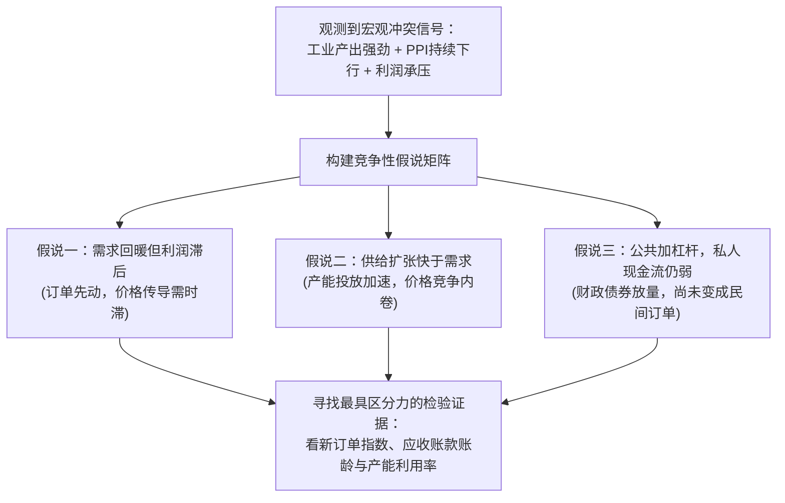

# 42 联合诊断与中国历史案例

[上一章：房地产再平衡](41-housing-rebalancing.md) · [目录](./) · [下一章：数据系统](43-data-workflow.md)

**前置阅读：**美国篇 [01 经济账户地图](https://fangpings.github.io/us-econ/01-economic-map.html)、[03 发布与版本](https://fangpings.github.io/us-econ/03-releases-and-vintages.html)、[10 通胀机制](https://fangpings.github.io/us-econ/10-inflation-mechanisms.html)。

在宏观经济研报中，最忌讳的做法是把一堆看似亮丽的宏观指标排成一列“红绿灯”，然后得出一个永远无法被证伪的模糊结论：“经济正在温和修复，政策效应逐步显现。”

真实的经济体永远充满了矛盾：**生产可能很旺，但出厂价格却在下跌；融资总量可能在放量，但企业投资意向却在走低；公司总利润可能在上升，但股民手中的股票却在大跌**。

一个优秀的分析师，其核心能力不是在矛盾中选一个自己喜欢的数字，而是让互相冲突的数字在严密的账户与逻辑链条下**共同约束判断**。本章将为你建立竞争性宏观诊断框架，复盘两段真实的中国宏观历史迷局，并手把手完成一套经典的月度宏观研报联合诊断实战。

---

## 1. 诊断方法论：分析的单位是一个命题，而非一列红绿灯

在建立宏观研报底稿时，必须把模糊的情绪宣泄转化为**具备明确检验条件的逻辑命题**。

一个合格的宏观命题必须具备三个要素：
1. **明确的主体与客体**（谁的行为？例如“中下游民营装备制造企业”而非笼统的“企业”）；
2. **带时限的前瞻预测**（未来几个季度？）；
3. **可证伪的判据**（什么样的事实出现，代表该判断必须被撤回？）。

### 三大竞争性假说的对比检验

| 假说体系 | 核心内在传导机制 | 判定支持的核心后续观测量 | 判定证伪的信号 |
| :--- | :--- | :--- | :--- |
| **假说一：需求回暖，利润滞后** | 终端新订单率先复苏带动开工，因库存去化与合同黏性，价格和毛利率滞后修复 | 制造业新订单指数持续位于荣枯线上，企业应收账款周转天数缩短 | 产成品存货被动积压，订单指数再度跌破荣枯线 |
| **假说二：供给快于需求（内卷）** | 新产能集中投产释放供给，全行业通过以价换量维持生产，价格承压侵蚀利润 | 工业品出厂价格（PPI）持续负增长，产能利用率偏低，单价下滑 | PPI 环比显著转正，主要工业品毛利率企稳反弹 |
| **假说三：公共扩张，私人收缩** | 政府债发行大幅推高社融总量，但资金主要用于借新还旧或清欠，尚未扩散至民间采购 | 社融中政府债占比异常高企，民间固定资产投资低迷，M1 增速偏弱 | 民营企业中长期中长期贷款与设备投资意向指数同步走强 |

---

## 2. 历史案例复盘一：2020 年复苏为何不能只看 GDP？

将信息时间窗口精确回溯至 **2021 年 1 月 18 日上午国家统计局数据发布时点**。

当时官方初步核算：
- **2020 年全年 GDP** 实际增长 **2.3%**，其中第四季度单季实际同比增长 **6.5%**；
- **规上工业增加值** 全年同比增长 **2.8%**；
- **社会消费品零售总额** 全年同比下降 **3.9%**，其中**餐饮收入暴跌 16.6%**。

### 联合诊断推理要点

1. **季度与全年的严重割裂**：四季度 $6.5\%$ 的高读数包含了极强的前期停工基数效应，绝不能机械外推为经济已经恢复到年化 $6.5\%$ 的高增长常态；
2. **生产与消费的极度分化**：以防疫物资、居家办公设备为代表的工业出口生产呈现“V型”大反弹，但以餐饮、旅游、线下零售为代表的聚集性服务业遭受严重冲击；
3. **事后修订纪律**：2021 年 12 月 17 日，国家统计局发布最终核实公告，将 2020 年现价 GDP 总量由 $1,015,986$ 亿元下调为 $1,013,567$ 亿元，实际增速由 $2.3\%$ 微调为 $2.2\%$。我们在复盘 2021 年初的研报时，**绝不能让年末才发布的修订数据穿越泄漏到年初的研究报告中**。

---

## 3. 历史案例复盘二：2024 年增长、房地产与股市的错位

让我们将研究时钟锁定在 **2025 年 1 月 17 日**：

| 官方发布指标 | 历史当期公布读数 | 可以确凿支持的宏观事实 | 容易引申出的错误推论 |
| :--- | ---: | :--- | :--- |
| **GDP 实际增速** | 初步核算 **5.0%** | 全年境内实体生产总规模实现稳健扩张 | 所有行业与微观企业的日子都很好过 |
| **房地产开发投资** | 可比口径 **−10.6%** | 房企前端开工与土地投资深度调整 | 全国整体固定资本形成总额必然大幅坍塌 |
| **新建商品房销售额** | 同比 **−17.1%** | 合同销售金额收缩，房企现金流收紧 | 同一套可比住房的价格必然下跌了 17% |
| **上证综指价格回报** | 全年上涨 **+12.67%** | 该指数所代表的股票价格总市值上升 | 实体经济全面过热、全市场股票普遍盈利 |
| **上证指数全收益** | 全年上涨 **+16.15%** | 计入上市公司现金分红后的总股东回报 | 投资者实际到手的税后现金股息收益率 |

### 加入微观企业利润与应收账款（推进至 2025 年 1 月 27 日）

国家统计局在 1 月 27 日公布了 2024 年全国规模以上工业企业财务数据：
- **营业收入**：$137.77$ 万亿元，同比增长 $2.1\%$；
- **营业成本**：同比增长 $2.5\%$（成本增速快于收入增速，毛利空间受挤压）；
- **利润总额**：$74,310.5$ 亿元，同比下降 $3.3\%$；
- **营业收入利润率**：
  $$\text{利润率} = \frac{74,310.5 \text{ 亿元}}{137.77 \text{ 万亿元}} \approx 5.39\% \quad \text{（同比下浮 0.30 个百分点）}$$
- **年末应收账款**：$26.06$ 万亿元，同比增长 $8.6\%$；
- **平均回收期**：$64.1$ 天，同比增加 $3.9$ 天。

> [!IMPORTANT]
> **拼图完成后的宏观画像：**  
> 实体产出在增长（GDP 5.0%），但工业企业利润出现收缩（-3.3%），企业回款账期被动拉长（64.1 天），应收账款占压资金剧增。这清晰地验证了前述的**假说二（供给快于需求，以价换量侵蚀利润）**与**假说三（现金流动性传导时滞）**。股市的上涨则反映了无风险利率下行推动的估值分母端扩张与分红政策驱动，与当期微观利润的调整形成了鲜明的“宏微观温差”。

---

## 4. 实战审计：月度宏观研报诊断沙盘

**教学情景（单位：亿元）：**  
某月发布的宏观数据简报称：“社融多增 50 亿元，证明企业信贷需求强劲；商品房成交面积持平，证明楼市全面止跌企稳；样本企业总利润增长 10%，股票资产至少应上涨 10%。”

**请基于以下当月真实核算底表，进行全面的逻辑审计与量化证伪：**

### 底表数据

1. **金融与社融**：当月新增社融 $300$ 亿元（上年同月为 $250$ 亿元）。其中政府债券净融资分别为 $180$ 亿元与 $100$ 亿元；其他所有分项合计分别为 $120$ 亿元与 $150$ 亿元；
2. **企业信贷与意向**：企业贷款期末余额净增 $80$ 亿元（当月实际提款 $130$ 亿元，偿还到期本金 $50$ 亿元）；但央行调查的企业设备投资意向指数并未改善；
3. **房地产销售**：新建商品房累计销售额为 $900$ 亿元、面积 $100$ 万平米；上年同期销售额为 $1,000$ 亿元、面积 $100$ 万平米；
4. **股票基本面**：固定样本上市公司税后净利润由 $100$ 亿元增长至 $110$ 亿元；但因定增配股，加权总股数由 $100$ 亿股增加至 $125$ 亿股；
5. **市场估值**：该股票的市盈率估值倍数（PE）受市场风险偏好影响由 $20$ 倍下调至 $18$ 倍。

---

### 计算与审计底稿

#### 1. 拆解社融多增的真实来源
$$\Delta \text{社融总增量} = 300 - 250 = +50 \text{ 亿元}$$
$$\Delta \text{政府债券融资} = 180 - 100 = +80 \text{ 亿元}$$
$$\Delta \text{其他实体融资（含企业与居民信贷）} = 120 - 150 = -30 \text{ 亿元}$$
**诊断结论**：社融同比多增的 $50$ 亿元，**完全由政府发债（+80 亿）贡献，民间自发性融资不仅没有扩张，反而收缩了 30 亿元**！原简报断言“企业信贷需求强劲”被数据直接证伪。

#### 2. 房地产量价结构的真实含义
- 当期平均成交单价：
  $$\bar{P}_1 = \frac{900 \text{ 亿元}}{100 \text{ 万平米}} = 9 \text{ 万元/平米}$$
- 上年同期平均成交单价：
  $$\bar{P}_0 = \frac{1,000 \text{ 亿元}}{100 \text{ 万平米}} = 10 \text{ 万元/平米}$$
- 混合均价变动率：
  $$\frac{9 - 10}{10} = -10.0\%$$
**诊断结论**：物理销售面积虽然走稳，但销售额大幅缩水 $10\%$，混合成交均价下跌 $10\%$。房企实际回笼的现金流仍在承压，绝非“全面止跌企稳”。

#### 3. 股票价格的严密解耦
根据每股收益与市盈率定价公式：
$$P = \text{EPS} \times \text{PE} = \frac{\text{净利润}}{\text{总股本}} \times \text{PE}$$

- **期初每股收益与价格**：
  $$\text{EPS}_0 = \frac{100 \text{ 亿元}}{100 \text{ 亿股}} = 1.00 \text{ 元/股}, \quad P_0 = 1.00 \times 20 = 20.00 \text{ 元}$$
- **期末每股收益与价格**：
  $$\text{EPS}_1 = \frac{110 \text{ 亿元}}{125 \text{ 亿股}} = 0.88 \text{ 元/股}, \quad P_1 = 0.88 \times 18 = 15.84 \text{ 元}$$
- **每股收益变动率与股票价格总回报**：
  $$\Delta \text{EPS} = \frac{0.88 - 1.00}{1.00} = -12.0\%$$
  $$\text{股票价格回报率} = \frac{15.84 - 20.00}{20.00} = -20.8\%$$

> [!IMPORTANT]
> **财务学常识：利润总额上涨，为什么股价可以大跌 20.8%？**  
> 因为总利润的增长（$+10\%$）被股权的大幅稀释（$+25\%$ 股本）彻底吃掉，导致归属于每一股的真实盈利（EPS）反而缩水了 $12\%$；再叠加上市场估值中枢（PE）从 20 倍下移到 18 倍的乘数效应，股票价格暴跌逾 $20\%$ 完全符合金融基本面规律！

---

## 5. 撰写专业结论：150—250 字标准研报示范

> **【宏观联合诊断核心研判】**  
> 本月数据显示宏观动能呈现典型的“政府端托底、私人端承压”特征。当月社融同比多增 50 亿元完全由政府债券（多增 80 亿元）拉动，实体私人融资同比少增 30 亿元，叠加企业设备投资意向平淡，表明私人自发信贷需求依然偏弱。房地产呈现以价换量，成交面积虽稳但混合均价下跌 10%，房企现金回款仍需改善。样本企业盈利虽有增长，但受股本摊薄与估值压缩拖累，股票呈现理性回调。下一步重点跟踪：财政资金向实体订单的转化时滞、企业应收账款回收周期以及房地产同质核心价格指数。

---

## 6. 练习与逐步答案

1. 某分析师看到某月全社会用电量同比增长 $8\%$，而同期工业企业利润总额同比下降 $5\%$，他认为“统计局数据肯定有一方报错了”。请用宏观供需机制为他解开这一矛盾。
2. 某公司全年净利润由 $2$ 亿元增长至 $2.2$ 亿元（增长 $10\%$），总股本因员工期权行权由 $1$ 亿股增至 $1.2$ 亿股，估值 PE 维持在 $15$ 倍不变。请计算该公司股票价格当年的变动幅度。
3. 为什么在宏观研报撰写中，“政策正在发挥积极效应”属于不合格的分析语句？

参考答案与详细推理

1. **矛盾合理解释**：用电量是**物理实体生产活动量**的度量，而工业利润是**名义经济价值量**的度量。在以价换量、新产能投放加速的行业格局下，企业为了维持开工和市场份额开足马力运转，拉动用电量快速增长；但由于产成品价格持续低迷、价格战压低毛利率，导致名义营业收入无法覆盖刚性折旧和原料成本，出现用电量增长与利润下降并存的经典微观利润承压景象。
2. **计算步骤**：
   - 期初 $\text{EPS}_0 = 2 / 1 = 2.0$ 元，股价 $P_0 = 2.0 \times 15 = 30.0$ 元；
   - 期末 $\text{EPS}_1 = 2.2 / 1.2 \approx 1.833$ 元，股价 $P_1 = 1.833 \times 15 = 27.5$ 元；
   - 股价变动率 $= \frac{27.5 - 30.0}{30.0} \approx -8.33\%$。
   - **机制启示**：即使估值倍数 PE 纹丝不动，股本稀释（$+20\%$）超过了净利润增幅（$+10\%$），每股收益的下滑必然导致股价下跌。
3. **分析缺陷指出**：该语句缺乏分析主体的具体指向，没有给出政策传导的作用机制与时限，更没有列举可供检验或证伪的指标判据。它是一种永远无法被证明错误、但也无法提供任何预测价值的套话，无法帮助投资者做出有依据的宏观决策。

---

[上一章：房地产再平衡](41-housing-rebalancing.md) · [目录](./) · [下一章：数据系统](43-data-workflow.md)
