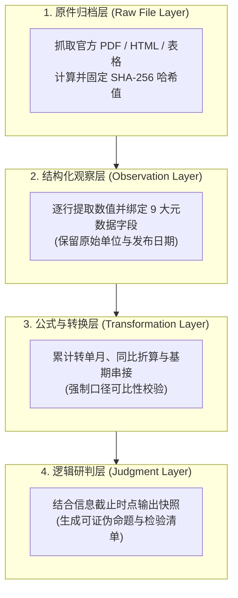
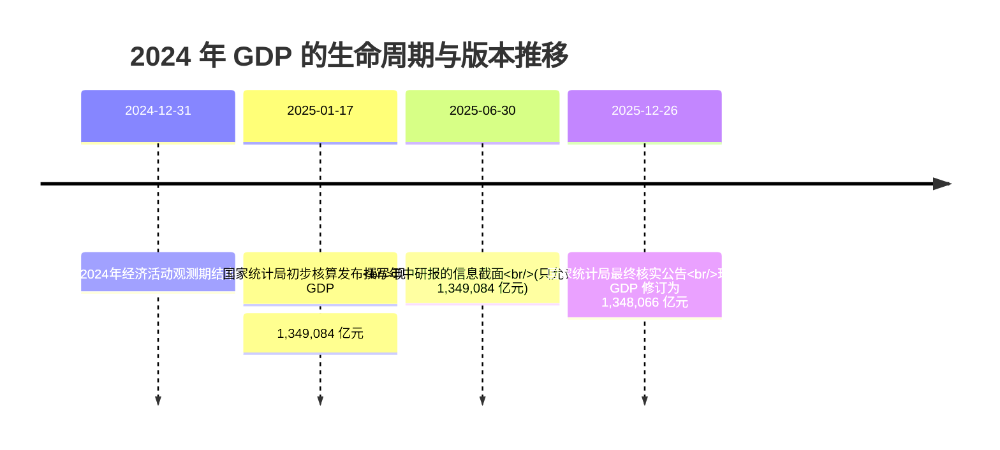
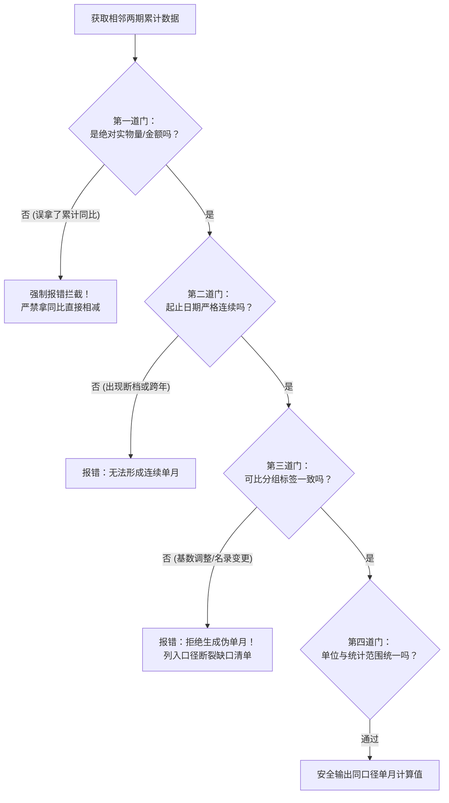
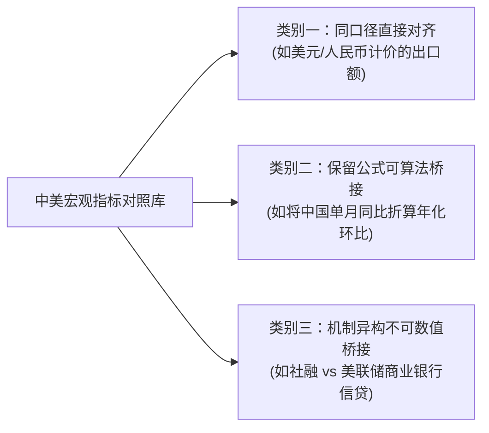

# 43 中国经济数据系统与可复核分析

[上一章：联合诊断](42-joint-diagnosis.md) · [目录](./) · [下一章：月报项目](44-monthly-report.md)

**前置阅读：**美国篇 [02 测量与口径](https://fangpings.github.io/us-econ/02-measurement.html)、[03 发布与版本](https://fangpings.github.io/us-econ/03-releases-and-vintages.html)，中国篇 [03 数据生产](03-data-production.md)、[04 发布与版本](04-releases-and-vintages.md)。

许多分析师在搭建宏观数据库时，往往一上来就追求复杂的爬虫算法或华丽的图表前端。

然而，如果在底层没有把**数据版本（Vintage）、发布日期（Release Date）、可比口径标签（Comparability Group）与累计转单月门槛**设计好，后续所有复杂的计量模型和自动化报告都只是在以极高的效率“批量生产错误”。

本章将带你设计一套面向中国宏观统计特性的四层可复核数据工程架构，掌握累计数据剥离单月的四道硬性安全门，并配合仓库自带的离线 Python 实验室，跑通一套杜绝“未来信息泄漏”的现代化研究系统。

---

## 1. 系统架构：四层解耦的数据生产流水线

在严谨的宏观量化与研报系统中，数据加工应当遵循清晰的单向流动与分层隔离原则：



1. **原件归档层**：完整保留统计局、央行、财政部等部委发布的第一手原始文本或数据表，生成不可篡改的校验哈希；
2. **结构化观察层**：将原件中的离散表格转录为规范数据行，严密绑定统计范围、计量单位与发布时戳；
3. **公式与转换层**：在此层执行算术与金融计算。任何计算必须引用上层明确的数值行，绝不在观察层直接覆盖修改；
4. **逻辑研判层**：根据研究报告的信息截止时间（`as-of`），严格拉取当时已知的数据切片，输出研报分析结论。

---

## 2. 元数据标准：每个宏观数字必须佩戴的身份证

很多初学者把数据库设计成极简的“日期 + 数值”，这在处理中国宏观数据时会引发灾难性的口径错乱。在标准架构中，每一条观察值记录必须包含以下九大核心元数据字段：

| 元数据字段 | 标准字段释义 | 在中国宏观场景下的关键防错作用 |
| :--- | :--- | :--- |
| `series_id` | 经济指标唯一编码 | 严格区分“房地产开发投资（含土地购置）”与“GDP 住宅资本形成” |
| `period_start` / `period_end` | 经济活动所属起止日期 | 明确界定“1—3 月累计值”、“3 月当月值”与“3 月末时点存量余额” |
| `frequency` | 数据观测频率 | 区分月度（monthly）、季度（quarterly）与年度（annual） |
| `measure` | 测量指标维度 | 明确是绝对金额、建筑面积、同比百分比（yoy）还是定基指数 |
| `unit` | 物理或货币单位 | 绝不能在表头省略！严格区分“亿元”、“万元”或“万平方米” |
| `scope` | 统计覆盖地理与主体边界 | 区分“全国”、“70 城合计”、“市辖区（不含县）”还是“规上工业” |
| `method_version` | 统计方法与编制版本 | 标注是否经历统计制度轮换（如 2025 年起扩容的 M1 口径） |
| `comparability_group` | 可比性分组标签 | **核心字段！** 只有标签完全一致的累计值，才允许做单月差分 |
| `release_date` | 官方正式公布生效日期 | **杜绝未来信息泄漏！** 研报回测时仅读取此前已发布的版本 |

---

## 3. 防错基石：发布日、观测期与整理日的严格区分

在金融量化回测或历史研报复盘中，最致命的作弊叫作**未来信息泄漏（Look-ahead Bias）**。

以 **2024 年中国现价 GDP** 为例，它在时间轴上留下了三个截然不同的关键时戳：
1. **经济活动观测期（Observation Period）**：`2024-01-01` 至 `2024-12-31`；
2. **初步核算发布日（Preliminary Release）**：`2025-01-17`，国家统计局公布现价 GDP 为 **1,349,084 亿元**；
3. **最终核实发布日（Final Vintage）**：`2025-12-26`，国家统计局依据年报决算公告最终核实为 **1,348,066 亿元**。



如果你在撰写一篇回顾 2025 年 6 月宏观形势的策略报告，你的程序只能读取 `release_date <= 2025-06-30` 的数据（即 $1,349,084$ 亿元）。如果你不小心把年末修订的 $1,348,066$ 亿元读入了年中的模型，你就犯了严重的“时间旅行”错误。

---

## 4. 累计转单月的四道安全门

国家统计局的大量核心数据（如固定资产投资、商品房销售、民间投资等）均采用“年初至本期末累计公布”的方式，且每年 1—2 月合并发布。将累计值还原为单月数值时，必须严格执行四道门禁校验：

$$\text{单月数值 } X_{\text{single}, t} = X_{\text{cum}, t} - X_{\text{cum}, t-1}$$



> **教学算例：口径断裂时的系统防御**  
> 某序列 1—2 月累计销售额为 $180$ 亿元，1—3 月累计为 $300$ 亿元，两者 `comparability_group` 均为 `basis_A`。系统通过校验，输出 3 月单月销售为：
> $$300 - 180 = 120 \text{ 亿元}$$
> 紧接着，官方在 4 月份因企业名录剔除等因素调整了基数，1—4 月累计公布为 $430$ 亿元，元数据打标为 `basis_B`。  
> 此时，虽然小学生都能算术得出 $430 - 300 = 130$，但**严谨的数据系统必须在此处主动抛出异常（ValueError）拒绝差分！** 因为用不同口径基础相减得到的所谓“130 亿”，是一个没有任何经济学意义的虚假数字。

---

## 5. 动手实战：可运行的离线 Python 实验室

在本书配套的工程仓库根目录下，我们提供了轻量级、零外部第三方依赖的离线宏观数据处理实验室。

### 命令行检验版本隔离

打开终端，在项目根目录下直接运行以下命令：

```sh
# 1. 模拟以 2025-06-30 为截止日查询 2024 年 GDP，输出初步核算值 1349084 亿元
python3 tools/econ_lab.py --as-of 2025-06-30

# 2. 模拟以 2025-12-31 为截止日查询，程序自动平滑切换至最终核实值 1348066 亿元
python3 tools/econ_lab.py --as-of 2025-12-31

# 3. 运行全套单元测试，验证单月转换边界防御与房贷精算
python3 -m unittest discover -s tests -v
```

### Python 交互式代码验证

```python
from tools.econ_lab import read_rows, single_month

# 读取教学累计数据集
rows = read_rows('data/teaching_cumulative.csv')

# 正常提取 3 月单月数值：1-3月累计 300 减去 1-2月累计 180
print(single_month(rows[1], rows[0]))  # 输出: 120.0

# 尝试差分口径不一致的 4 月数据：
try:
    single_month(rows[2], rows[1])
except ValueError as e:
    print(f"安全拦截成功: {e}")  # 捕获异常：可比分组标签不一致！
```

---

## 6. 中美指标映射对照原则

在撰写包含中美宏观对比的研究报告时，严禁使用粗暴的“中英文术语一一对应字典”。我们建议采用三分类法：



对于第三类指标（如中国社会融资规模与美国信贷），研报正文中应当并列呈现两者的制度机理，**绝不能为了画在一张双轴折线图里，强行把它们缩放成同一个指数**。

---

## 7. 练习与逐步答案

1. 2025 年 5 月 1 日，某分析师正在复盘 2024 年第四季度中国宏观走势。他在数据库中查到了 2025 年 1 月发布的初步值与 2025 年 12 月发布的最终核实值。请问他在撰写当时的复盘报告时，必须选用哪一个数值？为什么？
2. 统计公报中只有 1—2 月合并累计的固定资产投资完成额，能否直接除以 2 算出 1 月和 2 月的单月数值？
3. 某商业机构声称：“通过大模型智能补齐，我们成功把过去五年统计局公布的所有固定资产投资累计同比，全部还原成了高精度的单月同比序列。”请从统计学角度评价该机构声明的可靠性。

<details>
<summary>参考答案与详细推理</summary>

1. **必须选用 2025 年 1 月发布的初步核算值（1,349,084 亿元）**。因为在 2025 年 5 月的时间截面上，年末的最终核实公告尚未发生。若采用年底的版本，将破坏真实历史分析中的信息集边界，导致严重的未来信息泄漏。
2. **绝对不能**。中国 1—2 月份受春节假期、工商业停复工及冬季严寒天气影响，每年的开工节奏极不均匀。直接除以 2 是一种脱离实际生产规律的纯数学均摊假设，并非真实世界中可观测的统计数据。
3. **不可靠，存在严重的统计造假嫌疑**。
   - 官方公布的累计同比增速，是国家统计局基于经核实后的同口径可比基数计算出来的；
   - 外部商业数据库由于无法获取未公开的企业名录调整、剔除或补报的微观明细，根本无法通过单纯的代数倒算精确剥离单月同比；
   - 任何宣称“完美还原”的商业数据，本质上都是人为强加了平滑假设的模型插值，绝不能当作客观官方历史事实来使用。

</details>

---

[上一章：联合诊断](42-joint-diagnosis.md) · [目录](./) · [下一章：月报项目](44-monthly-report.md)
