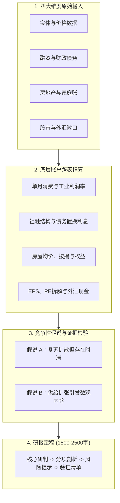
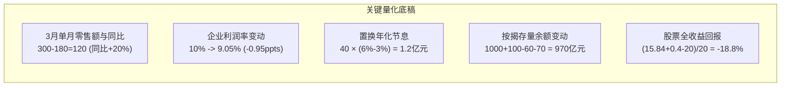

# 44 中国经济月报毕业项目

[上一章：数据系统](43-data-workflow.md) · [目录](./) · [配套资料](appendix-research-kit.md)

**前置阅读：**美国篇 [03 发布与版本](https://fangpings.github.io/us-econ/03-releases-and-vintages.html)、[22 资产与全球传导](https://fangpings.github.io/us-econ/22-assets-and-global.html)，中国篇 [42 联合诊断](42-joint-diagnosis.md)、[43 数据系统](43-data-workflow.md)。

恭喜你！学完前面的 43 个章节，你已经掌握了中国宏观经济在实体、价格、货币、财政、股票与房地产等各个领域的微观形成机制与统计脉络。

现在的终极任务，是**像一名顶尖的专业宏观分析师一样，将分散在各个部委的月度离散数据，熔炼成一份逻辑自洽、计算严密、观点鲜明的综合月度宏观研报**。

本章为你提供了一套全要素的月度教学沙盘材料包。你将亲手完成全套底层复核计算，搭建竞争性假说检验，并撰写出一份可以直接交付专业投资机构的月度宏观深度报告。

---

## 1. 研报标准：一份专业月报的交付要素

一份优秀的宏观经济月报，绝对不是各大部委新闻稿的机械汇总，更不是罗列几十个互不相干的同比折线图。一份专业可交付的研报应遵循以下流水线：



---

## 2. 毕业项目教学材料包

> **说明**：以下数据均为 M 月报告截止日时点已发布的教学数据集。金额除特别注明外均为**亿元**；所有数字之间受统一经济假说约束，请严格基于给定输入计算。

### 模块 A：实体经济与物价
1. **工业增加值**：规模以上工业增加值实际同比由上月的 $4.0\%$ 显著攀升至本月的 $6.0\%$；但当期工业品出厂价格调查指数显示出厂售价环比偏弱；
2. **企业经营抽样**：固定样本工业企业名义营业收入由上年同月的 $1,000$ 亿元微增至 $1,050$ 亿元；同期税后利润总额由 $100$ 亿元下滑至 $95$ 亿元；期末应收账款净额由上年同期的 $200$ 亿元激增至 $260$ 亿元；
3. **商品零售**：本年 1—2 月累计商品零售额为 $180$ 亿元，1—3 月累计为 $300$ 亿元；上年同期 1—2 月累计为 $160$ 亿元，1—3 月累计为 $260$ 亿元（统计口径、价格基期与企业名录均一致）。

### 模块 B：货币金融与财政化债
1. **社会融资规模**：当月社融新增 $300$ 亿元（上年同月为 $250$ 亿元）。其中政府债券净融资分别为 $180$ 亿元与 $100$ 亿元；其余所有分项合计分别为 $120$ 亿元与 $150$ 亿元；
2. **地方债务置换**：地方政府发行专项再融资债券 $40$ 亿元，全额用于置换存量高息城投平台银行贷款（该置换量已包含在上述社融统计中，不可重复计入新增融资）。新发行地方债年利率为 $3.0\%$，被置换的原平台贷款年利率为 $6.0\%$；
3. **基建项目施工**：某重点新规划产业园项目当期完成融资筹措 $100$ 亿元，经监理核定当期实际完成建安实物工程量 $30$ 亿元；同时财政专户当月向施工单位拨付了 $15$ 亿元用于清偿往年已竣工工程的拖欠尾款。

### 模块 C：房地产与居民家庭
1. **商品房销售**：本年 1—M 月全国新建商品房累计网签金额为 $900$ 亿元、销售面积为 $100$ 万平方米；上年同期累计金额为 $1,000$ 亿元、面积为 $100$ 万平方米；
2. **项目白名单**：某典型保交楼项目获批银行信贷额度 $20$ 亿元，本月实际提款 $12$ 亿元，经批准向总包拨付工程款 $9$ 亿元（其中 $4$ 亿元为偿还半年前拖欠的旧钢筋款，$5$ 亿元为当月新完工进度款），项目监管账户尚留存 $3$ 亿元；
3. **按揭银行账务**：某大型银行个人住房按揭贷款期初余额为 $1,000$ 亿元，当月新发放购房按揭 $100$ 亿元，借款人按月正常偿还本金 $60$ 亿元，主动提前还贷 $70$ 亿元；
4. **家庭资产负债表**：典型高杠杆购房家庭名下房产市场估值由 $200$ 万元下调至 $180$ 万元，银行按揭负债 $140$ 万元暂未偿还；另有一项房贷存量降息政策落地，使得该市借款家庭未来一年合计可节省月供现金支出 $3$ 亿元。

### 模块 D：股票市场与外部汇率敞口
1. **上市公司盈利解耦**：固定样本上市公司税后总利润由 $100$ 亿元增至 $110$ 亿元；但因配股融资，加权总股数由 $100$ 亿股增至 $125$ 亿股；同期市场估值倍数 PE 由 $20$ 倍下滑至 $18$ 倍；期末向全体股东派发每股现金股息 $0.40$ 元（不考虑税费）；
2. **汇率进出口冲击**：美元兑人民币即期汇率由 $7.00$ 升至 $7.20$（人民币贬值）：
   - A 企业为纯出口制造企业，当期确定收汇 $100$ 万美元，国内固定生产成本为 $650$ 万元人民币（无外汇套保）；
   - B 企业为纯原料进口企业，当期需对外刚性付汇 $100$ 万美元，其国内产品售价受合同锁定暂时无法上调。

---

## 3. 分析师基本功：计算与平衡底稿

在撰写研报的正文之前，必须在后台底稿中完成严密的数学复核：



<details>
<summary>点击展开：全套底稿标准计算步骤与公式</summary>

1. **实体与微观企业**：
   - 企业收入增速：$\frac{1,050 - 1,000}{1,000} = +5.0\%$；
   - 利润增速：$\frac{95 - 100}{100} = -5.0\%$；
   - 营业利润率：期初为 $\frac{100}{1,000} = 10.0\%$，期末为 $\frac{95}{1,050} \approx 9.0476\%$（下降约 $0.95$ 个百分点）；
   - 应收账款增速：$\frac{260 - 200}{200} = +30.0\%$（资金被严重占压）；
   - **单月零售额剥离**：
     - 本年 3 月 $= 300 - 180 = 120$ 亿元；
     - 上年 3 月 $= 260 - 160 = 100$ 亿元；
     - 单月同比增速 $= \frac{120 - 100}{100} = +20.0\%$。
2. **财政与信贷化债**：
   - 社融同比多增 $50$ 亿元 $= \text{政府债多增 } 80 \text{ 亿元} + \text{其他分项少增 } 30 \text{ 亿元}$；
   - 债务置换节息：
     $$\Delta \text{年利息} = 40 \times (6.0\% - 3.0\%) = 1.2 \text{ 亿元}$$
   - GDP 核算边界辨析：筹资 $100$ 亿是金融量，支付旧款 $15$ 亿是清欠转移，当期进入固定资本形成物理产出的仅为经核定的 $30$ 亿元建安量。
3. **房地产与家庭**：
   - 混合成交均价由 $\frac{1,000}{100} = 10$ 万元/平米降至 $\frac{900}{100} = 9$ 万元/平米（跌幅 $10.0\%$）；
   - 银行按揭贷款期末余额：
     $$B_t = 1,000 + 100 - 60 - 70 = 970 \text{ 亿元（环比净缩水 30 亿元，下降 3.0%）}$$
   - 家庭住房净资产：由 $200 - 140 = 60$ 万元缩水至 $180 - 140 = 40$ 万元，降幅高达 $-33.33\%$。
4. **股票与外汇**：
   - 每股收益：$\text{EPS}_0 = \frac{100}{100} = 1.00$ 元，$\text{EPS}_1 = \frac{110}{125} = 0.88$ 元（$\Delta \text{EPS} = -12.0\%$）；
   - 股票价格：$P_0 = 1.0 \times 20 = 20.00$ 元，$P_1 = 0.88 \times 18 = 15.84$ 元（价格跌幅 $-20.8\%$）；
   - 含现金分红总回报：
     $$R_{\text{total}} = \frac{15.84 + 0.40 - 20.00}{20.00} = \frac{-3.76}{20.00} = -18.8\%$$
   - 汇率对现金流的影响：
     - 出口企业 A：人民币销售收入由 $100 \times 7.0 = 700$ 万元升至 $100 \times 7.2 = 720$ 万元，净现金利润由 $700 - 650 = 50$ 万元激增至 $720 - 650 = 70$ 万元（利润大涨 $+40\%$）；
     - 进口企业 B：采购成本直接由 $700$ 万元上升至 $720$ 万元，净现金流直接减少 $20$ 万元。

</details>

---

## 4. 毕业成果交付：月度宏观研报范文

```markdown
# 宏观经济月度运行深度报告：生产与现金流的分化、财政托底与资产负债表重塑

**报告发布日期**：202X 年 M 月  
**研究部门**：宏观经济策略部  
**核心要点**：实体生产与部分商品消费显露回暖信号，但微观企业利润率与居民资产负债表仍受负向约束。宏观呈现典型的“公共端发力扩张、私人端内生修复承滞”特征。

---

### 一、 核心研判与宏观综述
本月宏观数据显示经济运行呈现复杂的“温差”景象：
一方面，规模以上工业增加值同比回升至 6.0%，同口径剥离后的 3 月单月商品零售额同比实现 20.0% 的亮丽增长；
但另一方面，微观盈利与现金回流并未同步跟进。样本企业营业收入增长 5.0% 的同时，净利润同比下滑 5.0%，销售净利润率下滑 0.95 个百分点，应收账款增幅高达 30.0%。

综合现有证据，我们认为当前宏观更符合**“供给扩张与以价换量驱动生产，终端真实需求仍待巩固”**的再平衡初期特征。

### 二、 实体经济与企业微观现金流
工业产出加速与出厂价格偏弱并存，反映出中下游制造业正通过压降毛利空间维持开工率与全球市场份额。
值得关注的是企业资产负债表两端的不对称拉伸：应收账款增速（+30.0%）大幅超越名义营收增速（+5.0%），企业经营性净现金流明显收紧。
零售单月 20.0% 的同比反弹虽然亮眼，但考虑到上年同期的低基数与季末集中结算因素，其持续性仍需通过次季度的连续订单数据进一步检验。

### 三、 财政化债与信用传导效率
当月社会融资规模同比多增 50 亿元，拆解显示完全由政府债券（同比多增 80 亿元）拉动，实体自发性融资同比少增 30 亿元。
财政化债推进迅速：40 亿元专项再融资债券置换高息城投贷款落地，每年直接为地方广义公用事业主体削减 1.2 亿元刚性利息负担，有效缓释债务流动性风险。
但在基建实物形成端，筹资 100 亿元中仅有 30 亿元转化为当期物理建安投资，另外 15 亿元用于清偿既有账款。资金从国库发行到民间采购订单的传导链条存在明显的时滞。

### 四、 房地产出清与家庭资产重估
房地产市场依然处于筑底重塑阶段：
1. **量价解耦**：新建商品房网签面积虽企稳于 100 万平米，但混合均价下跌 10.0%，房企销售回款的现金压力未解；
2. **白名单成效与局限**：保交楼项目提款 12 亿元，其中近半数（4 亿元）被用于填补历史材料欠款，真正形成新增施工量为 5 亿元，显示项目自我造血依然脆弱；
3. **家庭缩表**：存量房贷提前还贷潮（单月达 70 亿元）导致商业按揭贷款余额出现 30 亿元净缩水；典型家庭房产权益因估值下浮缩水 33.33%，降息节省的月供更多转化为预防性储蓄，未能立即体现为新增消费冲动。

### 五、 资本市场定价与外部约束
A 股样本企业总利润增长 10.0%，但由于股权融资稀释使得 EPS 倒退 12.0%，叠加市场估值 PE 从 20 倍回落至 18 倍，股票价格出现 20.8% 的回调，含分红后的全收益回报为 -18.8%。这表明股市定价紧紧锚定于每股真实内生价值，并未偏离基本面。
汇率端，人民币对美元贬值至 7.20，为纯出口企业贡献了 40% 的现金利润增量，但也加剧了进口成本压力。

### 六、 下一步追踪与风险提示
1. **区分性检验**：下个月重点跟踪制造业新订单指数能否维持在扩张区间、工业企业应收账款回收期是否出现拐点；
2. **重点观察项**：专项债募集资金拨付后的施工开工率，核心城市二手房带看量与同质价格指数走势。
```

---

## 5. 研报质量评估标准

| 评审维度 | 满分权重 | 核心考核与验收要求 |
| :--- | :---: | :--- |
| **数据与版本纪律** | 25 分 | 每个宏观数字来源清楚，严格坚守信息截止时间，杜绝未来信息泄漏 |
| **账户与数学平衡** | 25 分 | 累计转单月四道门校验无误；等额本息、置换节息、EPS 稀释与汇率计算毫厘不爽 |
| **制度与中美辨析** | 25 分 | 准确剖析白名单资金闭环、土地财政收支杠杆及公积金组合贷的制度机理 |
| **逻辑研判与可证伪性** | 25 分 | 提出相互竞争的解释矩阵，给出明确的后续验证指标判据，打破防御性套话 |

---

[上一章：数据系统](43-data-workflow.md) · [目录](./) · [配套资料](appendix-research-kit.md)
